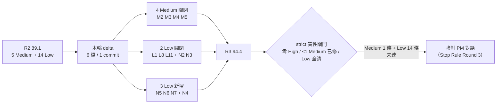

# NFC Reader Spike — DELTA 複審報告（Re-Review Mode, Round 3）

| 項目                  | 值                                                                                                                 |
| --------------------- | ------------------------------------------------------------------------------------------------------------------ |
| 審查對象              | `tools/nfc-reader-spike/`                                                                                          |
| 本輪範圍              | `git --no-pager diff 498a150..HEAD` → **1 個 commit**（`971fc3c`），6 檔，`+214 / −34`                             |
| 上一輪報告            | `.edison/artifacts/review-nfc-drivers-apdu-script.md`（R1）、`.edison/artifacts/review-delta-nfc-drivers.md`（R2） |
| 分支                  | `feat/nfc-gate1-reader-spike` @ `971fc3c`                                                                          |
| 審查員                | smith（Checker；Maker ≠ Checker）                                                                                  |
| 模式                  | `strict`（threshold **93**）                                                                                       |
| 動作模式              | **`audit_only`**（使用者明示：不改碼、不 commit）                                                                  |
| 日期                  | 2026-10-22                                                                                                         |
| 修復前（R2）          | **89.1 / 100** → REPAIRABLE                                                                                        |
| **修復後（R3 實測）** | **94.4 / 100** → **數值過線，但 strict 質性閘門未過 → 非 PASS**                                                    |

## 0. delta 邊界與方法

R2 的 12 項「最小修復清單」逐項對照本輪 delta：

| 檔案                          | 變動        | 對應項                                                                                                           |
| ----------------------------- | ----------- | ---------------------------------------------------------------------------------------------------------------- |
| `bin/spike.js`                | `+16 / −3`  | M3（usage）、N2（`hasOwnProperty`）、N3（`--transport` 無 `--os` → 2）、M2（`installsNeeded === false ? 0 : 1`） |
| `src/driver-matrix.js`        | `+72 / −34` | M2（`answerFromRows`）、L11（5 列 evidence 補版本號、`macos-bluetooth` 標籤去版本）                              |
| `src/apdu-script.js`          | `+7 / −5`   | L1（`PASS_THROUGH_INS` 補上，欄位序對齊）                                                                        |
| `tests/cli.test.js`           | `+97 / 0`   | M4（4 個 `script` CLI 測試）                                                                                     |
| `tests/driver-matrix.test.js` | `+47 / 0`   | M5（可查證來源）、L11（版本號溯源）、M2（全 unsupported）                                                        |
| `README.md`                   | `+9 / −6`   | M3（`script` 列 exit 語意）、L8（移除測試數字）、N3（`--transport` 說明）                                        |

**未動（維持 unchanged confirmation）**：`src/ntag.js`、`src/tag-session.js`、`src/reader-model.js`（`git diff --name-only` → 0 檔）。

**所有驗證皆為實跑**：`npm test`、CLI 逐命令 capture exit code、`node -e` 直呼 library、`/tmp` 複本上 **9 組突變**（含 2 組刻意證明「測不到」）、以及一個「合成 OS」端到端驗算。**被審程式碼零修改**（`git status --short` 僅 `?? .edison/`）。



---

## 1. 逐項實測（使用者指定重點）

### 1.1 M3 — exit code 2 是否有寫進 `--help`／README，且與實作一致

| 檢查               | 指令                       | 實測輸出                                                                                                                   | 判定                                        |
| ------------------ | -------------------------- | -------------------------------------------------------------------------------------------------------------------------- | ------------------------------------------- |
| `usage()` 是否列 2 | `node bin/spike.js --help` | `Exit codes: 0 = the checked question is a yes, 1 = no (or an error was reported), 2 = the command line itself was wrong.` | ✅ 已寫                                     |
| 缺 `--url`         | `node bin/spike.js script` | `exit=2`，stderr `script needs --url <url>`                                                                                | ✅                                          |
| 非法 `--variant`   | `--variant NTAG999`        | `exit=2`，stderr `unknown --variant NTAG999; expected one of NTAG213, NTAG215, NTAG216`                                    | ✅                                          |
| README `script` 列 | `README.md:71`             | `1 = payload too large, 2 = bad arguments`                                                                                 | ✅ 與實作一致（0 成功／1 不 fit／2 參數錯） |

**判定：FIXED。** 文件與實作現在是同一句話，且參數錯誤與容量不足在 exit code 上已分開（操作員換卡 vs 改參數，處置不同）。

### 1.2 M4 — `npm test` 是否真有 4 個 `script` CLI 測試，且**有鑑別力**

`node --test tests/*.test.js` → **89 tests / 89 pass / 0 fail**（R2 為 82，+7 = 4 CLI ＋ 3 matrix）。

新增的 4 個 `main(["script", …])` 測試：`script prints a replayable sequence and exits 0`、`script --out writes the file and leaves stdout clean`、`script refuses an oversized payload without writing a file`、`script rejects a bad command line with exit 2`。

**鑑別力（在 `/tmp/nfc-mut` 複本上做，repo 零污染）**：

| 突變                                   | 結果                 | 抓到的測試                                                      |
| -------------------------------------- | -------------------- | --------------------------------------------------------------- |
| 把容量 guard 改成「先寫檔再拒絕」      | 88 pass / **1 fail** | ✅ `script refuses an oversized payload without writing a file` |
| 缺 `--url` 的 `return 2` 改 `return 1` | 88 / **1 fail**      | ✅ `script rejects a bad command line with exit 2`              |
| 註解掉 `fs.writeFileSync(out, text)`   | 88 / **1 fail**      | ✅ `script --out writes the file …`                             |

**判定：FIXED。** 三個突變全部轉紅，不是「跑過就算」。第 3 個測試特別有價值 —— 它守的是**順序**（guard 必須在寫檔之前），這正是 R1 說「只有人工試跑」的那條路徑。

### 1.3 M5 — 「每一列都有來源」是否對「無來源」有鑑別力

新測試 `every row cites something a reviewer can look up` 用 `sourceMarker = /https?:\/\/|§|v?\d+\.\d+/`，並斷言 `evidence !== mechanism`。

**突變（選 `linux-usb`，其 `osLabel` 無版本號，可與 L11 測試隔離）**：

| 突變                                                                                                        | 結果                                                                         | 判定                                                     |
| ----------------------------------------------------------------------------------------------------------- | ---------------------------------------------------------------------------- | -------------------------------------------------------- |
| `evidence` → `'this is a made up sentence that is definitely over twenty chars'`（61 字元，無數字／URL／§） | 88 / **1 fail**，紅的正是 `every row cites something a reviewer can look up` | ✅ 有鑑別力（舊的 `length > 20` 斷言會讓它**綠燈通過**） |
| 同上但內含 `version 2.0`                                                                                    | **89 / 89 全綠**                                                             | ⚠️ 殘留缺口 → 見 §3 CRA-N5                               |

**判定：FIXED（達到 R2 remediation 指定的標準）**，但只能保證「有形狀」、不保證「可查證」——後者已在 §3 記為 Low，不重複計入 M5。

### 1.4 M2 — `answerFromRows` 的「全 unsupported」是否回 `installsNeeded: null`、summary 正確

以**合成 OS**（`beos`，唯一一列 `requirement: "unsupported"`）在 `/tmp` 複本端到端驗算：

| 指令                                | 輸出                                                                                                                                                          | exit     |
| ----------------------------------- | ------------------------------------------------------------------------------------------------------------------------------------------------------------- | -------- |
| `drivers --os beos`                 | `beos  — no supported route on this platform` ＋ `usb  not a supported route`                                                                                 | **1** ✅ |
| `drivers --os beos --json`          | `"known": true, "installsNeeded": null, "installsNeededByTransport": {"usb": null}, "usableTransports": [], "summary": "no supported route on this platform"` | **1** ✅ |
| `drivers --os beos --transport usb` | `beos over usb: not a supported route here`                                                                                                                   | **1** ✅ |

程式碼路徑也確認：`commandDrivers` 的 OS 級判定已改為 `return answer.installsNeeded === false ? 0 : 1;` —— `null` 不會再被當成 `false`（這正是 R2 說的「反向安全預設」）。

突變驗證：把該分支的 `installsNeeded: null` 改回 `false` → **1 fail**（`a platform with only unsupported routes is not reported as install-free`）。

**判定：FIXED（三層：library／JSON／文字／exit code 全部一致）。**

### 1.5 N2 — `drivers --os windows --transport constructor` 是否被擋

```
$ node bin/spike.js drivers --os windows --transport constructor
windows has no constructor row. Supported: usb, bluetooth
exit=1
```

已改用 `Object.prototype.hasOwnProperty.call(...)`。**判定：FIXED（原始碼層）**，但**無回歸測試**：把 `hasOwnProperty` 改回 `in` → **89/89 全綠**（見 §3 CRA-N4）。

### 1.6 N3 — `drivers --transport usb`（無 `--os`）是否 exit 2

```
$ node bin/spike.js drivers --transport usb
--transport only means something together with --os <name>
exit=2
```

README 也補了三態說明（`README.md:74-77`）：route 需要安裝 → 1、平台沒有這條 route → 1、`--transport` 無 `--os` → 2。**判定：FIXED（兩項可執行子項）**，但仍有兩個殘留（見 §4 CRA-N3）：

- `drivers --os <已知平台>` 的 **OS 級（AND）規則**仍未寫進 commands 表；今日 5 個已知平台實測全部 `exit=0`（`windows/macos/linux/android/ios` → 0、`beos` → 1），所以表格的「non-zero = 該平台需要東西」實務上只剩 unknown 會觸發。
- `--json` 模式下這條參數錯誤**沒有任何 JSON 輸出**（`stdout_bytes=0`），與 README「所有命令都支援 `--json` 做證據擷取」有落差。另 `--transport ""`（空值）帶 `--os` 時仍被靜默忽略 → 印出完整 OS 答案、`exit=0`。
- 同樣**無回歸測試**：移除整個 guard → **89/89 全綠**。

### 1.7 L1 — `passThrough` 欄位命名是否對齊 `CLA INS P1 P2`，位元組是否仍正確

```js
const PASS_THROUGH_CLA = 0xff;
const PASS_THROUGH_INS = 0x00;
const PASS_THROUGH_P1 = 0x00;
const PASS_THROUGH_P2 = 0x00;
Buffer.from([CLA, INS, P1, P2, command.length]);
```

| 探針                               | 輸出                                                                                                    | 判定                        |
| ---------------------------------- | ------------------------------------------------------------------------------------------------------- | --------------------------- |
| `passThrough(Buffer.from([0x60]))` | `FF 00 00 00 01 60`（len 6）                                                                            | ✅ `FF 00 00 00 <Lc> <cmd>` |
| `passThrough(A2 04 00 00 00 00)`   | `FF 00 00 00 06 A2 04 00 00 00 00`（Lc=6、total=11、`total === 5 + Lc` → true）                         | ✅                          |
| 註解                               | 「Its header is CLA INS P1 P2, in that order: FF is the CLA, the three zero bytes are INS, P1 and P2.」 | ✅ 與位元組一致             |

**判定：FIXED。** 這是 R1→R2 一路沒修好的那條（R2 只把錯位往後移一格），本輪真正消除：四個 header 位元組現在各有正確名字，且位元組順序未動。

### 1.8 L8 / L11 — README 數字是否還會過期；每列 label 版本號是否都能在 evidence 找到

**L8：** `README.md:97` 現在只寫 `npm test        # no hardware and no native build required`。全目錄掃描 `42 tests|79 tests|82 tests|89 tests|# N tests` → **零命中**。數字被移除而非再改一次 → **結構上不可能再過期**（第二輪是 42→79、實測 82，典型的「改了但沒對」）。**FIXED。**

**L11：** 逐列核對 10 列的 `osLabel` 版本號是否出現在 `evidence`：

| row                                 | osLabel                                          | evidence 是否含該版本                                |
| ----------------------------------- | ------------------------------------------------ | ---------------------------------------------------- |
| `windows-usb` / `windows-bluetooth` | Windows 10 / 11                                  | ✅ `(Windows 10 and 11)`                             |
| `macos-usb`                         | macOS 10.15+                                     | ✅ `from macOS 10.15`                                |
| `macos-bluetooth`                   | ~~macOS 10.15+~~ → `macOS`（**移除未溯源版本**） | ✅ 無版本需溯源                                      |
| `linux-usb` / `linux-bluetooth`     | Linux                                            | ✅ 無版本                                            |
| `android-usb`                       | Android 4.3+                                     | ✅ `host mode from Android 4.3`                      |
| `android-bluetooth`                 | Android 4.4+                                     | ✅ `for Android 4.4+`                                |
| `ios-usb`                           | iOS 16.1+ / iPadOS 16+                           | ✅ `iOS 16.1 / iPadOS 16`                            |
| `ios-bluetooth`                     | iOS 15+ / iPadOS 16+                             | ✅ `iOS 15.0+` / `(iPadOS 16+ per the product page)` |

新增測試 `any version number in a label also appears in the evidence` 會機械化守住這件事：把 `linux-usb` 的標籤改成 `Linux 5.15+` → **1 fail**。**FIXED。**

> 註：R2 指出「改到隔壁列」的問題這輪已修正 —— 被點名的 `android-usb`（4.3）與 `ios-usb`（16.1）都補了溯源文字。

---

## 2. 突變總表（鑑別力一次看）

在 `/tmp/nfc-mut`（baseline 89/89）上逐一套用、跑完即還原：

| #   | 突變                                  | tests/pass/fail | 結果                                                                 |
| --- | ------------------------------------- | --------------- | -------------------------------------------------------------------- |
| 1   | `linux-usb` evidence → 61 字元捏造句  | 89 / 88 / **1** | ✅ RED：`every row cites something a reviewer can look up`           |
| 2   | 同上但含 `version 2.0`                | 89 / **89** / 0 | ⚠️ GREEN → CRA-N5                                                    |
| 3   | 標籤改 `Linux 5.15+`                  | 89 / 88 / **1** | ✅ RED：`any version number in a label also appears in the evidence` |
| 4   | 容量 guard 改成先寫檔                 | 89 / 88 / **1** | ✅ RED：`script refuses an oversized payload without writing a file` |
| 5   | 缺 `--url` 的 2 → 1                   | 89 / 88 / **1** | ✅ RED：`script rejects a bad command line with exit 2`              |
| 6   | 移除 `fs.writeFileSync(out, text)`    | 89 / 88 / **1** | ✅ RED：`script --out writes the file …`                             |
| 7   | 全 unsupported 分支 `null` → `false`  | 89 / 88 / **1** | ✅ RED：`a platform with only unsupported routes …`                  |
| 8   | `hasOwnProperty` 改回 `in`            | 89 / **89** / 0 | ❌ GREEN → CRA-N4                                                    |
| 9   | 移除 `--transport` 無 `--os` 的 guard | 89 / **89** / 0 | ❌ GREEN → CRA-N4                                                    |

**7/9 有效、2/9 無效**：本輪四個「行為修復」中的兩個（N2、N3）在原始碼層確實生效（§1.5、§1.6 實測），但沒有任何測試能阻止它們被改回去。

---

## 3. 本輪新引入／新發現的缺陷（4 條，皆 Low）

### 🟡 CRA-N4 — N2 與 N3 的修復沒有回歸測試

| 欄位 | 內容                                                                                                                                                                                                           |
| ---- | -------------------------------------------------------------------------------------------------------------------------------------------------------------------------------------------------------------- |
| 維度 | CR-D1                                                                                                                                                                                                          |
| 位置 | `tests/cli.test.js`（`drivers` 段，第 86-108 行）、`bin/spike.js:685`、`:744-750`                                                                                                                              |
| 事實 | 突變 #8、#9 皆 89/89 全綠。也就是說：`--transport constructor` 與 `--transport`（無 `--os`）這兩個**本輪才修好的契約**，一旦有人把 `hasOwnProperty` 改回 `in`、或把 guard 刪掉，測試不會有任何反應             |
| 影響 | 這正是 R1 M4 的同型問題（「測到 library，不測 CLI 契約」）在新程式碼裡復發：修得對，但沒上鎖。此二處都是**安全失敗**（exit code 仍非 0），故為 Low                                                             |
| 建議 | 在 `drivers --os exits 1 only when …` 那個測試旁補 2 行：`assert.equal(await main(["drivers","--os","windows","--transport","constructor"]),1)`、`assert.equal(await main(["drivers","--transport","usb"]),2)` |

### 🟡 CRA-N5 — 「有來源」的機械判定可被含版本號的捏造文字滿足

| 欄位 | 內容                                                                                                                                                                                      |
| ---- | ----------------------------------------------------------------------------------------------------------------------------------------------------------------------------------------- |
| 維度 | CR-D1                                                                                                                                                                                     |
| 位置 | `tests/driver-matrix.test.js:173-190`（`sourceMarker = /https?:\/\/                                                                                                                       | §          | v?\d+\.\d+/`）                                                                                                                                                    |
| 事實 | 把任一列 `evidence` 換成 `'a fabricated claim citing version 2.0 of a document that does not exist'` → **89/89 全綠**（突變 #2）。原因是 `\d+\.\d+` 把「version 2.0」當成可查證標記       |
| 影響 | 比 R1 的 `length > 20` 強得多（捏造句已無法用「打滿 21 字」過關），但仍不能區分「引用可查的文件」與「捏造一段帶版本號的文字」。本模組的存在理由就是 anti-folklore，這條守門仍有可繞過的路 |
| 建議 | 收緊成**可定位的來源形狀**：`/https?:\/\/                                                                                                                                                 | '[^']{8,}' | §\s?\d/`（要求「引號內的官方文件名」或「URL」或「節號」），並把 `1.0.3.1`、`PIV`、`0x3e` 這三個關鍵事實做成表驅動斷言。或直接接受現狀並在測試註解寫明**已知上限** |

### 🟡 CRA-N6 — `script --out … leaves stdout clean` 這個測試名稱與它斷言的事不符

| 欄位 | 內容                                                                                                                                                                                                                |
| ---- | ------------------------------------------------------------------------------------------------------------------------------------------------------------------------------------------------------------------- |
| 維度 | CR-D1                                                                                                                                                                                                               |
| 位置 | `tests/cli.test.js:161-186`                                                                                                                                                                                         |
| 事實 | 測試把 `console.log` 換成 noop 之後**只斷言檔案內容**，對 stdout 一個字都沒驗。實測 `script --out /tmp/x` 的 stdout 是 `WROTE ../../../../…/x` ＋ 兩行 dim 摘要（**APDU 本體確實沒有落到 stdout**，這點行為是對的） |
| 影響 | 測試名稱宣稱的性質（stdout 乾淨）沒有被守住：若哪天有人把 `process.stdout.write(text)` 也接到 `--out` 分支，這個測試仍會綠燈                                                                                        |
| 建議 | 要嘛改名為 `script --out writes the file and keeps the APDU body off stdout`，並用 `captureConsole()` 斷言 stdout 不含 `FF 00 00 00`；要嘛改成斷言 stdout 為空                                                      |

### 🟡 CRA-N7 — `driverAnswer` 的 JSDoc 仍宣稱 `installsNeeded: boolean`

| 欄位 | 內容                                                                                                               |
| ---- | ------------------------------------------------------------------------------------------------------------------ |
| 維度 | CR-D2                                                                                                              |
| 位置 | `src/driver-matrix.js:214-219`                                                                                     |
| 事實 | `@returns {{os: string, installsNeeded: boolean, vendorInstaller: string                                           | null, summary: string}}`，但實作在 `known: false` 與「全 unsupported」兩處回 **`null`**（本輪才把第二處改成 `null`）。三態是本輪最核心的概念，型別契約卻仍寫兩態 |
| 影響 | 讀 JSDoc 的人（或未來接 TypeScript 的 `checkJs`）會得到錯誤的型別期待；與 H1/M2 的病根同型（用一個值代表三種狀態） |
| 建議 | 改為 `installsNeeded: boolean                                                                                      | null` 並加一行：`null = the question does not apply (unknown platform, or no route exists)`                                                                      |

---

## 4. 仍未修的 findings（含 severity）

### 🟡 Medium（1）

| ID         | 內容                                    | 本輪實測                                                                                                                                    |
| ---------- | --------------------------------------- | ------------------------------------------------------------------------------------------------------------------------------------------- |
| **CRA-M7** | 同一檔案多種 exit-code 慣例、無共用抽象 | `grep -c 'return [012];' bin/spike.js` → **22**（R2 為 21，本輪新增 1 處 `return 2`）；`const EXIT` → **0**；`drivers`（無 `--os`）仍永遠 0 |

> 修 M7 會同時讓 M3／N3 的文件同步成本降到 0 —— 這是本輪唯一剩下的 Medium，也是唯一非 Low 的扣分來源（見 §5）。

### 🔵 Low（14）

| ID      | 一句話                                                                                         | 本輪實測                                                                                         |
| ------- | ---------------------------------------------------------------------------------------------- | ------------------------------------------------------------------------------------------------ |
| CRA-L5  | `commandWrite` 對同一張卡 `identify()` 兩次                                                    | `src/tag-session.js` 未動                                                                        |
| CRA-L6  | `--out` 印 `path.relative(...)`，且無路徑檢查                                                  | `bin/spike.js:624`；實測印出 `../../../../../../../../../var/folders/…`                          |
| CRA-L7  | `hasBinary("pcsctest")` 重複掃 PATH                                                            | `grep -c` → **2** 處呼叫點                                                                       |
| CRA-L9  | TLV 擴充長度落在 16-byte 讀取窗邊緣 → 錯誤診斷                                                 | `src/tag-session.js` 未動                                                                        |
| CRA-L10 | `FAMILIES` 依陣列順序、無註解無測試                                                            | `src/reader-model.js` 未動，`FAMILIES` 前無順序警語                                              |
| CRA-L12 | `result.url` 原樣輸出（ANSI 注入）                                                             | `bin/spike.js:538`                                                                               |
| CRA-L13 | `script --url hello` → **exit 0** 且產出完整腳本                                               | 本輪實測 `exit=0`                                                                                |
| CRA-L14 | `verdictFor` 三層 nested ternary；delta 新增一處同型                                           | `src/reader-model.js` 未動；`bin/spike.js` transport 判定仍為 3 層                               |
| CRA-N1  | `writePageCommand(110)` 仍被接受；`buildScript` 超容量仍產 107 個 write steps                  | 實測 `A26E00000000`、`overflow=true`、107 steps、`renderScript` 有 `DO NOT SEND`（無 `REFUSED`） |
| CRA-N3  | OS 級（AND）exit 規則未寫進 commands 表；`--json` 下參數錯誤無 JSON；`--transport ""` 靜默忽略 | `drivers --os` 五平台全 0；`--transport usb --json` → `stdout_bytes=0, exit=2`                   |
| CRA-N4  | N2／N3 無回歸測試                                                                              | 突變 #8/#9 全綠                                                                                  |
| CRA-N5  | 來源判定可被「含版本號的捏造句」通過                                                           | 突變 #2 全綠                                                                                     |
| CRA-N6  | `--out` 測試名稱宣稱 stdout 乾淨但未斷言                                                       | `tests/cli.test.js:161`                                                                          |
| CRA-N7  | `driverAnswer` JSDoc 仍寫 `installsNeeded: boolean`                                            | `src/driver-matrix.js:216`                                                                       |

---

## 5. Delta Scorecard（可重算）

計分規則沿用前兩輪：每維度自 100 起扣，`High −12`、`Medium −6`、`Low −2`；`CR-D3` 為 N/A 並自加權中排除，以剩餘 85% 歸一化。

| 維度                  |    R1    |    R2    | 本輪扣分項                          | **R3**  |  權重   |      加權 |
| --------------------- | :------: | :------: | ----------------------------------- | :-----: | :-----: | --------: |
| CR-D1 Plan Compliance |    54    |    76    | N3 −2、N4 −2、N5 −2、N6 −2          | **92**  |   20%   |     18.40 |
| CR-D2 Architecture    |    88    |    94    | N1 −2、L10 −2、N7 −2（L1 ✅ 已清）  | **94**  |   15%   |     14.10 |
| CR-D3 DB/ORM Schema   |   N/A    |   N/A    | N/A（無 DB / ORM / migration）      | **N/A** |  (15%)  |         — |
| CR-D4 Cross-Module    |    88    |    92    | L9 −2（M2 ✅ 已清）                 | **98**  |   15%   |     14.70 |
| CR-D5 Security/OWASP  |    94    |    92    | L6 −2、L12 −2、L13 −2（N2 ✅ 已清） | **94**  |   20%   |     18.80 |
| CR-D6 Performance     |    96    |    96    | L5 −2、L7 −2                        | **96**  |   10%   |      9.60 |
| CR-D7 Design Pattern  |    92    |    92    | M7 −6、L14 −2                       | **92**  |   5%    |      4.60 |
| **合計**              | **82.6** | **89.1** |                                     |         | **85%** | **80.20** |

$$\text{R3 Score} = \frac{80.20}{85} \times 100 = 94.353 \approx \mathbf{94.4}\qquad(\Delta = +5.3\ \text{vs R2})$$

**「扣分是否只來自 Low？」→ 不是。** 80.20 的失分中：

| 失分來源                            |               加權失分 | 佔全部失分 |
| ----------------------------------- | ---------------------: | ---------: |
| **Medium CRA-M7**（唯一非 Low）     |      6 × 5% = **0.30** |       6.3% |
| Low ×14（分布在 D1/D2/D4/D5/D6/D7） |                   4.50 |      93.7% |
| **合計**                            | **4.80**（85 − 80.20） |       100% |

也就是說：**扣分 93.7% 來自 Low，但仍有 1 條 Medium 在扣分**（M7，−0.30 加權）。若只清掉 14 條 Low 而不動 M7：`(80.20 + 4.50) / 85 = 84.70 / 85 = 99.6`（數值很高），但 strict 另有一條質性條件「≤1 Medium 且**必須 Fixed**」，M7 未修即不滿足 —— 這就是為什麼 94.4 分仍不是 PASS。

### Gate Decision（strict, 93）

| 判準                     | 值                                     | 結果 |
| ------------------------ | -------------------------------------- | ---- |
| 分數 ≥ 93                | 94.4 ≥ 93                              | ✅   |
| 零 Critical / 零 High    | 0 / 0（H1、H2 於 R2 關閉，本輪無回歸） | ✅   |
| ≤1 Medium **且已 Fixed** | Medium 尚有 **1 條未修**（M7）         | ❌   |
| Low 全清                 | 尚有 **14 條**                         | ❌   |

→ **數值 PASS，strict 質性閘門未過 → 判決 `REPAIRABLE`（不由我放行）。**

### Stop Rule（strict）

R1 未 PASS → R2 未 PASS → **R3 仍未 PASS** → 依 `rubric-contract.md`：

> `strict` Round 3 未 PASS → **強制 PM 對話**（Round 4 未 PASS → 停手）

且本輪 **+5.3 分 > 3 分**，不觸發 diminishing-returns 標記；分數未下降，不觸發「下降即 PM 對話」。

---

## 6. 明確回答使用者四問

| 問題                     | 回答                                                                                |
| ------------------------ | ----------------------------------------------------------------------------------- |
| **實測分數**             | **94.4 / 100**（R2 89.1，+5.3），仍 **REPAIRABLE**                                  |
| **Critical / High 數**   | **0 / 0**（無新增，R2 關閉的 H1、H2 本輪無回歸）                                    |
| **未修 Medium 數與清單** | **1 條**：`CRA-M7`（三種 exit-code 慣例、22 個裸 `return [012]`、無 `EXIT` 常數表） |
| **未修 Low 數**          | **14 條**：L5、L6、L7、L9、L10、L12、L13、L14、N1、N3、N4、N5、N6、N7               |

### 這輪做對的地方（不吝給分）

1. **M2 修得比 remediation 要求更好**：不是把 `false` 改成別的值，而是抽出 `answerFromRows()` 讓「全 unsupported」**可以被測試**，並在 library／JSON／文字／exit code 四層同時表達 `null`。合成 OS 端到端驗算三條路徑全對。
2. **M4 的第三個測試守的是順序**（guard 必須在寫檔之前），這是唯一能防「先落地再拒絕」的測試形式；我的突變 #4 證明它真的會紅。
3. **L1 真正修好**：R2 只把錯位往後移一格，本輪四個 header 位元組各有名字、註解與位元組三者一致，且 `Lc`／`total` 不變式實測成立。
4. **L8 用「移除數字」而非「再改一次數字」**：42→79→82 這兩次錯誤的正解就是不要再寫死數字。
5. **L11 修到被點名的那兩列**（`android-usb` 4.3、`ios-usb` 16.1），而非像 R2 那樣改到隔壁列；且新增機械化守門。

### 下一輪最小修復清單（若 PM 決定再跑一輪）

| #   | 動作                                                                       | 對應 | 分數影響                    |
| --- | -------------------------------------------------------------------------- | ---- | --------------------------- |
| 1   | `EXIT` 常數表收斂 22 個裸 `return [012]`，`usage()` 由表生成               | M7   | D7 +6（→ 唯一 Medium 清零） |
| 2   | 補 2 個 CLI 斷言（`--transport constructor`→1、`--transport` 無 `--os`→2） | N4   | D1 +2                       |
| 3   | `sourceMarker` 收緊為 URL／引號內文件名／§節號                             | N5   | D1 +2                       |
| 4   | `--out` 測試改名並斷言 stdout 無 `FF 00 00 00`（或斷言為空）               | N6   | D1 +2                       |
| 5   | `driverAnswer` JSDoc 改 `boolean\|null` ＋ 一行三態說明                    | N7   | D2 +2                       |
| 6   | README 補 OS 級（AND）exit 規則；`--json` 參數錯誤也出 JSON                | N3   | D1 +2                       |
| 7   | 其餘 Low：L5、L6、L7、L9、L10、L12、L13、L14、N1                           | —    | 逐步 +12                    |

> 1–6 做完：`(80.20 + 0.30[M7] + 1.60[N3~N6] + 0.30[N7]) / 85 = 82.40 / 85 = 96.9`，**Medium 歸零、Low 降至 9 條**（仍未達「Low 全清」）。剩下 L5/L9/L10/L14 等屬「有價值的清理」而非契約風險；要真正 PASS 必須連它們一起清。

---

## 7. 凍結與下一輪契約

```yaml
delta_rereview:
  round: 3
  gate_mode: audit_only
  delta_range: "498a150..971fc3c (1 commit, 6 files, +214/-34)"
  code_modified: false # git status --short 僅 ?? .edison/
  numerical_score: 94.4 # 80.20/85
  strict_qualitative_gate: FAIL # Medium 1 未修 + Low 14 未清
  verdict: REPAIRABLE
  stop_rule: "strict Round 3 未 PASS → 強制 PM 對話"
  verified_by_execution:
    - "npm test → 89/89 pass（R2 82 → +7）"
    - "node bin/spike.js --help → 明列 '2 = the command line itself was wrong.'"
    - "script（缺 --url）→ exit 2；--variant NTAG999 → exit 2"
    - "drivers --os windows --transport constructor → 'has no constructor row', exit 1"
    - "drivers --transport usb（無 --os）→ exit 2（stderr 單行）"
    - "合成 OS（全 unsupported）→ installsNeeded null / summary 'no supported route on this platform' / exit 1（文字、JSON、transport 三路）"
    - "passThrough([60]) → FF 00 00 00 01 60；A2 → Lc=6, total=11, invariant true"
    - "README 測試數字已移除；全目錄無 42/79/82/89 tests 殘留"
    - "10 列 osLabel 版本號全部在 evidence 內（android-usb 4.3、ios-usb 16.1 已補溯源）"
    - "9 組突變：7 組轉紅；2 組（N2/N3 回退）全綠 → CRA-N4"
  fixed_this_round:
    [CRA-M2, CRA-M3, CRA-M4, CRA-M5, CRA-L1, CRA-L8, CRA-L11, CRA-N2]
  new_findings: [CRA-N4, CRA-N5, CRA-N6, CRA-N7]
  still_open:
    medium: [CRA-M7]
    low:
      [
        CRA-L5,
        CRA-L6,
        CRA-L7,
        CRA-L9,
        CRA-L10,
        CRA-L12,
        CRA-L13,
        CRA-L14,
        CRA-N1,
        CRA-N3,
        CRA-N4,
        CRA-N5,
        CRA-N6,
        CRA-N7,
      ]
```

```yaml
review_telemetry:
  mirror_drift_flag: false
  repair_mode_used: none # audit_only（使用者明示不改碼、不 commit）
  evidence_method: >-
    npm test、CLI 逐命令 capture exit code、node -e 直呼 library、
    /tmp/nfc-mut 複本上 9 組突變（每組跑完即還原）、合成 OS 端到端驗算、
    eslint / prettier 檢查。被審程式碼零修改。
  assumptions:
    - "「計畫」以 README + usage() + JSDoc + 測試名稱為準"
    - "外部事實（ACS/Microsoft/Apple 文件字串）未做網路查證，只驗證內文一致性與標籤↔evidence 對應"
  ref_unavailable: none
```
