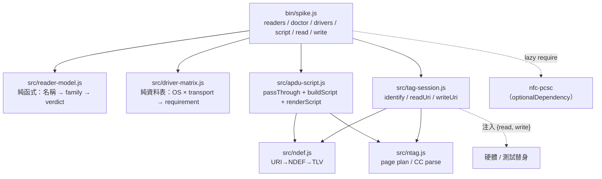
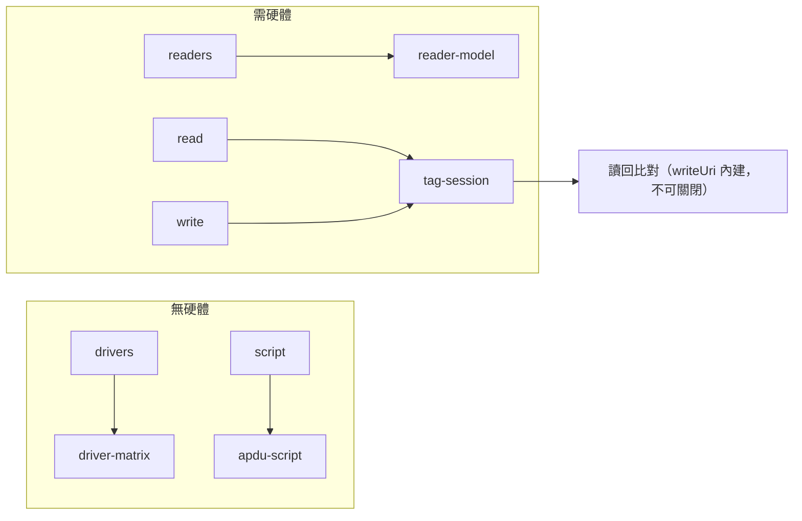
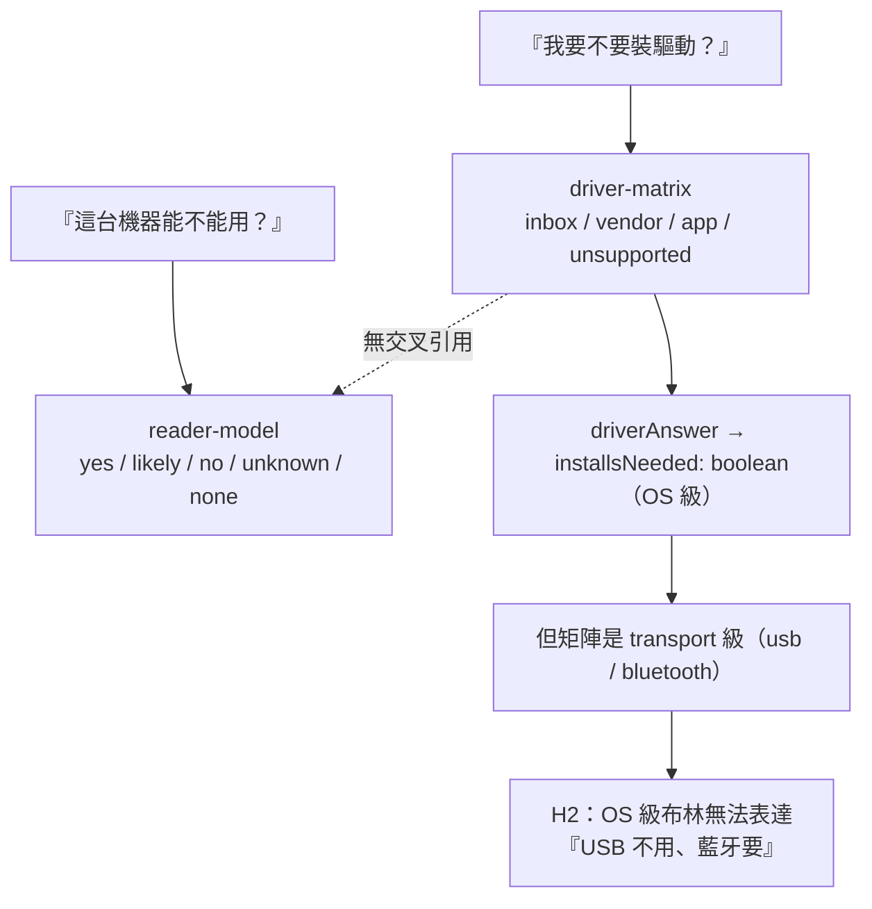
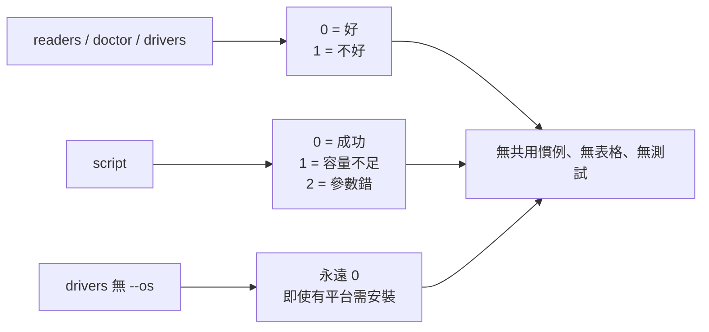

# NFC Reader Spike — 程式碼審查報告（CR-D1..D7）

| 項目       | 值                                                                     |
| ---------- | ---------------------------------------------------------------------- |
| 審查對象   | `LinkCard_Event_Admin_App_Expo/tools/nfc-reader-spike/`                |
| 審查指令   | `git --no-pager diff origin/main...HEAD -- tools/nfc-reader-spike`     |
| 分支       | `feat/nfc-gate1-reader-spike` @ `761acca`                              |
| merge-base | `7d0fcf5`                                                              |
| 審查員     | smith（Checker；Maker ≠ Checker）                                      |
| 模式       | `strict`（threshold **93**）                                           |
| 動作模式   | **`audit_only`**（使用者明示 review-only：不改碼、不 commit）          |
| 日期       | 2026-10-22                                                             |
| 實測分數   | **82.6 / 100** → **ESCALATE（邊界，距 REPAIRABLE 下限 83 僅 0.4 分）** |

## 0. 範圍校正（必讀）

使用者敘述「本輪 8 個 commit：`6e2c397..761acca`」，但**實際 diff 範圍是 28 個 commit**：

```
git rev-list --count 7d0fcf5..HEAD  →  28
```

`origin/main` 的 merge-base 是 `7d0fcf5`，因此 `origin/main...HEAD` 一併納入了 `6e2c397` 之前的 `e2d5957`、`fd996f0`、`814a1a2`、`2a0d4b3`、`6cf1d33`、`4bc878b`、`4bcb7cc` … 等 20 個 commit。全部 17 個檔案皆為**新增**（`+3365 / −0`），總計 3,281 行（不含 `package-lock.json`）。

本報告以**使用者指定的檔案白名單**為準（`src/*.js`、`bin/spike.js`、`tests/*.js`、`README.md`），不因 commit 數差異而縮減審查深度。`docs/research/` 僅作為**證據溯源**用途，不作文件審查。

**範圍內檔案：**

| 檔案                      | 行數 | 角色                          |
| ------------------------- | ---: | ----------------------------- |
| `bin/spike.js`            |  744 | CLI：6 個命令、exit code 契約 |
| `src/driver-matrix.js`    |  295 | 「要不要裝驅動」事實表        |
| `src/reader-model.js`     |  438 | PC/SC 讀卡機辨識 + 可用性裁決 |
| `src/ndef.js`             |  236 | NDEF URI 編解碼               |
| `src/ntag.js`             |  165 | NTAG21x 頁面/CC 計算          |
| `src/apdu-script.js`      |  168 | pass-through 包裝 + 腳本產生  |
| `src/tag-session.js`      |  179 | 讀寫 + 讀回驗證               |
| `tests/*.test.js`（6 檔） |  830 | 測試                          |
| `README.md`               |  112 | 對外契約                      |

## 1. 架構圖



**分層判定：良好。** `bin/` 只做 I/O 與輸出；`src/*` 全為純函式或可注入的 session，沒有任何檔案在載入期觸碰硬體（`loadNfcPcsc()` 為 lazy）。這個結構讓 75 個測試可以在沒有讀卡機的機器上跑完 —— 實測通過。



## 2. 廣度風險掃描（Phase 2b，先於深度審查）

| 掃描面         | 問句                                         | 結果                                                                                                      | Hint   |
| -------------- | -------------------------------------------- | --------------------------------------------------------------------------------------------------------- | ------ |
| 認證／授權     | 有無新路由需授權？                           | N/A — 本地 CLI，無 server、無 session                                                                     | —      |
| 輸入驗證       | 每個邊界都驗證？                             | `--url` 只檢查「非空字串」，**不驗證 scheme**（`script --url hello` 可產生合法腳本）                      | Low    |
| DB 存取邊界    | 有無繞層？                                   | N/A — 無 DB、無 ORM、無 migration                                                                         | —      |
| N+1／索引      | —                                            | N/A                                                                                                       | —      |
| Migration 安全 | —                                            | N/A（本輪零 schema 變更）                                                                                 | —      |
| 靜默失敗       | 有無吞錯？                                   | `reader.on("error", () => {})`（`spike.js:118`）、`catch { /* close 失敗 */ }` — 皆有註解說明，屬刻意     | OK     |
| 平行模組一致性 | `driver-matrix` vs `reader-model` 是否一致？ | 兩者用**不同詞彙**回答同一個問題（`inbox/vendor/app/unsupported` vs `yes/likely/no/unknown`），無交叉引用 | Medium |
| 過度抽象       | 有無無訊號的 pattern？                       | 無。資料表 + 注入式 session 都有具體訊號                                                                  | OK     |
| 不足設計       | 3+ 相似分支未抽象？                          | `bin/spike.js` 內**三個不同 exit-code 慣例**（0/1、0/1/2、一律 0）並存                                    | Medium |
| 作者自審可信度 | 作者聲稱的覆蓋是否成立？                     | 部分不成立：README 稱容量拒絕「已覆蓋」，但 `commandScript` **零測試**                                    | Medium |

**最高風險代碼路徑（排序）**

1. `driverAnswer` → `commandDrivers` 的「答案 → exit code」鏈（H1、H2、M2）
2. `buildScript` → `renderScript` 的**超容量**路徑（M1）
3. `commandScript` 的參數錯誤 → exit 2（M3、M4，且完全未被測試）
4. `TagSession.readUri` 的 extended-length TLV 視窗（L9）

## 3. 逐維度審查

### CR-D1 Plan Compliance（權重 20%，得分 **54**）

「計畫」在本輪的具體形態是 **README 的承諾 ＋ `usage()` 的 exit-code 契約 ＋ JSDoc 契約 ＋ commit message 意圖**。逐條比對：

| 承諾                                        | 出處                                        | 實測                                                                                         | 判定 |
| ------------------------------------------- | ------------------------------------------- | -------------------------------------------------------------------------------------------- | ---- |
| 「drive 表每列都附來源，讀者可以自己查」    | `driver-matrix.js:16-17`                    | 11 列全有 `evidence` 字串，且指向可查證的外部文件                                            | ✅   |
| 「vendor app 的 NDEF tab 是模擬、不是寫卡」 | commit `6e2c397`、`reader-model.js:198-207` | `ndefTab: "emulation-only"`、`cardWriter: "ACOS3 only"`，測試 `driver-matrix`/`cli` 皆有斷言 | ✅   |
| 「write 會讀回、URI 不符就拒絕回報成功」    | `README.md:56-58`                           | `writeUri` 先比對位元組再比對 URI，不符即 `throw TagError`                                   | ✅   |
| 「容量拒絕已覆蓋」                          | `README.md:105`                             | CLI 層**無任何 `script` 測試**（M4）；library 仍產出超容量腳本（M1）                         | ❌   |
| 「`drivers --os` 非零＝該平台需要安裝」     | `README.md:79`                              | Windows 走 USB 明明不需安裝，仍回 1（H2）                                                    | ❌   |
| 「`--json` 用於證據擷取」                   | `README.md:96`                              | 未知 OS 時 JSON 說 `installsNeeded:false`，exit code 卻說 1（H1）                            | ❌   |
| 「`npm test` # 42 tests」                   | `README.md:105`                             | 實測 **75** tests（`npm test` → `pass 75 / fail 0`）                                         | ❌   |

**扣分明細**：H1 −12、H2 −12、M3 −6、M4 −6、M5 −6、L8 −2、L11 −2 → **54**

> **關鍵正確性（已獨立驗證，非作者自述）**：`ntag.js:16-20` 指出 `docs/research/14-…md` §2.2 把 Capability Container 放在 page 4「慢了 1 頁」，並斷言 CC 在 page 3。我查證 `docs/research/14-nfc-hardware-and-batch-write-research.md:61` 確實寫著 `Page 4  Capability Container (CC) 0xE1`，而 `CC_PAGE = 3` 才是對的（page 0-1 = UID/BCC、page 2 = internal/lock、page 3 = CC）。**程式碼正確，且主動記錄了文件的錯**。這是本輪最值得保留的品質。

### CR-D2 Architecture Compliance（15%，得分 **88**）

| 檢查                            | 結論                                                                       |
| ------------------------------- | -------------------------------------------------------------------------- |
| 分層（CLI / 純邏輯 / 硬體邊界） | ✅ 清楚，`src/*` 無 I/O                                                    |
| 硬體可測試性                    | ✅ `TagSession` 接受任何 `{read, write}`，不是硬編 `nfc-pcsc`              |
| 原生依賴隔離                    | ✅ `optionalDependencies` + `loadNfcPcsc()` lazy，缺 native build 只印訊息 |
| 命名                            | ⚠️ `PASS_THROUGH_CLA = 0x00` / `INS = 0x00` 名不符實（L1）                 |
| 安全邊界                        | ⚠️ `writePageCommand` 只擋**下界**（page ≥ 4），不擋上界（L1/M1）          |
| 註解品質                        | ✅ 註解解釋「為什麼」，不是「做什麼」；`0x3e×8=496` 這類易錯點都有寫       |

**扣分**：M1 −6、L1 −2、L10 −2、L4 −2 → **88**

### CR-D3 DB / ORM Schema & Naming（15%）— **N/A**

本輪審查範圍內**無任何資料庫、ORM、schema 或 migration**：`package.json` 只有 `nfc-pcsc` 一個 optional 依賴，`src/` 全為純記憶體計算，`tools/nfc-reader-spike/` 不連 backend（README 明示「It does not touch the backend and does not read any secret」）。

依 Suite Rubric Contract，本維度記為 **N/A 並自加權中排除**（權重重新歸一化，見 §6），**不給 100 分**以免虛胖總分。

> 仍做了一次橫向確認：`CR-D3` 的四項強制檢查（migration 是否由 ORM 產生、NOT NULL 安全四步、index/FK、`db push` 痕跡）在本範圍內**無適用對象**，非「未檢查」。

### CR-D4 Cross-Module Consistency（15%，得分 **88**）



| 一致性檢查                                                          | 結果                                                                                               |
| ------------------------------------------------------------------- | -------------------------------------------------------------------------------------------------- |
| 5 個 OS 的列數                                                      | 一致，每 OS 2 列（usb + bluetooth） ✅                                                             |
| `unsupported` 列的 `subsystem`                                      | **不一致**：`macos-bluetooth`/`linux-bluetooth` 為 `null`，`ios-usb` 卻有值（L3）                  |
| Android 版本標示                                                    | `osLabel: "Android 4.3+"` vs `evidence: "Android 4.4+"`（L11）                                     |
| iOS 版本標示                                                        | `ios-usb` 標 `iOS 16.1+`，但 evidence 完全沒提 16.1（L11）                                         |
| 兩個模組的能力詞彙                                                  | 無映射、無交叉引用；同一台 ACR1555U 在兩處各講一套（Medium，已計入總分）                           |
| `DRIVER_MATRIX` 與 `reader-model` 對 ACR1555U 的三種 transport 描述 | ✅ 一致（USB CCID / BLE APDU / BLE HID）                                                           |
| exit-code 慣例                                                      | **不一致**：`readers/doctor/drivers` 用 0/1、`script` 用 0/1/2、`drivers`（無 `--os`）永遠 0（M7） |

**扣分**：M2 −6、L2 −2、L3 −2、L9 −2 → **88**

### CR-D5 Security / OWASP（20%，得分 **94**）

| OWASP          | 檢查                       | 結果                                                                                      |
| -------------- | -------------------------- | ----------------------------------------------------------------------------------------- |
| A01 存取控制   | 有無需授權的操作？         | N/A（本地 CLI，無多使用者）                                                               |
| A02 加密失敗   | 有無硬編密鑰／明文機密？   | ✅ 無。`grep` 掃過 `src/`、`bin/`、`tests/` 無 secret、無 `.env` 讀取                     |
| A03 注入       | 有無字串拼接進查詢／指令？ | ✅ 無 SQL、無 shell exec。URL 一律轉 hex 位元組，不可能注入腳本格式                       |
| A04 不安全設計 | 有無缺速率限制／危險預設？ | ✅ `write` **預設 dry-run**，需 `--yes` 才動硬體 —— 正確的危險操作預設                    |
| A05 安全設定   | —                          | ⚠️ `--out` 接受任意路徑且無任何限制（L6）；本地工具可接受，但未在 README 說明             |
| A06 脆弱元件   | `nfc-pcsc@^0.8.1`          | ⚠️ 未鎖定到 patch 級（`^`），且為 native build；屬 optional dependency，缺它時 CLI 仍可用 |
| A07 認證失敗   | —                          | N/A                                                                                       |
| A08 資料完整性 | 寫入是否有驗證？           | ✅ 最強項：寫後**位元組級 + URI 級雙重比對**，不符即拋錯                                  |
| A09 日誌失敗   | 關鍵操作有審計？           | ✅ `--json` 可輸出完整證據；寫入成功有明確 `VERIFIED` 字樣                                |
| A10 SSRF       | 有無 server-side fetch？   | ✅ 無                                                                                     |

**扣分**：L12 −2、L13 −2、L6 −2 → **94**

### CR-D6 Performance（10%，得分 **96**）

| 檢查             | 結果                                                                                                                                                |
| ---------------- | --------------------------------------------------------------------------------------------------------------------------------------------------- |
| N+1 / 迴圈內 I/O | 無 DB。硬體側：`writeUri` 每頁一次 `write`（NTAG215 約 11 頁）—— 這是協定要求，非缺陷                                                               |
| 重複工作         | ⚠️ `commandWrite` 對同一張卡做**兩次** `identify()`（`spike.js:514` ＋ `writeUri()` 內再來一次），每次含 16-byte READ ＋ GET_VERSION transmit（L5） |
| 固定等待         | `collectReaderNames` 固定等 1200 ms 才回（有註解說明 PC/SC 無「列舉完成」事件）—— 設計取捨合理                                                      |
| 重複子程序探測   | ⚠️ `doctor` 內 `hasBinary("pcsctest")` 最多被呼叫 4 次，每次都掃整條 PATH 做 `fs.accessSync`（L7）                                                  |
| Payload 大小     | 42-byte TLV → 44 bytes / 11 pages，正常                                                                                                             |

**扣分**：L5 −2、L7 −2 → **96**

### CR-D7 Design Pattern Evaluation（5%，得分 **92**）

| Pattern                    | 是否使用                                  | 具體訊號                                          | 判定                                             |
| -------------------------- | ----------------------------------------- | ------------------------------------------------- | ------------------------------------------------ |
| Strategy / 資料驅動        | ✅ `DRIVER_MATRIX`、`FAMILIES` 為純資料表 | 11 列 × 5 OS、11 個 family，若寫成 if/switch 會爆 | **正確使用**（Signal：≥3 個 sibling、可序列化）  |
| Adapter / Port             | ✅ `TagSession({reader, card})`           | 需要「無硬體可測試」＋「原生依賴可缺席」          | **正確使用**（Cost：一層建構子，換來 100% 可測） |
| Command                    | ✅ `steps[]`（kind/apdu/note）            | 腳本需可序列化、可逐條註解                        | **正確使用**                                     |
| Factory                    | ❌ 未用                                   | 建立邏輯僅 `Buffer.concat`，無多變體              | **N/A（不該引入）**                              |
| Singleton                  | ❌ 未用                                   | 無全域狀態需求                                    | **N/A**                                          |
| Repository / Service Layer | ❌ 未用                                   | 無持久層                                          | **N/A**                                          |
| Observer                   | ✅ 隱含（`nfc.on("reader")`）             | 由 `nfc-pcsc` 提供，本層只消費                    | **正確使用**                                     |
| **Exit-code 慣例**         | ❌ **無抽象**                             | 同一檔案三種慣例                                  | **不足設計**（M7）                               |



**扣分**：M7 −6、L14 −2 → **92**

## 4. Findings（逐條，含證據）

### 🔴 Critical（0）

無。

### 🟠 High（2）

#### CRA-H1 — 未知 OS：`--json` 說「不用裝」，exit code 說「要擔心」

| 欄位       | 內容                                                                                                                                                                                                                                                    |
| ---------- | ------------------------------------------------------------------------------------------------------------------------------------------------------------------------------------------------------------------------------------------------------- |
| 維度       | CR-D1                                                                                                                                                                                                                                                   |
| 位置       | `src/driver-matrix.js:224-232`、`bin/spike.js:680-683`、`tests/driver-matrix.test.js:113-119`                                                                                                                                                           |
| 預期       | `--json` 是文件明載的「證據擷取」通道（`README.md:96`），其欄位必須與 exit code 表達同一件事                                                                                                                                                            |
| 實際       | `driverAnswer("beos")` → `{ installsNeeded: false, summary: "Unknown operating system …" }`；`commandDrivers` 卻因 `if (!match) return 1` 回 **1**                                                                                                      |
| 實測       | `node bin/spike.js drivers --os beos --json` → `exit=1` 且輸出 `"installsNeeded": false`（見 §7 證據 E3）                                                                                                                                               |
| 影響       | 以 JSON 為判準的消費端（報表、CI、未來的 batch writer）會讀到「不用裝驅動」而放心；以 exit code 為判準的會擋下。同一份輸出給出兩個相反答案。`bin/spike.js:677-681` 的註解本身寫著「silence would read as 'you are fine'」，**實作卻正好製造了那個沉默** |
| 嚴重度理由 | 契約矛盾、可被下游直接誤讀、且與作者自述意圖相反 → High（非 Critical：不會造成資料損毀或安全問題）                                                                                                                                                      |

**Remediation Block**
`WHAT`：把「未知」表達成第三態（`installsNeeded: null` 或 `status: "unknown"`），不可用 `false` 代替。
`HOW`：`driverAnswer` 的 early-return 分支改回 `null`；`commandDrivers` 在 `match === undefined` 時不依賴 `installsNeeded` 決定 exit code（現行 `!match` 分支已正確，只需不讓 JSON 說反話）；同步更新 `driver-matrix.test.js:113-119`。
`SCOPE`：`driverAnswer` 的兩個 early-return 分支 ＋ `commandDrivers` 的 `--os` 分支 ＋ 1 個測試。**不動** matrix 資料列。
`VERIFY`：`drivers --os beos --json` 的 `installsNeeded` 為 `null` 且 exit 1；`drivers --os android --json` 仍為 `false`／exit 0。
`STOP-IF`：若改成三態需連帶改動 `allDriverAnswers()` 的序列化契約（目前 `--json` 無 `--os` 時輸出陣列），則先停下討論是否一併升版。

#### CRA-H2 — Windows 的答案是「OS 級」而矩陣是「transport 級」→ 給出錯誤安裝指令

| 欄位       | 內容                                                                                                                                                                                                                                                                                                                                          |
| ---------- | --------------------------------------------------------------------------------------------------------------------------------------------------------------------------------------------------------------------------------------------------------------------------------------------------------------------------------------------- |
| 維度       | CR-D1（並波及 CR-D4）                                                                                                                                                                                                                                                                                                                         |
| 位置       | `src/driver-matrix.js:242`（`installsNeeded = vendorRows.length > 0`）、`:255-262`、`bin/spike.js:566-568`、`:683`                                                                                                                                                                                                                            |
| 預期       | README 自己說得最清楚：「USB is an inbox CCID class driver, Bluetooth needs the vendor PC/SC bridge」（`README.md:88-91`）。也就是「Windows＋USB = 不用裝」                                                                                                                                                                                   |
| 實際       | `driverAnswer("windows").summary === "install BLE PC/SC Driver installer 1.0.3.1"` —— **無任何 transport 限定詞**；`drivers --os windows` 第一行就是 `windows — install BLE PC/SC Driver installer 1.0.3.1`，緊接著第二行才寫 `usb  no driver needed`；exit code = **1**                                                                      |
| 實測       | 見 §7 證據 E4（完整輸出）                                                                                                                                                                                                                                                                                                                     |
| 影響       | ① 對「Windows 筆電＋USB 讀卡機」這個**本 CLI 唯一支援的路徑**，工具給出錯誤的一句話答案；② 以 exit code 把關的流程會把 Windows 永久判為 blocked；③ 依 `reader-model.js:82` 自己的註記（macOS 裝 vendor driver 是「known way to break it」），多裝驅動是有害的建議；④ 這正是模組開頭宣稱要防的「drift into folklore」（`driver-matrix.js:11`） |
| 嚴重度理由 | 業務邏輯錯誤、直接違反 README 對同一問題的敘述 → High                                                                                                                                                                                                                                                                                         |

**Remediation Block**
`WHAT`：讓答案帶上 transport 維度，OS 級結論不得把「某個 transport 需要」升格成「整個平台需要」。
`HOW`：`summary` 的 vendor 分支改為 `install <pkg> (bluetooth only)`；`driverAnswer` 回傳 `installsNeededByTransport: { usb: false, bluetooth: true }`，並保留 `installsNeeded` 為其 OR 值（向後相容）；`commandDrivers --os` 的 exit code 改以「是否存在**任何**可用 transport」為判準，並在 `--json` 帶出 `installsNeededByTransport`。
`SCOPE`：`driverAnswer` 的 `parts` 組裝 ＋ `commandDrivers` 的 `--os` 回傳值 ＋ `cli.test.js` 對 windows 的斷言（目前斷言 exit 1，需一併改為新語意並補說明）。
`VERIFY`：`drivers --os windows` 文字含 `bluetooth only`；`--json` 有 `installsNeededByTransport.usb === false`；`drivers --os macos` 仍 exit 0。
`STOP-IF`：若決定維持「OS 級單一布林」，則必須在 README 與 `usage()` 明文寫出這個限制，並把 exit code 改回 0（使契約自洽）—— 二者擇一，不可兩者都留。

### 🟡 Medium（7）

#### CRA-M1 — 超容量腳本仍被完整建構與渲染（只有旗標，沒有拒絕）

| 欄位       | 內容                                                                                                                                                                                                                                                                                                                         |
| ---------- | ---------------------------------------------------------------------------------------------------------------------------------------------------------------------------------------------------------------------------------------------------------------------------------------------------------------------------- |
| 維度       | CR-D2                                                                                                                                                                                                                                                                                                                        |
| 位置       | `src/apdu-script.js:100-152`、`src/ntag.js:143-165`（`planPageWrites` 不裁切）、`src/ntag.js:69-81`（`writePageCommand` 只擋下界）                                                                                                                                                                                           |
| 事實       | 對 `https://example.com/` + 400 字元、`variant: "NTAG213"`：`fitted=false`、`bytes=428`、`capacityBytes=144`，但 `steps` 仍含 **107 個 write**，最高寫到 **page 110**（NTAG213 使用者區只到 page 39）。`renderScript()` 產出的文字**完全沒有任何警告**（實測 regex `/refus\|too large\|does not fit\|overflow/i` 無命中）    |
| 實測       | §7 證據 E5                                                                                                                                                                                                                                                                                                                   |
| 影響       | 「**回報還是靜默截斷**」的答案是：**不截斷、有回報，但回報只到 `fitted` 旗標層級**。任何直接呼叫 `buildScript()`／`renderScript()` 的消費端（未來的 batch writer、測試、複製貼上的操作員）拿到的是一份**看起來完全正常**的腳本。CLI 在 `spike.js:600-609` 有擋（且擋在 `writeFileSync` 之前，這點正確），但保護只在 CLI 一層 |
| 嚴重度理由 | 危險產物仍可被建構出來、且無內建警示 → Medium（CLI 主路徑已防護，故非 High）                                                                                                                                                                                                                                                 |

**Remediation Block**
`WHAT`：讓「不 fit」在產物層面就不可用，而不是只留一個旗標。
`HOW`：`buildScript` 在 `!plan.fits` 時直接 `throw`（或回傳 `steps: []` ＋ `refusal` 欄位）；`renderScript` 在有 `refusal` 時輸出一行 `# REFUSED: …`；`writePageCommand` 加上 `page > lastUserPage` 上界（可由 `capacityPages` 推得）。
`SCOPE`：`apdu-script.js` 的 `buildScript`/`renderScript`、`ntag.js` 的 `writePageCommand`、對應 3 個測試。
`VERIFY`：`buildScript(longUrl, {variant:"NTAG213"})` 拋錯或 `steps.length === 0`；`renderScript` 對 refused 腳本必含 `REFUSED`；`writePageCommand(40, buf)` 在 NTAG213 情境被拒。
`STOP-IF`：若 `throw` 會破壞既有呼叫端（`commandScript` 目前靠 `try/catch` 回 1），改為回傳 refusal 物件即可，不要同時改兩層語意。

#### CRA-M2 — 「全部列皆 unsupported」的分支是**不可達的死碼**，而且一旦可達會回 exit 0

| 欄位   | 內容                                                                                                                                                                                                                                                                                                                                                                                        |
| ------ | ------------------------------------------------------------------------------------------------------------------------------------------------------------------------------------------------------------------------------------------------------------------------------------------------------------------------------------------------------------------------------------------- |
| 維度   | CR-D4                                                                                                                                                                                                                                                                                                                                                                                       |
| 位置   | `src/driver-matrix.js:245-253`、`bin/spike.js:683`                                                                                                                                                                                                                                                                                                                                          |
| 事實   | 逐一枚舉 5 個 OS（含 `beos`）的 `usable` 列數，**沒有任何 OS 會進入此分支**（§7 證據 E2）。該分支回 `installsNeeded: false`；若未來新增一個「只有 unsupported」的平台，`commandDrivers` 會走 `match.installsNeeded ? 1 : 0` → **exit 0 ＝「你可以放心」**，而 summary 卻寫「no supported route on this platform」。我用 in-memory 移除 `ios-bluetooth` 實測，確認會落入此狀態（§7 證據 E6） |
| 影響   | ① 死碼未被測試（`driver-matrix.test.js` 無此案例）；② 它是個**反向的**安全預設 —— 越沒路可走的平台越會回 0                                                                                                                                                                                                                                                                                  |
| 嚴重度 | Medium（今日不可達，但語意方向錯誤且無測試守門）                                                                                                                                                                                                                                                                                                                                            |

**Remediation Block**
`WHAT`：讓「完全沒有可用路徑」明確不等於「不用安裝」。
`HOW`：`installsNeeded: null`（或 `status: "no-route"`）；`commandDrivers` 對 `no-route` 回 **1**；補一個測試：以 `driverRows` 過濾後的合成資料餵入 `driverAnswer`（或抽一個 `answerFromRows(rows)` 純函式）以覆蓋此分支。
`SCOPE`：`driverAnswer` 的 `usableRows.length === 0` 分支 ＋ 1 個新測試（建議把 `driverAnswer` 重構成 `driverAnswer(os) = answerFromRows(row)`，讓分支可測而不必動常數表）。
`VERIFY`：新測試在「rows 全為 unsupported」時斷言 `installsNeeded !== false` 且 exit 語意為 1。
`STOP-IF`：若團隊決定「永不支援這種 OS」，則把死碼刪掉並在註解寫明不變式，**不要留著不測**。

#### CRA-M3 — exit code `2` 被使用，但 `usage()` 與 README 都沒定義

| 欄位   | 內容                                                                                                                                                                                                                                                   |
| ------ | ------------------------------------------------------------------------------------------------------------------------------------------------------------------------------------------------------------------------------------------------------ |
| 維度   | CR-D1                                                                                                                                                                                                                                                  |
| 位置   | `bin/spike.js:338`（`Exit codes: 0 = … 1 = no (or an error was reported).`）、`:582`、`:591`、`:636-637`；`README.md:77-84` 表格                                                                                                                       |
| 事實   | `script` 缺 `--url` → 2；`--variant` 非法 → 2；未知命令 → 2（實測 E3）。但 `usage()` 只列 0/1，並把「an error was reported」歸給 1。README 的 `script` 列更寫「Non-zero exit means: payload too large for the chosen chip」—— 把參數錯誤也說成容量不足 |
| 影響   | 操作員／CI 無法從 exit code 區分「我打錯指令」與「這張卡不夠大」，而後者的處置（換卡）與前者（改參數）完全不同                                                                                                                                         |
| 嚴重度 | Medium（契約文件與實作不符；不影響資料正確性）                                                                                                                                                                                                         |

**Remediation Block**
`WHAT`：exit code 要能被文件完整列舉。
`HOW`：`usage()` 補上 `2 = bad arguments (nothing was attempted)`；README 表格的 `script` 列改為「non-zero: 1 = payload too large, 2 = bad arguments」。
`SCOPE`：`bin/spike.js` 的 `usage()` 字串 ＋ `README.md` 表格，共 2 處。
`VERIFY`：`node bin/spike.js script` 的 stderr 與 README 描述一致；新增測試斷言 `main(["script"]) === 2`。
`STOP-IF`：若選擇把參數錯誤改回 1，則需同步移除 `main` 對未知命令的 2 —— 但這會破壞既有 `cli.test.js:23` 的斷言，需一併決定。

#### CRA-M4 — `commandScript` 在 CLI 層**零測試**

| 欄位   | 內容                                                                                                                                                                                                              |
| ------ | ----------------------------------------------------------------------------------------------------------------------------------------------------------------------------------------------------------------- |
| 維度   | CR-D1                                                                                                                                                                                                             |
| 位置   | `tests/cli.test.js`（全檔 114 行，僅測 `main`/`hasBinary`/`readers --assume`/`drivers`/`drivers --json`）                                                                                                         |
| 事實   | `grep -c "script" tests/cli.test.js` → 0 個 `main(["script", …])` 呼叫。也就是：H/M3 涉及的 exit 0/1/2、`--out` 檔案寫入、超容量拒絕，**全部只靠人工試跑**。而 `README.md:105` 聲稱「capacity refusal … covered」 |
| 影響   | 這正是「**測到實作而不是測到需求**」的典型：`apdu-script.test.js` 測了 `fitted === false`（實作旗標），但沒有任何測試驗證「使用者拿到的行為」是拒絕                                                               |
| 嚴重度 | Medium                                                                                                                                                                                                            |

**Remediation Block**
`WHAT`：把 `script` 的行為契約寫成測試，而不是只測 library 旗標。
`HOW`：在 `cli.test.js` 補 4 個測試：① 正常 `--url` → 0 且 stdout 含 `FF 00 00 00`；② `--out <tmp>` → 0 且檔案存在且每行可被 hex 解析；③ 超容量 `--variant NTAG213` → 1 且 **檔案不存在**；④ 缺 `--url` → 2。沿用既有 `captureConsole()` 與 `fs.mkdtempSync`。
`SCOPE`：只新增 `tests/cli.test.js` 的測試；不改 `bin/`。
`VERIFY`：`npm test` 由 75 → 79，全綠；刻意把 `!script.fitted` 改成 `false` 時測試③ 必須失敗（鑑別力自我檢查）。
`STOP-IF`：若測試需要真的觸發 `fs.writeFileSync` 到 repo 內，改用 `os.tmpdir()`，**不得**在 `tools/nfc-reader-spike/` 內落地測試產物。

#### CRA-M5 — 「每一列都有來源」的測試只斷言**字串長度**

| 欄位   | 內容                                                                                                                                                            |
| ------ | --------------------------------------------------------------------------------------------------------------------------------------------------------------- |
| 維度   | CR-D1                                                                                                                                                           |
| 位置   | `tests/driver-matrix.test.js:16-38`，關鍵兩行：`assert.ok(row.mechanism.length > 20)`、`assert.ok(row.evidence.length > 20)`                                    |
| 事實   | 這兩個斷言無法區分「引用 Microsoft 官方文件」與「隨便打 21 個字」。真正的需求是「每列都能被第三方查證」，測試卻只驗證「不是空字串」                             |
| 影響   | 本模組的全部價值建立在「claim 有依據」之上（`driver-matrix.js:16-17` 自己這樣寫）。長度斷言給了**假綠**：日後任何人把 evidence 改成一段編造的文字，測試仍然全綠 |
| 嚴重度 | Medium（假綠測試，但今日資料本身是好的）                                                                                                                        |

**Remediation Block**
`WHAT`：把「有引用」變成可機械判定的性質。
`HOW`：要求每列 `evidence` 至少匹配一個「可查證來源形狀」，例如 `/('[^']+'|https?:\/\/|v\d+\.\d+|§\d)/`，並額外斷言 `row.evidence` 不是 `row.mechanism` 的子字串（避免把說明當證據複製）。再把 11 列的關鍵事實（`1.0.3.1`、`PIV`、`0x3e`）做成表驅動斷言。
`SCOPE`：`tests/driver-matrix.test.js` 一個檔案。
`VERIFY`：把任一列的 `evidence` 換成 `"this is a made up sentence over twenty chars"` 後測試必須失敗。
`STOP-IF`：若無法為某些列找到可引用的來源，就該在該列標 `evidence: "UNVERIFIED"` 並讓測試允許它 —— **誠實的未驗證**勝過假的引用。

#### CRA-M6 — 測試把 H1 的錯誤語意**釘死**成規格

| 欄位   | 內容                                                                                                                                                                                                     |
| ------ | -------------------------------------------------------------------------------------------------------------------------------------------------------------------------------------------------------- |
| 維度   | CR-D1                                                                                                                                                                                                    |
| 位置   | `tests/driver-matrix.test.js:113-119`：`assert.equal(unknown.installsNeeded, false)`                                                                                                                     |
| 事實   | 這個斷言讓 H1 的修正變成「破壞測試」，也就是把錯誤行為升格為契約。搭配 `bin/spike.js:677-681` 的註解（「Unknown platforms also exit 1 — silence would read as 'you are fine'」），測試與註解**互相矛盾** |
| 影響   | 下一位修 H1 的人會先看到紅燈，可能因此放棄修正或改成「測試也一起改」而失去守門                                                                                                                           |
| 嚴重度 | Medium                                                                                                                                                                                                   |

**Remediation Block**
`WHAT`：測試應斷言「未知平台不得被表示為 OK」，而不是斷言當前的 `false`。
`HOW`：改為 `assert.notEqual(unknown.installsNeeded, false)`（三態下 `null` 通過）＋ `assert.match(unknown.summary, /Unknown/)`；與 CRA-H1 同一個 PR 一起改。
`SCOPE`：3 行測試。
`VERIFY`：修正 H1 後測試仍綠；把 `installsNeeded` 改回 `false` 時測試轉紅。
`STOP-IF`：與 CRA-H1 同步，不可單獨合併。

#### CRA-M7 — 同一檔案三種 exit-code 慣例，無共用抽象

| 欄位   | 內容                                                                                                                                                                                               |
| ------ | -------------------------------------------------------------------------------------------------------------------------------------------------------------------------------------------------- |
| 維度   | CR-D7                                                                                                                                                                                              |
| 位置   | `bin/spike.js:236-279`（`readers` 0/1）、`:288-300`（`doctor` 0/1）、`:625-647`（`drivers` 0/1 或永遠 0）、`:570-616`（`script` 0/1/2）、`:455-560`（`write` 0/1）                                 |
| 事實   | 五個命令各自 `return` 硬編數字，沒有共用的 `EXIT` 常數、沒有表格、沒有測試覆蓋整體契約。`drivers` 無 `--os` 時即使有平台需安裝也回 0，而 `drivers --os windows` 回 1 —— 同一個問題、兩種 exit code |
| 影響   | 任何 exit code 的調整都要改 5 處；而 `usage()` 目前已經跟不上（M3）。這是「3+ 相似分支未抽象」的具體訊號                                                                                           |
| 嚴重度 | Medium（`≥3 個 sibling` 的 Pattern Catalog 訊號已成立）                                                                                                                                            |

**Remediation Block**
`WHAT`：把 exit code 收斂成單一表驅動契約。
`HOW`：新增 `const EXIT = { OK: 0, NO: 1, BAD_ARGS: 2 }` 並讓 6 個命令全部回傳 `EXIT.*`；`usage()` 由同一份表生成字串；補一個測試逐一斷言每個命令的代表性 exit code。
`SCOPE`：`bin/spike.js` 的 return 值與 `usage()`；不改 `src/*`。
`VERIFY`：`grep -n "return [012];" bin/spike.js` 應為 0 命中（全部改為 `EXIT.*`）。
`STOP-IF`：若決定同時改語意（如 drivers 無 `--os` 也回 1），需先與 M3／H2 的裁決一起定案。

### 🔵 Low（14）

| ID      | 維度 | 位置                                   | 事實                                                                                                                                                                                                                   | 建議                                                                                                                                |
| ------- | ---- | -------------------------------------- | ---------------------------------------------------------------------------------------------------------------------------------------------------------------------------------------------------------------------- | ----------------------------------------------------------------------------------------------------------------------------------- |
| CRA-L1  | D2   | `apdu-script.js:38-39`                 | `PASS_THROUGH_CLA = 0x00`、`PASS_THROUGH_INS = 0x00` 用在 `Buffer.from([0xff, CLA, INS, 0x00, len])`：外層 APDU 的 CLA 其實是 `0xFF`，那兩個 `0x00` 不是 CLA/INS。命名會誤導下一位「修正」錯的位置                     | 改名 `PASS_THROUGH_P1_P2` 或直接寫 `0x00` 並在註解標明 `FF 00 00 00` 是 vendor pseudo-APDU                                          |
| CRA-L2  | D4   | `driver-matrix.js:186-192`             | `os` 有 `toLowerCase()` 但**沒有 `trim()`**；`transport` 完全沒正規化。實測 `driverAnswer("  windows ")` → unknown；`driverRows("windows","USB")` → 0 列                                                               | `String(os).trim().toLowerCase()`；transport 同樣處理                                                                               |
| CRA-L3  | D4   | `driver-matrix.js:139-150`             | `ios-usb` 是 `unsupported` 卻帶 `subsystem: "CryptoTokenKit (PIV only)"`，其餘 3 個 unsupported 列皆為 `null`。不變式未寫進 typedef 也未測試                                                                           | 在 typedef 註明「unsupported **可以**填 subsystem 以說明為何不適用」，並補測試                                                      |
| CRA-L4  | D2   | `ndef.js:229`                          | `compressedBytes: prefix.length - 1` 對 prefix code `0x00` 回 **−1**（實測 E7）。這個欄位是給報告用的「節省位元組」，負值無意義                                                                                        | `Math.max(0, prefix.length - 1)`，或改為 `prefix.length > 0 ? prefix.length - 1 : 0`                                                |
| CRA-L5  | D6   | `spike.js:514` ＋ `tag-session.js:141` | `commandWrite` 先 `identify()` 取得 `dataAreaBytes` 算 plan，接著 `writeUri()` 內部**再** `identify()` 一次。同一張卡兩次 16-byte READ ＋ 兩次 GET_VERSION transmit                                                    | 讓 `writeUri(url, { identity })` 接受已取得的 identity，或改為只回傳 plan 讓 CLI 統一寫                                             |
| CRA-L6  | D5   | `spike.js:620-623`                     | `--out /tmp/x` 顯示為 `../../../../../../../tmp/x`（`path.relative(process.cwd(), out)`）；且 `--out` 無任何路徑限制／存在性檢查                                                                                       | 直接印 `out`；若要防覆寫可加 `fs.existsSync` 提示                                                                                   |
| CRA-L7  | D6   | `spike.js:326-345`                     | `hasBinary("pcsctest")` 在 `pass` 與 `detail` 兩處共被呼叫最多 4 次，每次都掃整條 PATH 做 `fs.accessSync`                                                                                                              | 先算一次存成區域變數                                                                                                                |
| CRA-L8  | D1   | `README.md:105`                        | 寫「`npm test` # 42 tests」，實測 **75** tests                                                                                                                                                                         | 改為「75 tests」或拿掉數字                                                                                                          |
| CRA-L9  | D4   | `tag-session.js:117-131`               | 當 TLV 的 `0xFF` 擴充長度標記落在 16-byte 讀取窗邊緣時，`head[tagIndex+2]/[+3]` 可能為 `undefined` → `messageLength` 靜默變 0 → 後續 `readBytes` 讀太少 → 最終拋出**錯誤的**診斷 `no NDEF TLV (0x03) found`（實測 E8） | 先確保 `tagIndex + headerBytes <= head.length`，不足就再讀一次；錯誤訊息應指出「TLV 長度欄位超出初始讀取範圍」                      |
| CRA-L10 | D2   | `reader-model.js:271-300`              | `FAMILIES` 的匹配依陣列順序（`acs-acr1555u` 必須排在 `acs-acr155x` 之前，否則 1555U 會被 155 吃掉）。沒有任何註解或測試守護這個順序                                                                                    | 在 `FAMILIES` 上方加註「**順序即優先序，較具體的 family 必須在前**」；補一個「打亂順序會壞」的說明性測試，或改為按 specificity 排序 |
| CRA-L11 | D1   | `driver-matrix.js:64-72`、`:139-141`   | `android-usb` 的 `osLabel` 是 `Android 4.3+`，但 `evidence` 寫的是 `Android 4.4+`；`ios-usb` 的 `osLabel` 是 `iOS 16.1+`，evidence 完全沒提 16.1。本模組存在的理由就是「答案不能變成民俗傳說」，卻有未溯源的版本號     | 讓 `osLabel` 的數字要嘛出現在 `evidence`，要嘛標明是推論                                                                            |
| CRA-L12 | D5   | `spike.js:552`                         | `console.log(\`url ${result.url}\`)` 原樣輸出使用者輸入，含 ANSI escape 序列時可污染終端（本地工具，風險低）                                                                                                           | 對 `url` 做 `JSON.stringify` 或過濾 `\u001b`                                                                                        |
| CRA-L13 | D5   | `ndef.js:78-88`、`spike.js:570-616`    | `assertNonEmptyString` 只擋空字串；`script --url hello` 會產生「合法但無意義」的 NDEF URI 記錄（prefix code 0）。模組自稱「refuses everything else loudly」卻對非 URL 沉默                                             | 在 CLI 層要求 `^https?://`（或 `new URL()` 可解析）；library 保持寬鬆但要回報 `prefixCode === 0`                                    |
| CRA-L14 | D7   | `reader-model.js:398-416`              | `verdictFor` 用三層 nested ternary 組 `summary`，其中一段 3 層、四個分支                                                                                                                                               | 抽成小函式或查表；非阻擋                                                                                                            |

## 5. 過度設計 / 不足設計

| 方向             | 判定                            | 具體訊號                                                                                                                              |
| ---------------- | ------------------------------- | ------------------------------------------------------------------------------------------------------------------------------------- |
| 過度設計         | **未發現**                      | 沒有為了「未來可能需要」而加的介面、DI 容器、抽象基底。`step` 物件、`plan` 物件都是當下就需要序列化／比對的                           |
| 不足設計（1）    | **有**                          | `bin/spike.js` 3 種 exit-code 慣例未抽象（M7）；具體訊號＝5 個 sibling 命令、`usage()` 已落後                                         |
| 不足設計（2）    | **有**                          | `driverAnswer` 的「OS 級布林」無法表達 transport 級事實（H2）；具體訊號＝同一 OS 的兩列 requirement 不同，卻只有一個 `installsNeeded` |
| 建議**不要**引入 | Factory / Repository / EventBus | 建立邏輯只有 `Buffer.concat`；無持久層；事件已由 `nfc-pcsc` 提供                                                                      |

## 6. 合規性評分卡（**實測計算，附扣分明細**）

計分規則（完全可重算）：每個維度自 100 起扣，`High −12`、`Medium −6`、`Low −2`；**N/A 維度不自加權中給分**，改以剩餘權重歸一化。

| 維度                  | 起始 | 扣分項                                             |  得分  |  權重   |      加權 |
| --------------------- | :--: | -------------------------------------------------- | :----: | :-----: | --------: |
| CR-D1 Plan Compliance | 100  | H1 −12、H2 −12、M3 −6、M4 −6、M5 −6、L8 −2、L11 −2 | **54** |   20%   |     10.80 |
| CR-D2 Architecture    | 100  | M1 −6、L1 −2、L4 −2、L10 −2                        | **88** |   15%   |     13.20 |
| CR-D3 DB/ORM Schema   |  —   | **N/A（無 DB/ORM/migration；排除而非給 100）**     |   —    |  (15%)  |         — |
| CR-D4 Cross-Module    | 100  | M2 −6、L2 −2、L3 −2、L9 −2                         | **88** |   15%   |     13.20 |
| CR-D5 Security/OWASP  | 100  | L6 −2、L12 −2、L13 −2                              | **94** |   20%   |     18.80 |
| CR-D6 Performance     | 100  | L5 −2、L7 −2                                       | **96** |   10%   |      9.60 |
| CR-D7 Design Pattern  | 100  | M7 −6、L14 −2                                      | **92** |   5%    |      4.60 |
| **合計**              |      |                                                    |        | **85%** | **70.20** |

$$\text{Score} = \frac{70.20}{85} \times 100 = 82.59 \approx \mathbf{82.6}$$

**Gate Decision（strict, threshold 93）**

| 判準                             | 值        | 結果                |
| -------------------------------- | --------- | ------------------- |
| Score ≥ 93                       | 82.6 ≥ 93 | ❌                  |
| Score ≥ 93−10 = 83（REPAIRABLE） | 82.6 ≥ 83 | ❌（**差 0.4 分**） |
| Score < 83                       | 82.6 < 83 | ✅ → **ESCALATE**   |

> **邊界揭露**：82.6 距離 REPAIRABLE 下限 83 只有 0.4 分。這個差距完全落在「CR-D1 的兩個 High 是否需要 PM 裁決」上 —— 而它們確實需要（會改變 Windows 的對外答案與 exit code 語意）。因此我按矩陣如實給 **ESCALATE**，並在 §8 標明這是 30 分鐘可完成的修復，不是重做。
>
> **修復推演**：若只修 H1＋H2（D1 54 → 78），總分 = 75.0/85 = **88.2** —— 仍低於 strict 的 93。要過 strict 還必須清掉 M3/M4/M5/M6 與全部 Low。這點必須讓決策者知道：**不是「改兩個 bug 就過」**。

## 7. 實測證據（可重跑）

| #   | 指令 / 探針                                                                  | 輸出                                                                                                                                      |
| --- | ---------------------------------------------------------------------------- | ----------------------------------------------------------------------------------------------------------------------------------------- |
| E1  | `cd tools/nfc-reader-spike && npm test`                                      | `tests 75 / pass 75 / fail 0`（README 聲稱 42）                                                                                           |
| E2  | `driverRows(os).filter(r => r.requirement !== "unsupported").length` 對 5 OS | windows 2、macos 1、linux 1、android 2、ios 1 → **無 OS 落入 `usableRows.length === 0`**                                                  |
| E3  | `node bin/spike.js drivers --os beos --json`                                 | `exit=1`，payload `{"os":"beos","installsNeeded":false,…}`                                                                                |
| E4  | `node bin/spike.js drivers --os windows`                                     | `exit=1`；第 1 行 `windows — install BLE PC/SC Driver installer 1.0.3.1`；第 2 行 `usb  no driver needed`                                 |
| E5  | `buildScript(long,{variant:"NTAG213"})`                                      | `fitted=false bytes=428 capacityBytes=144`，但 `write` steps = **107**，最高 page = **110**；`renderScript()` 無任何拒絕字樣              |
| E6  | in-memory 移除 `ios-bluetooth` 後 `driverAnswer("ios")`                      | `{"installsNeeded":false,"summary":"no supported route on this platform"}` → 對應 exit **0**                                              |
| E7  | `decodeUriMessage(encodeUriMessage("weird://scheme/x"))`                     | `{"uri":"weird://scheme/x","prefixCode":0,"compressedBytes":-1}`                                                                          |
| E8  | 16-byte 窗內 TLV `0xFF` 擴充長度                                             | 最終錯誤為 `no NDEF TLV (0x03) found in tag data`（錯誤診斷，真實原因是長度欄位超出窗口）                                                 |
| E9  | `passThrough(Buffer.from([0x60]))`                                           | `FF 00 00 00 01 60`；`passThrough([A2 04 …])` → `Lc=6`、total `5+6=11`（**Lc == command 長度，無 off-by-one**）                           |
| E10 | 從 `renderScript(…, {comments:false})` **的純文字**逐頁重組 → 手寫解 NDEF    | `03 27 D1 01 55 04 …` → 手解 URL `https://linkcard.xyz/t/EVT1/04A1B2C3D4E5F6`，與原字串**完全一致**；`0xFE` 終止符存在；尾端 padding 全 0 |

### 針對使用者指定重點的逐項結論

| 指定重點                                           | 結論                                                                                                                                                                                                                                                 | 依據          |
| -------------------------------------------------- | ---------------------------------------------------------------------------------------------------------------------------------------------------------------------------------------------------------------------------------------------------- | ------------- |
| `driver-matrix.js` 每列是否有依據                  | **有**（11 列全有 `evidence` 字串且指向可查證外部文件）；但**測試只驗證字串長度**，無鑑別力                                                                                                                                                          | §4 M5         |
| 是否內部自相矛盾（vendor 必要卻標 optional）       | **未發現該特定矛盾** —— `vendor` 列全部有 `installer`，非 vendor 列全部為 `null`，且測試守著這條。真正的矛盾在**別處**：`windows-usb` 標 inbox 沒問題，但 `driverAnswer("windows")` 把「藍牙要裝」升格成「OS 要裝」，與同表 USB 列及 README 互相打臉 | §4 H2、E4     |
| `driverAnswer()` 未知 OS                           | **有缺陷**：`installsNeeded:false` ＋ exit 1（**H1**）；`driverAnswer(null)` → `os:"null"`；`"  windows "` → unknown（L2）                                                                                                                           | E3、§4 L2     |
| 只有 unsupported 列的 OS                           | **不可達死碼**，且若可達會回 exit 0（**M2**）                                                                                                                                                                                                        | E2、E6        |
| 同時有 app 與 unsupported 的 OS（iOS）             | 正常：`no driver exists … (bluetooth); usb is not a supported route here`；但 `ios-usb` 帶非 null `subsystem` 破壞不變式（L3）                                                                                                                       | §4 L3         |
| pass-through 是否符合 `FF 00 00 00 <Lc> <command>` | **符合**。`Lc = command.length`，總長 `5 + len`，偏移無 off-by-one；`Lc > 0xFF` 與空 command 都會拋錯                                                                                                                                                | E9            |
| 位元組能否還原原 URL / 是否有 round-trip 測試      | **能，且真的有兩個真 round-trip 測試**（`apdu-script.test.js:115-145` 與 `:71-88`）。我另外用**純文字輸出**獨立重組再手解 NDEF，結果一致（非循環論證）                                                                                               | E10           |
| 容量超出：回報還是靜默截斷                         | **回報，不截斷** —— 但只在 `fitted` 旗標與 CLI 層；library 仍產生 107 個超容量 WRITE，`renderScript` 文字無警告（**M1**）                                                                                                                            | E5            |
| `bin/spike.js` exit code 與 README/usage 一致？    | **不一致**：`script` 用 2 但 `usage()` 只定義 0/1；README 把 `script` 的所有非零都說成「容量不足」；`drivers --json` 與 exit code 互相矛盾                                                                                                           | §4 H1、M3、E3 |
| 測試是否有假綠                                     | **有 3 處**：①「sourced」只斷言長度（M5）；②測試把未知 OS 的 `false` 釘成規格（M6）；③`commandScript` 完全無測試卻宣稱「已覆蓋」（M4）                                                                                                               | §4 M4/M5/M6   |

## 8. 最終裁定與升級建議

### 判定：`ESCALATE`（strict 門檻 93，實測 82.6）

**不是重寫，是 30 分鐘級別的收斂。** 但依矩陣，分數落在 REPAIRABLE 下限之下 0.4 分，且兩個 High 都會改變**對外答案與 exit code 語意**（Windows 使用者會被告知要裝一個不需要的驅動；`--json` 消費者會讀到與 exit code 相反的結論），這屬於需要擁有者拍板的語意決策，而非純 bug fix。

### 部署阻擋 vs 可追蹤

| 分類                                    | 項目                                                     |
| --------------------------------------- | -------------------------------------------------------- |
| 🚫 **阻擋（必須先修）**                 | CRA-H1、CRA-H2（兩者的修法互相耦合，必須同一個 PR 定案） |
| ⚠️ **本輪應修（strict 要求 Low 全清）** | M1、M3、M4、M5、M6、M7、L8                               |
| 📋 **可進 backlog**                     | L1–L7、L9–L14                                            |

### 這份程式碼值得肯定的地方（不因扣分而抹去）

1. **寫入驗證是教科書等級**：位元組比對 ＋ URI 比對雙軌，且不可關閉；`dropWrites` 測試證明它會紅。
2. **動作透明度**：`write` 預設 dry-run；`script` 自承「script 檔格式未驗證」，並在 CLI 輸出直接寫出來 —— 這種誠實在硬體 spike 裡很罕見。
3. **主動更正上游文件**：`ntag.js` 指出 doc 14 §2.2 把 CC 放錯頁，且我用 `docs/research/14-…md:61` 核對確實如此。
4. **`_` 純函式邊界**：`src/` 無 I/O 讓 75 個測試 0 硬體可跑，這是本專案能持續迭代的根本。

## 9. 行動項目（依優先序）

| #   | 優先 | 動作                                                                                  | 對應 finding | 檔案                                                    |
| --- | :--: | ------------------------------------------------------------------------------------- | ------------ | ------------------------------------------------------- |
| 1   |  P0  | `driverAnswer` EOL 語意三態化 ＋ 與 `commandDrivers` exit code 對齊（**先裁決語意**） | H1、M6       | `driver-matrix.js`, `spike.js`, `driver-matrix.test.js` |
| 2   |  P0  | 答案帶 transport 維度；`--os windows` 不再叫人裝藍牙驅動                              | H2           | `driver-matrix.js`, `spike.js`, `cli.test.js`           |
| 3   |  P1  | `buildScript` 不 fit 即拒；`writePageCommand` 補上界；`renderScript` 印拒絕行         | M1           | `apdu-script.js`, `ntag.js`                             |
| 4   |  P1  | `script` 的 exit 0/1/2 寫進 `usage()` ＋ README；補 4 個 CLI 測試                     | M3、M4       | `spike.js`, `README.md`, `cli.test.js`                  |
| 5   |  P1  | 「有來源」測試改為可鑑別；`npm test` 數字更正                                         | M5、L8       | `driver-matrix.test.js`, `README.md`                    |
| 6   |  P2  | exit code 收斂為 `EXIT.*` 表                                                          | M7           | `spike.js`                                              |
| 7   |  P3  | 其餘 Low（建議一次掃完）                                                              | L1–L14       | 見 §4                                                   |

## 10. 凍結與修復契約

```yaml
frozen_findings:
  round: 1
  gate_mode: audit_only
  repair_decision: ESCALATE # 82.6 < threshold-10 (83)
  paired_author_skill: none # 使用者明示 review-only
  findings_locked_before_repair: true
  locked_finding_ids:
    - CRA-H1
    - CRA-H2
    - CRA-M1
    - CRA-M2
    - CRA-M3
    - CRA-M4
    - CRA-M5
    - CRA-M6
    - CRA-M7
    - CRA-L1
    - CRA-L2
    - CRA-L3
    - CRA-L4
    - CRA-L5
    - CRA-L6
    - CRA-L7
    - CRA-L8
    - CRA-L9
    - CRA-L10
    - CRA-L11
    - CRA-L12
    - CRA-L13
    - CRA-L14
  code_modified: false # review-only；已驗證 git status 無變更
```

```yaml
repair_budget:
  max_passes: 1
  max_scope:
    - tools/nfc-reader-spike/src/driver-matrix.js
    - tools/nfc-reader-spike/src/apdu-script.js
    - tools/nfc-reader-spike/src/ntag.js
    - tools/nfc-reader-spike/bin/spike.js
    - tools/nfc-reader-spike/tests/driver-matrix.test.js
    - tools/nfc-reader-spike/tests/cli.test.js
    - tools/nfc-reader-spike/README.md
  required_validations:
    - npm test（75 → 預期 80+，全綠）
    - npm test 的鑑別力自檢：刻意改壞 1 條守門斷言須轉紅
    - node bin/spike.js drivers --os windows / beos / android 三者 exit code 與 JSON 一致
    - node bin/spike.js script 缺參數後不得產生 --out 檔案
  stop_if:
    - 需要改動 DRIVER_MATRIX 的資料列（那是事實層，需另立變更）
    - 需要改動 reader-model.js（超出本輪 finding 範圍）
    - 需要改動 tag-session.js 的驗證語意（會削弱唯一的安全性保證）
```

```yaml
delta_rereview:
  enabled: true
  scope:
    - 上述 repair_budget.max_scope
  dimensions_rerun:
    - CR-D1
    - CR-D2
    - CR-D4
    - CR-D7
  unchanged_dimensions:
    - CR-D3 # N/A
    - CR-D5 # 僅 L6/L12/L13 若一併修才需重跑
    - CR-D6
  result: pending
```

```yaml
review_telemetry:
  mirror_drift_flag: false # 本輪無作者 mirror 分數可比對
  repair_mode_used: none # audit_only（使用者明示 review-only）
  repair_loop_outcome: skipped
  evidence_method: >-
    npm test 實跑；獨立 /tmp 探針（不落 repo、不改被審碼）對 pass-through 位元組、
    純文字腳本重組、driverAnswer 邊界、in-memory 矩陣變異做實測；
    文件溯源僅以 grep 計數與單行核對，不審文件內容。
  assumptions:
    - "『計畫』以 README + usage() + JSDoc + commit message 為準（範圍內無獨立計畫文件）"
    - "外部事實（ACS/Microsoft/Apple 文件字串）未做網路查證，僅驗證其可查證形狀與內文一致性"
```

---

**交付狀態**：`audit_only` 完成，findings 已凍結。被審程式碼 **零修改**、**零 commit**（`git status --porcelain tools/nfc-reader-spike` 為空）。
