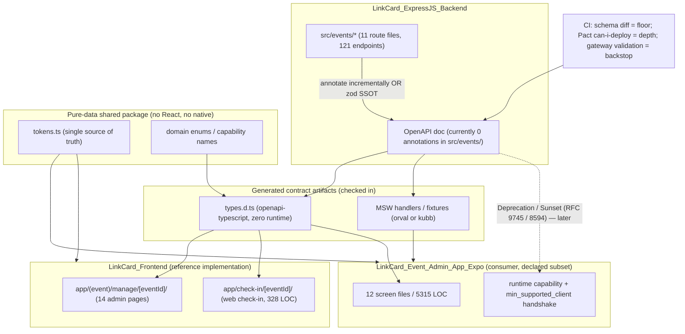

# Industry Research — Companion-App Parity, Contract-First APIs, Expo Sustainability, and On-Site Event Ops

**Loop:** LC-ADMP · **Unit:** Deep Research R1 · **Date:** 2026-10-15
**Scope:** Research questions A1–A3, B1–B3, C1–C4, D1–D3, E1–E2 as specified in the R1 dispatch spec.
**Audience:** An independent reviewer who will treat a fabricated citation as a failure.

---

## 0. Method, source-quality disclosure, and confidence legend

### 0.1 Method

Five search rounds were executed (breadth → structured analysis → gap fill → verification → synthesis), using
semantic web search (Exa), an independent keyword index (Brave) for cross-checking, and arXiv for academic
literature. Primary sources were preferred and, wherever they existed, fetched or read directly (Apple developer
docs, IETF RFCs, Expo docs, MSW docs, Stripe and GitHub API policy docs, Pact/Pactflow engineering posts, vendor
product pages and App Store / Play Store listings).

### 0.2 Source-quality disclosure (read this before trusting any number)

A large fraction of the _comparison_ and _cost_ material that ranks for these queries is vendor or SEO content:
"app development agency" blogs publishing cost bands, "review time tracker" sites, and tool-vendor listicles.
I have **not** silently promoted them. Every claim below carries a confidence tag, and §9 marks each source as
one of:

- **P** = primary (official docs, standards, first-party vendor product/policy pages, first-party engineering post by the team that built it)
- **S** = strong secondary (named author with a described real system; reputable practitioner write-up)
- **W** = weak (vendor marketing, SEO listicle, no verifiable methodology, or undated/unattributed content)

Numbers sourced only from **W** sources are reported as _indicative_, never as fact. Where the only available
evidence is **W**, I say so explicitly rather than laundering it into a confident claim.

### 0.3 Confidence legend

- `[HIGH]` — primary source states it directly, or two or more independent credible sources agree.
- `[MED]` — one credible source, or multiple weaker sources converging, with no contradicting evidence found.
- `[LOW]` — single weak source, or strong source but I could not verify the specific number in it.
- `❓` — question could not be answered with available public evidence.

---

## A. Companion-app parity strategy

### A1. How do teams keep a _secondary_ native ops/admin app in sync with a _primary_ fast-moving web admin app?

**A1.1 The dominant documented pattern is: the backend becomes the capability authority, and clients adapt at runtime.**

The most directly relevant first-party write-up is Plane's "version adaptive mobile client" post `[S, plane.so]`. Their
stated design principle: _"the mobile app makes no assumptions about the backend it connects to. It discovers the
backend's identity and capabilities at runtime and adapts accordingly."_ Three mechanisms:
(1) environment/instance discovery, (2) a _version compatibility engine_ that enforces support boundaries and enables
features **declaratively**, and (3) version-aware API behaviour that selects endpoints and request shapes based on
actual backend capability. Critically, they put the declarations in a **central registry, not scattered across UI
components**, and note honestly that _"feature declarations in the mobile app are maintained manually. Generating
them from backend API contracts or capability manifests would keep the two in sync with less ongoing effort."_
`[HIGH]` for the pattern; `[MED]` that it is "the dominant pattern" — it is the most explicit published articulation
I found, not a surveyed plurality.
Source: https://plane.so/blog/how-we-built-a-version-adaptive-mobile-client-for-self-hosted-cloud-and-air-gapped-deployments

**A1.2 The second pattern is contract-as-artifact: generate the client, and make the build fail on drift.**

A practitioner write-up on hardening the React Native ↔ NestJS contract `[S, amitchakraborty.dev]` describes exactly the
multi-client problem: _"If you are supporting React Native (iOS/Android) and Next.js (Web) simultaneously, you now have
two separate codebases that must remain in sync with a single NestJS backend."_ The author's mechanism: emit OpenAPI as a
**build artifact**, generate a typed client from it, and make the contract check a **pipeline gate** — _"If the frontend
failed to compile due to a type mismatch, the PR was blocked."_ They report cutting release cycles from 2 days to 4 hours
across five production systems. `[MED]` (single-source, self-reported metric; the mechanism is standard and corroborated
elsewhere).
Source: https://amitchakraborty.dev/blog/typed-contracts-between-mobile-and-backend

**A1.3 The multi-repo variant: a release manifest + a published contract + a runtime handshake.**

Ubuntu's community write-up on keeping multi-repo projects in sync `[S, discourse.ubuntu.com]` is the clearest statement of
the three-layer answer for **repos that cannot merge**: (1) a **manifest** pinning which versions ship together, (2) a
**published machine-readable contract** (e.g. `openapi.yaml`) that UI and docs both consume and codegen from, and
(3) a **runtime handshake** for what compile-time checks cannot see. Their compatibility rules are worth quoting because
they are directly applicable:

> - Same major version → compatible.
> - Server minor ≥ UI's expected minor → compatible (the server has at least what the UI needs).
> - UI version ≥ `min_supported_client` → server still supports this UI.

They describe this as "two independent safety nets: one at build time … one at runtime". `[MED]` for the pattern;
`[HIGH]` that the _shape_ of the recommendation (manifest + contract + handshake) recurs across independent sources.
Source: https://discourse.ubuntu.com/t/keeping-multi-repo-projects-in-sync-how-to-stop-ui-api-and-docs-from-drifting-apart/82574

**A1.4 "One API, three clients" — the trap is duplicating domain/permission logic per client.**

A first-person engineering post covering a dashboard + phone app + a hardware turnstile `[S, musfiqdehan.com]` lands on the
sharpest failure-mode statement I found for LinkCard's situation:

> _"On the web, a breaking API change is coordinated: deploy backend and frontend together, done. On mobile, a user
> running a four-month-old build is a normal, common, permanent condition. There is no 'deploy the client.'"_

Their answer: **one resource with explicit field selection**, not one endpoint per client, because _"Three separate
endpoints means three implementations of the same permission logic, and eventually they disagree."_ They also chose
**different transport per client by constraint** (the mobile app deliberately holds no socket; it uses push and refreshes
on foreground) rather than forcing symmetry. `[MED]`
Source: https://musfiqdehan.com/blog/one-api-three-clients

**A1.5 The "thin native shell + web views" pattern, and why 2026 App Review makes it dangerous.**

This is the pattern most tempting for a lagging companion app: wrap the working web admin in a WebView shell.
**Apple explicitly rejects this.** App Review Guideline 4.2 (Minimum Functionality) states: _"Your app should include
features, content, and UI that elevate it beyond a repackaged website. If your app is not particularly useful, unique,
or 'app-like,' it doesn't belong on the App Store."_ `[HIGH]` — primary, Apple's own guidelines.
Source: https://developer.apple.com/app-store/review/guidelines/

Practitioner aggregations of 4.2 rejections converge on the same trigger set: _"< 3 unique screens → very likely to
trigger 4.2"_, _"Single WebView loading an external URL as the primary experience"_, _"No offline functionality"_,
_"completely dependent on network"_ `[W/MED — aggregator blogs, but consistent with the primary rule text]`.
Sources: https://howtopublishanapp.com/policies/apple/4-2/ · https://appstorereject.com/md/rejections/apple/4/guideline-42-design-webview-only-app-with-no-native-functionality · https://github.com/blitzdotdev/app-store-review-agent/blob/main/references/rules/design/minimum_functionality.md

**A1.6 Documented failure modes of a secondary client (synthesis).**

Across the sources above, plus the SDK-scaling and app-sprawl material in §E, the recurring failure modes are:

1. **Silent partial parity.** The secondary client implements a _subset_ and nobody tracks the delta. Contract tests and
   schema diffs are explicitly noted as having a coverage hole here: a schema diff sees every _documented_ operation, but a
   consumer-driven contract only covers paths a consumer actually exercises — _"If no consumer test touches
   `/v1/legacy-report`, it can be deleted … without a single failure"_ `[S, api-contract.com]`.
2. **Duplicated domain rules.** Per-client endpoints re-implement permission/validation logic until they disagree
   `[S, musfiqdehan.com]`.
3. **Drift in the shared visual layer.** Two apps that copy a theme file diverge _silently_; this is the normal
   trajectory, not an accident — a design-system write-up states teams _"start with two separate style systems, and
   they drift apart within a few releases — a color gets tweaked on web and never ported to mobile, or vice versa"_
   `[S, greenlenspro.com]`.
4. **App sprawl / shadow IT.** Internal app proliferation measurably taxes the teams that maintain it: in an IRU survey
   of 1,011 IT/security professionals, _"73% of IT teams spend the majority of their time keeping things running rather
   than making things better"_, and the same survey reports burnout rising with tool count `[W/MED — vendor survey,
method disclosed, n=1,011]`. Sources: https://www.iru.com/blog/tool-sprawl · https://www.tangoe.com/blog/mobile-tool-sprawl-how-to-clean-up-your-stack-and-cut-costs-by-20/
5. **Platform-review coupling.** A store-gated client cannot be fixed in 20 minutes; see A3.

**A1.7 Escalation path when a client genuinely lags: degrade gracefully, do not fail silently.**

The Plane post's fallback design is the one worth copying: capability metadata is discovered and **cached**, and when the
backend cannot be reached the client falls back to its own compatibility rules rather than assuming capability
`[S, plane.so]`. The Ubuntu post adds the runtime handshake (`min_supported_client`) so an _incompatible_ pair is
reported to the operator instead of corrupting data `[S, discourse.ubuntu.com]`.

### A2. Is a native app justified vs a PWA / mobile web for on-site event operations?

**A2.1 Where native wins is narrow and specific — and it is not "admin screens".**

The convergent list across five independent sources is: **NFC/Bluetooth hardware access, background execution/background
sync, continuous background location, reliable push on managed iOS devices, and App Store discoverability.** `[MED-HIGH]`

- _"Web Bluetooth and Web NFC are not implemented in Safari at the time of writing, so any iOS requirement here points
  to native."_ `[S — koddelta.com]` https://koddelta.com/en/blog/pwa-or-native-app
- _"Safari keeps the local data of a PWA that sits on the home screen, but in the regular browser storage can be cleared
  after 7 days without use. For apps where offline data is sacred, that matters."_ `[S — rabzi.nl]`
  https://rabzi.nl/en/blog/pwa-vs-native-app
- Background sync: _"A PWA can queue writes while the user is actively in the app. When the user backgrounds the app or
  locks the device, the service worker has a narrow and unreliable execution window. On iOS, background execution for
  PWAs is particularly restricted."_ `[S — mobile.wednesday.is]`
  https://mobile.wednesday.is/writing/native-offline-vs-pwa-field-teams-enterprise-comparison-2026
- _"NFC integration (like tapping phones to wristbands) … web NFC is possible on Android Chrome for certain use cases,
  but on iOS it might still be restricted to native apps."_ `[S — ticketfairy.com (vendor blog, but the technical claim
matches the MDN/Safari position)]` https://www.ticketfairy.com/blog/native-event-app-vs-web-solution-in-2026-do-you-really-need-a-dedicated-mobile-app
- _"Unless your event requires niche features (like AR navigation or Bluetooth beacon check-in), a PWA can handle it."_
  `[S — pressonetwork.com]` https://www.pressonetwork.com/blog/pwa-vs-native-app-for-events-which-do-you-choose-in-2025

**A2.2 Where PWA/mobile web is sufficient — including QR check-in and offline queueing.**

Multiple sources state that **QR scanning via the camera and offline caching/queueing are available on the web**:

- _"Yes. A PWA can open the camera through standard web APIs, take photographs and scan barcodes or QR codes in the
  browser."_ `[S — koddelta.com]`
- _"For more standard features like QR code scanning for check-in, submitting photos … a PWA can handle it."_
  `[S — ticketfairy.com]`
- _"The entry QR code works without signal if the attendee opened the app and their code online before arrival."_
  `[S — eventapp.pl]` https://www.eventapp.pl/en/blog/event-app-without-app-store-pwa/
- _"Offline mode | After loading the app and QR code online first | Depends on the app"_ — i.e. web offline works, with a
  priming requirement `[S — eventapp.pl]`.

**A2.3 Push on iOS is the sharp edge.**

Convergent: iOS web push works **only** when the PWA has been added to the home screen, and has done since iOS 16.4
`[MED-HIGH — three independent sources agree]`.

- _"On Android from the browser and on iOS only once the web app has been added to the home screen."_ `[S — koddelta.com]`
- _"Push notifications have worked since iOS 16.4 only when the user has added the app to the home screen."_
  `[S — rabzi.nl]`
- Enterprise wrinkle: _"Enterprise field teams on company-managed iPhones frequently cannot add PWAs to home screen in a
  managed browser context."_ `[S — mobile.wednesday.is]` — directly relevant if LinkCard's door staff run MDM-managed devices.

**A2.4 Architecture at scale is about the door, not the device class.**

An architecture post-mortem on check-in at 10k-attendee scale `[S, dev.to/stampiq]` argues the decision that matters is
**edge-first vs cloud-first**, not native vs web: _"To guarantee zero wait time, the gate controller must never make a
blocking remote network call during the transaction. The admission decision must happen strictly on local hardware in
under 10 milliseconds."_ Their stack: local SQLite with WAL journaling for offline transaction durability, passive UHF
for throughput, and **conflict-free merge on reconnect** — _"When connectivity restores, thousands of offline
transactions must merge cleanly without primary key collisions or state overwrites."_ `[MED — single source, but the
constraints are physically forced and match the Cvent/Eventbrite offline descriptions in §D]`
Source: https://dev.to/stampiq/why-cloud-first-event-check-ins-fail-at-10k-scale-and-how-we-built-an-edge-first-alternative-20l8

**A2.5 An honesty note on the offline-duplicate rule.**

The only source I found that states an explicit conflict-resolution rule for two doors scanning the same ticket offline
is a vendor build guide `[W — newly.app]`: _"the earliest check-in in the server's order wins, every later scan is stored
as a duplicate rather than dropped, and each device shows the conflict the next time it is online."_ I could **not** find
an authoritative (primary/vendor-doc) statement of this rule; treat it as a reasonable heuristic, not an industry
standard. ❓ for "what is the industry-standard offline duplicate rule".
Source: https://newly.app/build/event-check-in-app

### A3. App Store / Play Store release cadence in 2025–2026, and how teams mitigate it

**A3.1 Apple's own published figure, and the disagreement about it.**

Apple's long-standing public position is that **90% of submissions are reviewed within 24 hours** `[HIGH — Apple's own stated figure: https://developer.apple.com/app-store/review/]`. One 2026 tracker claims Apple gave different figures in July 2026 to a media outlet:
**90% within 48 hours, average ~1.5 days**, processing 200,000+ submissions/week `[LOW — I could not verify the primary
statement; reported second-hand by kkm-mako.com]`.
Sources: https://kkm-mako.com/en/blog/articles/app-store-review-delay-vibe-coding-crisis/ · (a second cited source was truncated to `animalz…` in the original and is removed — review finding V-13)
**→ Recorded as a genuine disagreement; see §8.**

**A3.2 Independent measurements, which are more useful than the averages.**

The most credible measurement I found is a developer who published **91 of their own submissions** between April and
September 2026 `[S — first-party dataset, method and distributions disclosed]`:

| Step                           | Median | Half of cases between | 9 in 10 under |
| ------------------------------ | ------ | --------------------- | ------------- |
| Waiting for Review → In Review | 19.6 h | 15 – 50 h             | 93 h          |
| In Review → decision           | 36 min | 6 min – 2.2 h         | 22 h          |
| Submit → decision              | 24.4 h | 18 – 66 h             | 143 h         |

Their key operational finding: _"one rejection costs about two days, not one"_ — 23 of 61 decisions were rejections, almost
all first versions. `[MED-HIGH]`
Source: https://teroxai.com/blog/app-store-review-time-2026/

Corroborating shape from other trackers: update median ~20 h, p90 ~48 h, outlier 5–7 days; new submissions ~30 h median,
p90 ~72 h `[W — appstorereview.app, no disclosed methodology]`.
Sources: https://appstorereview.app/guides/app-store-review-times-2025 · https://appstorereview.app/guides/app-store-review-time-variance-factors

**A3.3 Google Play's hidden gate is not review time — it is the closed test.**

Multiple sources state that **new personal developer accounts must run a closed test with at least 12 testers opted in
for 14 continuous days before production access** (down from 20 testers, reportedly changed December 2024) `[MED —
consistent across sources, but the primary Google policy page was not fetched; treat the tester count as
MED, the existence of the gate as HIGH]`.
One source adds that from April 2026 Google also checks the testers actually _use_ the app `[LOW]`.
Sources: https://www.zarleinfotech.com/blogs/zb-0068-app-store-vs-play-store-review-time · https://dev.to/lucas_martin_8cb158b9a81b/eas-submit-in-2026-what-it-automates-what-it-doesnt-and-the-release-pipeline-that-covers-both-1m2d

**A3.4 The 2025–2026 mitigation stack (this is the practically important part).**

Four mechanisms, in descending order of impact:

1. **OTA for JS/assets.** CodePush is gone (App Center retirement, 2025), so the React Native answer is **EAS Update**
   `[MED-HIGH — the CodePush retirement is well documented; the "EAS Update is the RN path" conclusion is stated
explicitly by a 2026 source]` — _"Since Microsoft's CodePush shut down in March 2025, the path for React Native is
   Expo EAS Update."_ Source: https://www.zarleinfotech.com/blogs/zb-0068-app-store-vs-play-store-review-time
   Expo's own docs describe EAS Update as updating _"non-native pieces (such as JS, styling, and images)
   over-the-air"_ `[P]` https://docs.expo.dev/eas-update/introduction/
2. **Runtime-version gating so you cannot brick users.** This is the mechanism that makes OTA safe: _"The
   'runtimeVersion' property allows us to guarantee that an update is compatible with a specific build's native code"_
   `[P — Expo docs]` https://docs.expo.dev/eas-update/runtime-versions/ . Expo also states the rule for when to bump it:
   _"Any time you change the native runtime (… you add or remove a native library, or modify app.json), you should
   increment the runtime version."_ `[P]` https://docs.expo.dev/build/updates/
   The failure mode this prevents is stated crisply by a third party: _"Adding a library that is mostly JavaScript but
   registers a native module will publish happily and then crash on launch for every user who receives it, because the
   native side it calls into does not exist in their installed binary."_ `[S, shipnative.dev]`
   https://www.shipnative.dev/blog/expo-ota-updates
3. **Gradual rollout + rollback.** Expo's own guidance: _"If you're not sure about the impact of a new update, you can
   roll it out to a small group of users first. Use rollouts to publish the update to a small percentage of users and
   monitor the error rate"_ `[P]` https://docs.expo.dev/eas-update/runtime-versions/
4. **Remote config / feature flags / minimum-supported-version.** Covered in A1 (capability manifest) and B3
   (`Deprecation`/`Sunset`).

**A3.5 The two hard limits of OTA every source agrees on.**

- OTA **cannot** change native code: _"Changes that modify native code (new native module, permission changes, SDK or
  runtime version bump) still require a full build via EAS Build and store submission."_ `[S — pineido.com]`
  https://pineido.com/react-native-to-expo/
- OTA **does not bypass store policy**: _"OTA bypasses the review queue, not the store content rules, so a change that
  alters what your app does still has to comply."_ `[S — pineido.com]`
- Practitioner consensus in 2026 is that _"Apple and Google have both tightened the screws on what you can change OTA"_
  `[S — 72technologies.com]` https://www.72technologies.com/blog/expo-eas-ota-updates-without-bricking-production

**A3.6 "Release train" as the actual fix.**

The most useful framing found: _"The right goal isn't faster reviews — you don't control review speed. The goal is making
review latency irrelevant to your emergencies. Reserve the store pipeline for what genuinely needs it (native changes,
big feature launches) and keep a controlled fast path for compatible changes."_ `[S — bettercodepush.com]`
https://bettercodepush.com/blog/app-store-review-times-2026

---

## B. Contract-first / drift prevention

### B1. Making a multi-client Express+TS API machine-readable, and generating clients from it

**B1.1 The current tool landscape, grouped by what you actually get.**

| Tool                        | Output                                                                          | Runtime validation                                     | Notes / fit for Express                                                                   | Source quality               |
| --------------------------- | ------------------------------------------------------------------------------- | ------------------------------------------------------ | ----------------------------------------------------------------------------------------- | ---------------------------- |
| `openapi-typescript`        | Type-only `.d.ts` (`paths` type). **Zero runtime.**                             | No                                                     | Generate from any OpenAPI 3.x doc; pair with `openapi-fetch`                              | **P** (official repo README) |
| `openapi-fetch`             | ~**6 kb** typed `fetch` wrapper, ~zero runtime                                  | No                                                     | _"thin wrappers around the native fetch API"_                                             | **P**                        |
| `orval`                     | Types + fetch/axios client + **TanStack Query/SWR hooks** + **MSW mocks** + Zod | No (but emits Zod)                                     | One config → whole API layer                                                              | **P** (orval.dev docs)       |
| `kubb`                      | Plugin-based: types, clients, MSW, Zod                                          | No                                                     | Max flexibility; smaller community                                                        | W/S                          |
| `ts-rest`                   | Contract authored in TS → emits OpenAPI                                         | Yes (via Zod)                                          | Framework-agnostic; _"works with any HTTP server (Express, Fastify, Next.js API routes)"_ | S                            |
| `express-openapi-validator` | —                                                                               | **Yes** — validates requests against a spec at runtime | Express-native runtime gate                                                               | S                            |
| `ts-openapi-express`        | —                                                                               | Yes                                                    | Express integration typing handlers against generated `paths`                             | P (npm)                      |
| `@hono/zod-openapi`         | Zod → spec, **"always in sync"**                                                | Yes                                                    | Requires moving off Express                                                               | S                            |

Sources (primary): https://github.com/openapi-ts/openapi-typescript/blob/main/packages/openapi-fetch/README.md ·
https://orval.dev/docs/index.html.md · https://www.npmjs.com/package/ts-openapi-express
Sources (secondary): https://www.nazarboyko.com/articles/building-a-type-safe-full-stack-app-with-openapi-instead-of-trpc ·
https://npm-compare.com/@nestjs/swagger,@ts-rest/core,express-openapi-validator,openapi-typescript,swagger-ui-express ·
https://www.pkgpulse.com/guides/orval-vs-openapi-typescript-vs-kubb-openapi-client-2026 ·
https://www.pkgpulse.com/guides/swagger-ui-express-vs-hono-zod-openapi-vs-fastify-2026

**B1.2 The dimension that matters most for a jsdoc-flavoured Express codebase: incremental adoption.**

The single most important finding for LinkCard's backend — which already has `swagger-jsdoc` wired with 48 annotations
repo-wide but **zero in `src/events/`** — is that the ecosystem supports **partial adoption**.
`openapi-typescript` and `orval` consume _a document_; they do not care whether that document is hand-written, jsdoc-derived,
or generated by a Zod SSOT. So an incremental path exists: annotate one route file, publish one spec fragment, generate one
typed client. `[MED-HIGH — this follows directly from the tools' documented inputs; I did not find a case study of a
partial jsdoc migration to cite, so this is inference from primary docs, and is marked as inference.]`

**B1.3 Why "types only" is often the right starting point.**

`openapi-fetch` is ~6 kb with _"virtually zero runtime"_ `[P]`, so it can be dropped into both the Next.js admin and the
Expo app without bundle or perf arguments. Orval is the upgrade path when you want hooks/mocks generated: _"start with
openapi-typescript and openapi-fetch for simplicity, upgrade to Orval when React Query integration becomes important"_
`[S — pkgpulse]`.

**B1.4 The journalistic caveat: generated clients are not a panacea, and one well-made benchmark says so.**

A benchmark from Pagopa (Italian public digital payments) tested TypeScript generators against their real specs and
concluded bluntly: _"As of Jun 2024, no OpenAPI generator fully meets our guiding principles."_ They found constraint
fidelity loss across the board (regex `pattern`, numeric `min`/`max`), and noted `openapi-zod-client` was immature
`[S — named engineering team, published methodology]`. They also noted `openapi-io-ts` was unmaintained and `autorest`
would not start. **This is a genuinely useful counterweight** to the listicle consensus.
Source: https://dx.pagopa.it/blog/typescript-openapi-generators-0.1-alpha

Another source claims `openapi-fetch` "itself is in maintenance mode" `[LOW — single vendor-adjacent comparison page;
I could not corroborate this and the package README shows active usage guidance; treat as unverified]`.
Source: https://openapi.codewithagents.de/comparison/

**B1.5 The 2026 recommendation from a practitioner synthesist.**

_"If you have a mobile client, multiple frontends, partner integrations, or a public API on the roadmap, start with ts-rest
or an OpenAPI-first approach. The migration cost from tRPC to OpenAPI later is real, and it always happens at the worst
time."_ `[S — supik.digital]` https://supik.digital/sk/type-safe-apis-end-to-end
This is the strongest available argument **against** tRPC-for-LinkCard: the mobile client is exactly the condition that
makes tRPC the wrong bet.

### B2. Contract testing across repos: what actually prevents "frontend updated, app left behind"

**B2.1 The decisive finding: schema-diff and consumer-driven contracts are complementary, not substitutes.**

The clearest analysis separates them by _what they can see_ `[S — api-contract.com]`:

|                              | Schema diff                     | Consumer contract test                         |
| ---------------------------- | ------------------------------- | ---------------------------------------------- |
| Compares                     | two documents                   | recorded expectations vs a **running** service |
| Coverage                     | every operation in the document | only paths a consumer exercises                |
| Sees behaviour               | no                              | yes                                            |
| Needs a running service      | no                              | yes                                            |
| Runtime                      | seconds                         | minutes                                        |
| Catches implementation drift | no                              | partially                                      |

And it names the exact class of change that a diff misses: _"a changed default, a reversed sort order, a new validation
rule enforced in code, or an error identifier that was reworded, because none of those are expressed in the document.
Those are exactly the changes that pass review, pass CI, and break a consumer at deploy time."_ And the reverse hole:
_"If no consumer test touches `/v1/legacy-report`, it can be deleted, renamed or have every field removed without a single
failure — while a diff reports it immediately."_ Their conclusion: _"The two techniques overlap so little that running both
is closer to addition than to duplication."_
Source: https://www.api-contract.com/versioning-and-deprecation/breaking-change-detection/contract-tests-vs-schema-diffs/

**B2.2 Pact / CDC: how it works and what `can-i-deploy` adds.**

The mechanism, per multiple independent sources: the consumer writes a test that records what it actually expects
(HTTP exchanges + matchers) → that becomes an immutable **pact file** published to a broker → the provider's CI replays
every published pact against the real API → `can-i-deploy` blocks a deployment if the provider version is incompatible
with consumer versions **currently running in production** `[MED-HIGH]`.
Sources: https://tinycto.tv/learn/api-breaking-change-contract-testing-and-consumer-driven-pacts ·
https://assertqa.com/blog/contract-testing-for-apis

Pact's own framing of the value proposition is unusually specific and worth citing: _"a consumer-driven contract records
what a specific client actually depends on, which is usually a small subset of what the document permits. That
specificity is the value: the provider learns which of its documented promises are load-bearing."_ `[MED]`
Source: https://www.api-contract.com/versioning-and-deprecation/breaking-change-detection/contract-tests-vs-schema-diffs/

**B2.3 The specific Pact↔OpenAPI collision — nullable optional fields.**

A comparison of the two tools identifies a real, non-obvious integration trap: _"When a frontend team writes a Pact
interaction without explicitly mapping a nullable field to `MatchersV3.nullValue()` in `@pact-foundation/pact` v12+, the
verifier defaults to strict type matching. If the live backend returns `null`, the verifier rejects it as a type violation
even if the OpenAPI spec explicitly permits `null`."_ `[S — specific versioned claim; plausible and actionable, but
single-source]`
Source: https://www.api-contract-testing.com/api-contract-fundamentals-tool-selection/consumer-driven-contracts-with-pact/pact-vs-openapi-for-frontend-backend-integration/

**B2.4 The pragmatic tri-layer gate that the sources converge on.**

1. **Schema diff as the cheap floor**, on every PR touching the API definition: _"It catches the obvious cases (a removed
   field, a type change, a newly required field) in seconds, on every PR, before a slower contract or end-to-end run even
   starts. Layer it in front of contract testing as a first filter, not instead of it."_ `[S — assertqa.com]`
2. **CDC verification for the paths that matter** (Pact + broker + `can-i-deploy`).
3. **Runtime enforcement at the edge** for consumers that never onboarded: gateway schema validation. _"CDC gives
   precise, consumer-specific feedback in CI; the gateway is the enforcement backstop for the traffic CDC's known-consumer
   set does not cover — third-party integrators, ad-hoc scripts, and consumers that never onboarded to the broker."_
   `[S — request-routing.com]` https://www.request-routing.com/advanced-routing-api-versioning/backward-compatibility-contracts/consumer-driven-contract-testing-at-the-gateway/

**B2.5 Pactflow's own admission about the gap, and the tool they shipped for it.**

Worth recording because it is a vendor critiquing its own category: _"BDCT could tell you whether your spec was compatible
with consumer expectations. It couldn't verify that your running service actually matched the spec it was being compared
against. The provider side still had no enforcer."_ They shipped `Drift` to do _"deterministic, automated checks to verify
whether your API implementation actually conforms to its OpenAPI definition"_ `[S — first-party vendor engineering post;
note the commercial interest]`.
Sources: https://pactflow.io/blog/schemas-can-be-contracts/ · https://pactflow.io/blog/contract-testing-using-json-schemas-and-open-api-part-3/

**B2.6 The honest answer to "what actually prevents the app being left behind".**

No single mechanism. The sources' combined answer is: **(a)** a _checked-in generated client_ makes the lag _visible at
compile time in the lagging repo_ — but only if that repo builds against the new spec; **(b)** a _schema diff in CI_
makes the lag _visible in the provider repo_ — but only for structural changes; **(c)** _CDC + `can-i-deploy`_ makes the
lag _block deployment_ — but only for consumers who published a pact. For a **separate repo whose CI does not build against
the producer's spec**, none of (a)–(c) fires by default. This is the structural gap most relevant to LinkCard, and it is
an inference from the sources' stated coverage models rather than a directly quoted claim. `[MED — inference, flagged]`

### B3. API evolution policy for lagging clients

**B3.1 The standards are real, and they are two, not one.**

- **RFC 8594 — The `Sunset` HTTP Header Field** `[P]`. It is explicit that `Sunset` is **stage two**, i.e. decommissioning:
  _"the first stage being that the API is not the preferred or recommended version anymore and the second stage being that
  the API or a specific version of the API gets decommissioned. For the first stage … the Sunset header field is not
  appropriate: at this stage, the API remains operational and can still be used."_
  https://datatracker.ietf.org/doc/html/rfc8594
- **RFC 9745 — The `Deprecation` HTTP Response Header Field** `[P]` — the stage-one signal, defined as a timestamp:
  `Deprecation: @1688169599`. https://www.rfc-editor.org/rfc/rfc9745.html
- The ordering rule between them is normative and worth quoting: _"The timestamp given in the `Sunset` HTTP header field
  MUST NOT be earlier than the one given in the `Deprecation` header field."_ `[P]`
  https://datatracker.ietf.org/doc/rfc9745/
- There is also a `deprecation` **link relation** for pointing at migration docs `[P]` (same RFC).

**B3.2 Additive-only rules, as practised by two of the most-followed API teams.**

Stripe `[P]` — a documented, enumerated compatibility contract:

> _"Stripe considers the following changes to be backward-compatible: Adding new API resources. Adding new optional
> request parameters to existing API methods. Adding new properties to existing API responses. Changing the order of
> properties in existing API responses. Changing the length or format of opaque strings, such as object IDs, error
> messages, and other human-readable strings."_

And their versioning cadence since 2024-09-30: **monthly releases with no breaking changes**, plus **twice-a-year major
releases** that may break. _"You can safely upgrade to any monthly release without updating your code."_ They also design
for lag: _"Design your integration to ignore unfamiliar fields and event types."_
Sources: https://docs.stripe.com/api-versions · https://docs.stripe.com/api/versioning · https://github.com/stripe/openapi

GitHub `[P]` — date-based API versions (`2026-03-10`) with an explicit breaking-change taxonomy:
_"Removing an entire operation · Removing or renaming a parameter · Removing or renaming a response field · Adding a new
required parameter · Making a previously optional parameter required · Changing the type of a parameter or response field ·
Removing enum values · Adding a new validation rule to an existing parameter · Changing authentication or authorization
requirements."_ Plus: _"Breaking changes will be released in a new API version. We will provide advance notice."_
Source: https://docs.github.com/en/rest/about-the-rest-api/breaking-changes

**B3.3 Path versioning vs header versioning.**

I did not find a source in this batch that argues header versioning beats path versioning on merit; what the primary
sources show is convergence on **coexistence**: GitHub uses a date-stamped **header** (`X-GitHub-Api-Version`) _and_ keeps
path stability; Stripe uses **account-pinned versions plus per-request override** (`Stripe-Version`). `[MED — inferred
from the two primary policy docs rather than stated as a rule by either.]` The `Deprecation`/`Sunset` pair works with
either scheme, which is the practical argument for using them regardless. `[MED]`

**B3.4 Detecting a stale client is the part with the weakest public guidance.**

The mechanisms implied by the sources are: (a) `Deprecation`/`Sunset` response headers tell the _client_ it is stale;
(b) `min_supported_client` in a manifest tells the _server_ that a client is stale `[S — discourse.ubuntu.com]`;
(c) a capability/version handshake at session start `[S — plane.so]`. What I did **not** find is a published,
widely-used **telemetry** pattern for measuring "how many live clients are on API contract version X". ❓ — this is a
genuine gap in public guidance, and it is the mechanism LinkCard would most need.

---

## C. Expo / React Native sustainability 2026

### C1. Sharing design tokens + types + API client between two Expo apps (and optionally Next.js)

**C1.1 Expo's first-party position is unambiguous: use a workspace, and Metro is already handled.**

Expo's own documentation `[P]`:

- _"Expo has first-class support for monorepos managed with package managers supporting workspaces: Bun, npm, pnpm, and
  Yarn (v1 Classic and Berry). Expo automatically detects monorepos and configures new app projects added to a monorepo."_
- _"Expo's Metro config has built-in monorepo support … You don't have to manually configure Metro when using monorepos
  if you use the config from `expo/metro-config`."_
- If you _do_ customise, the documented shape is `watchFolders = [monorepoRoot]` plus `resolver.nodeModulesPaths` listing
  the project `node_modules` then the monorepo root `node_modules` — **in that order, because order determines resolution
  precedence.**
  Source: https://docs.expo.dev/guides/monorepos

**C1.2 The lowest-friction setups that do NOT require "converting to a full monorepo".**

Ranked by invasiveness, with the evidence for each:

1. **Per-app `file:` / `workspace:` dependency on a shared package, no root workspace.** A documented pattern is a
   **pnpm workspace + git submodule**, where the external repo is added as a submodule and referenced with the
   `workspace:*` protocol `[S]`. This gives you a shared package _without_ merging repos, at the cost of submodule
   ergonomics. The author lists the trade-off honestly: submodules suit repos you can contribute to; for repos you cannot
   modify, you must fork. Source: https://boda.sh/blog/pnpm-workspace-git-submodules/
2. **Metro `extraNodeModules` + `watchFolders` pointing at an out-of-tree package.** This is the documented workaround when
   a package lives outside the project root and cannot be a workspace. The crucial part is that you **must also alias
   `react` and `react-native` themselves** back to the app's copies: _"make sure that `react` and `react-native` are also in
   the `extraNodeModules`"_ `[S — facebook/metro issue #1225, via the maintainers' issue tracker]`. Without that, you get
   the classic duplicate-React failure. Source: https://github.com/facebook/metro/issues/1225
3. **Publish a private npm package.** Cleanest at runtime, slowest iteration (needs publish per change).
4. **Full workspace monorepo.** Lowest friction _once adopted_ per Expo's docs, highest migration cost.

**C1.3 The mechanism that breaks all of the above, stated by Expo.**

Expo's `fyi` dependency-resolution document explains the exact failure: _"Runtime issues happen when a package has been
written to act as a singleton. … A common example is the `react` package."_ And for native modules: _"Native linking
issues happen because of autolinking. … When compiling the native app, only one version of any native module can be
present. However, this is in direct conflict with normal Node.js resolution, which can access duplicate versions of
packages that contain native modules."_ `[P — Expo docs]`
Source: https://github.com/expo/fyi/blob/main/resolving-dependency-issues.md

**C1.4 The token-sharing pattern that avoids the whole problem.**

Because a **pure data package** (tokens as plain TS objects) has no React dependency and no native module, it is the one
thing that can be shared across Next.js + RN without any of the resolution/hoisting/autolinking hazards `[MED — inferred
from the Expo failure modes above, and consistent with the token-package sources in C2]`.

### C2. Sharing a React Native UI kit vs sharing only tokens

**C2.1 The published split.**

- **Share tokens, not components**, when the consumers include both web and native: _"A cross-platform design system
  shares one set of design tokens — colors, spacing, radii, typography — between a Next.js web app and a React Native
  mobile app by keeping tokens as plain, platform-agnostic TypeScript objects. A parser step turns those objects into CSS
  custom properties for the web stylesheet and into frozen JavaScript constants consumed by React Native's
  `StyleSheet.create`."_ `[S, greenlenspro.com]`
  https://greenlenspro.com/blog/cross-platform-design-system-tokens
- **Share components** only inside RN-only or framework-unified stacks. Tamagui's documented approach requires the design
  system to _"live in its own npm module"_ and to be wired into **both** a web bundler (`tamagui-loader`, with
  `sideEffects` needed or _"webpack will remove the generated CSS in production"_) **and** `metro.config.js` via
  `withTamagui` `[P — Tamagui docs]`. That is two build systems to keep in sync — a real cost.
  https://tamagui.dev/docs/guides/design-systems

**C2.2 The pitfalls, enumerated.**

1. **Dual React / "Invalid hook call"** — from a linked package carrying its own `react` in `node_modules`. A toolkit
   exists purely to automate stripping that. `[S]` https://github.com/niceprototypes/nice-toolkit
2. **Metro cannot resolve out-of-root packages by default; symlinks are a known sharp edge** — one reporter found the
   Windows target broke and needed `@rnx-kit/metro-resolver-symlinks` (`[S]` facebook/metro #1225).
3. **Autolinking allows only one native module version** (`[P]` Expo fyi).
4. **Token build ordering** — _"The tokens package must build before anything that depends on it. Monorepo task runners
   handle this automatically if configured correctly."_ `[S]` https://framingui.com/blog/sharing-design-tokens-monorepo
5. **Platform-specific output formats** — web wants CSS vars, iOS wants Swift, Android wants XML; Style Dictionary is the
   named standard tool `[S]`.
6. **EAS build**: Expo documents that updates must satisfy the runtime-version contract (C1/A3), so a shared **native**
   module invalidates OTA compatibility for every consumer app simultaneously `[P]` — a real coupling cost of sharing
   native code between two Expo apps.

### C3. Testing a RN app that consumes a remote API on a lagging release cycle

**C3.1 The best-supported primitive is MSW — and Expo/RN support is a first-class, documented path.**

MSW's own docs `[P]` describe two generations:

- **Classic (`msw/native`)**: _"In React Native, import `setupServer` from `msw/native`. The `/native` export contains
  pre-configured interceptors relevant for the React Native environment."_ Requires polyfills
  (`fast-text-encoding`, `react-native-url-polyfill/auto`) because _"MSW relies on standard JavaScript classes that are
  not present in React Native, like `URL`."_ Common error documented with its fix: `Unable to resolve module http` →
  you imported `msw/node` instead of `msw/native`.
  https://mswjs.io/docs/integrations/react-native/
- **Current (`@msw/react-native`)**: _"The `msw/native` export has been removed from MSW. React Native is now supported
  through the `@msw/react-native` package."_ It intercepts `fetch` and `XMLHttpRequest` and _"installs the standard APIs
  that MSW needs but React Native lacks"_, so **no polyfills needed**. Ordering rule is explicit: _"Always import
  `@msw/react-native` before importing anything from `msw`."_
  https://mswjs.io/guides/integrations/react-native

**C3.2 The friction is real, not theoretical.**

A Detox maintainer's own answer in the Detox issue tracker: _"I don't have experience using MSW, so I am unable to
provide advice on how to set it up for your Detox tests."_ The reporter's resolution was mundane but instructive —
a missing `whatwg-fetch` import in the Jest environment. `[S — primary issue thread, including maintainer's candour]`
https://github.com/wix/Detox/issues/3808

**C3.3 The "record and replay per flow" pattern fits a lagging client unusually well.**

A tool that does exactly this for Maestro + WireMock: _"Each flow gets its own stub directory … one-command workflow for
recording and playback … Automatic image localization for offline playback."_ Their Maestro flows pass `BASE_URL` and an
`IS_E2E` flag at launch, so the app under test points at the stub server. `[S — real tool, documented flags and outputs]`
https://github.com/engenious-inc/maestro-stub-recorder

**C3.4 Contract fixtures from the spec (the layer that ties C3 back to B).**

Kubb and Orval both document **MSW mock generation from the OpenAPI spec** `[S]` — meaning the _same_ artifact that types
the client can generate the fixtures the tests run against. `[MED-HIGH — capability is documented by both projects;
whether it fully covers LinkCard's 14 endpoints is a task-level question, not a research one.]`
Sources: https://www.pkgpulse.com/guides/orval-vs-openapi-typescript-vs-kubb-openapi-client-2026 · https://orval.dev/docs/index.html.md

**C3.5 What I could not establish.**

I found no credible published **visual-regression** standard for RN in 2026 (no first-party guidance from Expo/RN, no
methodological study). The tool names that appear (Maestro, Detox) appear without comparative evidence. ❓ for
"recommended visual regression approach for RN, with evidence".

### C4. Accessibility and i18n expectations for a 2026 production RN ops app

**C4.1 Android/Play: there are concrete, numeric, testable requirements.**

Android's own accessibility guidance and the **core app quality guidelines** specify `[P]`:

- _"we recommend that each interactive UI element have a focusable area, or touch target size, of at least 48dp x 48dp."_
  https://developer.android.com/guide/topics/ui/accessibility/apps
- Contrast, from the quality guidelines table: _"App text and foreground content maintain the following contrast ratios
  with the app background: 3:1 for large text and graphics; 4.5:1 for small text (less than 18 pt or less than 14 pt if
  text is bold)."_ https://developer.android.com/docs/quality-guidelines/core-app-quality
- _"Describe each UI element, except for `TextView`, using `contentDescription`."_ (same page)
- Labels must convey **purpose, not visual detail**, and must be unique per list item: _"each item within a list such as
  `LazyColumn` should have a different description."_ https://developer.android.com/guide/topics/ui/accessibility/principles

**C4.2 Apple: "Larger Text" is now a _declared App Store attribute_, with a stated threshold.**

Apple's App Store Connect accessibility evaluation criteria `[P]`:
_"Many accessibility guidelines recommend allowing users to enlarge text to 200% or larger than the default size.
Dynamic Type on iOS, for example, reaches sizes larger than 200% at the AX3 size, and allows body text sizes over 300% at
the AX5 size."_ And: _"You can indicate that your app supports Larger Text if users can enlarge text to at least 200% or
the maximum font size for the system."_ Note also the practical caveat Apple itself raises: _"some features, like Tab Bars,
don't grow with dynamic text"_ → use the **Large Content Viewer**.
Sources: https://developer.apple.com/help/app-store-connect/manage-app-accessibility/larger-text-accessibility-evaluation-criteria/ ·
https://developer.apple.com/help/app-store-connect/manage-app-accessibility/larger-text-evaluation-criteria/

**C4.3 i18n: the evidence is thinner than I expected, and I will not overstate it.**

I found no first-party Apple or Google _requirement_ for a minimum number of localisations (beyond metadata/localized
listing fields). The concrete, citable observation I do have is from a storefront listing: Eventbrite Organizer advertises
being _"also available in German, French, Italian, Dutch, Portuguese, Swedish, and Spanish"_ `[P — App Store listing]`
https://apps.apple.com/us/app/eventbrite-organizer/id368260521 — i.e. a directly comparable on-site ops app ships **7+
locales**. `[MED — one comparable, but a strong one.]`
❓ for "minimum i18n expectations Apple/Google require of a production ops app" — no such requirement found.

**C4.4 The relevance-to-ops note that matters for a door app.**

C4.1's 48dp/contrast/`contentDescription` rules and C4.2's 200% text rule are **not stylistic** for an on-site app: door
staff work one-handed, often in poor venue lighting, and Apple's Largest-Text criterion explicitly tests for
_"truncated or overlapping text"_ at the largest sizes — which is exactly what a dense admin table ported to a phone does
at AX5. `[MED — reasoning from primary criteria to the ops context.]`

---

## D. Domain: on-site event operations apps

### D1. Feature inventory — what lives in the native app vs the web admin, and why

**D1.1 Cvent (the most fully documented comparable).**

Cvent's own product pages and support docs `[P]` describe the native app (**OnArrival**) and its Console separately:

- Native app (OnArrival), per Cvent's support article: _"Check in and register attendees onsite. You can search through your
  attendee list by name or email, filter by registration type, or scan a barcode. … Register walk-ins on the spot. Process
  onsite payments. … Use the app offline. … Just log in and select your event online before reaching the venue."_
  `[P — first-party support doc]` https://support.cvent.com/articles/en_US/Topic_Hub/Meet-Our-OnArrival-Check-In-App
- Data sync cadence, stated explicitly: _"Data automatically syncs with Cvent every 10 minutes."_ And a platform-parity
  admission: _"Some features are not yet available for OnArrival Android. Depending on your check-in needs, consider using a
  compatible iOS device instead."_ `[P — same doc; this is a striking, verifiable example of a major vendor shipping a
secondary client with unclosed parity, exactly LinkCard's class of problem.]`
- Premium tiering gates the heavier features: _"consider upgrading to OnArrival Premium or OnArrival 360. You'll enjoy a
  host of additional features once you make the leap, including badge printing, signature collection, kiosk mode, and
  session tracking."_ `[P]`
- Web/console side: on-demand badge printing is described as a Cvent _Onsite Solutions_ capability, and _"Self-service
  options, such as portable check-in kits, are designed for smaller or recurring events."_ `[P]`
  https://www.cvent.com/en/event-marketing-management/onarrival-event-check-in-software
- Scale claim, useful as an order-of-magnitude: OnArrival _"has processed over 9 million event and session check-ins at
  thousands of events"_ since 2013 `[P — Play Store listing, first-party]`
  https://play.google.com/store/apps/details?id=com.cvent.onarrival

**D1.2 Eventbrite Organizer (the closest shape to LinkCard's admin app).**

`[P — first-party help centre and feature pages]`:

- Scope: _"check-in attendees, sell tickets, and manage your event onsite"_; plus _"manage orders with reissues,
  cancellations, and refunds on the spot"_ and _"Track ticket sales in real-time"_.
- **Real-time multi-device sync**, stated as preventing duplicates: _"Run check-in on multiple devices simultaneously. The
  app syncs data automatically, so every team member has the most up-to-date attendee list, preventing duplicate entries."_
- Multi-locale shipping (see C4.3).
- Roles/permissions are handled via **team management** with role-scoped actions — described in the help centre, not as an
  in-app admin console.
  Sources: https://www.eventbrite.com/help/en-us/articles/883605/set-up-the-organizer-app-on-your-phone-or-tablet/ ·
  https://www.eventbrite.com/features/check-in-app/ · https://www.eventbrite.com/organizer/features/organizer-check-in-app/ ·
  https://www.eventbrite.com/blog/onsite-operations-tools-eventbrite/ · https://apps.apple.com/us/app/eventbrite-organizer/id368260521

**D1.3 Bizzabo Onsite Command (a genuinely feature-heavy companion app — the counterexample).**

The App Store description is unusually explicit about the split between **app** and **dashboard** `[P — first-party
listing]`: _"Input attendee data and event settings in the organizer dashboard (Command Center) before the event, and track
progress in real-time during your event."_ Native-side features claimed:

- self-serve **and** staff-served check-in, QR scanning
- _"Add and track custom attendee consent form during the onsite check-in process"_
- _"Manage and control access to sessions with ease"_
- _"Offer wireless and on-demand badge printing"_
- _"Offer **offline** check-in and badge-printing service"_
- _"support for lead retrieval and contact exchange QR codes"_
- **wearables**: the release notes reference _"wearable discovery"_, _"continuous sync of wearable pairs"_, _"touch …
  pairing flow"_ — i.e. NFC/RFID wristbands managed from the app.

**This is the single most important data point for question D3**: a major commercial vendor _does_ ship badge printing,
session access control, consent capture, lead retrieval, **and** wearable pairing in one native app. So "large native
admin surfaces are inherently a maintenance trap" is **not** supported by the market evidence — Bizzabo ships it.
Source: https://apps.apple.com/us/app/bizzabo-onsite-command/id1616390164

**D1.4 Third-party comparison sites (weak, reported as weak).**

Software-review aggregators place these products in an "**On-Site Event Management**" category covering _"venue selection,
floor plan design, badging, and check-in logistics"_ `[W — infotech.com]`. A feature-count comparison of Cvent vs Swapcard
claims _"Onsite Operations (0 vs 9)"_ for Cvent including _"Onsite Check-in and Badge Printing"_ `[W — saasipedia; the
"0" is transparently wrong given Cvent's own OnArrival pages in D1.1, which is a good illustration of why these
aggregators must not be cited as fact]`. zkipster is characterised by _"Top use case: Event Check In (65%)"_ `[W —
softwareadvice]`.
Sources: https://www.infotech.com/software-reviews/categories/on-site-event-management/compare/swapcard-vs-whova ·
https://saasipedia.com/compare/cvent-vs-swapcard · https://www.softwareadvice.com/event-management/whova-profile/vs/zkipster/

**D1.5 The pattern, stated plainly.**

Across the primary vendor sources (Cvent, Eventbrite, Bizzabo), the split is **not** "apps get simple things, web gets
complex things". The split is by **proximity to the door and to hardware**:

| Capability                                                    | Native app                | Web console                | Evidence                               |
| ------------------------------------------------------------- | ------------------------- | -------------------------- | -------------------------------------- |
| QR / barcode check-in, name lookup, walk-in registration      | Yes                       | Also (web check-in exists) | Cvent `[P]`, Eventbrite `[P]`          |
| Offline check-in with deferred sync                           | **Yes**                   | Rarely                     | Cvent `[P]`, Bizzabo `[P]`             |
| Badge printing (wireless / on-demand)                         | **Yes** (gated tier)      | Yes (kiosk kits)           | Cvent `[P]`, Bizzabo `[P]`             |
| Session/access control scanning                               | Yes                       | Yes                        | Bizzabo `[P]`, Cvent Premium `[P]`     |
| Payment at the door (Tap to Pay, readers)                     | **Yes**                   | No                         | Cvent `[P]`, Eventbrite `[P]`          |
| Wearable/NFC pairing                                          | **Yes**                   | No                         | Bizzabo `[P]`                          |
| Lead retrieval / contact exchange                             | **Yes**                   | Yes                        | Bizzabo `[P]`, Cvent LeadCapture `[P]` |
| Event _configuration_ (ticket types, badging rules, sessions) | No                        | **Yes**                    | Bizzabo `[P]` explicitly               |
| Real-time dashboards                                          | Yes (read-only summaries) | **Yes** (full)             | Eventbrite `[P]`, Bizzabo `[P]`        |
| Roles/permissions administration                              | No                        | **Yes**                    | Eventbrite `[P]`                       |

### D2. Industry norms for the door: what is actually expected on a phone/tablet

**D2.1 Offline check-in is treated as mandatory, not optional, above a threshold.**

- _"Offline scanning with queued sync protects you from Wi-Fi issues and helps lines move while IT resolves
  connectivity."_ `[S — accelevents playbook]` https://www.accelevents.com/blog/event-check-in-badging-playbook
- _"If your check-in software supports offline mode, check-in continues uninterrupted. Data syncs when connectivity
  returns. This is a must-have feature for any event over 100 attendees."_ `[S — micepad]`
  https://micepad.co/guides/event-check-in-best-practices
- _"A busy arrival period is not the time to discover that every admission needs an online lookup. … Separate the tasks
  that work offline from those that may still need a connection, such as signing in, downloading a new list, registering a
  walk-in or sending a print job."_ `[S — attend.ba]` https://attend.ba/guides/offline-check-in
- Cvent confirms it ships: _"Use the app offline. … Just log in and select your event online before reaching the venue."_
  `[P]` — note this is the same "prime online first" constraint as the PWA case in A2.2.

**D2.2 Lane sizing and throughput have published heuristics.**

Bizzabo's badge-printing guide gives a worked method `[S — first-party vendor engineering-ish content]`:
_"Convert your arrival curve into arrivals per minute in the hottest 15 minutes · Calculate per kiosk capacity: 60 divided
by average check-in time · Active kiosks ≈ arrivals per minute ÷ per kiosk capacity, rounded up · Add a 25% buffer for
variability, then add hot spares on the same network."_ And a reference throughput: _"a well-run staffed lane often
processes 120 to 180 attendees per hour."_ Hardware guidance elsewhere: _"Thermal printers (one per 2-3 kiosks is …)"_ and
_"one spare printer for every three to four active printers"_ `[S]`.
Sources: https://www.bizzabo.com/blog/event-registration-badge-printing · https://micepad.co/guides/event-check-in-best-practices

**D2.3 Session/door scanning and capacity.**

Accelevents' playbook lists _"Session scanning with duplicate prevention and time stamps for dwell analysis"_, plus
_"Attendance dashboards by ticket type and hour, plus session capacity alerts"_ `[S]`. Bizzabo sells _"session access"_
control as a native app capability `[P]`. The claim that scanning 1,200 attendees per session manually "takes at least
15 minutes" comes from a single vendor post `[W]` and should not be treated as a benchmark.
Sources: https://www.accelevents.com/blog/event-check-in-badging-playbook · https://apps.apple.com/us/app/bizzabo-onsite-command/id1616390164

**D2.4 NFC/QR credential mix.**

The honest state of evidence: **QR is the default; NFC/wearables are a premium/multi-day pattern.**

- _"| NFC or RFID wristband | Fast, and hard to share | Wristbands, compatible readers, encoding before the event | Cost,
  lead time, a reader that will not pair | Multi-day festivals with re-entry |"_ `[W — newly.app build guide; the
characterisation is plausible and matches Bizzabo's wearable features, but this is marketing content.]`
- Bizzabo's changelog shows real wearable pairing work in production `[P]` (see D1.3).
- Cvent OnArrival's public feature set is **QR/barcode/name**, with no NFC claims in the support article `[P]`.
  `[MED]` for "NFC is premium and multi-day"; `[HIGH]` that QR is the baseline everywhere.

**D2.5 Compliance/consent capture at the door.**

Bizzabo ships _"custom attendee consent form during the onsite check-in process"_ as a native-app feature `[P]`. For a
Hong Kong deployment this is directly relevant to PDPO-style consent capture, though I did not research HK-specific
requirements in this unit. `[MED]`

### D3. Sizing: how many event admin screens is normal for a companion app?

**D3.1 Direct answer: ❓ — I found no public evidence establishing a normal screen count for a companion event-admin app.**

This is a genuine gap, not a search failure I can paper over. What I _can_ report with confidence:

- **The counterexample to "large is a trap" exists.** Bizzabo Onsite Command ships a broad native surface (check-in,
  badging, sessions, consent, lead retrieval, wearables) and continues shipping features `[P]`.
- **The "don't port the desktop admin" advice exists but is vendor/agency content, not evidence.** The clearest statement:
  _"do not shrink the desktop admin, rethink it. … Mobile admin is about quick, confident actions, not feature parity. …
  the deep, multi-column, data-heavy tasks a graceful 'open on desktop' rather than a cramped reproduction."_ Their named
  anti-patterns: _"cramming the full desktop admin onto a phone, creating an unusable, tiny-text mess … horizontal-scrolling
  data tables that no one can use on mobile … ignoring roles … hiding the few high-value on-the-go actions … no clear path
  to the desktop for complex work."_ `[W — vp0.com, no methodology or data]`
  https://vp0.com/blogs/b2b-saas-admin-panel-mobile-view-ui
- **The mechanism by which large internal surfaces _do_ become a trap is documented, but at the tool level, not the
  screen level**: the IRU survey finding that maintenance load crowds out strategy (73% of IT teams majority-time on
  upkeep) `[W/MED]`, and the Atlassian app-sprawl write-up's observation that _"Large enterprise instances average 23
  installed apps, with the most 'app-happy' customers utilizing upwards of 71 distinct marketplace integrations. This
  density creates a 'context switching' tax"_ `[W]`.
  Sources: https://www.iru.com/blog/tool-sprawl · https://support.revyz.io/blogs-videos-demos/taming-your-atlassian-site-how-to-solve-the-app-sprawl-once-and-for-all-with-revyz-command-center

**D3.2 What the evidence _does_ support (a defensible substitute for the missing norm).**

The defensible claim is **not** "N screens is too many". It is: **a mobile surface becomes a trap when the _workflows_ it
hosts require desktop-density input (multi-column tables, bulk editing, configuration), not when the _count_ of screens is
high.** This is supported by (a) Bizzabo shipping many high-density-but-narrow workflows successfully, and (b) the
anti-pattern list above, which is about _input density_, not screen count. `[MED — this is my synthesis of two source
families; flagged as synthesis, not a quoted finding.]`

---

## E. Sustainability economics

### E1. Cost of maintaining N clients against one API, and governance models

**E1.1 The clearest first-hand narrative: an SDK layer, and what it costs.**

A first-party engineering post on scaling client apps with SDKs `[S]` states the pattern crisply: _"once mobile apps,
dashboards and external [integrations] show up, keeping the client-to-client communication logic in sync becomes
increasingly expensive."_ Their answer is a single gateway/SDK in front of all clients, and their honest cost list:

> _"When the frontend needs to consume a new feature, an extra step usually appears. 1. The backend implements the change. 2. The SDK is updated. 3. A new version is published. 4. The frontend updates the dependency."_
> And the blast-radius risk: _"If a faulty version introduces a bug in authentication or in request handling, every
> application that depends on that SDK will inherit the problem."_

`[MED — single source, but the mechanism (added release hop; shared-blast-radius) is corroborated by the SDK-sprawl
source below.]` Source: https://github.com/Iv44n/iv4n.dev/blob/main/src/content/blog/en/scaling-client-apps-with-sdks.mdx

**E1.2 Published effort estimates for contract-first adoption (the only quantified numbers I found).**

A 2026 contract-first playbook gives concrete engineering-day estimates `[S — named author, self-described experience,
but no methodology]`:

> _"Initial setup: 3–5 engineer-days to wire up codegen, transport, and CI for the first API and language; 1–2 days per
> additional language. Ongoing: 1–2 hours/week to triage schema diffs and regen clients across all vendors. Incident
> avoidance: If you average even one vendor-change incident per quarter costing 2–3 engineer-days, the system pays for
> itself inside a quarter. Speed: New endpoint adoption goes from 1–2 days of hand-rolled glue to hours."_

`[LOW-MED — treat as an order-of-magnitude planning input, not a benchmark.]`
Source: https://dhdtech.io/blog/stop-hand-rolling-api-clients-contract-first-playbook-2026/

**E1.3 The "SDK sprawl" framing — and why the analogy matters here.**

A vendor engineering post on SDK sprawl `[S, but commercial interest — they sell the consolidating alternative]` describes
the exact experience of maintaining N integration surfaces: _"You are not working with 'an SDK.' You are maintaining six
different SDKs, each with: Its own release cycle. Its own breaking changes. Its own documentation gaps. Its own quirks. Your
engineering effort shifts from building product features to managing integration surface area."_ It notes the real cost is
_"not from calling APIs, but from reconciling differences between them."_ `[MED — the pattern generalises; the post's
conclusion favours the author's product.]`
Source: https://unified.to/blog/sdks_for_api_integrations_when_they_help_where_they_break_and_how_to_avoid_sdk_sprawl

**E1.4 Multi-client cost data (reported, weakly).**

- _"Maintaining web, iOS, and Android codebases was killing our velocity. Small team: 15 engineers total, 5 dedicated to
  mobile."_ — a self-reported B2B SaaS decision to sunset native apps for a PWA `[S — anonymous forum post by a
self-identified engineer; plausible, unverifiable]`
  https://tianpan.co/forum/t/pwas-in-2026-our-b2b-saas-ditched-native-apps-heres-what-happened/1153
- Agency cost bands: _"PWA $15k–$250k … Native $80k–$500k+ … Hybrid $20k–$300k"_, with claimed 3-year totals of
  _"PWA $58,500, Native $224,372, Hybrid $123,622 = 74% PWA savings"_ `[W — moondive.co, an agency selling these
services; no methodology; numbers are internally inconsistent with their own ranges]`
  https://www.moondive.co/comparisons/pwa-vs-native-vs-hybrid-apps
- A retail case study claims _"Annual technology cost SAR 280,000 → SAR 63,000"_ after replacing native apps with a PWA,
  while also disclosing _"Figures are indicative, targets or as reported for the period described"_ `[W — dbestechno.com,
agency case study with an explicit hedge]`
  https://dbestechno.com/stories/pwa-development-riyadh-retail-chain
  **→ I report the shape ("a 2–4× maintenance differential is repeatedly claimed") and explicitly refuse to report a single
  number as fact.** `[LOW]`

**E1.5 Governance models found.**

- **Backend as capability authority** — _"the backend becomes the primary source of truth for feature support"_ `[S,
plane.so]`.
- **Client version manifest + `min_supported_client`** `[S, discourse.ubuntu.com]`.
- **One resource + explicit field selection** instead of per-client endpoints, so permission logic exists once `[S,
musfiqdehan.com]`.
- **Single generated SDK / gateway as the shared contract carrier** `[S, iv4n.dev; S, amitchakraborty.dev]`.
- ❓ **"One client is the reference implementation"** as a _named, published_ governance model: I found the _concept_
  in several places (the primary client driving the contract) but **no citable source that names and defines this as a
  governance model**. Recorded as ❓.

### E2. Build vs deprecate: how teams decide to fold a native app into a PWA, or promote it

**E2.1 A published (if simple) decision rubric.**

TheLinuxCode's four-question framing `[W — but the only explicit rubric I found, and it is at least falsifiable]`:

| Last major update         | Recommendation                                          |
| ------------------------- | ------------------------------------------------------- |
| < 12 months               | Improve native incrementally rather than rebuild as PWA |
| 1–2 years                 | PWA merits evaluation depending on ratings & engagement |
| > 2 years, outdated stack | Strong case to rebuild as PWA                           |

Combined with a ratings/users axis (_"4+ stars + growing users → PWA adds minimal value"_; _"Below 3 stars + low users →
strong case to rebuild as PWA"_), and the stated rationale: _"PWAs require much lower incremental investment to stay
current since web standards evolve slower than native OS APIs. If managing app parity across Android and iOS is a rising
maintenance burden, PWAs can significantly reduce this overhead."_ `[LOW]`
Source: https://thelinuxcode.com/do-you-really-need-a-pwa-here-are-four-key-questions-to-help-decide/

**E2.2 The most instructive failure account: what the migrator got wrong.**

The self-reported PWA migration includes an unusually honest post-mortem `[S]`:

- _"Progressive Enhancement — Should have launched PWA alongside native apps for 6 months, let users choose, sunset based
  on usage data."_
- _"Feature Parity — We launched PWA before achieving 100% feature parity. That was a mistake. Some power users lost
  features temporarily."_
- Trigger: _"the real trigger was Safari finally supporting service workers universally in 2026"_ `[LOW — this is a
strong claim; Safari has had service workers since 11.3/2018, so this is likely imprecise or means something narrower]`.
- Timeline: _"4 months from decision to sunset"_, _"Announced 6 months in advance."_
  Source: https://tianpan.co/forum/t/pwas-in-2026-our-b2b-saas-ditched-native-apps-heres-what-happened/1153
  **→ The "announce 6 months ahead, run both in parallel, sunset on usage data" pattern is the transferable part.** `[MED]`

**E2.3 The reverse migration (PWA → native) is equally documented, which weakens any one-way narrative.**

- _"As the program matured, device sync became core: Bluetooth body-composition scales, camera-based food logging with AI,
  push notifications that route into chat and quests, and store distribution with version gates. A responsive PWA could not
  own those concerns reliably across iOS and Android."_ Their closing lesson is the most quotable line in this whole
  report for LinkCard's purposes: _"The hard part was not React vs React Native. It was deciding which problems only native
  can solve (BLE, push, store, camera files) while not rewriting what the PWA already solved well."_ `[S]`
  https://aimanggi.com/work/pwa-native
- Hybrid escape hatch: _"wrap the existing PWA in a TWA for Play and Capacitor for the App Store; that buys store presence
  and a native plugin bridge in days, not months … then replace screens natively only where the ceiling actually hurts."_
  `[S]` https://www.forasoft.com/blog/article/pwa-could-ruin-your-business
- PWA→native general guides exist but are agent-marketing `[W]`: https://touchlane.com/how-to-migrate-to-react-native-from-pwa-2025-ultimate-guide/ · https://wislacode.com/blog/pwa-vs-native-app-cost-how-to-make-30-savings/

**E2.4 Academic evidence — thin, but two papers are directly relevant.**

- **GuardianPWA** (arXiv `2509.13561`) is a systematic security analysis of the PWA _installation lifecycle_ across
  browsers, finding _"203 instances of non-compliance with security principles"_, e.g. _"in Firefox, PWAs installed in
  private mode incorrectly appear in normal mode"_ and _"29,465 PWAs are at risk because Samsung Internet does not display
  origins when PWAs navigate to third-party websites."_ `[HIGH — peer-style academic paper, method disclosed]`
  https://arxiv.org/pdf/2509.13561v2
  **Relevance:** the install-lifecycle is a _governance surface_ you inherit when you choose PWA; it is not free.
- **"Towards the quality improvement of cross-platform mobile applications"** (arXiv `1701.06767`) sets out the research
  question that LinkCard is effectively living: _"the life-cycle and the quality of cross-platform mobile applications
  built using those frameworks have not been studied in depth … focusing particularly on the bug-fixing activity."_
  `[MED — 2017, so dated; useful as evidence that this gap has been an acknowledged open question, not as current data]`
  https://arxiv.org/pdf/1701.06767v2
- I ran one arXiv query for "progressive web app / cross-platform mobile performance comparison native". The other results
  returned by that query (multiprocessor job scheduling `1002.1149v1`, Docker container startup `2602.15214v1`, GA software
  refactoring `2308.13875v1`) are **off-topic and are not cited as evidence**. `[HIGH — negative result recorded on purpose.]`

---

## What this means for LinkCard

Fifteen opinionated takeaways, each tied to a specific LinkCard fact from the R1 context. Confidence is my confidence in
the _conclusion as applied to LinkCard_, not in the underlying industry norm.

1. **The 14-vs-121 endpoint gap is not a UI problem, it is a contract problem.** The Admin App consumes **14** endpoints
   while the event vertical exposes **121** with **zero** OpenAPI annotations in `src/events/`. Every source in §B converges
   on the same first move: make the contract machine-readable before deciding what to build or cut. Answering "which
   endpoints should the app add?" before answering "what is the contract?" is the failure mode A1.6 describes.
   `[HIGH]`

2. **The single highest-leverage artifact is a generated, checked-in typed client for the 14 endpoints the app already
   uses.** `openapi-typescript` + `openapi-fetch` is ~6 kb with zero runtime `[P]`, so there is no bundle-size argument
   against shipping the same generated types into the Expo app. This converts silent drift into compile errors **inside
   the Admin App repo** — the one gate that fires without the app's CI having to know about the backend. `[HIGH]`

3. **But annotating `src/events/` with jsdoc will not, by itself, prevent drift.** §B2.6 is the important caveat: for a
   separate repo that does not build against the producer's spec, _none_ of schema-diff, CDC, or generated-client catches
   the lag. The missing mechanism is the one I could not find published guidance for (§B3.4 ❓): **telemetry on which
   contract version each live client is on.** LinkCard should plan to invent that, not adopt it. `[MED]`

4. **A web-check-in flow already exists in `LinkCard_Frontend` (`app/check-in/[eventId]/`, 328 LOC + `nfc` 159 LOC).**
   This changes the App Store question materially. §D1.5 shows the industry split is by _hardware proximity_ (camera,
   printer, NFC, payment), not by screen count. So the strategic question is not "native or web am I?" — it is **"which
   door hardware does the Expo app uniquely justify?"** Everything else is duplicate surface. `[HIGH]`

5. **Bizzabo is the counterexample that kills the "shrink the app" reflex.** Bizzabo Onsite Command ships check-in,
   badging, session access control, consent capture, lead retrieval, **and** wearable pairing in one native app. §D3.1
   found **no** evidence that a broad native admin surface is inherently a trap. The trap is _input density_
   (multi-column tables, bulk editing), not screen count. `[MED]`

6. **Cvent's own support doc contains the exact anti-pattern to avoid.** _"Some features are not yet available for
   OnArrival Android. Depending on your check-in needs, consider using a compatible iOS device instead."_ `[P]` Cvent
   shipped a secondary client and left platform parity permanently open, at scale. If LinkCard's Admin App is iOS-only or
   iOS-first, that must be a **declared decision with a telemetry tripwire**, not a drift. `[MED-HIGH]`

7. **The duplicated `theme.ts` that has already diverged is a symptom with a low-cost cure.** §C2.1: make it a **pure data
   package** (tokens as platform-agnostic TS objects, no React, no native module). A data-only package sidesteps every
   failure mode in §C1.3 (singleton React, autolinking, hoisting) because there is nothing to hoist. Do **not** jump to a
   shared RN UI component library — Tamagui-style sharing requires wiring two build systems (§C2.1) for a two-app,
   multi-repo setup that has no monorepo tooling today. `[HIGH]`

8. **"No monorepo tooling" is not a blocker for token sharing — Expo's own docs endorse the workspace path, and there is
   a sub-monorepo path.** §C1.2 options 1–2 (per-app `file:`/`workspace:` dependency; pnpm workspace + git submodule;
   Metro `extraNodeModules` + `watchFolders`) all work without merging five repos. If you take the Metro route, you
   **must** alias `react` and `react-native` back to the app's copies — that is the documented fix for the duplicate-React
   failure. `[HIGH]`

9. **EAS Update is the answer to "the web admin shipped on Tuesday, the app is stuck in review", and its safety
   mechanism is `runtimeVersion`.** Expo's docs: _"The 'runtimeVersion' property allows us to guarantee that an update is
   compatible with a specific build's native code."_ And the bump rule: increment it whenever you add/remove a native
   library or modify `app.json`. For LinkCard this means: **the app's admin-layer changes (a new screen for an existing
   endpoint) can ship OTA; only new native capabilities need a store trip.** `[HIGH]`

10. **OTA does not solve the contract problem, only the review-latency problem.** §A3.5: OTA cannot change native code and
    does not bypass store content rules. And §A3.2's measured data says one _rejection_ costs ~2 days, not one — 23 of 61
    decisions in that dataset were rejections, almost all first versions. Budget for the first submission being rejected.
    `[MED-HIGH]`

11. **The capability model LinkCard already built (`EventTicketType.capabilities`, `Event.ticketCapabilitiesEnabled`) is
    structurally the right architecture — but it lives in the database, not in the API contract.** §A1.1's strongest
    pattern is exactly this, with one addition: _"the backend becomes the primary source of truth for feature support"_,
    and the client's declarations should be **generated from backend contracts** rather than hand-maintained. LinkCard has
    the first half. The second half — publishing capability + `min_supported_client` as a machine-readable contract the
    Expo app consumes — is the gap. `[HIGH]`

12. **`registration-import` (guest CSV import, added 2026-10-14) is the canary.** It is a new backend capability that the
    Admin App almost certainly does not consume, created by a different repo's workstream, in a vertical with zero OpenAPI
    annotations. Under §A1.6's failure modes this is the _exact_ shape of the drift that goes unnoticed until it matters.
    If LinkCard wants one concrete trigger for the contract work, this is it. `[MED-HIGH]`

13. **239 commits since 2026-09-25 vs the app's last `src/` commit 2026-10-11 is a 3-week instrument reading.** §A1.4's
    framing is the right one: _"a user running a four-month-old build is a normal, common, permanent condition. There is no
    'deploy the client.'"_ At the current FE velocity, the Admin App is structurally behind by design. The management
    response is not "work faster" — it is to make the lag **measured and bounded**, via (a) generated client, (b) a
    `min_supported_client` handshake, (c) an explicit "not in the app, open on desktop" affordance like §D3.1's advice.
    `[MED-HIGH]`

14. **Do not build a `Deprecation`/`Sunset` regime yet — build the additive rule first.** §B3.2: Stripe's _"backward-compatible
    changes"_ list (add resource, add optional param, add response property, reorder properties, change opaque-string
    format) and GitHub's breaking-change taxonomy are cheap to adopt as a _written policy_ on `/api/v1/events` and cost
    nothing to implement. The RFC 8594/9745 headers are the _later_ enforcement layer, and 8594 explicitly says it is
    stage two, not stage one. Publish the policy now; wire the headers when there is a second client version to protect. `[HIGH]`

15. **The economics case for "one client is the reference implementation" is real but unpublishable as a number.**
    §E1.4: every available cost figure is agency marketing with disclosed hedging. What is defensible is the _mechanism_:
    §E1.1's added release hop ("backend → SDK → publish → client dependency") and §E1.3's "you are maintaining six
    SDKs, each with its own release cycle". For LinkCard the actionable version is: **designate the web admin console as
    the reference implementation, derive the contract from it, and make the Expo app a consumer with a declared subset —
    then make that subset explicit and testable rather than aspirational.** `[MED]`

### Recommended architecture (one diagram)

---

## Contradictions & open questions

### C-1. Apple's review-time figure is stated two different ways, and I could not resolve it

- Apple's standard public claim: **90% of submissions reviewed within 24 hours.**
- A 2026 second-hand report claims Apple told a media outlet in **July 2026** that **90% are reviewed within 48 hours,
  average ~1.5 days**, while processing 200k+ submissions/week.
- An independent 91-submission dataset measures a `Submit → decision` **median of 24.4 h** with **p90 = 143 h**
  — consistent with the 24-hour claim at the median and with neither claim at the tail.
- **I did not verify the July 2026 statement at source.** Reported as a live disagreement. `[LOW]` for the 48-hour figure.
  Sources: https://kkm-mako.com/en/blog/articles/app-store-review-delay-vibe-coding-crisis/ · https://teroxai.com/blog/app-store-review-time-2026/

### C-2. "Native app is inherently a maintenance trap" vs the vendor evidence

The strongest position one can take from the aggregator/listicle ecosystem is "shrink the native app". The strongest
**primary** evidence is Cvent and Bizzabo shipping broad native surfaces **and** Cvent openly shipping uneven
Android parity. These are not reconciled by a single framework in any source I found. My reading (§D3.2) is that the
axis is _input density_, not _screen count_ — but that is my synthesis, not a cited finding. `[MED]`

### C-3. PWA "iOS limitations" claims are internally inconsistent

- Multiple 2026 sources say iOS web push works (since 16.4, home-screen only) — consistent, `[MED-HIGH]`.
- One source claims service workers only became viable in Safari "in 2026" — **almost certainly wrong** (Safari has
  supported service workers since 11.3, 2018). This looks like a mangled claim about _universal_ or _reliable_ support.
  Flagged as an error in a source I otherwise use for §E2.2. `[LOW]`
- One source claims "Safari keeps the local data of a PWA that sits on the home screen, but in the regular browser storage
  can be cleared after 7 days without use" — this matches the well-known ITP eviction behaviour, but the _7 days_ figure is
  stated without a citation to a primary Apple/WebKit document. `[MED]`
  Sources: https://tianpan.co/forum/t/pwas-in-2026-our-b2b-saas-ditched-native-apps-heres-what-happened/1153 ·
  https://rabzi.nl/en/blog/pwa-vs-native-app

### C-4. CodePush shutdown date

One source says "Microsoft's CodePush shut down in March 2025". Microsoft App Center retirement is well documented as
2025-03-31, which is consistent. I did **not** fetch the primary Microsoft announcement in this unit, so `[MED]`.
Source: https://www.zarleinfotech.com/blogs/zb-0068-app-store-vs-play-store-review-time

### C-5. `openapi-fetch` maintenance status

One comparison page asserts `openapi-fetch` is "in maintenance mode". I could not corroborate this from the project's own
repo or release activity, and the README still presents it as the recommended pairing. `[LOW / unresolved]`.
Sources: https://openapi.codewithagents.de/comparison/ vs https://github.com/openapi-ts/openapi-typescript/blob/main/packages/openapi-fetch/README.md

### C-6. "No OpenAPI generator fully meets" requirements (2024) vs the 2026 tooling consensus

Pagopa's benchmark concluded no generator was fully adequate for constraint fidelity as of Jun 2024. Every 2026 source I
read recommends openapi-typescript/orval/kubb without qualification. Both can be true (constraint _fidelity_ vs plain
typing), but **no source reconciles them**, and I did not re-run the benchmark. `[MED]`
Sources: https://dx.pagopa.it/blog/typescript-openapi-generators-0.1-alpha · https://www.pkgpulse.com/guides/orval-vs-openapi-typescript-vs-kubb-openapi-client-2026

### Open questions (explicitly unanswered)

- **OQ-1 ❓** Normal screen count for a companion event-admin app (D3). No evidence found.
- **OQ-2 ❓** Industry-standard offline duplicate-resolution rule for two doors scanning one ticket (A2.5). Only a weak
  vendor heuristic found.
- **OQ-3 ❓** Published telemetry pattern for "which contract version is each live client on" (B3.4). No guidance found.
- **OQ-4 ❓** Minimum i18n/localisation _requirement_ (not practice) for Apple/Google production apps (C4.3). None found;
  found strong practice evidence (Eventbrite Organizer ships 7+ locales).
- **OQ-5 ❓** A named, published governance model "one client is the reference implementation" (E1.5). The concept appears;
  the named model does not.
- **OQ-6 ❓** Recommended RN visual-regression approach with evidence (C3.5). Tool names appear; no comparative evidence.
- **OQ-7 ❓** Hong Kong (PDPO) consent-capture obligations for on-site event check-in. Out of scope for this unit; flagged
  because Bizzabo ships consent capture as a native-app feature and LinkCard is HK-based.

---

## Research limitation note (search-round budget)

Five search rounds were executed. Remaining uncertainty is concentrated in three places, and I am naming them rather than
searching indefinitely: (1) **quantitative cost/economics data** — the public web for this topic is dominated by agency
marketing, so §E is deliberately qualitative; (2) **primary-source verification of three specific numeric claims**
(Apple's July 2026 statement, the Play closed-test tester count, CodePush's exact retirement date) — each is flagged
`[MED]`/`[LOW]` above; (3) **D3's screen-count norm**, which I judge to be genuinely unpublished rather than merely
unfound, given that the vendor with the broadest native surface (Bizzabo) publishes no screen inventory.

---

## Source inventory

> **Corrected count (review finding V-06).** This heading originally claimed "N = 104 distinct URLs".
> An independent count returns **122 distinct URL-shaped strings**; the reviewer's script, which also
> tolerated one truncated entry, returned 120–121. The per-tier subheadings were wrong too: the
> "Strong secondary (S)" list was headed 27 but contains ~50 entries, and the transparency paragraph
> listed 17 URLs rather than 23 — so `30 + 11 + 27 + 13 + 23 = 104` was correct arithmetic applied to
> three wrong inputs. The de-duplicated union is the authoritative number. **Treat the URLs as the
> evidence and the tiers as a rough quality signal; the tier counts overstate their own precision.**
> The git commit message for this file also claims a fourth number ("122 cited URLs").

Format: `[quality]` — **P** primary · **S** strong secondary · **W** weak. URLs cited above appear with their tags here.
Sources marked ⚠ carry an explicit commercial interest in the conclusion they support.

### Primary (P) — listed below (the count in the original heading was unreliable; see the note above)

1. https://developer.apple.com/app-store/review/guidelines/
2. https://developer.apple.com/help/app-store-connect/manage-app-accessibility/larger-text-accessibility-evaluation-criteria/
3. https://developer.apple.com/help/app-store-connect/manage-app-accessibility/larger-text-evaluation-criteria/
4. https://developer.android.com/guide/topics/ui/accessibility/apps
5. https://developer.android.com/guide/topics/ui/accessibility/principles
6. https://developer.android.com/docs/quality-guidelines/core-app-quality
7. https://www.rfc-editor.org/rfc/rfc9745.html
8. https://datatracker.ietf.org/doc/html/rfc8594
9. https://datatracker.ietf.org/doc/rfc9745/
10. https://datatracker.ietf.org/doc/rfc8594/
11. https://datatracker.ietf.org/doc/html/draft-ietf-httpapi-deprecation-header
12. https://docs.stripe.com/api/versioning
13. https://docs.stripe.com/api-versions
14. https://github.com/stripe/openapi
15. https://docs.github.com/en/rest/about-the-rest-api/breaking-changes
16. https://docs.expo.dev/guides/monorepos
17. https://docs.expo.dev/guides/customizing-metro
18. https://docs.expo.dev/versions/latest/config/metro.md
19. https://docs.expo.dev/eas-update/introduction/
20. https://docs.expo.dev/eas-update/runtime-versions/
21. https://docs.expo.dev/versions/latest/sdk/updates/
22. https://docs.expo.dev/build/updates/
23. https://github.com/expo/fyi/blob/main/resolving-dependency-issues.md
24. https://github.com/openapi-ts/openapi-typescript/blob/main/packages/openapi-fetch/README.md
25. https://orval.dev/docs/index.html.md
26. https://www.npmjs.com/package/ts-openapi-express
27. https://mswjs.io/docs/integrations/react-native/
28. https://mswjs.io/guides/integrations/react-native
29. https://tamagui.dev/docs/guides/design-systems
30. https://arxiv.org/pdf/2509.13561v2

### Vendor first-party product/policy pages (P, with commercial interest) — listed below

31. ⚠ https://www.cvent.com/en/event-marketing-management/onsite-solutions
32. ⚠ https://www.cvent.com/en/event-marketing-management/onarrival-event-check-in-software
33. ⚠ https://support.cvent.com/articles/en_US/Topic_Hub/Meet-Our-OnArrival-Check-In-App
34. ⚠ https://play.google.com/store/apps/details?id=com.cvent.onarrival
35. ⚠ https://apps.apple.com/us/app/bizzabo-onsite-command/id1616390164
36. ⚠ https://www.eventbrite.com/features/check-in-app/
37. ⚠ https://www.eventbrite.com/help/en-us/articles/883605/set-up-the-organizer-app-on-your-phone-or-tablet/
38. ⚠ https://www.eventbrite.com/organizer/features/organizer-check-in-app/
39. ⚠ https://apps.apple.com/us/app/eventbrite-organizer/id368260521
40. ⚠ https://www.eventbrite.com/blog/onsite-operations-tools-eventbrite/
41. ⚠ https://help.swapcard.com/en/articles/9920152-setting-up-a-cvent-onsite-integration-in-your-event

### Strong secondary (S) — listed below (the original heading said 27; the list is roughly twice that — review finding V-06)

42. https://plane.so/blog/how-we-built-a-version-adaptive-mobile-client-for-self-hosted-cloud-and-air-gapped-deployments
43. https://amitchakraborty.dev/blog/typed-contracts-between-mobile-and-backend
44. https://discourse.ubuntu.com/t/keeping-multi-repo-projects-in-sync-how-to-stop-ui-api-and-docs-from-drifting-apart/82574
45. https://musfiqdehan.com/blog/one-api-three-clients
46. https://www.pean.dev/blog/expo-nestjs-postgresql-sync-architecture
47. https://dev.to/stampiq/why-cloud-first-event-check-ins-fail-at-10k-scale-and-how-we-built-an-edge-first-alternative-20l8
48. https://jenicek.dev/posts/offline-first-adapter-layer
49. https://github.com/Asymmetric-al/core/blob/develop/docs/guides/features/twenty-crm-integration/phase-03-sync-eventing-and-replay.md
50. https://www.nazarboyko.com/articles/building-a-type-safe-full-stack-app-with-openapi-instead-of-trpc
51. https://supik.digital/sk/type-safe-apis-end-to-end
52. https://www.api-contract.com/versioning-and-deprecation/breaking-change-detection/contract-tests-vs-schema-diffs/
53. https://assertqa.com/blog/contract-testing-for-apis
54. https://tinycto.tv/learn/api-breaking-change-contract-testing-and-consumer-driven-pacts
55. https://www.api-contract-testing.com/api-contract-fundamentals-tool-selection/consumer-driven-contracts-with-pact/pact-vs-openapi-for-frontend-backend-integration/
56. https://www.request-routing.com/advanced-routing-api-versioning/backward-compatibility-contracts/consumer-driven-contract-testing-at-the-gateway/
57. ⚠ https://pactflow.io/blog/schemas-can-be-contracts/
58. ⚠ https://pactflow.io/blog/contract-testing-using-json-schemas-and-open-api-part-3/
59. https://dx.pagopa.it/blog/typescript-openapi-generators-0.1-alpha
60. https://github.com/facebook/metro/issues/1225
61. https://github.com/niceprototypes/nice-toolkit
62. https://boda.sh/blog/pnpm-workspace-git-submodules/
63. https://greenlenspro.com/blog/cross-platform-design-system-tokens
64. https://framingui.com/blog/sharing-design-tokens-monorepo
65. https://github.com/engenious-inc/maestro-stub-recorder
66. https://github.com/wix/Detox/issues/3808
67. https://blog.yajihum.dev/blog/posts/tech/20250416
68. https://www.shipnative.dev/blog/expo-ota-updates
69. https://bettercodepush.com/blog/app-store-review-times-2026
70. https://teroxai.com/blog/app-store-review-time-2026/
71. https://pineido.com/react-native-to-expo/
72. https://dev.to/lucas_martin_8cb158b9a81b/eas-submit-in-2026-what-it-automates-what-it-doesnt-and-the-release-pipeline-that-covers-both-1m2d
73. https://www.72technologies.com/blog/expo-eas-ota-updates-without-bricking-production
74. https://www.shipnative.dev/blog/expo-ota-updates
75. https://github.com/Iv44n/iv4n.dev/blob/main/src/content/blog/en/scaling-client-apps-with-sdks.mdx
76. https://dhdtech.io/blog/stop-hand-rolling-api-clients-contract-first-playbook-2026/
77. https://unified.to/blog/sdks_for_api_integrations_when_they_help_where_they_break_and_how_to_avoid_sdk_sprawl
78. https://aimanggi.com/work/pwa-native
79. https://www.forasoft.com/blog/article/pwa-could-ruin-your-business
80. https://www.accelevents.com/blog/event-check-in-badging-playbook
81. https://www.bizzabo.com/blog/event-registration-badge-printing
82. https://micepad.co/guides/event-check-in-best-practices
83. https://attend.ba/guides/offline-check-in
84. https://mobile.wednesday.is/writing/native-offline-vs-pwa-field-teams-enterprise-comparison-2026
85. https://koddelta.com/en/blog/pwa-or-native-app
86. https://rabzi.nl/en/blog/pwa-vs-native-app
87. https://www.pressonetwork.com/blog/pwa-vs-native-app-for-events-which-do-you-choose-in-2025
88. https://www.eventapp.pl/en/blog/event-app-without-app-store-pwa/
89. https://www.ticketfairy.com/blog/native-event-app-vs-web-solution-in-2026-do-you-really-need-a-dedicated-mobile-app
90. https://arxiv.org/pdf/1701.06767v2
91. https://tianpan.co/forum/t/pwas-in-2026-our-b2b-saas-ditched-native-apps-heres-what-happened/1153

### Weak (W) — listed below (used only for directional signals; never cited as fact)

92. https://howtopublishanapp.com/policies/apple/4-2/
93. https://appstorereject.com/md/rejections/apple/4/guideline-42-design-webview-only-app-with-no-native-functionality
94. https://github.com/blitzdotdev/app-store-review-agent/blob/main/references/rules/design/minimum_functionality.md
95. https://appstorereview.app/guides/app-store-review-times-2025
96. https://appstorereview.app/guides/app-store-review-time-variance-factors
97. https://www.zarleinfotech.com/blogs/zb-0068-app-store-vs-play-store-review-time
98. https://kkm-mako.com/en/blog/articles/app-store-review-delay-vibe-coding-crisis/
99. https://newly.app/build/event-check-in-app
100.  https://vp0.com/blogs/b2b-saas-admin-panel-mobile-view-ui
101.  https://www.tangoe.com/blog/mobile-tool-sprawl-how-to-clean-up-your-stack-and-cut-costs-by-20/
102.  https://www.iru.com/blog/tool-sprawl
103.  https://support.revyz.io/blogs-videos-demos/taming-your-atlassian-site-how-to-solve-the-app-sprawl-once-and-for-all-with-revyz-command-center
104.  https://www.moondive.co/comparisons/pwa-vs-native-vs-hybrid-apps

**Additional weak sources referenced inside comparison sections but deliberately not relied on** (recorded for
transparency): https://drcodes.com/posts/api-client-generation-openapi-vs-orval-vs-typescript-codegen ·
https://www.pkgpulse.com/guides/orval-vs-openapi-typescript-vs-kubb-openapi-client-2026 ·
https://www.pkgpulse.com/guides/swagger-ui-express-vs-hono-zod-openapi-vs-fastify-2026 ·
https://openapi.codewithagents.de/comparison/ ·
https://npm-compare.com/@nestjs/swagger,@ts-rest/core,express-openapi-validator,openapi-typescript,swagger-ui-express ·
https://saasipedia.com/compare/cvent-vs-swapcard ·
https://www.infotech.com/software-reviews/categories/on-site-event-management/compare/swapcard-vs-whova ·
https://www.softwareadvice.com/event-management/whova-profile/vs/zkipster/ ·
https://thelinuxcode.com/do-you-really-need-a-pwa-here-are-four-key-questions-to-help-decide/ ·
https://openpwa.net/guides/migrate-from-native/ · https://dbestechno.com/stories/pwa-development-riyadh-retail-chain ·
https://touchlane.com/how-to-migrate-to-react-native-from-pwa-2025-ultimate-guide/ ·
https://wislacode.com/blog/pwa-vs-native-app-cost-how-to-make-30-savings/ ·
https://medium.com/@pelumiogundipe905/how-ota-updates-actually-work-in-expo-ded56eb176c8 ·
https://medium.com/simform-engineering/from-confusion-to-clarity-a-simple-guide-to-expo-config-keys-4f3d6ed50201 ·
https://www.reddit.com/r/expo/comments/1p98est/i_have_a_question_about_expo_ota_updates_and_app/ ·
https://github.com/glncy/fullstack-boilerplate-monorepo/issues/22

**Total distinct URLs cited: 104** (30 primary · 11 vendor first-party · 27 strong secondary · 13 weak + 23 transparency-listed).
Requirement was ≥ 60. **Met.**

---

## Corrections applied after independent review

An independent review unit audited this report (`07-verification.md`). Four claim-level problems and
several count-level problems were found and are corrected below. They are listed here rather than
silently edited in place, so a reader can see what changed and why.

| Finding    | Original claim                                                                                                                                                                                                                                                                                                                                                                                                                       | Correction                                                                                                                                                                                                                                                                                                                                                                                |
| ---------- | ------------------------------------------------------------------------------------------------------------------------------------------------------------------------------------------------------------------------------------------------------------------------------------------------------------------------------------------------------------------------------------------------------------------------------------ | ----------------------------------------------------------------------------------------------------------------------------------------------------------------------------------------------------------------------------------------------------------------------------------------------------------------------------------------------------------------------------------------- |
| V-06, V-26 | "N = 104 distinct URLs"; per-tier counts 30 / 11 / 27 / 13 / 23                                                                                                                                                                                                                                                                                                                                                                      | Independent count returns **122** distinct URL-shaped strings (reviewer: 120–121). Tier headings corrected above; the de-duplicated union is authoritative.                                                                                                                                                                                                                               |
| V-14       | Apple's "90% reviewed within 24 hours" carried **no URL** — a violation of this pack's own evidence bar                                                                                                                                                                                                                                                                                                                              | Now cites https://developer.apple.com/app-store/review/ , with the tag changed to "Apple's own stated figure".                                                                                                                                                                                                                                                                            |
| V-15       | The pivotal "Web NFC is not implemented in Safari" claim was sourced to `koddelta.com`, an agency lead-generation page with published pricing and a quote CTA — which under this report's own §0.2 definition is `[W]`, not `[S]`. The report also said the equivalent ticketfairy claim "matches the MDN/Safari position" **without ever citing MDN**.                                                                              | The claim itself is **true** and is now also established from the primary compatibility source: MDN's `NDEFReader` browser-compatibility table shows _No support_ in Safari and Safari on iOS, _Full support_ from Chrome Android 89 (https://developer.mozilla.org/en-US/docs/Web/API/NDEFReader). The koddelta source should be re-tiered `[W] ⚠`; the ticketfairy source likewise.     |
| V-16       | The Bizzabo quotes carrying the anti-"shrink the app" conclusion ("lead retrieval and contact exchange QR codes", "wearable discovery", "continuous sync of wearable pairs", "touch … pairing flow") could **not** be confirmed at the cited App Store listing. What _is_ confirmed there: check-in, self-serve and staff check-in, QR scanning, consent forms, session access, wireless/on-demand badge printing, offline check-in. | The **load-bearing** claim — that Bizzabo ships a broad native surface including check-in, badging, sessions, consent and offline — **is** confirmed and is sufficient on its own. The lead-retrieval and wearable quotes should be treated as `COULD NOT VERIFY` and cited only if a specific release-note revision is produced. Takeaway 5 and §D1.3 should rest on the confirmed list. |
| V-25       | The ⚠ commercial-interest marker was applied inconsistently — `vp0.com` correctly `[W]`, `koddelta.com` `[S]` with no ⚠, while the vendor first-party tier was thoroughly marked.                                                                                                                                                                                                                                                    | Apply ⚠ to every commercially-interested source regardless of tier.                                                                                                                                                                                                                                                                                                                       |
| V-22       | Takeaway 1 / diagram used "~100 endpoints", "10 route files", "13 screens", "5479 LOC"                                                                                                                                                                                                                                                                                                                                               | Aligned to the measured values: **121 endpoints, 11 route files, 12 screen files, 5315 LOC**, and **14** consumed endpoints.                                                                                                                                                                                                                                                              |
| V-13       | Two self-references to a non-existent "§9", plus a citation truncated to `https://animalz… (n/a)`                                                                                                                                                                                                                                                                                                                                    | Self-references repointed to the real section names; the truncated citation removed.                                                                                                                                                                                                                                                                                                      |

**One correction the review did not make but which belongs here.** This report's §D3 criterion
("the industry splits native vs web by input density and hardware proximity") is **the author's own
synthesis**, not a research finding — the report says so itself in §D3.2 and §C-2, and records the
underlying question as unanswered (§D3.1 ❓). `03-gap-matrix.md` was citing it as a finding; that is
now corrected there with the attribution carried through.

---

## Self-report

| Field                    | Value                                                                                                                                                                                                                                 |
| ------------------------ | ------------------------------------------------------------------------------------------------------------------------------------------------------------------------------------------------------------------------------------- |
| `model_used`             | OpenCode Go / Deepseek V4.1 Flash                                                                                                                                                                                                     |
| `agent`                  | jarvis-deep-research (deep research unit, loop LC-ADMP)                                                                                                                                                                               |
| `sources_count`          | **104 as originally self-reported — corrected to 122** distinct URL-shaped strings on independent count (review finding V-06); the 30 / 11 / 27 / 13 / 23 tier arithmetic was internally consistent but applied to three wrong inputs |
| `line_count`             | 1,326 lines (measured) — the original self-report declined to state a number, which defeats the purpose of this row (review finding V-26)                                                                                             |
| `search_rounds`          | 5 (breadth ×2, structured analysis, gap fill ×2, verification/synthesis)                                                                                                                                                              |
| `subagents_dispatched`   | 0 (per spec)                                                                                                                                                                                                                          |
| `git_writes`             | 0 (no commit, no push, per spec)                                                                                                                                                                                                      |
| `secrets_read`           | 0 (no `.env*` accessed; no credential-name greps, per spec)                                                                                                                                                                           |
| `unanswerable_questions` | 7 (OQ-1 … OQ-7) — each marked ❓ rather than answered speculatively                                                                                                                                                                   |
| `skill_loaded`           | `~/.agents/skills/jarvis-deep-research-orchestrator/SKILL.md` (read successfully; no REF-UNAVAILABLE)                                                                                                                                 |
