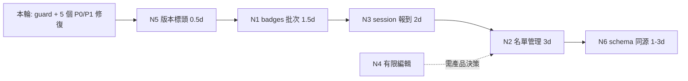

# 04 — 同步計畫（Sync Plan）

本檔分三段：**已修**、**該修但本輪未修**、**不該修（刻意差異）**。

## 4.1 本輪已修（附 commit）

| ID        | 問題                                             | 修法                                                                          | commit    |
| --------- | ------------------------------------------------ | ----------------------------------------------------------------------------- | --------- |
| S-1       | 呼叫不存在的 `checkin/override`                  | 移除服務方法與按鈕；改為導向詳情頁；文案改成「後端沒有這個能力」              | `5bcdb53` |
| S-2       | 錢包流水讀不存在的 `approvedBy`、忽略分頁        | 型別改成後端真實投影（`balanceAfter`/`sourceType`）；請求上限 100；超過時明說 | `075f775` |
| S-3       | `Registration` 缺退款／稽核欄位                  | 補型別，並註明「只有名單端點會回」                                            | `031972f` |
| S-4 / S-9 | 缺 `depositRefunded` / `boundOnly` 參數          | 加參數，值域收緊成後端的聯集型別                                              | `84cb423` |
| S-6 / S-7 | 從不呼叫 `/my-access`；overview 借受限端點算數字 | 先問權限；`canManage` 為 false 時用本地 `_meta` 總數 + 誠實顯示「未取得」     | `9e3c7a2` |
| S-8       | Token placeholder 深連結到不存在的 Web 路由      | 改為導向名單；文案改成「帳本以每位參加者為單位」                              | `860404f` |
| —         | 沒有任何機制擋 dead endpoint                     | `scripts/check-backend-contract.mjs` + 快照 + CI step + 負向測試              | `7c19f0a` |

修完後的閘門狀態：`npm run check:contract` = 15/15、`npm test` = 216 tests / 213 pass / 0 fail。

## 4.2 該修但本輪未修（依「現場價值 ÷ 成本」排序）

> 工期是估算，假設一位熟悉此 codebase 的工程師。標 `(估)`。

### N1 — Badges 批次生命週期（P1，≈1.5 人日 `(估)`）

後端 4 條全就緒，App 一條都沒接：

| 端點                                         | 用途                                   |
| -------------------------------------------- | -------------------------------------- |
| `POST /:eventId/nfc/batch`                   | 產生一批卡片（含 `tagUid` / `qrCode`） |
| `POST /:eventId/nfc/batch/claim`             | 認領（指派給參加者）                   |
| `POST /:eventId/nfc/batch/:batchId/complete` | 回填真實 UID                           |
| `GET /:eventId/nfc/badges/export`            | CSV 匯出                               |

**為什麼是 P1**：這是**活動前**的發卡準備工作，目前必須回 Web 做。
活動當天若發現卡片數量不足，App 沒有任何補救手段。
（產業對照：Cvent／zkipster／Expo Pass 都把 badge 產出放在現場層。）

### N2 — 名單的現場管理動作（P1–P2，≈3 人日 `(估)`）

| 能力                                  | 端點                                  | 優先 |
| ------------------------------------- | ------------------------------------- | ---- |
| 狀態修正（撤銷報到／人工報到）        | `POST /:id/registrations/:rid/status` | P1   |
| visibility 切換（hidden/archived）    | `GET /registrations?visibility=`      | P2   |
| ticketType 篩選                       | 同上                                  | P2   |
| depositRefunded 篩選（已可傳，缺 UI） | 同上                                  | P2   |
| 隱藏／封存（含 reason）               | `POST …/hide`、`…/archive`            | P2   |
| 退款登記                              | `POST …/deposit-refund`               | P2   |
| 取 activation link                    | `GET …/activation-link?readonly=1`    | P3   |
| 重寄確認信                            | `POST …/resend-confirmation`          | P3   |

**注意（重要）**：`status` 端點需要 **COORDINATOR 以上**，不是閘口的 OPERATOR。
若做成 UI，必須依 `canManage` 顯示，否則又是一顆 403 按鈕。

### N3 — Session 現場報到（P1，≈2 人日 `(估)`）

`POST /:eventId/sessions/:sessionId/checkin`（body `{ registrationId }`）已存在。
App 完全沒有 session 概念。

**為什麼是 P1**：R1 §5 顯示五家競品（Cvent、Whova、zkipster、Swapcard、Expo Pass）
都把 session 掃描放在現場層。LinkCard 是目前少數沒有的。

### N4 — 有限的報名資料編輯（P2，需先做產品決策）

R1 §3a：業界三派——禁止（Eventbrite）、條件允許（Expo Pass 需 Web 開權限＋passcode）、
正面允許（Cvent）。**沒有廠商把完整編輯器放進門側 App。**

建議：先決定「現場要改哪 3 個欄位」（例如姓名、公司、手機），再談實作。
這需要後端支援（目前 `PATCH /registrations/:id` 不存在）。

### N5 — Client 版本標頭（P2，≈0.5 人日 `(估)`）

R2 §5.2 指出：所有漂移量測都建立在「請求可被 client 版本切分」上。
App 目前不送 `X-Client-Version` / `X-Client-Platform`。

沒有它，你無法回答「這條 404 是舊版 App 打的，還是新版有 bug」。

### N6 — Schema 同源 + generated client（P2，1–3 人日 `(估)`）

R3 §5.3 的第二週計畫。與本輪的 guard 互補：guard 管路由存在，schema 管形狀一致。

## 4.3 不該修（刻意差異，需正式記錄）

以下 9 個 Web-only 模組**經產業檢驗後確認為標準做法**（見 `05-industry-research.md` §5.1）：

`profile`、`content`、`ticket types`、`exhibitors`（+import）、`sessions`（CRUD）、
`polls`、`bank transfers`、`org roles`、`settings`。

把它們寫進 `08-intentional-differences.md`，目的是**停止每季重新辯論**。

## 4.4 為什麼本輪不做 N1–N6

三個理由，按重要性：

1. **N2 的每一項都需要產品決策**（誰能撤銷報到？要不要在門口退款？），
   而本輪的授權是「核對與同步」，不是「擴充功能」。
2. **N1/N3 會新增畫面**，需要設計與 QA（此 repo 有 216 個測試與 journeys，
   新增畫面不能只靠 tsc）。
3. **先建立閘門再擴充**才不會重複製造漂移。本輪先裝了 guard，之後每一個新能力
   都會被它檢查——這個順序比反過來有效。

## 4.5 建議的執行順序

先做 N5 是因為它讓後面每一項都可被量測；先做 N1/N3 是因為它們是「活動當天會痛」
的能力，而且後端已就緒、不需要新 API。
