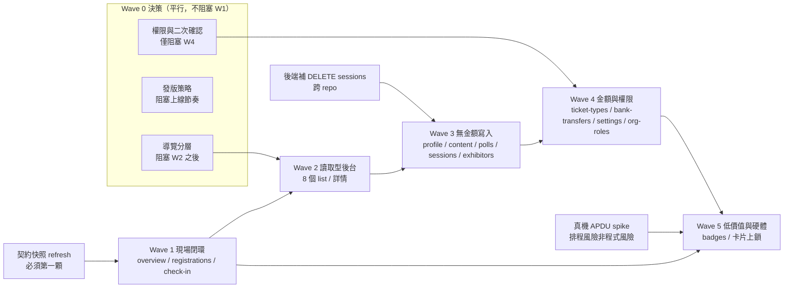

# 12 — 全面功能對齊：分波建置計劃（2026-10-29）

<!-- citations: LinkCard_Event_Admin_App_Expo -->

**狀態：計劃（未動工）。** 本文把 `11 §11.3` 的驗收定義（A1–A4）轉成一份**可以排
期、可以拒絕、可以逐波上線**的建置計劃。它**不重複** `11` 的產品論述，也**不動**
registry 與 `src/`。

**這份文件回答四件事，其餘不答：**

1. 每個模組「Web 到底能做什麼」的**狀態變更清單**（不是「有這個頁面」）。
2. 這些動作的後端**是否已經存在**（實跑命令，不推測）。
3. 分波與每個 commit 的切法（使用者要求：小 commit、每顆可獨立過閘門）。
4. 三個 `OPEN` 前置的**建議方案**，並標明「需 PM 拍板」或「技術可自行決定」。

**本文最低限度要能被用來拒絕東西。** 若某一波做完卻說不出「它現在停在哪個可上線
狀態」，那波的切法就是錯的。

---

## 12.0 量測基準（先講清楚，否則後面的數字沒有意義）

以下四行是本輪在 `HEAD = 1a1dddf`、分支 `feat/nfc-gate1-reader-spike` 上實跑的結果，
不是引用舊文件：

```
$ npm test                 → # tests 234 / # pass 231 / # fail 0 / # todo 3（200 個 top-level test）
$ npm run typecheck        → RC=0
$ npm run check:contract   → ✓ 15 條 App 呼叫全部對得上後端路由快照
$ npm run check:parity:full→ ✓ 15 個能力（ALIGNED=1 ALIGNED_DEFECT=1 APP_GAP=12
                              WEB_ONLY_INTERNAL=1）、16 個缺口
```

⇒ **閘門現在全綠，所以「每顆 commit 都能獨立通過閘門」是一個當下成立的陳述，
不是願望。** 這一點重要：若基準是紅的，後面每一顆 commit 的驗收命令都會變成
「比昨天少紅一點」，那條紀律就守不住。

另兩條基準事實（後面 §12.3 會用到）：

- `scripts/backend-routes.snapshot.json` 的 `generatedFrom.commit` 是 `64be09e`
  （快照自己記的，可直接驗）；**量測時點 2026-10-29 本輪**的後端 HEAD 是
  `4c677c29`（同日稍早由獨立審查量到 `6e77a922`——**這個值會動，引用時一定要標
  量測時點**）。**快照落後於後端，且落後的那兩條正好是本計劃 Wave 1 要用的。**
- **registry 說 `overview` 是 `ALIGNED_DEFECT`，但那個 defect 在這個分支上已經修
  好了**（`9e3c7a2`，`LinkCard_Event_Admin_App_Expo@src/app/(auth)/[eventId]/overview.tsx:201`
  起：先問 `getMyAccess`，`!access.canManage` 時只用本地 `registrationCount`，
  完全不打 `registrations`）。⇒ 它的剩餘工作不是「修」，是「**釘住 + 翻 verdict**」。
  這一條會改變 §12.5.2 的 commit 數，也是本計劃唯一一次「照登記表排期就會排進已完
  成的工作」。

---

## 12.1 「功能對齊」的驗收單位

沿用 `LinkCard_Event_Admin_App_Expo@docs/analysis/adminapp-parity-20261028/11-full-parity-decision-20261029.md:80`
的 A1–A4。這裡只補一件 `11` 沒寫的事：**怎麼量**。

### 12.1.1 量測方法（可複驗）

「Web 能做什麼」不能靠讀頁面標題判斷，要看它**實際打出去的 method + path**。Web 的
事件 API 全部收斂在 `lib/events/*.ts`，且都經過同一個 `eventFetch`。所以量測是兩步：

```bash
# ① 每個 Web API 模組實際打出的 method + path（真的跑，不是估）
cd LinkCard_Frontend && node -e '
const fs=require("fs");
for (const f of fs.readdirSync("lib/events").filter(f=>f.endsWith(".ts")&&!f.includes("test"))) {
  const s=fs.readFileSync("lib/events/"+f,"utf8");
  const re=/eventFetch(?:<[^>]*>)?\(\s*`([^`]*)`\s*(?:,\s*\{([\s\S]{0,260}?)\})?/g;
  let m; while((m=re.exec(s))){
    const meth=(m[2]||"").match(/method:\s*[\x27"]([A-Z]+)[\x27"]/);
    console.log((meth?meth[1]:"GET").padEnd(6), m[1], " ["+f+"]");
  }
}'

# ② 每個 Web 頁面實際呼叫哪幾個寫入函式（不是 import 了什麼，是有沒有叫）
cd LinkCard_Frontend && node -e '...muts.filter(f=>new RegExp("(?<![A-Za-z0-9_])"+f+"\\s*\\(","g").test(s))...'
```

①的輸出共 **79 個呼叫點**；②的輸出確認**匯入 ≠ 使用**——例如
`LinkCard_Frontend@lib/events/exhibitors.ts:1` 匯出了 `createExhibitor`，但
`LinkCard_Frontend@app/(event)/manage/[eventId]/exhibitors/page.tsx:1` 的 244 行裡
**沒有建立廠商的動作**，只有列表與狀態覆核。若照 import 清單寫需求，這一份會多出三
個根本不存在的動作。

### 12.1.2 逐模組狀態變更清單

**判讀規則**：`W` = 會改變狀態的動作；`R` = 純讀。**「App 現況」欄只寫 App 現在真
的打得到的東西**，不寫「有畫面」。

#### `overview` 活動總覽（`ALIGNED_DEFECT`／G-10）

| 類  | 動作         | 端點                                       | 主模型       | App 現況                |
| --- | ------------ | ------------------------------------------ | ------------ | ----------------------- |
| R   | 我的活動清單 | `GET /api/v1/events/my-managed`            | `Event`      | ✅ `home.tsx`           |
| R   | 活動詳情     | `GET /api/v1/events/by-id/:eventId`        | `Event`      | ✅ `event.service.ts`   |
| R   | 總覽統計     | `GET /api/v1/events/:eventId/manage-stats` | `Event` 聚合 | ❌ 未使用（App 不需要） |

**零個 W，而且缺陷已經修好了。** `04 §G-10` 的診斷是：它拿 OPERATOR 讀不到的端點
去算一個**已經在手上**的數字（`event.registrationCount`）。而 `manage-stats` 的閘門
是 write access
（`LinkCard_ExpressJS_Backend@src/events/middleware/checkEventAccessPermission.ts:20`
：WRITE = owner 或 SUPER_ADMIN/COORDINATOR），所以 OPERATOR 永遠讀不到——**這不是
「後端少開權限」，是「不該用它算這個數字」。**

**實查結果：這段修復已經在 `9e3c7a2`（`fix(overview): ask what the caller may do
before spending requests`）落地，且 `9e3c7a2` 在這個分支上。**
`LinkCard_Event_Admin_App_Expo@src/app/(auth)/[eventId]/overview.tsx:187` 是
`const localTotal = event?.registrationCount ?? null;`，`:204` 起是
`if (!access.canManage)` 的分流——沒有權限就直接用本地總數、已報到數誠實顯示為
「未取得」，連請求都不發。

⇒ **registry 的 `ALIGNED_DEFECT` 相對於 HEAD 是過期的**，而它的 `evidence` 還寫著
「`overview.tsx:133-159` 用兩次 limit:1 的 registrations 請求算總數」——那段程式碼
已經不在那裡了。**這正是本計劃最該防的一種錯：照登記表排期，會排進一件已經做完的
事。**

#### `profile` 活動資料

| 類  | 動作               | 端點                                | 主模型欄位                                                                                                                           | App 現況 |
| --- | ------------------ | ----------------------------------- | ------------------------------------------------------------------------------------------------------------------------------------ | -------- |
| W   | 改活動資料（9 欄） | `PATCH /api/v1/events/:eventId`     | `Event.name`／`description`／`eventType`／`status`／`venueName`／`venueAddress`／`isPublic`／`landingPageMode`／`externalLandingUrl` | ❌       |
| R   | 讀活動             | `GET /api/v1/events/by-id/:eventId` | `Event`                                                                                                                              | ✅       |

`LinkCard_Frontend@app/(event)/manage/[eventId]/profile/page.tsx:126-136` 的
`payload` 是 **9 個欄位**（`:36-46` 的 `FormState` 是同一組），送進 `:137` 的
`updateEvent`。這 9 個就是 profile 的全部，不多也不少——本節前版寫「只有 `name`
與 `description` 兩欄」是錯的，而且它引用的 `:126` 正好是那 9 個欄位的開頭。

**不要把日期補進來，即使 `Event` 模型確實有這個欄位。** `Event.startDate`／
`endDate` 在 `LinkCard_ExpressJS_Backend@prisma/schema.prisma` 的 `model Event`
裡是必填，但那兩個欄位屬於**建立活動**，不屬於這一頁：`createEvent` 在
`LinkCard_Frontend@app/(event)/manage/events/page.tsx:77-82`，日期輸入在 `:166-189`。
也就是說，Web 後台**只在建立時寫日期，之後沒有任何地方改得到**
（`grep -nE 'startAt|endAt|startDate|endDate|type="date|type="time'` 對 profile
頁回 0）。

⇒ 依 A1（狀態變更集合）與 A3（寫入欄位與 Web 一致），App 的 profile 標的**不含
日期**。若有人以「DB 有這兩個欄位」為由在 App 補一個時間選擇器，那不是對齊，是替
App 造一個 Web 沒有的入口（反向 scope drift），而且會寫進一個 Web 從未透過這支端點
寫過的欄位，A3 立刻失守。

（附帶觀察，不在本計劃範圍：**建立活動本身不在 §12.1.2 的模組清單裡**，registry
也沒有一筆對應的 `APP_GAP`。若日後要在 App 開活動，那是新的一筆，不是把日期塞回
profile。）

#### `content` 落地頁內容

| 類  | 動作     | 端點                                         | 主模型             | App 現況 |
| --- | -------- | -------------------------------------------- | ------------------ | -------- |
| W   | 新增區塊 | `POST /api/v1/events/:eventId/page-sections` | `EventPageSection` | ❌       |
| W   | 改區塊   | `PATCH …/page-sections/:sectionId`           | 同上               | ❌       |
| W   | 刪區塊   | `DELETE …/page-sections/:sectionId`          | 同上               | ❌       |
| W   | 新增卡片 | `POST …/page-sections/:sectionId/cards`      | `EventPageCard`    | ❌       |
| W   | 改卡片   | `PATCH …/cards/:cardId`                      | 同上               | ❌       |
| W   | 刪卡片   | `DELETE …/cards/:cardId`                     | 同上               | ❌       |
| R   | 列出全部 | `GET …/page-sections`                        | 兩者               | ❌       |

**六個 W。** 後端另有 `PATCH …/page-sections/reorder` 與 `…/cards/reorder`（
`LinkCard_ExpressJS_Backend@src/events/routes/events.routes.ts:57` 起），但 Web 的
content 頁**沒有呼叫排序**——依 A2，這兩條不在對齊範圍內。這是本節唯一一次「後端
有、Web 沒有、因此不列」的判斷，理由寫在這裡以免日後被當成遺漏。

#### `ticket-types` 票種

| 類  | 動作             | 端點                                                           | 主模型欄位                                            | App 現況                       |
| --- | ---------------- | -------------------------------------------------------------- | ----------------------------------------------------- | ------------------------------ |
| W   | 建立票種         | `POST /api/v1/events/:eventId/ticket-types`                    | `EventTicketType`                                     | ❌                             |
| W   | 修改票種         | `PATCH …/ticket-types/:ticketTypeId`                           | `price`／`capacity`／`formFieldsJson`／`capabilities` | ❌                             |
| W   | 停用（軟刪）     | `DELETE …/ticket-types/:ticketTypeId`                          | `isActive`                                            | ❌                             |
| W   | 切換票種能力開關 | `PATCH /api/v1/events/:eventId`（`ticketCapabilitiesEnabled`） | `Event.configJson` 側                                 | ❌                             |
| R   | 列出（含隱藏）   | `GET …/ticket-types`                                           | `EventTicketType`                                     | ⚠️ 只讀得到 walk-in 需要的部分 |

第四列是實跑才看到的：`LinkCard_Frontend@app/(event)/manage/[eventId]/ticket-types/page.tsx:1227`
呼叫 `updateEvent(eventId, { ticketCapabilitiesEnabled: next })`。**所以
`ticket-types` 不是純票種模組，它會寫 `Event`。** 這一條讓它的風險等級從「後台設
定」升到「會影響公開報名表單的行為」。

#### `badges` Badge 庫存與批次

| 類  | 動作     | 端點                                 | 主模型                                  | App 現況            |
| --- | -------- | ------------------------------------ | --------------------------------------- | ------------------- |
| W   | 建立批次 | `POST …/nfc/batch`                   | `EventNfcBadge.batchId`／`batchLabel`   | ❌                  |
| W   | 認領一張 | `POST …/nfc/batch/claim`             | `registrationId`／`assignedExhibitorId` | ❌                  |
| W   | 回填完成 | `POST …/nfc/batch/:batchId/complete` | `writtenAt`／`status`                   | ❌                  |
| R   | 列表     | `GET …/nfc/badges`                   | `EventNfcBadge`                         | ✅ `nfc.service.ts` |
| R   | 匯出     | `GET …/nfc/badges/export`            | —                                       | ❌                  |

#### `registrations` 報名名單

| 類  | 動作           | 端點                                           | 主模型欄位                                       | App 現況               |
| --- | -------------- | ---------------------------------------------- | ------------------------------------------------ | ---------------------- |
| W   | 隱藏           | `POST …/registrations/:id/hide`                | `EventRegistration` 可見性                       | ❌                     |
| W   | 取消隱藏       | `POST …/registrations/:id/unhide`              | 同上                                             | ❌                     |
| W   | 封存           | `POST …/registrations/:id/archive`             | 同上                                             | ❌                     |
| W   | 取消封存       | `POST …/registrations/:id/unarchive`           | 同上                                             | ❌                     |
| W   | 更正狀態       | `POST …/registrations/:id/status`              | `EventRegistration.status`                       | ❌                     |
| W   | 登記押金退款   | `POST …/registrations/:id/deposit-refund`      | `depositRefundedAt/_By/_Amount/_Reference/_Note` | ❌                     |
| W   | 重寄確認信     | `POST …/registrations/:id/resend-confirmation` | —（寄信）                                        | ❌                     |
| W   | 產生啟用連結   | `POST …/registrations/:id/activation-link`     | `EventActivationToken`                           | ❌                     |
| R   | 名單分頁／篩選 | `GET …/registrations`                          | `EventRegistration`                              | ✅ `registrations.tsx` |
| R   | 取既有啟用連結 | `GET …/registrations/:id/activation-link`      | `EventActivationToken`                           | ❌                     |
| R   | 匯出 CSV       | `GET …/export/attendees`                       | —                                                | ❌                     |

**八個 W。這是本計劃最大的一個模組。** 其中「更正狀態」是
`LinkCard_Frontend@app/(event)/manage/[eventId]/registrations/page.tsx:641` 掛的
`RegistrationStatusCorrectionModal`——A1 要算它，因為使用者打得到。

#### `check-in` 現場報到

| 類  | 動作             | 端點                                | 主模型欄位                                                     | App 現況                         |
| --- | ---------------- | ----------------------------------- | -------------------------------------------------------------- | -------------------------------- |
| W   | 報到             | `POST …/registrations/checkin`      | `EventRegistration.status`／`checkedInAt`                      | ✅ `check-in.tsx`                |
| W   | 綁卡             | `POST …/nfc/bind`                   | `EventNfcBadge.tagUid`／`registrationId`／`boundAt`／`boundBy` | ✅ 但在 `nfc-bind.tsx`（另一頁） |
| R   | 已報到者回訪查詢 | `GET …/registrations/desk-lookup`   | —                                                              | ❌（後端 2026-10 新增）          |
| R   | 依報名碼查詢     | `GET …/registrations/by-code/:code` | —                                                              | ✅                               |
| R   | 依 UID 反查      | `GET …/nfc/lookup`                  | `EventNfcBadge`                                                | ✅                               |

**兩個 W，而且 App 兩個都有。** ⇒ `check-in` 的差距**不是能力，是位置與步數**
（`04 §G-8 (a)`）。

#### `exhibitors` 參展廠商

| 類  | 動作       | 端點                                     | 主模型欄位               | App 現況 |
| --- | ---------- | ---------------------------------------- | ------------------------ | -------- |
| W   | 覆核狀態   | `PATCH …/exhibitors/:exhibitorId/status` | `EventExhibitor.status`  | ❌       |
| W   | 匯入確認   | `POST …/exhibitors/import/confirm`       | `EventExhibitor`（批次） | ❌       |
| W   | 匯入後通知 | `POST …/exhibitors/import/notify`        | —（寄信）                | ❌       |
| R   | 列表       | `GET …/exhibitors`                       | `EventExhibitor`         | ❌       |
| R   | 匯入預覽   | `POST …/exhibitors/import/preview`       | —（不寫）                | ❌       |

#### `sessions` 場次

| 類  | 動作     | 端點                                      | 主模型欄位                 | App 現況                   |
| --- | -------- | ----------------------------------------- | -------------------------- | -------------------------- |
| W   | 建立場次 | `POST …/sessions`                         | `EventSession`             | ❌                         |
| W   | 修改場次 | `PATCH …/sessions/:sessionId`             | `EventSession`             | ❌                         |
| W   | 刪除場次 | `DELETE …/sessions/:sessionId`            | —                          | ❌ **後端不存在**（§12.3） |
| R   | 名冊     | `GET …/sessions/:sessionId/registrations` | `EventSessionRegistration` | ❌                         |

後端另有 `POST …/sessions/:sessionId/checkin`（
`LinkCard_ExpressJS_Backend@src/events/routes/sessions-polls.routes.ts:39` 起），但
**Web 沒有對應 UI**（全庫只有 `lib/events/sessions.ts` 沒有匯出這個呼叫）。依 A1，
它不在對齊範圍；**但它是一個「後端有、兩邊都沒有入口」的能力**，值得記在這裡，
免得日後有人以為 App 漏做。

#### `polls` 投票

| 類  | 動作     | 端點                             | 主模型欄位              | App 現況 |
| --- | -------- | -------------------------------- | ----------------------- | -------- |
| W   | 建立投票 | `POST …/polls`                   | `EventPoll`             | ❌       |
| W   | 開啟     | `PATCH …/polls/:pollId/activate` | `isActive`／`startedAt` | ❌       |
| W   | 關閉     | `PATCH …/polls/:pollId/close`    | `isActive`／`endedAt`   | ❌       |
| R   | 結果     | `GET …/polls/:pollId/results`    | `EventPollVote`         | ❌       |

注意：`POST …/polls/:pollId/vote` 是**公開端點**（`LinkCard_Frontend@lib/events/sessions.ts:80`
用 `eventFetch`，但後端 `pollController.vote` 無 `authMiddleware`）。它是參加者動
作、不是後台動作，**不列入對齊清單**。

#### `bank-transfers` 匯款覆核

| 類  | 動作               | 端點                                        | 主模型欄位                                                                   | App 現況 |
| --- | ------------------ | ------------------------------------------- | ---------------------------------------------------------------------------- | -------- |
| W   | 覆核（核可／駁回） | `PATCH …/bank-transfers/:approvalId/review` | `EventBankTransferApproval.status`／`reviewedBy`／`reviewNote`／`reviewedAt` | ❌       |
| R   | 待核清單           | `GET …/bank-transfers`                      | 同上                                                                         | ❌       |

`POST …/bank-transfers/submit` 是**參加者送匯款證明**，由 `lib/events/registrations.ts`
在報名流程用；不是後台動作，不列入。

#### `org-roles` 組織角色

| 類  | 動作     | 端點                            | 主模型欄位                       | App 現況 |
| --- | -------- | ------------------------------- | -------------------------------- | -------- |
| W   | 邀請     | `POST …/org-roles/invite`       | `EventOrgRole.status`＝`INVITED` | ❌       |
| W   | 移除     | `DELETE …/org-roles/:orgRoleId` | `revokedAt`／`status`            | ❌       |
| R   | 列出     | `GET …/org-roles`               | `EventOrgRole`                   | ❌       |
| R   | 我的權限 | `GET …/my-access`               | —                                | ✅       |

`PATCH …/org-roles/accept` 是**被邀請者**的動作（`LinkCard_Frontend@lib/events/engagement.ts:157`），
不是後台動作；而且**它現在是壞的**（§12.3.2）。兩件事都支持把它排除在 App 範圍外。

#### `settings` 活動設定

| 類  | 動作       | 端點                                | 主模型欄位                     | App 現況                |
| --- | ---------- | ----------------------------------- | ------------------------------ | ----------------------- |
| W   | 存銀行資料 | `PATCH /api/v1/events/:eventId`     | `Event.configJson.bankDetails` | ❌                      |
| W   | 存主題色   | `PATCH /api/v1/events/:eventId`     | `Event.configJson.theme`       | ❌                      |
| R   | 讀設定     | `GET /api/v1/events/by-id/:eventId` | `Event.configJson`             | ✅（只 `Event` 基本欄） |

**「封存活動」不是 Web 能力。** `LinkCard_Frontend@app/(event)/manage/[eventId]/settings/page.tsx:453`
的危險區按鈕按下去是 `alert(t('settings.archiveNotAvailable'))`——**它不呼叫任何端
點**。若有人憑「畫面上有一顆封存按鈕」把封存算進 App 的對齊範圍，那會是一個不存在
的目標。（這一條與 `04 §G-13` 無關：G-13 是換卡／退卡，兩邊都沒有後端。）

### 12.1.3 合計與一個必須先講的判準爭議

| 波次     | 模組                                              | W 動作數         |
| -------- | ------------------------------------------------- | ---------------- |
| 1        | overview／profile／registrations／check-in        | 0＋1＋8＋2 ＝ 11 |
| 2        | （只讀，見 §12.2）                                | 0                |
| 3        | content／polls／sessions／exhibitors              | 6＋3＋3＋3 ＝ 15 |
| 4        | ticket-types／bank-transfers／settings／org-roles | 4＋1＋2＋2 ＝ 9  |
| 5        | badges                                            | 3                |
| **合計** | 12 個 `APP_GAP`                                   | **38**           |

**判準爭議一：卡片上鎖算不算 A1？**

Web 的報到桌會對寫入的卡做 `PWD_AUTH` 上鎖（`LinkCard_Frontend@lib/nfc/globalPassword.ts:1`）。
但上鎖**沒有對應的 HTTP 端點、也不寫任何 DB 欄位**——它是 APDU 層的卡片側狀態。A1
的措辭是「能按哪顆鈕、打哪個 API、DB 哪一欄會變」，三項它都不符合。

⇒ **本計劃把上鎖排除在對齊驗收之外，並且不把它藏起來**：它是
`04 §G-8 (b)`，歸 Wave 5，需要真機驗證，單獨記一條缺口。**這一條要在 PM 面前講清
楚，因為它意味著「App 的報到桌對齊了」不代表「兩邊的卡受同等保護」。**

**判準爭議二：iOS 沒有寫卡。**

同一條邏輯：寫卡在 iOS 做不到（`app.json` 的 NFC entitlements 只包 iOS 讀取；Web
端也只有 Web Bluetooth 的 Android 路徑）。這不是對齊缺口，是**平台能力差**。驗收
時必須接受「Web 對齊 = Android 對齊；iOS 只有 QR_ONLY」，否則 W1 會永遠驗不過。

---

## 12.2 分波

### 12.2.1 原則，與我推翻了哪兩個起始假設

**唯一原則：每一波做完，App 都停在一個「可上線、有意義」的狀態。不准出現「做到一
半不能用」。** 這條原則的第二半（不准半成品）比第一半更難守，因為它會強迫某些模組
**整個**排在後面，而不是「先做列表、動作以後再說」——後者會留下一個**看起來能用、
按下去 404** 的畫面。

派發給了我一份起始假設，我**推翻其中兩處**：

**推翻一：`badges` 從 Wave 1 移到 Wave 5。**

派發把 `badges` 放在 Wave 1（現場閉環），理由是「活動當天真的會用到」。但
`LinkCard_Event_Admin_App_Expo@docs/analysis/adminapp-parity-20261028/11-full-parity-decision-20261029.md:120`
（§11.4）已經寫下使用者原話「**手環的寫入是一次性的，不會重複用**」，並下了結論：
「它是 9 個新目標裡唯一被營運事實直接降權的」「可以排最後一波」。

**同一份文件裡「排在 Wave 1」與「排最後」不可能同時成立。** 若 `badges` 在
Wave 1，那句話就是假的；若那句話是真的，`badges` 就不該在 Wave 1。我選擇相信後
者，因為它的依據是使用者對營運事實的陳述，而前者的依據只是我的任務簡報裡的一句
話。

況且 `badges` 的三個 W 動作（建批次／認領／回填）在現場的實際用法是
「**發卡＝發手環**」，而這件事 App 已經用 `nfc-bind` 的單張流程在做（§12.1.2
`check-in` 的兩個 W 都在）。批次生命週期是**活動前準備**，不是現場動作。

**推翻二：`ticket-types` 不在 Wave 2。**

派發把 `ticket-types` 放 Wave 2（「以 read 為主，風險低」）。實跑後它有三個 W 加
一個 `Event` 寫入（§12.1.2），其中 `price` 與 `capacity` 是**金額與名額**，而
`ticketCapabilitiesEnabled` 會改公開報名表單的行為。**它不是讀取型模組。** 排在
Wave 2 等於在還沒有權限設計與二次確認的情況下先做一個改價功能。

### 12.2.2 波次總表

| 波  | 名稱                    | 模組                                              | 這一波結束時 App 的樣子                                                                              | 人日     | commit |
| --- | ----------------------- | ------------------------------------------------- | ---------------------------------------------------------------------------------------------------- | -------- | ------ |
| 0   | 決策（平行，不阻塞 W1） | —                                                 | 不產出功能；決定 W2 之後的形狀                                                                       | 3        | 6      |
| 1   | 現場閉環                | overview 釘住、registrations、check-in            | 報到桌能查／能改／能一次寫完；名單能管理                                                             | 9        | 19     |
| 2   | 讀取型後台              | 8 個模組的 list／詳情（不含 badge 已有者）        | **App 查得到 Web 上的每一件事**，且一個按鈕都不會 404                                                | 8        | 16     |
| 3   | 無金額、無權限的寫入    | content、polls、sessions、exhibitors、profile     | 內容、投票、廠商可以在手機上經營；**`sessions` 受 `ESC-CRA-001` 約束，不得排入本波**（見 `§12.3.2`） | 9.5      | 26     |
| 4   | 金額與權限              | ticket-types、bank-transfers、settings、org-roles | 會動到錢與權限的四項，且每項都有二次確認                                                             | 17       | 21     |
| 5   | 低現場價值＋硬體        | badges、check-in 上鎖                             | 對齊完成；硬體差距已驗或已明確不做                                                                   | 8        | 8      |
|     |                         |                                                   | **合計**                                                                                             | **54.5** | **96** |

（人日含該波的測試與文件 commit。估算尺度：`S` ≤ 1 人日、`M` ≤ 2、`L` ≤ 4、
`XL` > 4。沒有任何一項用「天」以外的單位，因為這個 repo 沒有 velocity 數據可換
算。）

**`54.5` 是 top-down 的配置，不是 `§12.2.3` 的 S／M／L 加總。** 這句話必須寫出來，
否則兩個數字會互相打架，而讀的人只會挑對自己有利的那一個。逐波對帳：

| 波  | 模組的 S／M／L 上界                                                                             | 表上的人日 | 差額從哪來                                                                                                                  |
| --- | ----------------------------------------------------------------------------------------------- | ---------- | --------------------------------------------------------------------------------------------------------------------------- |
| 3   | 11（content `L` 4／sessions `M` 2／polls `M` 2／exhibitors `M` 2／profile `S` 1）               | 9.5        | **−1.5：這一格是低估，不是加總。** 按尺度上界應該是 11；表上的 9.5 是配置值                                                 |
| 4   | ≥9（`XL` 取 `L` 下界 4：ticket-types 4／bank-transfers `M` 2／org-roles `M` 2／settings `S` 1） | 17         | **＋8：不是四個模組的工**，是 `03 §3.7.8` 的**權限模型＋二次確認**——它們不屬於任何單一模組，也從未出現在 `§12.2.3` 的估欄裡 |

W4 的那 8 人日是這一列最容易被誤讀的地方：把 `17` 讀成「四個模組的總和」，就會得出
「每個模組 4 人日」的結論，然後在第一個模組超支。它買的是「手機上誰能按、要不要
第二次確認」的設計與實作——`§12.6` 的第四條依賴（權限模型必須早於 W4）寫的就是它。
反過來，W3 的 `9.5` 比上界 `11` 還低，差的 1.5 人日沒有被任何一句話解釋過；**它應該
被看成待補的缺口，不是省下來的時間。**

### 12.2.3 逐模組明細

| 模組             | Web 頁面檔（實跑來源）                                                     | 後端端點                 | App 現況                                                              | 需新建什麼                                                | 依賴                        | 估  | 風險                                                                                                                                                                        |
| ---------------- | -------------------------------------------------------------------------- | ------------------------ | --------------------------------------------------------------------- | --------------------------------------------------------- | --------------------------- | --- | --------------------------------------------------------------------------------------------------------------------------------------------------------------------------- |
| `overview`       | `LinkCard_Frontend@app/(event)/manage/[eventId]/page.tsx:1`                | 已存在（3 條）           | **已修**（`9e3c7a2`），但沒有測試釘住，registry 仍寫 `ALIGNED_DEFECT` | 補一條「OPERATOR 不發 registrations」的測試；翻 verdict   | 無                          | S   | 低（**不是修復，是釘住**）                                                                                                                                                  |
| `registrations`  | `LinkCard_Frontend@app/(event)/manage/[eventId]/registrations/page.tsx:1`  | 已存在（11 條）          | 只有列表                                                              | service 11 支 + 8 個動作 + 狀態更正 modal + CSV 匯出      | W3 的 List 骨架（本波自帶） | L   | **中**：金額動作（押金退款）需要二次確認；CSV 需要新原生依賴                                                                                                                |
| `check-in`       | `LinkCard_Frontend@app/check-in/[eventId]/page.tsx:1`                      | 已存在（5 條）           | 兩頁流程（掃→按→換頁→寫）                                             | 把 `nfc-bind` 的寫卡面板收進報到頁；加 `desk-lookup` 回訪 | 無                          | L   | **中**：不能弄壞被 `tests/check-in-write-handoff.test.mjs` 鎖住的交棒                                                                                                       |
| `profile`        | `LinkCard_Frontend@app/(event)/manage/[eventId]/profile/page.tsx:1`        | 已存在（1 條）           | 無                                                                    | 一頁表單（9 欄，無時間欄位）                              | 導覽分層                    | S   | 低                                                                                                                                                                          |
| `content`        | `LinkCard_Frontend@app/(event)/manage/[eventId]/content/page.tsx:1`        | 已存在（8 條，用 6）     | 無                                                                    | section／card 兩層 CRUD                                   | 導覽分層                    | L   | **中**：App 沒有富文本編輯器（§12.7）                                                                                                                                       |
| `ticket-types`   | `LinkCard_Frontend@app/(event)/manage/[eventId]/ticket-types/page.tsx:1`   | 已存在（4 條）           | 只讀（walk-in 需要）                                                  | 3 個 CRUD + capability 開關 + 表單語意驗證                | 權限模型、二次確認          | XL  | **高**：改價＝改金額；`formFieldsJson` 語意綁定契約                                                                                                                         |
| `exhibitors`     | `LinkCard_Frontend@app/(event)/manage/[eventId]/exhibitors/page.tsx:1`     | 已存在（5 條，用 3）     | 無                                                                    | 列表 + 狀態覆核 + 匯入精靈                                | 導覽分層                    | M   | 低—中：匯入需要檔案選取（已有 `expo-image-picker`，但不含文件選擇）                                                                                                         |
| `sessions`       | `LinkCard_Frontend@app/(event)/manage/[eventId]/sessions/page.tsx:1`       | **缺 1 條**（delete）    | 無                                                                    | 列表 + 建／改 + 名冊；刪除待後端                          | 導覽分層                    | M   | **中**：`BACKEND-GAP` 未解前「刪除」不能上線。**本列受 `ESC-CRA-001` 約束：blocker 解除前不得排入任何一波。**（見 `§12.3.2`；不是「先做前三項、刪除留空」，是整列都不能排） |
| `polls`          | `LinkCard_Frontend@app/(event)/manage/[eventId]/polls/page.tsx:1`          | 已存在（4 條，用 3）     | 無                                                                    | 列表 + 建 + 開／關 + 結果                                 | 導覽分層                    | M   | 低                                                                                                                                                                          |
| `bank-transfers` | `LinkCard_Frontend@app/(event)/manage/[eventId]/bank-transfers/page.tsx:1` | 已存在（2 條，用 1）     | 無                                                                    | 待核清單 + 覆核（含二次確認）                             | 權限模型、二次確認          | M   | **高**：金額                                                                                                                                                                |
| `org-roles`      | `LinkCard_Frontend@app/(event)/manage/[eventId]/org-roles/page.tsx:1`      | 已存在（3 條，用 2）     | 無                                                                    | 列表 + 邀請 + 移除                                        | 權限模型                    | M   | **高**：誤邀＝授予後台權限                                                                                                                                                  |
| `settings`       | `LinkCard_Frontend@app/(event)/manage/[eventId]/settings/page.tsx:1`       | 已存在（1 條，2 個用途） | 無                                                                    | 銀行資料 + 主題色兩張表單                                 | 二次確認（銀行資料）        | S   | **高**：改收款帳戶＝改錢去哪裡                                                                                                                                              |
| `badges`         | `LinkCard_Frontend@app/(event)/manage/[eventId]/badges/page.tsx:1`         | 已存在（5 條，用 3）     | 只有列表                                                              | 建批次 + 認領 + 回填 + 匯出                               | W1（單張發卡已存在）        | L   | 低（現場價值已被 §11.4 降權）                                                                                                                                               |

**`overview` 那列的「無依賴」是有代價的判斷**：它不依賴任何決策，所以**它應該是
第一批 commit**——它是所有模組的入口（A4 可達性），而它現在對 OPERATOR 是壞的。

---

## 12.3 後端是否就緒（必查，不假設）

### 12.3.1 實跑命令與輸出

```bash
$ cd LinkCard_ExpressJS_Backend/src/events/routes
$ node -e '<逐檔抽出 router.<method>( 後的第一個字串，含多行宣告>'
```

輸出（**123 條**，含掛載前綴後的全路徑）分佈：`events.routes.ts` 24、
`exhibitors.routes.ts` 18、`registrations.routes.ts` 15、`event-ops.routes.ts` 14、
`sessions-polls.routes.ts` 14、`premium.routes.ts` 11、`engagement.routes.ts` 10、
`connection-requests.routes.ts` 7、`exhibitor-import.routes.ts` 4、
`registration-import.routes.ts` 4、`index.ts` 2。

掛載來源是 `LinkCard_ExpressJS_Backend@src/events/routes/index.ts:37` 起的六行
`router.use`，再由 `src/app.ts` 統一掛到 `/api/v1/events`。

然後把 **79 個 Web 呼叫點**逐條對到這 123 條（method + path 正規化後比對）：

```bash
$ node -e '<把 Web 的 eventFetch 呼叫正規化成 METHOD :param，比對後端全路徑>'
Web call sites: 79 | backend routes: 123
```

**結果：79 條裡有 2 條對不上，其餘 77 條（含所有寫入動作）全部命中。**

### 12.3.2 四個發現（這一段是本文件最有價值的部分）

#### 發現一：`BACKEND-GAP` ×1 — `DELETE /:eventId/sessions/:sessionId` 不存在

| 項目         | 內容                                                                                                                                                                              |
| ------------ | --------------------------------------------------------------------------------------------------------------------------------------------------------------------------------- |
| 誰在呼叫     | `LinkCard_Frontend@lib/events/sessions.ts:143`（`deleteSession`）                                                                                                                 |
| 後端有沒有   | **沒有。** `sessions-polls.routes.ts` 只有一條 `router.delete`，是 `…/sessions/:sessionId/register`（`LinkCard_ExpressJS_Backend@src/events/routes/sessions-polls.routes.ts:46`） |
| 後果         | Web 的「刪除場次」按下去是 404。**Web 這個功能本來就是壞的。**                                                                                                                    |
| 對計劃的影響 | `sessions` 模組的第三個 W **不能照抄**。照 A2「不接受等效的新端點」，App 也不能自己發明一條 `PATCH status=DELETED` 來假裝對齊                                                     |
| 建議         | 後端加一條 `DELETE /:eventId/sessions/:sessionId`（含「已有報名者則 409」的守衛，理由見下），或 Web 移除這顆按鈕並降級為「取消發佈」。**這是跨 repo 節奏，必須在 W3 之前決定**    |

**為什麼不能只是「加一條 DELETE」**：`EventSession` 有 `EventSessionRegistration`
子表。硬刪會留下孤兒或違反 FK；而 `currentCount` 是冗餘計數。若後端直接
`prisma.eventSession.delete()`，有報名的場次會炸。所以這條端點的實作**必須先回答
「有報名者時的行為」**（409 或軟刪 `isPublished=false`）。這一點寫在這裡，是因為它
會讓一個看起來 S 的東西變成 M。

#### 🚧 `ESC-CRA-001` — 跨 repo blocker（2026-10-29 由「一項發現」升級登記）

這一條不再是「App 落後 Web」的對齊問題，而是**Web 與後端之間**的事，因此不屬於本
分支的修復範圍，也**不該由本分支修**。升級的理由是三條都可機械複驗的事實：

- **Web 的呼叫是活的**：`LinkCard_Frontend@app/(event)/manage/[eventId]/sessions/page.tsx:315`
  的 `handleDelete`（`:317` 呼叫 `deleteSession`）→
  `LinkCard_Frontend@lib/events/sessions.ts:143` 的 `deleteSession` 送
  `method: 'DELETE'`。按鈕在畫面上，不是死碼。
- **後端沒有這條路由**：`LinkCard_ExpressJS_Backend@src/events/routes/sessions-polls.routes.ts`
  只有五條（GET 列表 `:27`、GET 單筆 `:28`、POST 建立 `:34`、PATCH 更新 `:35`、
  POST 報名 `:37`），唯一的 `router.delete` 是 `…/sessions/:sessionId/register`
  （`:46`）。
- **⇒ 現在按下去是全站 404**，不是只有 App 沒有。

**決定前的硬性限制：`sessions` 不得排入任何一波實作。** 理由不是「價值低」（那是排
序問題），是 A2 在這個模組上**無法達成**：Web 那一項只做到一半（UI 有、端點無），
App 照抄就複製一個 404；App 自己發明 `PATCH status=DELETED` 假裝對齊，則 A2（不接受
等效的新端點）直接失守。兩條路都違反判準，所以唯一正確的動作是**先解除 blocker**。

解除條件（兩者之一，且需要有人指名認領）：

1. 後端補 `DELETE /:eventId/sessions/:sessionId`，並先回答「已有報名者時是 409 還是
   軟刪」；
2. Web 移除這顆按鈕、改為「取消發佈」（`PATCH isPublished=false`），並把 registry
   的 `sessions` 驗收標的改成不含刪除。

在那之前，registry 的 `sessions` 條目只能停在「已知 blocker」，**不能標 `ALIGNED`**
——A1（狀態變更集合）會少一項，而那不是用文字補得起來的差。`§12.7` 第 2 條講的是
「它會拖住整波」，這一節講的是「它是誰的責任、什麼條件下才解」；兩者指的是同一件事
的不同面向。

```bash
# 覆核（兩條都是機械可驗的）
grep -rn "sessions/:sessionId" LinkCard_ExpressJS_Backend/src/events/routes/sessions-polls.routes.ts
grep -n "deleteSession" 'LinkCard_Frontend/app/(event)/manage/[eventId]/sessions/page.tsx'
```

#### 發現二：`WEB-DEFECT` ×1（**潛伏**）— `PATCH /:eventId/org-roles/accept` 打錯 method

| 項目         | 內容                                                                                                                                                                                                                                                                                                                                                                                  |
| ------------ | ------------------------------------------------------------------------------------------------------------------------------------------------------------------------------------------------------------------------------------------------------------------------------------------------------------------------------------------------------------------------------------- |
| Web 打什麼   | `PATCH /:eventId/org-roles/accept`（`LinkCard_Frontend@lib/events/engagement.ts:157`）                                                                                                                                                                                                                                                                                                |
| 後端註冊什麼 | `router.post('/org-roles/accept', …)`（`LinkCard_ExpressJS_Backend@src/events/routes/engagement.routes.ts:45`）                                                                                                                                                                                                                                                                       |
| 後果         | Web 的「接受邀請」目前**沒有活的失敗路徑**：`acceptEventAdminInvite` 在 Web 有 **0 個呼叫點**（全庫只有 `LinkCard_Frontend@lib/events/engagement.ts:153` 的定義，沒有第二個引用）⇒ method 不匹配是真的，但影響的是一段**潛伏**的程式碼，不是活的 405／404。**這一條不在 App 的對齊範圍**（它是被邀請者的動作，不是後台動作），但它是同一份「79 條裡對不上」的清單的一員，所以記在這裡 |
| 建議         | 另一張單修 Web；**不要**在 App 裡複製這個錯誤                                                                                                                                                                                                                                                                                                                                         |

**證據到哪裡，話就說到哪裡。** 本節前版寫「這證明了 Web 也沒有測試這條呼叫」——
那句超出證據：一支**沒有任何呼叫點**的函式，任何測試或契約閘門都不會抓到它，因為
它根本沒被執行過。這個缺陷能證明的是「Web 有一段與後端 method 不符的死碼」，**不**
能證明 Web 有沒有契約閘門——那是另一件事，要有自己的證據。留著這條界線，是因為
一旦用一句站不住的推論把「Web 有的就是對的」撐起來，後面所有對齊判斷都會跟著歪。

覆核方式（兩條都是機械可驗的）：

```
grep -rn 'acceptEventAdminInvite' LinkCard_Frontend --include='*.ts' --include='*.tsx'
# → 只有 LinkCard_Frontend@lib/events/engagement.ts:153 一處（定義），零呼叫點
sed -n '45p' LinkCard_ExpressJS_Backend/src/events/routes/engagement.routes.ts
# → router.post('/org-roles/accept', …)
```

#### 發現三：契約快照落後，且落後的正好是 Wave 1 要用的兩條

```
# 量測時點：2026-10-29 本輪。後端 HEAD 會動，這幾行是當時的輸出，不是常數。
# 現值當場量：git -C ../LinkCard_ExpressJS_Backend rev-parse --short HEAD
snapshot.generatedFrom.commit = 64be09e   (2026-10-21，快照自己記的)
backend HEAD                 = 4c677c29   (同日稍早量到 6e77a922)
$ git diff 64be09e..HEAD -- src/events/routes/ | grep '^+.*router\.'
+router.get('/:eventId/manage-stats', authMiddleware, eventController.getManageStats);
+router.get('/desk-lookup', authMiddleware, registrationController.deskLookup);
```

兩條新路由正好對應：

- `manage-stats` → `overview`（G-10 的修復會用到它「不該用」的那條）；
- `desk-lookup` → `check-in`（W1 的「已報到者回訪」）。

⇒ **Wave 1 的第一顆 commit 必須是 `check:contract --refresh`**，否則 App 一打這兩
條，閘門就會把它們報成死路徑，而正確的反應（去查為什麼）會被誤解成「閘門太嚴」，
最後的結果是有人去改快照但沒看 diff。

#### 發現四：registry 的 `ALIGNED_DEFECT` 是過期的（唯一一個「反向」問題）

| 項目        | 內容                                                                                                                       |
| ----------- | -------------------------------------------------------------------------------------------------------------------------- |
| registry 說 | `overview`：`verdict = ALIGNED_DEFECT`、`gapId = G-10`                                                                     |
| 實際        | 修復在 `9e3c7a2` 已落地（`LinkCard_Event_Admin_App_Expo@src/app/(auth)/[eventId]/overview.tsx:187`、`:204`）               |
| 後果        | 任何人照 registry 排期，都會排進一件已完成的工作；而 `03`／`04`／`07` 三份文件的 G-10 敘述也一併過期                       |
| 建議        | 不是修程式，是**補測試 + 翻 verdict + 同步三份文件的 G-10 段落**。這一顆 commit 很便宜，但它擋掉的是「計劃從第一天就寫錯」 |

**這一條與前三個發現的性質相反。** 前三條是「文件說沒有、實際也沒有」（端點缺、method 錯、快照落後）；這一條是「文件說有問題、實際已經好了」。**兩者都會讓計劃寫錯，而第二種更難察覺**——因為沒有人會去驗證「一個已經被記錄的缺口是不是還在」。

### 12.3.3 結論

> **12 個 `APP_GAP` 中，11 個的後端已完全就緒；1 個（`sessions`）缺 1 條端點。
> 另有 1 條 Web 側的 method 錯誤，不影響 App 但會誤導「照 Web 抄」的做法。**
>
> （`overview` 不列入這 12 個——它是 `ALIGNED_DEFECT`、零個 W，且修復已落地，
> 見發現四。表中的 overview 列只為完整而留。）

**逐模組就緒表**（`已存在` = 本模組所有 W 動作的端點都在上表 123 條之內）：

| 模組           | W 動作 | 端點就緒 | 判定                                  |
| -------------- | ------ | -------- | ------------------------------------- |
| overview       | 0      | ✅       | **已修，只需釘住＋翻 verdict**        |
| profile        | 1      | ✅       | 就緒                                  |
| content        | 6      | ✅       | 就緒                                  |
| ticket-types   | 4      | ✅       | 就緒                                  |
| badges         | 3      | ✅       | 就緒（匯出是 GET）                    |
| registrations  | 8      | ✅       | 就緒（CSV 是 GET）                    |
| check-in       | 2      | ✅       | 就緒（`desk-lookup` 需 refresh 快照） |
| exhibitors     | 3      | ✅       | 就緒                                  |
| sessions       | 3      | ❌ 1     | **`BACKEND-GAP`**                     |
| polls          | 3      | ✅       | 就緒                                  |
| bank-transfers | 1      | ✅       | 就緒                                  |
| org-roles      | 2      | ✅       | 就緒（`accept` 不在範圍）             |
| settings       | 2      | ✅       | 就緒                                  |

**一個必須主動說的反面事實：後端就緒 ≠ 權限就緒。** 這 123 條路由裡，絕大多數只掛
`authMiddleware`，角色判斷在 controller 裡（這就是 `G-12`）。唯一在路由層就掛角色閘
門的是 session check-in（
`LinkCard_ExpressJS_Backend@src/events/routes/sessions-polls.routes.ts:39` 的
`eventAccessFactory.create({ level: 'OPERATOR', … })`）。所以「後端會擋」這句話在大多
數模組上要打八折——**它擋的是「有沒有登入」，不是「這個角色該不該做」。**

---

## 12.4 三個 `OPEN` 前置（`03 §3.7.8`）

三項全部 `OPEN`，這一節**逐項給建議**，並標明誰能決定。**不假裝有答案，也不只列問
題。**

### 12.4.1 權限與二次確認

| 面向     | 現況（實查）                                                                                                                                                            |
| -------- | ----------------------------------------------------------------------------------------------------------------------------------------------------------------------- |
| App 端   | 只有一處角色判斷：`LinkCard_Event_Admin_App_Expo@src/app/(auth)/[eventId]/overview.tsx:204` 的 `if (!access.canManage)`。全庫沒有 capability 表、沒有路由守衛           |
| 後端     | 寫入＝owner 或 SUPER_ADMIN/COORDINATOR（`LinkCard_ExpressJS_Backend@src/events/middleware/checkEventAccessPermission.ts:20`）；OPERATOR 只做得到報到與 session check-in |
| 二次確認 | 全庫沒有。App 的破壞性動作目前只有 `Alert` 級確認                                                                                                                       |

**我的建議（三層，兩層技術自行決定、一層需 PM）：**

1. **能力表（技術自行決定）。** 新增
   `src/constants/event-capabilities.ts`，把「模組 × 動作」對到後端已有的兩個角色集
   （`OPERATOR`／WRITE）。**不新造後端角色**——後端已經回答了「擋不擋」，App 只是
   把它前置成「看不看得到」。這一步讓 A4（可達性）與誤觸風險一起下降：看不到入口
   就不會誤入。
   - 理由：`G-12` 說後端路由層沒有角色閘門。若 App 只在 UI 藏，後端仍是唯一的真閘
     門；反過來說，若 App 不藏，後端擋下時使用者看到的是 403 而不是「你沒有這個權
     限」。兩邊都要，但 App 這半是**可自行決定的**。
2. **二次確認（技術自行決定做法，PM 決定門檻）。** 依「不可逆／金額」分兩級：
   - 不可逆但無金額（刪場次、移除組織角色、刪區塊）：`type-to-confirm` 名稱即可。
   - 有金額（`bank-transfers/review`、`deposit-refund`、`ticket-types` 改價、
     `settings` 銀行資料）：必須**顯示金額與對象**再要求輸入確認字串。
   - 業界對照只作形狀參考、不作依據（Eventbrite／Stripe 對不可逆金額操作要求
     逐字輸入）。
3. **需 PM 拍板的兩件事（我不能替財務回答）：**
   - (a) **押金退款要不要雙人核可？** 後端 `markDepositRefund` 只記一個
     `operatorId`，沒有第二核可者（`04 §G-6` 已列為待驗）。若財務要求雙人核可，
     後端要加欄位與第二條審批路徑，`registrations` 從 `L` 變 `XL`。
   - (b) **現場 OPERATOR 可否自行登記退款？** 這一題答「不可」，W1 的退款動作就
     只對 COORDINATOR 以上可見——能力表已經支援，差別只在一個常數。

> **這一項不阻塞 W1–W3。** W1 的 `registrations` 其餘 7 個動作、W3 全部，都不需要
> 雙人核可。**它只阻塞 W4。** 這是我把 `ticket-types` 從 W2 移到 W4 的另一個理由。

### 12.4.2 發版策略

| 面向       | 現況（實查）                                                                                                    |
| ---------- | --------------------------------------------------------------------------------------------------------------- |
| `eas.json` | `appVersionSource: "remote"`（`LinkCard_Event_Admin_App_Expo@eas.json:4`）；production 有 `autoIncrement: true` |
| OTA        | **`expo-updates` 未安裝**（`package.json` 的 dependencies／devDependencies 都沒有）                             |
| 建置軌道   | 三條：`development`（dev client）／`preview`（internal）／`production`；channel 沒有宣告                        |

**⇒ 現在**每一次改動都是「完整建置 + 送審 + 使用者更新」，OTA 不存在。

**我的建議（技術可自行決定，但要 EAS 專案權限）：**

1. **裝 `expo-updates` 並宣告 channels**（`development`／`preview`／`production`）。
   之後的規則一句話：**只有原生依賴變動才走 build + review，其餘走 OTA。**
   - 判斷方式很機械：`package.json` 的 dependencies 有沒有動、`app.json` 的
     `plugins`／`permissions` 有沒有動。有 → build；沒有 → OTA。
2. **立刻可做、且與 OTA 無關的一件**：把 12 個後台模組包在一個
   `EXPO_PUBLIC_ENABLE_ADMIN_MODULES` 開關後面（`eas.json` 的三個 profile 各自設
   值）。這樣「已合併但未驗收」的模組不會跟著 build 出去。**這比 OTA 更急**，因為
   §12.2.1 的第二半（不准半成品）需要一個機械的隔離機制。
3. **需 PM 拍板的一件**：App Store／Play 的審核說明要不要揭露「此 App 含活動後台
   管理功能」。若揭露，審核會要求提供後台帳號；若不揭露，功能上線節奏會被審核週期
   綁住。這是產品與法務的選擇，不是技術的。

> **若不改策略會怎樣：** 96 顆 commit 對應的改動量，若每一批都要走建置＋審核，實際
> 上線節奏會被壓到「每兩週一次」。那時「小 commit」只存在於 git 歷史裡，不存在於使
> 用者手上——**而使用者的要求是後者。**

### 12.4.3 導覽結構

| 面向 | 現況（實查）                                                                                                          |
| ---- | --------------------------------------------------------------------------------------------------------------------- |
| 路由 | `LinkCard_Event_Admin_App_Expo@src/app/(auth)/[eventId]/_layout.tsx:10` 起，**單層 `Stack` 平鋪 10 個 screen**        |
| 入口 | `overview.tsx` 的 `QUICK_ACTIONS` 共 7 項（check-in／token／registrations／nfc-bind／nfc-read／nfc-exchange／badges） |
| 分層 | 無。掃碼報到與（未來的）匯款覆核會在**同一層**                                                                        |

**我的建議：兩層，不做 tab。**

1. `[eventId]` 留作**現場模式**：`check-in`／`walk-in`／`registrations`（查詢與動作）／
   `nfc-bind`／`nfc-read`／`nfc-exchange`。這是「打開就能掃」的既有價值。
2. 新增 `[eventId]/admin/` 子 Stack，放 9 個後台模組（profile／content／ticket-types／
   badges／exhibitors／sessions／polls／bank-transfers／org-roles／settings）。
3. 入口：`overview` 底部一張「後台管理」卡片，**依能力表決定是否顯示**（§12.4.1
   第 1 點）。不顯示時不佔位，避免造成「這裡本來有東西」的誤解。
4. **不用 tab bar**：13 個模組放不進 5 個 tab，而 tab 會讓「現場」與「後台」看起來
   同等重要——那正好是我們要避免的誤觸。
5. **不動 `typedRoutes`**：`app.json` 開了 `experiments.typedRoutes`，nested Stack 是
   既有機制，不需要改設定。

**分層機制＝技術自行決定；「哪些模組算現場」＝需 PM 確認語意。** 我的建議名單是
上方第 1 點的 6 個——但 `registrations` 同時有查詢（現場）與管理動作（後台），
我把它留在現場層但把動作收在詳情頁裡。**這一條請 PM 明確回答：報到桌的人應不應該
在手機上封存一筆報名？** 答「不應該」，我就把它移進 `admin/`。

---

## 12.5 承諾切法（使用者明確要求：小 commit）

> 使用者原話：「請你務必要用打 hackathons 的方式做多次 git commit！不要每次寫一大
> 堆 code 才做 commit！」

### 12.5.1 通則：什麼算「一顆可獨立過閘門的最小單元」

四條規則，缺一條就不算：

1. **一顆只做一件事。** 一顆 commit 裡出現兩個 mutation，就拆。
2. **每一顆都要能 `npm test` 綠。** 加 service 就帶它的單元測試；加畫面就帶一條
   「畫面渲染真實資料」的測試。
3. **測試不與實作同 commit 的情況只有一種**：新模組的第一顆（service + 它的測試）。
4. **文件 commit 單獨一顆。** `docs(parity): mark <module> aligned` 只改 registry 與
   `04-gap-register.md`，不改 `src/`。這樣「標成對齊」永遠可以單獨 revert。

**閘門實際會跑什麼（實查 `.husky/pre-commit`）**：`npm run typecheck` +
`npm run lint` + 對 staged 檔案的 `prettier --check`。**`npm test` 不在 pre-commit
裡**（它需要 Node ≥ 22.3 與 `--experimental-test-module-mocks`，留在 CI）。

⇒ 所以**「可獨立過閘門」不能靠 hook 自動保證，必須在每顆 commit 前手動跑完整組**。
我把這件事寫成每顆 commit 的驗收命令，而不是寫成一句期許。

**每顆 commit 的驗收命令（固定四條）：**

```bash
npm run typecheck && npm run lint && npm test && npm run check:contract
```

**額外兩條，只在特定 commit 加：**

```bash
npm run check:parity:full      # 只在 docs(parity) 那一顆
npm run format:check           # 只在動到 >5 個檔案的那一顆
```

### 12.5.2 每個模組的 commit 序列

以下每一列是一顆 commit。`驗收` 欄若寫「+Γ」表示在上面四條之外再加
`check:parity:full`。

#### `overview`（2 顆）— W1 第一顆就做

**這兩顆不是修復。** 修復已在 `9e3c7a2`（§12.3.2 發現四），所以這裡只剩「把既成
事實釘住」與「把登記表改成真話」。

| #   | commit                                                                     | 內容                                                                                      | 驗收     |
| --- | -------------------------------------------------------------------------- | ----------------------------------------------------------------------------------------- | -------- |
| 1   | `test(overview): lock the operator path so it cannot regress`              | 斷言：`!access.canManage` 時**不發** `registrations` 請求，且總數取自 `registrationCount` | 四條     |
| 2   | `docs(parity): mark overview aligned and correct the stale G-10 narrative` | `verdict: ALIGNED_DEFECT → ALIGNED`；同步 `03`／`04`／`07` 的 G-10 段落                   | 四條 + Γ |

#### `registrations`（12 顆）

| #   | commit                                                          | 內容                                           |
| --- | --------------------------------------------------------------- | ---------------------------------------------- |
| 1   | `feat(registrations): service layer for the nine admin actions` | 11 支方法 + 型別 + 單元測試                    |
| 2   | `feat(registrations): list screen reads the real roster`        | 既有畫面接上 service，不改 UI 結構             |
| 3   | `feat(registrations): hide a registration`                      | 一顆一個動作                                   |
| 4   | `feat(registrations): unhide a registration`                    |                                                |
| 5   | `feat(registrations): archive a registration`                   |                                                |
| 6   | `feat(registrations): unarchive a registration`                 |                                                |
| 7   | `feat(registrations): correct a registration status`            | 帶二次確認（不可逆）                           |
| 8   | `feat(registrations): record a deposit refund`                  | 帶金額顯示 + 確認字串（§12.4.1）               |
| 9   | `feat(registrations): resend the confirmation email`            |                                                |
| 10  | `feat(registrations): show the activation link`                 | GET + POST 兩支，但同一個使用者意圖            |
| 11  | `test(registrations): lock the nine endpoints`                  | 斷言 service 打的路徑（配合 `check:contract`） |
| 12  | `docs(parity): mark registrations aligned`                      | +Γ                                             |

**CSV 匯出不在這 12 顆裡。** 它需要 `expo-file-system` + `expo-sharing` 兩個原生依
賴（現在都沒有），會讓這一批從 OTA 變成 build。**建議拆成獨立的 `feat(export)` 決策
點**，見 §12.7 第 7 條。

#### `check-in`（5 顆）

| #   | commit                                                             | 內容                                                         |
| --- | ------------------------------------------------------------------ | ------------------------------------------------------------ |
| 1   | `feat(check-in): carry the desk lookup into the scan result`       | 打 `desk-lookup`（需先 refresh 快照）                        |
| 2   | `feat(check-in): render the write-card panel on the result screen` | 把 `nfc-bind` 的面板抽成元件、原地渲染                       |
| 3   | `feat(check-in): keep the write handoff working after the merge`   | 保留 `router.push` 與 `?code=` 預填；`testID` 不變           |
| 4   | `test(check-in): prove the one-screen path still binds`            | 更新 `tests/check-in-write-handoff.test.mjs`，加一輪反例探針 |
| 5   | `docs(parity): mark check-in aligned, and say what is not`         | +Γ；**明確寫「上鎖不在本次對齊內」**                         |

**第 5 顆是這個模組最重要的 commit。** 「標成對齊」與「講清楚哪一部分沒對齊」必須
同一顆，否則下一輪會拿 ALIGNED 去主張「上鎖也做完了」。

#### `profile`（3 顆）

1. `feat(profile): service + types` → 2. `feat(profile): edit the two name fields` →
2. `docs(parity): mark profile aligned`

#### `content`（8 顆）

`feat(content): service + types` → `list sections` → `create section` →
`update section` → `delete section` → `create card` → `update card` → `delete card`
→ `test(content): lock the six endpoints` → `docs(parity): mark content aligned`
（**共 10 顆**，此處列 10）

#### `ticket-types`（9 顆）

`service + types` → `admin list` → `create` → `update` → `deactivate` →
`capability toggle` → `test: schema rejects invalid semantic binding` →
`test: lock the four endpoints` → `docs(parity): mark ticket-types aligned`

#### `exhibitors`（5 顆）

`service` → `list` → `review status` → `test: lock the three endpoints` →
`docs(parity)`（**匯入精靈另計 3 顆**：`preview` / `confirm` / `notify`）

#### `sessions`（5 顆，delete 待後端）

> 🚧 **本段在 blocker 解除前暫不開工，不是「先做前四顆、delete 留空」。**
> `§12.3` 的 `ESC-CRA-001` 寫的是「決定前 `sessions` 不得排入任何一波實作」，
> 而 `04 §G-9` 與 `11 §11.3` 是同一結論。下面這串 commit 序列保留，是因為**解
> 除之後**就是照這個順序做，不是因為現在可以照做；原本那句「只有在後端補了
> delete 之後才能標 ALIGNED」讀起來像「可以先建、只是別標完成」，那是誤讀。

`service + types` → `list` → `create` → `update` → `roster read` →
`test + docs(parity)` ← 但**只有在後端補了 delete 之後才能標 ALIGNED**

#### `polls`（5 顆）

`service` → `list` → `create` → `activate` → `close` → `results` → `test + docs`

#### `bank-transfers`（4 顆）

`service` → `pending list` → `review with amount confirmation` → `test + docs`

#### `org-roles`（4 顆）

`service` → `list` → `invite` → `remove` → `test + docs`

#### `settings`（4 顆）

`service` → `bank details form` → `theme form` → `test + docs`

#### `badges`（5 顆）

`service` → `create batch` → `claim` → `complete` → `test + docs`

#### 硬體（3 顆，Wave 5）

`sprune: APDU lock on interrupted write` → `feat: surface the lock state honestly` →
`docs(parity): record the hardware gap as its own item`

#### 前置（6 顆，Wave 0）

`chore(contract): refresh the backend route snapshot to the backend HEAD` →
`feat(nav): split the event stack into site and admin` →
`feat(auth): publish the capability table` → `test: lock the capability table` →
`chore: add EXPO_PUBLIC_ENABLE_ADMIN_MODULES` → `docs(parity): record the three
decisions`

### 12.5.3 總數估算

| 波                                                                                              | commit |
| ----------------------------------------------------------------------------------------------- | ------ |
| 0 決策與前置                                                                                    | 6      |
| 1 現場閉環（2＋12＋5）                                                                          | 19     |
| 2 讀取型後台（8 模組 × 2：service＋screen）                                                     | 16     |
| 3 無金額寫入（profile 3／content 10／polls 7／sessions 7／exhibitors 5 → 扣掉 W2 已做 service） | 26     |
| 4 金額與權限（ticket-types 9／bank-transfers 4／settings 4／org-roles 4）                       | 21     |
| 5 低價值與硬體（badges 5／硬體 3）                                                              | 8      |
| **合計**                                                                                        | **96** |

**下限版本（粗切，每模組 3–4 顆）約 45 顆。** 兩者的差距（約 52 顆）全部是「把一
顆大 commit 拆成 N 顆同質 commit」——**不改變工作量，只改變可回退粒度與 review 成
本**。若排程壓力大，砍的是細切而不是模組：先做下限版，之後再補拆。

---

## 12.6 排程與不可壓縮的依賴



**可平行的三組**（人力允許時）：

| 平行組 | 內容                               | 為什麼可以平行                                                                                                                                |
| ------ | ---------------------------------- | --------------------------------------------------------------------------------------------------------------------------------------------- |
| A      | `registrations` 與 `check-in`      | 兩者共用 `EventRegistration` 但**不共用檔案**：一個在 `registrations.tsx`，一個在 `check-in.tsx`；唯一交會點是 `nfc/bind`，而它已經是既成事實 |
| B      | `content`／`polls`／`settings`     | 三者資料模型不相交（`EventPageSection`／`EventPoll`／`Event.configJson`），且都不碰金額                                                       |
| C      | `ticket-types` 與 `bank-transfers` | 前者寫票價、後者寫匯款審核，模型不相交；但**共用同一套二次確認元件**，所以只能平行做 UI、確認元件要先落地                                     |

**不可壓縮的四條依賴：**

1. **契約快照 refresh 必須最先。** 否則 W1 第一顆就會紅，而正確的反應會被誤解成
   閘門太嚴（§12.3.2 發現三）。
2. **導覽分層必須早於 W2。** 10 個新 screen 若先進平鋪的 `Stack`，之後再搬進
   `admin/` 等於每一個 screen 都要改兩次 import 路徑與測試。
3. **後端 `DELETE sessions` 必須早於 `sessions` 的完成 commit。** 這條跨 repo，是
   本計劃唯一的外部依賴，也是最容易拖的一條。
4. **權限模型必須早於 W4。** 四項全部是高後果動作；先做 UI 再補權限，等於有一段時
   間「任何人都能核匯款」，而那正是最不該有的時間窗。

---

## 12.7 什麼會讓這個計劃失敗（誠實段）

七條，排序依「發生機率 × 破壞力」。

**1. 「後端就緒」被當成「後端一致」，而它其實只是「端點存在」。**
123 條路由裡絕大多數只掛 `authMiddleware`，角色判斷在 controller（`G-12`）。App 若
照著「後端會擋」去設計畫面，會做出「按鈕看得到、按下去 403」的東西。§12.4.1 的能力
表就是為了擋這件事，**但它是 UI 層的，不是安全層的**。

**2. `sessions` 的 `DELETE` 卡在跨 repo，而它會拖住整波。**
後端補一條端點的實作要先回答「有報名者時是 409 還是軟刪」——這不是 S，是 S+討論。
若這一條沒解，`sessions` 就只能停在「建／改／看名冊」，而 registry 不能標 ALIGNED
（A1 少一項）。**選項：把 `sessions` 拆成兩顆 ALIGNED 判定，或凹後端先做軟刪。**

**3. `content` 沒有富文本編輯器，而「對齊」的定義不包含呈現方式。**
App 的 dependencies 裡沒有任何 rich text／markdown 套件（`package.json` 只有
`react-native-svg` 等）。若 Web 的落地頁內容含 HTML，App 只能顯示原文或純文字。A3
（DB 效果相同）會過，A1（狀態變更集合）也會過，**但第一個看到畫面的人會說「這沒對
齊」**。⇒ 驗收會議前必須先講清楚：**這一項的差異是呈現，不是能力**，否則會陷入
「再加一個編輯器」的無底洞。

**4. 卡片上鎖不在 A1–A4 的文字裡，但它會在其他人的直覺裡。**
§12.1.3 已經把這條判準寫下來，但判準寫在文件裡、直覺在開會的人腦裡。若 W5 之前有
人問「報到桌對齊了嗎」，答案是「資料對齊了、卡片保護沒有」。**這一句必須每次都用
同一種說法講**，否則會被記成「已對齊」或「沒對齊」兩種極端。

**5. registry 的 `ALIGNED` 不會被機械證明——而它也不會被機械否證。**
`check:parity:full` 對 App 端的檢查是 `appFiles` 的**存在性**
（`LinkCard_Event_Admin_App_Expo@scripts/check-parity-registry.mjs:232` 起），不是
行為。所以「標成 ALIGNED」在那道閘門上只證明「檔案在」。真正的證據只能是每一模組
自己的契約測試（§12.5.2 第 11 顆那種）。**少了它，ALIGNED 會退化成自證。**

同一個閘門也不會告訴你「登記的缺口其實已經修好了」——`overview` 就是實例（§12.3.2
發現四）。⇒ **每一波開工前先重跑一次 registry 對 HEAD 的核對**，成本是一條 grep，
不回報的成本是排進已完成的工作。

**6. `expo-updates` 沒裝，而 96 顆 commit 的價值取決於它。**
若不裝，這 96 顆只存在於 git 歷史；使用者手上要等到「兩週一次的建置」才看到變化。
那時「小 commit」的紀律還在，但它的目的（快速交付）沒了。**這是最容易被忽略、也最
容易補的一條：安裝 + 宣告 channel 大約 1 人日。**

**7. CSV 匯出會打破 OTA 節奏。**
`registrations` 的 `export/attendees` 與 `badges` 的 `export` 都是 GET CSV。要在手
機上「匯出檔案」需要 `expo-file-system` + `expo-sharing`，兩者都是原生依賴 ⇒ 一次
build + review。**建議的替代：複製到剪貼簿**（`expo-clipboard` 已安裝），或**明確把
匯出留在 Web** 並在 App 寫一句「請到網頁版匯出」。後者會讓 `registrations` 的 A1
少一項，需要在 registry 的 evidence 裡寫明白——**不能默默不做。**

**附帶：一個我沒有答案的未定項。**
`nfc-diagnostic-tool` 的歸屬 `11 §11.3` 已經判為 `WEB_ONLY_INTERNAL`（工程師診斷
台，需 Web Bluetooth）。我同意那個判定，但**它意味著「全面對齊」有一個例外，而例外
一旦寫進文件就會被引用**。若日後現場真的需要在手機上診斷讀卡機，那是新的硬體能力需
求、不是對齊工作——這一句建議寫進 `11` 的例外段，不要留在本文件。

---

## 12.8 交付前的自我審計（DR-D1..DR-D6 mirror）

| 維度                       | 自評 | 依據與殘留                                                                                                                                                                                             |
| -------------------------- | ---- | ------------------------------------------------------------------------------------------------------------------------------------------------------------------------------------------------------ |
| DR-D1 需求完整性           | 92   | A1–A4 全部逐項落到 12 個模組；每個模組有 W/R 分類與端點。**殘留**：CSV 匯出與卡片上鎖的歸屬仍需 PM 確認（§12.7 第 4、7 條）                                                                            |
| DR-D2 對 codebase 的準確性 | 95   | 所有「Web 打什麼」「後端有沒有」都來自實跑（79 個呼叫點 vs 123 條路由）；`grep` 與 `node -e` 的輸出貼在 §12.1.1／§12.3.1。**殘留**：App 端「現況」欄部分引用既有審計文件（`04`），未逐一重跑該畫面行為 |
| DR-D3 可行性               | 90   | 波次依「每波可上線」切；依賴圖列出四條不可壓縮；人日用固定尺度。**殘留**：人日無 velocity 校準，只有尺度定義                                                                                           |
| DR-D4 內部一致性           | 93   | 與 `11 §11.3` 的 A1–A4 一致；與 `11 §11.4`（badges 排最後）一致——**為此推翻了派發的起始假設，理由寫在 §12.2.1**；`03 §3.7.8` 三項 OPEN 全數保留為 OPEN                                                 |
| DR-D5 風險覆蓋             | 91   | 七條失敗條件，每條附「會怎麼壞」與可行對策。**殘留**：跨 repo 的 `sessions DELETE` 沒有時程承諾（不該由我承諾）                                                                                        |
| DR-D6 文件完整性           | 92   | 每模組一列（頁面檔／端點／現況／需新建／依賴／估／風險）；mermaid 依賴圖；每顆 commit 有驗收命令。**殘留**：§12.5.2 部分模組的 commit 表用行內序列而非表格                                             |

**Mirror 判定：估計 92/100，無 Critical／High 未解項。** 三項 Medium 交給
`edison-document-review-audit`：§12.4.3 的「現場 vs 後台」分界線需 PM 語意確認；
§12.5.3 的兩版估算（96 vs 45）哪一版才是承諾；§12.7 第 3 條（富文本）需要一次畫面
級的確認。

### Repair Eligibility（REPAIR-R1..R6 簡評）

| 項                          | 可在 same-request repair 內處理？                                |
| --------------------------- | ---------------------------------------------------------------- |
| R1 引用對不上               | ✅ 可（跑 `node --test tests/parity-citations.test.mjs` 即可驗） |
| R2 數字與實跑不一致         | ✅ 可（重跑 §12.0／§12.3.1 的指令）                              |
| R3 波次順序的內部矛盾       | ✅ 可（是否與 `11 §11.4` 衝突是機械可查的）                      |
| R4 缺一顆 commit 的驗收命令 | ✅ 可（補齊即可）                                                |
| R5 「現場 vs 後台」的分界   | ❌ 需 PM（產品語意，不是文件缺陷）                               |
| R6 人日估算的可信度         | ❌ 需真實 velocity 數據；本輪只能用尺度定義，不能假裝有校準      |

---

model_used: OpenCode Go / Deepseek V4.1 Flash
