# LinkCard Event Admin — Handbook (journey design)

`iOS and Android mobile app (Expo)`

**Audience**：Event organisers and door staff

**How the screens were captured**：Screens were captured in a phone-sized browser window (390 x 844 at 2x). Camera and NFC are phone hardware, so the app's own notices appear on those screens instead of a live view.

## The two kinds of user

- **Organiser**：Owns the event. Can read the roster, settings and every door tool.
- **Door staff**：Trusted to check people in and work the NFC desk, but cannot read the full roster.

## Journey index

| ID | Journey | Who | Steps |
| --- | --- | --- | --- |
| | **Part 1: Getting started** | | |
| A1 | Sign in to the app | Organiser | 4 |
| A2 | Pick the event you are working on | Organiser | 3 |
| A3 | Check the phone status and sign out | Organiser | 3 |
| | **Part 2: Before the doors open** | | |
| B1 | See where the event stands | Organiser | 3 |
| B2 | Check the badge inventory | Organiser | 3 |
| B3 | Get to know the roster | Organiser | 3 |
| | **Part 3: Checking people in** | | |
| C1 | Check someone in by scanning | Door staff | 4 |
| C2 | When the camera will not work, type the code | Door staff | 4 |
| C3 | Read the four check-in outcomes | Door staff | 4 |
| C4 | Register someone on the spot | Door staff | 4 |
| | **Part 4: The roster and looking people up** | | |
| D1 | Find someone on the roster | Organiser | 3 |
| D2 | Open one person's full record | Organiser | 3 |
| D3 | Why door staff cannot open the roster | Door staff | 2 |
| | **Part 5: NFC wristbands** | | |
| E1 | Write a wristband for an attendee | Door staff | 5 |
| E2 | Read a card number and exchange contacts | Door staff | 4 |
| | **Part 6: When things are not normal** | | |
| F1 | The token desk, and what to do when the network drops | Organiser | 4 |

## Part 1: Getting started

### A1．Sign in to the app

| | |
| --- | --- |
| Who | Organiser |
| When | The first time you open the app, or after switching devices. |
| What you want | Get into your own account and see the events you run. |
| Before you start | You have the email and password your event owner gave you. |
| When you are done | You land on My events and can pick an event. |

**A1-1　What you do**

Open the app.

**What you see**

The sign-in screen appears, asking for your email and password.

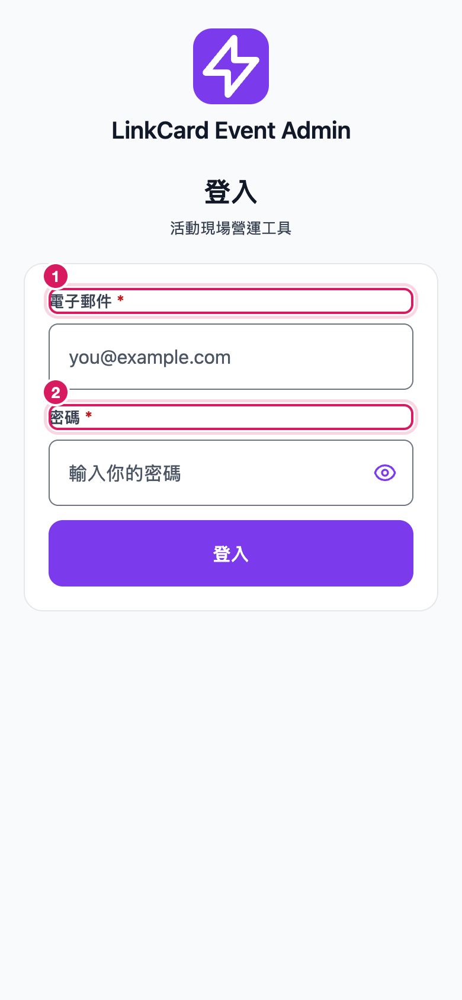

| Callout | What it points at |
| --- | --- |
| 1 | Email field |
| 2 | Password field |

**A1-2　What you do**

Tap the email field and type your email address.

**What you see**

The text you type shows in the field.

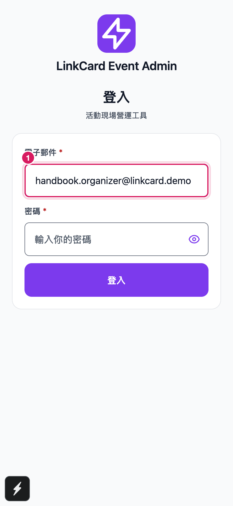

| Callout | What it points at |
| --- | --- |
| 1 | Your email |

**A1-3　What you do**

Tap the password field, type your password, then press Sign in.

**What you see**

The password shows as dots. The eye icon on the right reveals it, in case you mistyped.

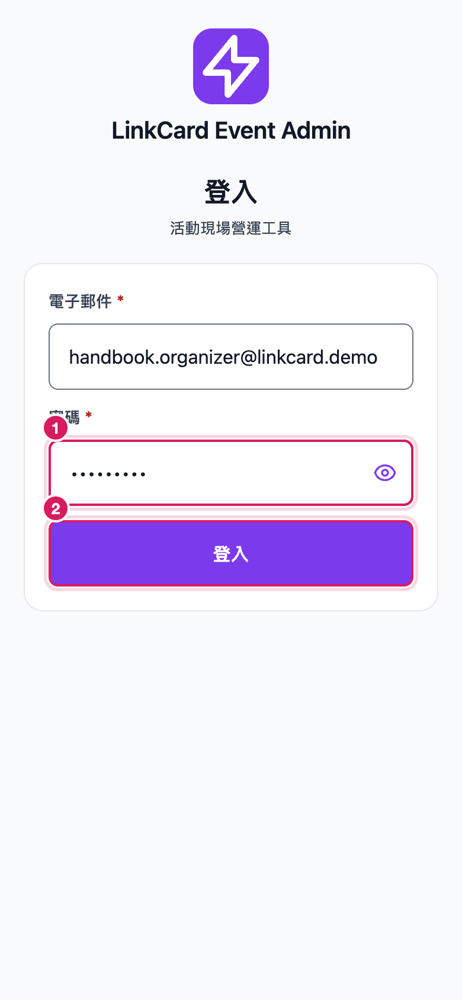

| Callout | What it points at |
| --- | --- |
| 1 | Password field (shown as dots) |
| 2 | Press to sign in |

**A1-4　What you do**

Press Sign in.

**What you see**

You go straight to My events, listing the events you are responsible for.

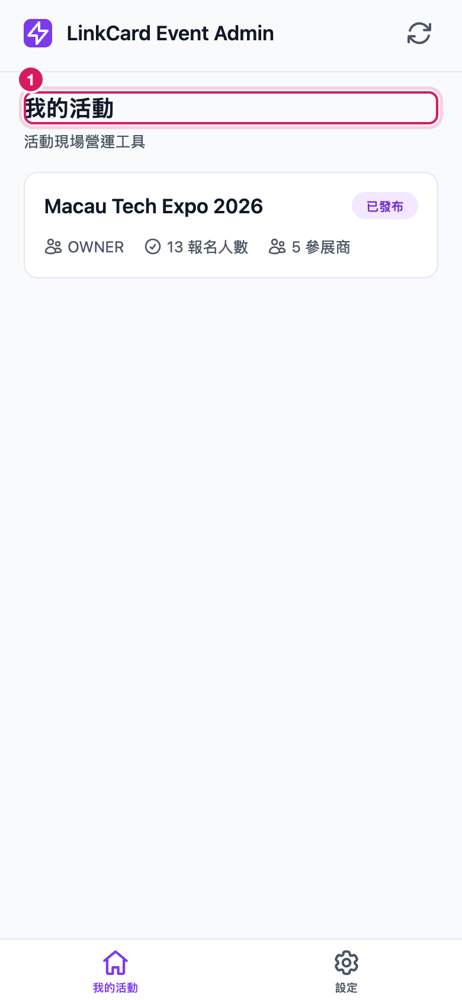

| Callout | What it points at |
| --- | --- |
| 1 | You are signed in; this is your event list |

### A2．Pick the event you are working on

| | |
| --- | --- |
| Who | Organiser |
| When | Every time you open the app. |
| What you want | Get into the tools for the right event. |
| Before you start | You are signed in. |
| When you are done | You are on that event's Overview. |

**A2-1　What you do**

Find the event you are working on in My events.

**What you see**

Each card shows the event name, status, your role, and the number of registrations and exhibitors.

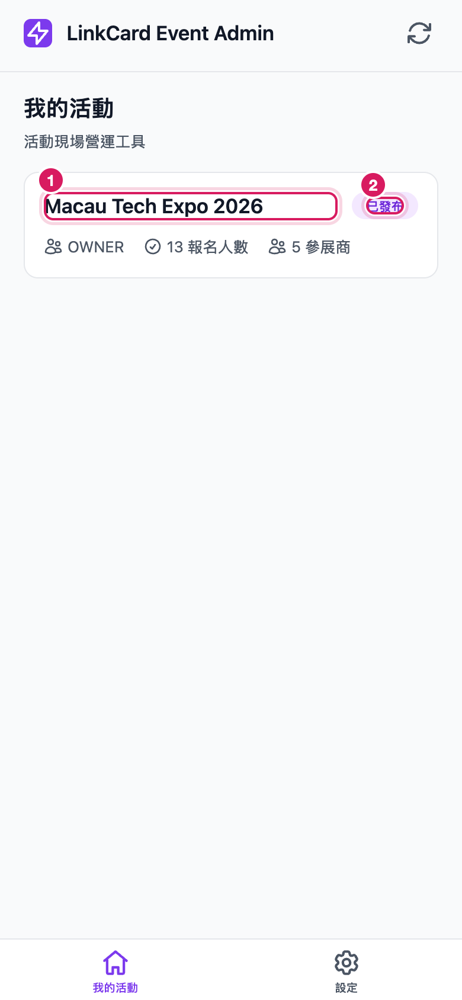

| Callout | What it points at |
| --- | --- |
| 1 | Event name |
| 2 | Event status |

**A2-2　What you do**

Check the numbers on the card to be sure it is the right event.

**What you see**

The registration and exhibitor counts sit under the name, no need to open it.

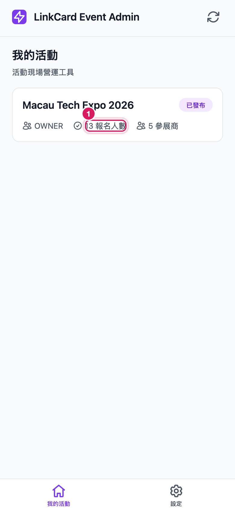

| Callout | What it points at |
| --- | --- |
| 1 | Registration and exhibitor counts |

**A2-3　What you do**

Tap the event card.

**What you see**

You arrive at Overview, with this event's live numbers at the top.

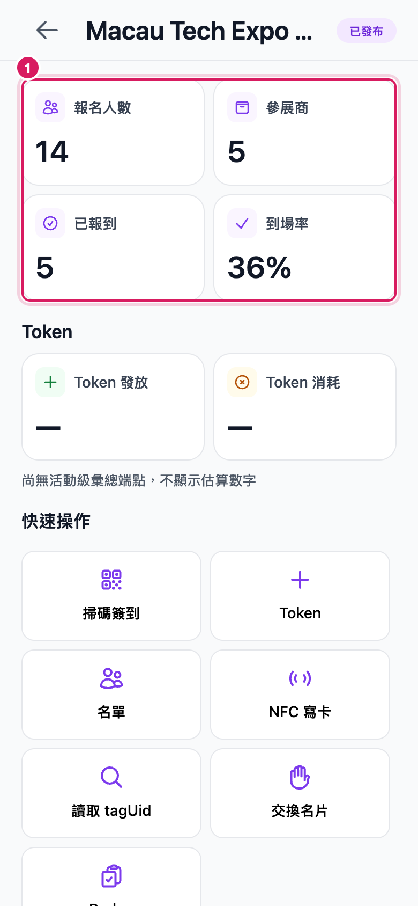

| Callout | What it points at |
| --- | --- |
| 1 | You are inside this event |

### A3．Check the phone status and sign out

| | |
| --- | --- |
| Who | Organiser |
| When | Before doors open to confirm the device is fine, or before handing the phone to someone else. |
| What you want | Confirm the app version and whether NFC works, and sign out safely when needed. |
| Before you start | You are signed in. |
| When you are done | You know whether this phone can write badges; after signing out you are back at the sign-in screen. |

**A3-1　What you do**

Tap Settings in the bottom bar.

**What you see**

You see two sections: Account and Device.

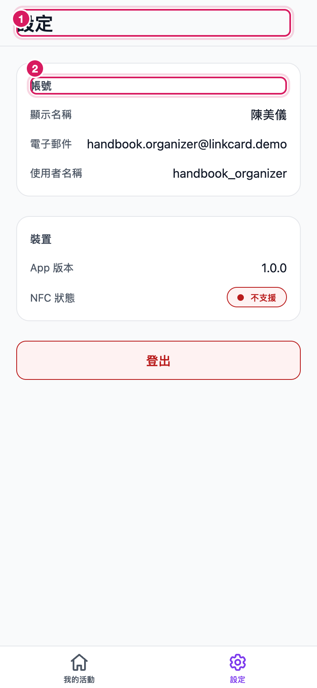

| Callout | What it points at |
| --- | --- |
| 1 | Account: who you are signed in as |
| 2 | Device: this phone's status |

**A3-2　What you do**

Look at the NFC status row.

**What you see**

Supported means this phone can write and read badges. Not supported means you need another phone for NFC work.

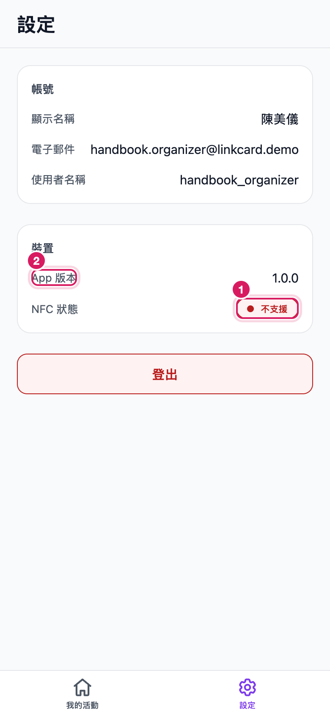

| Callout | What it points at |
| --- | --- |
| 1 | NFC status decides whether this phone can write badges |
| 2 | Quote this version when reporting a problem |

**A3-3　What you do**

When handing the phone over, scroll down and press Sign out.

**What you see**

You return to the sign-in screen, so the next person cannot see your event data.

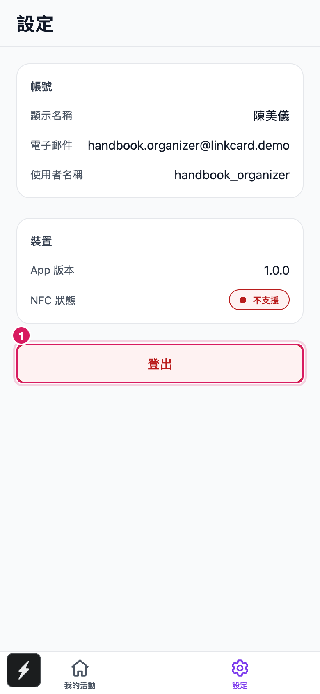

| Callout | What it points at |
| --- | --- |
| 1 | Press this before handing the phone over |

## Part 2: Before the doors open

### B1．See where the event stands

| | |
| --- | --- |
| Who | Organiser |
| When | Before doors open, and every so often during the day. |
| What you want | Read registrations, check-ins and attendance rate at a glance. |
| Before you start | You are inside the event. |
| When you are done | You know how the door is going and can jump straight to a tool. |

**B1-1　What you do**

Open this event's Overview.

**What you see**

Four figures: registrations, checked in, exhibitors, attendance rate.

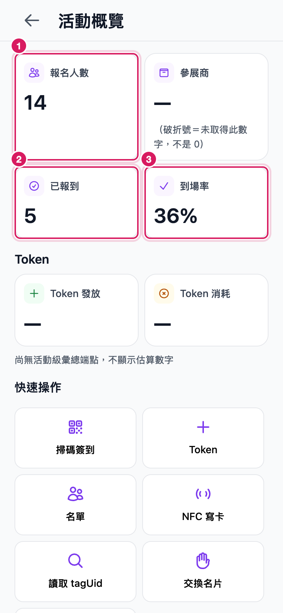

| Callout | What it points at |
| --- | --- |
| 1 | Registrations |
| 2 | Checked in |
| 3 | Attendance rate |

**B1-2　What you do**

If a figure shows a dash instead of a number, read the note under it.

**What you see**

A dash means the figure could not be read, not that it is zero. The note explains why.

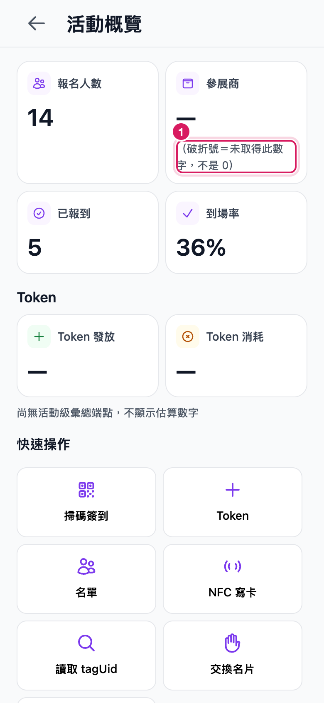

| Callout | What it points at |
| --- | --- |
| 1 | What the dash means |

**B1-3　What you do**

Scroll to Quick actions, the shortcuts you will use most on the door.

**What you see**

Seven buttons: scan check-in, Token, roster, write NFC badge, read tagUid, exchange contacts, badges.

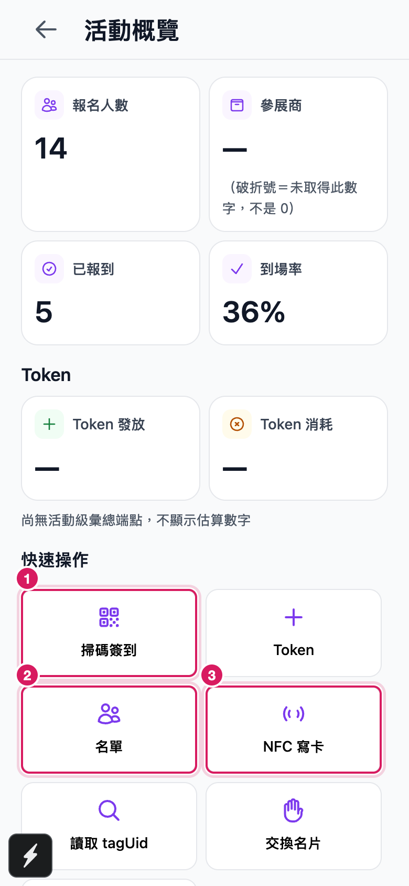

| Callout | What it points at |
| --- | --- |
| 1 | Scan check-in: the one you use most |
| 2 | Roster: to look someone up |
| 3 | Write NFC badge: to issue a wristband |

### B2．Check the badge inventory

| | |
| --- | --- |
| Who | Organiser |
| When | Before doors open, and whenever you run out of wristbands. |
| What you want | Know how many blank badges are left and how many are already issued. |
| Before you start | You are inside the event. |
| When you are done | You know whether you need to open a fresh batch. |

**B2-1　What you do**

Press Badges in Quick actions.

**What you see**

A lookup box on top, and every badge for this event below.

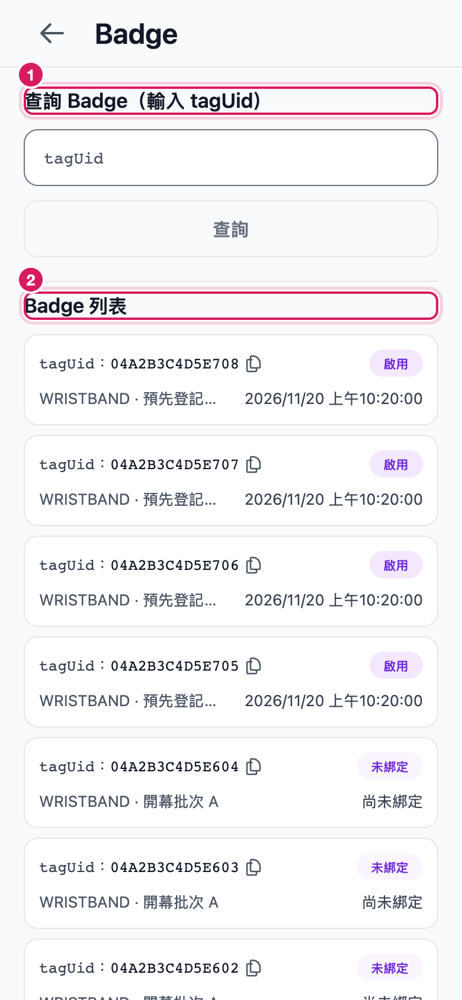

| Callout | What it points at |
| --- | --- |
| 1 | Use this when you know the card number |
| 2 | The full list |

**B2-2　What you do**

Read the status label on each card.

**What you see**

Unassigned means a blank badge not yet issued. Active means it is on someone and in use.

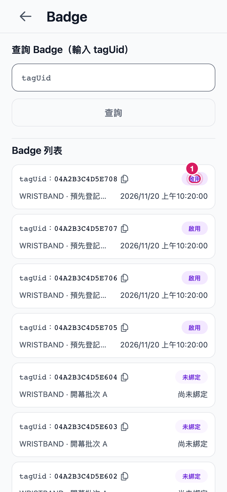

| Callout | What it points at |
| --- | --- |
| 1 | Issued and in use |

**B2-3　What you do**

Read the batch name on each card.

**What you see**

The batch name tells you which stack the badge came from, which makes reconciling easier.

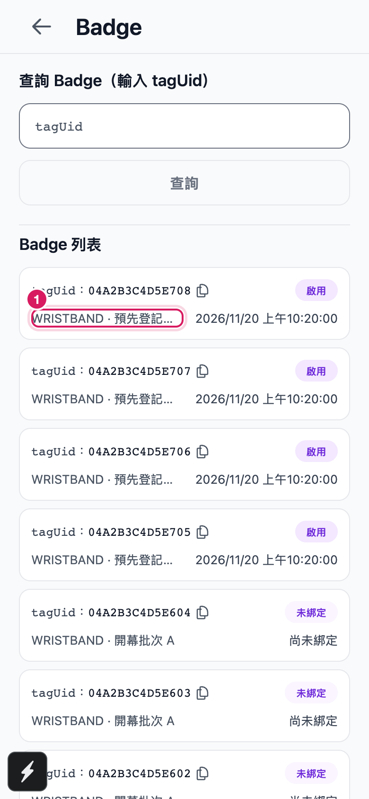

| Callout | What it points at |
| --- | --- |
| 1 | Batch name |

### B3．Get to know the roster

| | |
| --- | --- |
| Who | Organiser |
| When | Before doors open, to see who is coming. |
| What you want | Understand what each row on the roster is telling you. |
| Before you start | You are inside the event, and your account is allowed to read the roster. |
| When you are done | You know how to read a registration row and how to copy a registration code. |

**B3-1　What you do**

Press Roster in Quick actions.

**What you see**

You see this event's list of registrations.

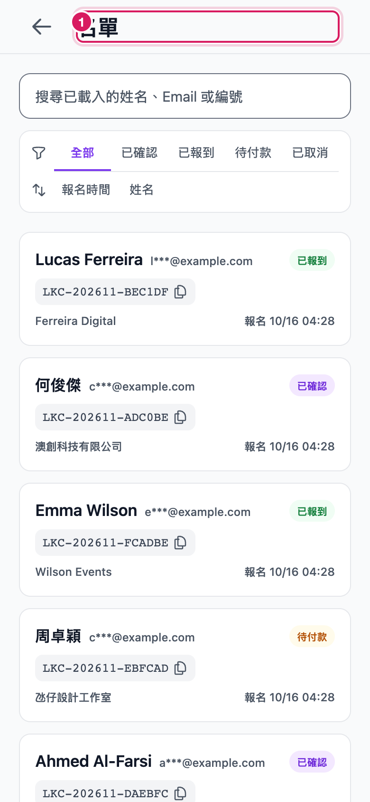

| Callout | What it points at |
| --- | --- |
| 1 | The roster |

**B3-2　What you do**

Read one registration row.

**What you see**

Left to right: name, email (partly starred for privacy), status label, registration code, company, and when they registered.

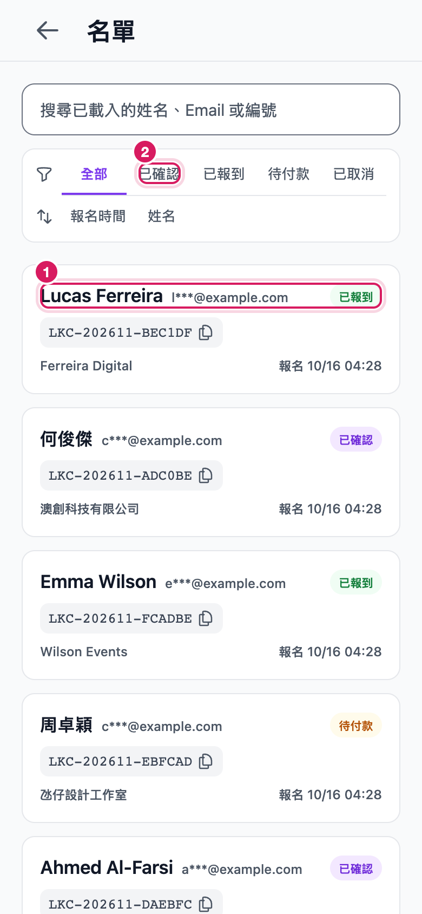

| Callout | What it points at |
| --- | --- |
| 1 | One row is one registration |
| 2 | Status: confirmed means they may enter |

**B3-3　What you do**

Tap the registration code.

**What you see**

The code is copied so you can paste it elsewhere or send it to a colleague.

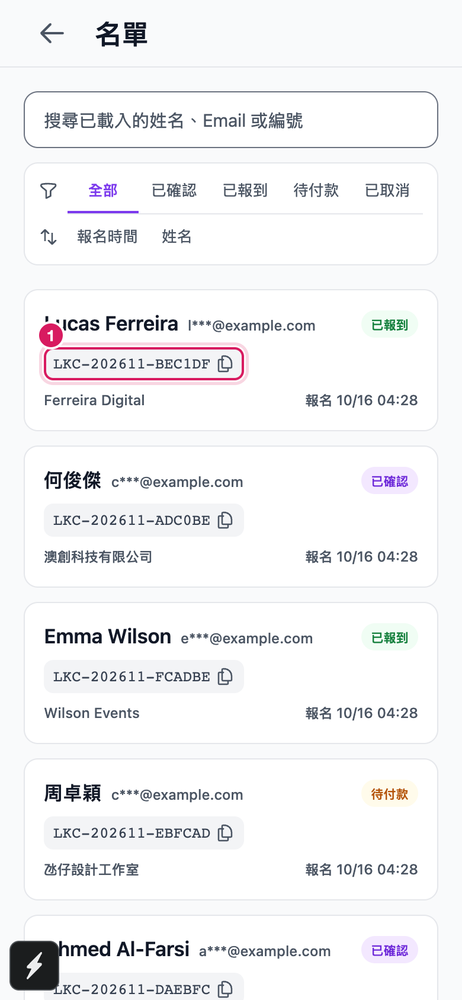

| Callout | What it points at |
| --- | --- |
| 1 | Tap to copy the code |

## Part 3: Checking people in

### C1．Check someone in by scanning

| | |
| --- | --- |
| Who | Door staff |
| When | When an attendee holds up a QR code on their phone or on paper. This is the fastest way. |
| What you want | Turn a QR code into a check-in record. |
| Before you start | You are on the scan screen for this event and the camera works. |
| When you are done | The result appears, then the screen returns to scanning after about 15 seconds, ready for the next person. |

**C1-1　What you do**

Press Scan check-in in Quick actions.

**What you see**

The running check-in total sits on top, with the scanning frame below.

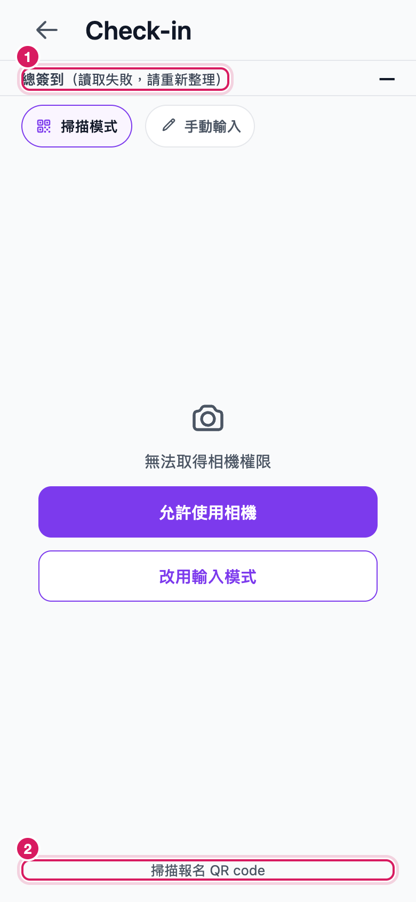

| Callout | What it points at |
| --- | --- |
| 1 | Running check-in total |
| 2 | Aim the QR code at this frame |

**C1-2　What you do**

Point the phone at the attendee's QR code, about 15 cm away.

**What you see**

The screen shows Checking, you do not press anything, it reads by itself.

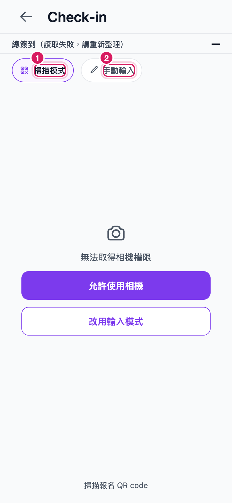

| Callout | What it points at |
| --- | --- |
| 1 | Just aim here |

**C1-3　What you do**

When it reads, look at the result card.

**What you see**

A green Checked in means you can let them through. The card shows their name, ticket type and check-in time.

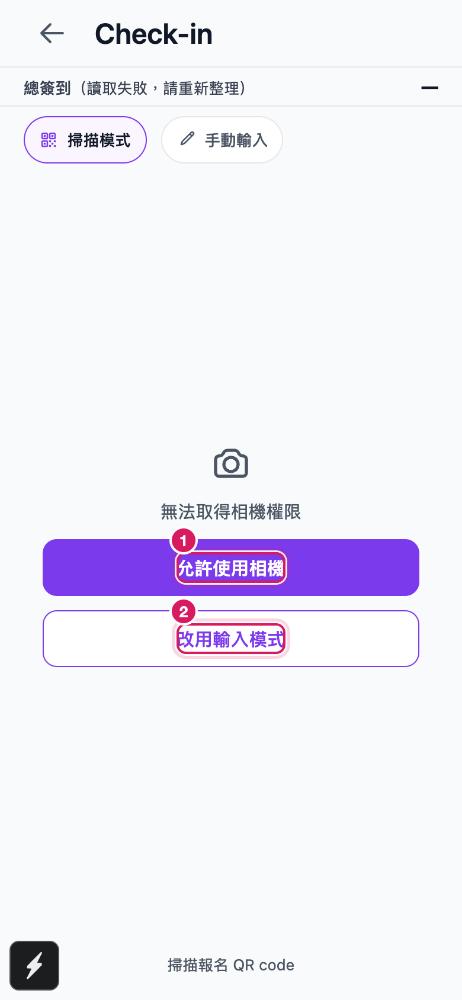

| Callout | What it points at |
| --- | --- |
| 1 | Let them through |
| 2 | Check the name matches the person |

**C1-4　What you do**

If this attendee needs a wristband, press Write NFC badge. You do not have to retype the code.

**What you see**

It carries the attendee's details over to the badge screen, saving 30 to 60 seconds per person.

| Callout | What it points at |
| --- | --- |
| 1 | Press to continue to badge writing |

### C2．When the camera will not work, type the code

| | |
| --- | --- |
| Who | Door staff |
| When | When the QR code is damaged, the screen reflects, or another app is holding the camera. |
| What you want | Still check the person in, without sending them back to the queue. |
| Before you start | You are on the scan screen for this event. |
| When you are done | You get the same result as scanning. |

**C2-1　What you do**

If the screen says the camera is unavailable, press Allow camera and try again.

**What you see**

Usually one press is enough.

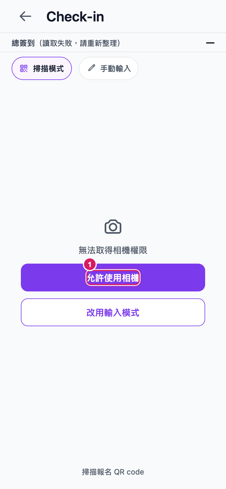

| Callout | What it points at |
| --- | --- |
| 1 | Try enabling the camera first |

**C2-2　What you do**

If it still will not work, press Switch to typing.

**What you see**

The scanning frame becomes a text box.

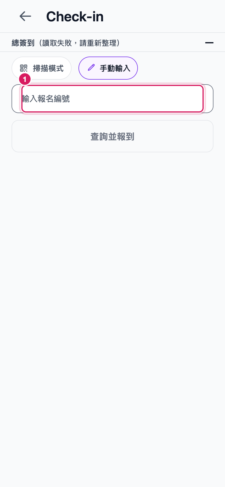

| Callout | What it points at |
| --- | --- |
| 1 | Switch to typing |

**C2-3　What you do**

Type the registration code the attendee gives you, for example LKC-202611-A1B2C3.

**What you see**

Case does not matter, and stray spaces are fine, the system corrects them.

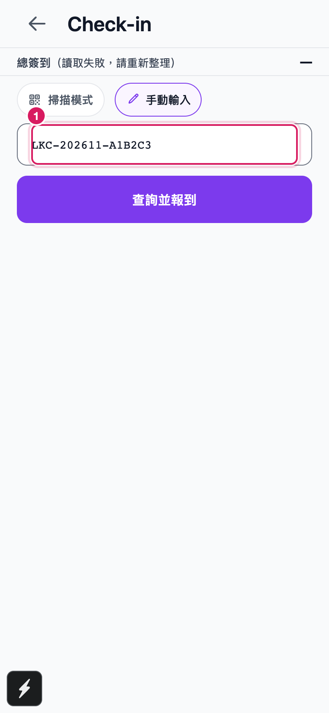

| Callout | What it points at |
| --- | --- |
| 1 | Type the registration code |

**C2-4　What you do**

Press Look up and check in.

**What you see**

The same result card appears as with scanning.

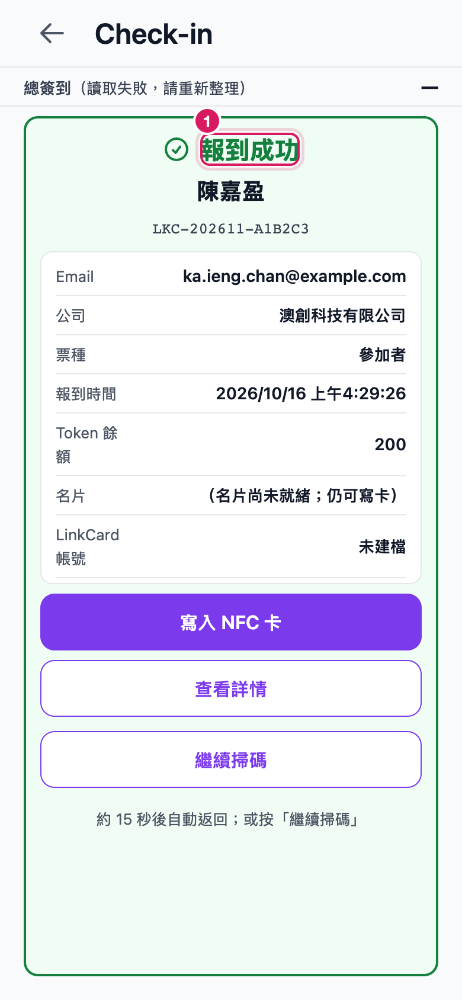

| Callout | What it points at |
| --- | --- |
| 1 | Press to submit |

### C3．Read the four check-in outcomes

| | |
| --- | --- |
| Who | Door staff |
| When | After every check-in. |
| What you want | Know which outcome lets someone through and which needs a supervisor. |
| Before you start | You have completed at least one lookup. |
| When you are done | You know what to do next for every outcome. |

**C3-1　What you do**

Outcome one: checked in.

**What you see**

A green Checked in headline means the ticket was valid and is now checked in. Let them through.

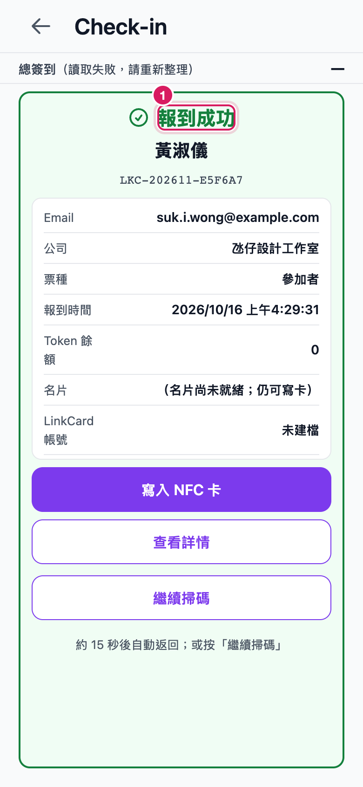

| Callout | What it points at |
| --- | --- |
| 1 | Let them through |

**C3-2　What you do**

Outcome two: already checked in.

**What you see**

The headline says Already checked in, meaning this person was checked in earlier. Do not wave them through again, ask whether they already entered.

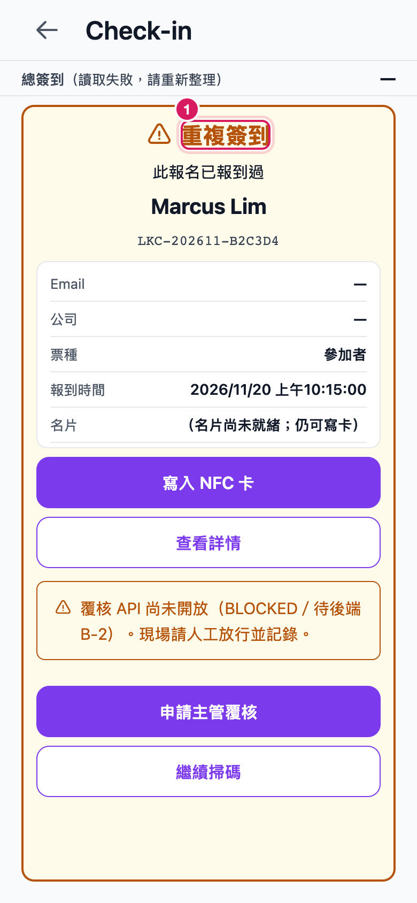

| Callout | What it points at |
| --- | --- |
| 1 | Not a new arrival, confirm first |

**C3-3　What you do**

Outcome three: invalid registration.

**What you see**

The headline says Invalid registration, meaning this ticket was not found. Check for a typo first, then ask for their original confirmation email.

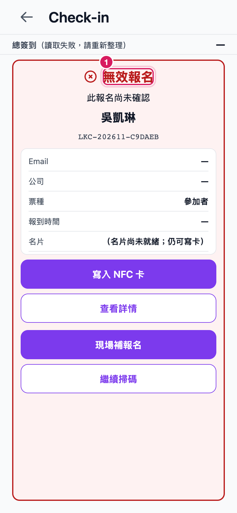

| Callout | What it points at |
| --- | --- |
| 1 | Do not let them through |

**C3-4　What you do**

If the network is the problem, the screen says the connection failed.

**What you see**

That is not the same as an invalid ticket. The ticket may be fine. Verify by hand or switch networks, but do not treat it as fake.

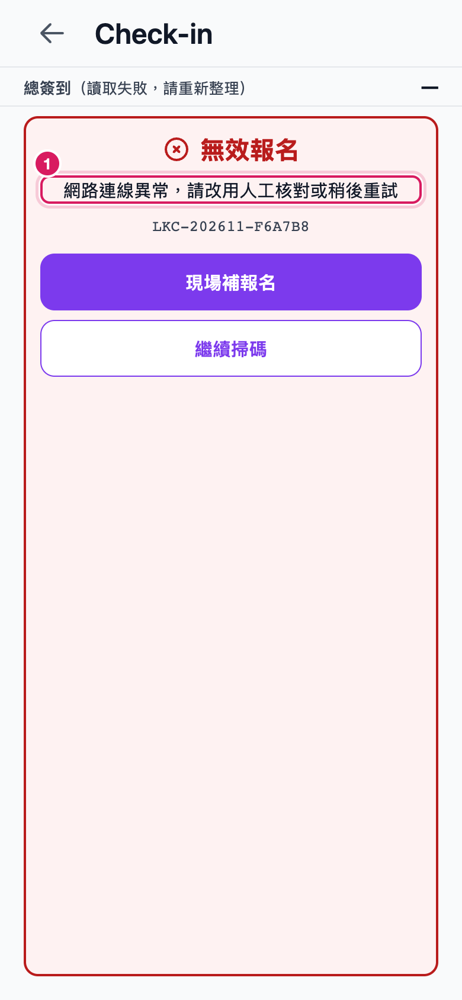

| Callout | What it points at |
| --- | --- |
| 1 | A network problem, not a ticket problem |

### C4．Register someone on the spot

| | |
| --- | --- |
| Who | Door staff |
| When | Someone turns up without having registered. |
| What you want | Create a registration for them, then check them in as usual. |
| Before you start | You know which ticket type to give them. |
| When you are done | The roster gains a record, and you can carry straight on to check-in or badge writing. |

**C4-1　What you do**

Open walk-in registration from the door tools.

**What you see**

A form appears: ticket type, email, first name, last name, phone, company.

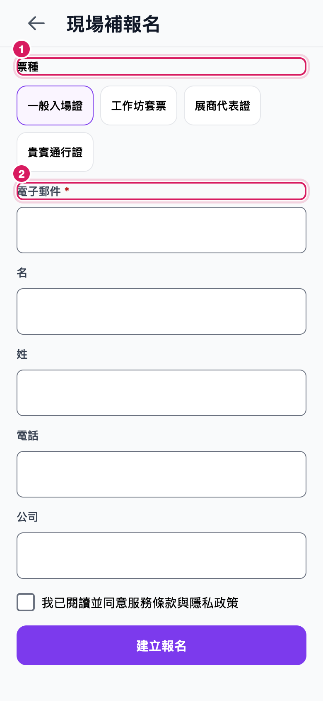

| Callout | What it points at |
| --- | --- |
| 1 | Choose the ticket type first |
| 2 | Email is required |

**C4-2　What you do**

Fill in the attendee's details, completing the starred fields.

**What you see**

First and last name are separate fields; phone and company are optional.

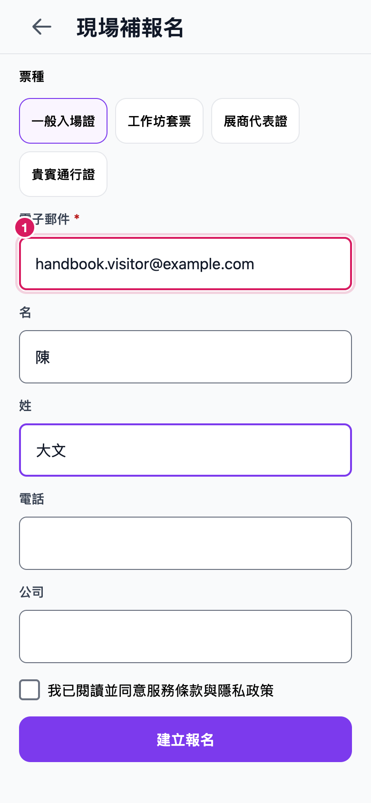

| Callout | What it points at |
| --- | --- |
| 1 | You must tick the consent box |

**C4-3　What you do**

Read the terms to the attendee, tick consent, then press Create registration.

**What you see**

The screen confirms the registration was created.

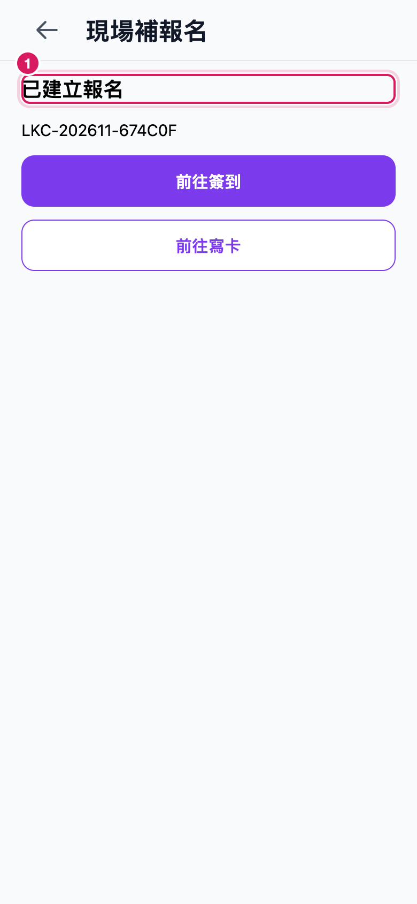

| Callout | What it points at |
| --- | --- |
| 1 | Press to create |

**C4-4　What you do**

Then press Go to check-in or Go to badge.

**What you see**

Note: for paid tickets the registration exists but is unpaid, so it does not count as entry.

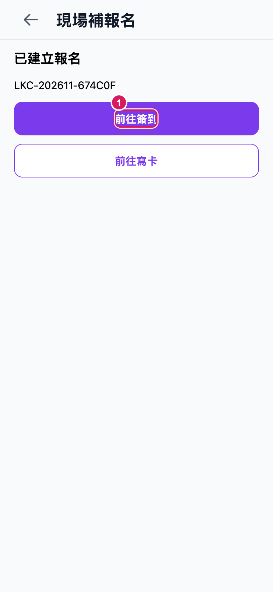

| Callout | What it points at |
| --- | --- |
| 1 | Carry straight on to check-in |

## Part 4: The roster and looking people up

### D1．Find someone on the roster

| | |
| --- | --- |
| Who | Organiser |
| When | Someone asks about their registration, or you need to confirm whether a person has arrived. |
| What you want | Find that person in seconds. |
| Before you start | You are on the roster screen. |
| When you are done | You found them and can open their detail. |

**D1-1　What you do**

To see one status only, press a filter chip at the top.

**What you see**

You can choose all, confirmed, checked in, awaiting payment, or cancelled.

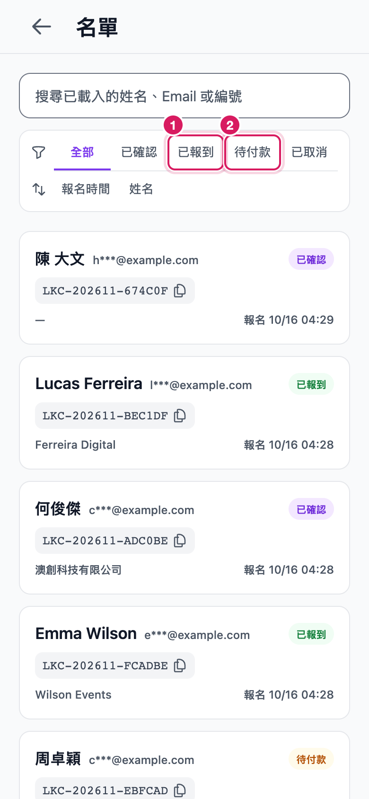

| Callout | What it points at |
| --- | --- |
| 1 | Show only people who have checked in |
| 2 | Show only unpaid registrations |

**D1-2　What you do**

To re-sort, press Registered or Name.

**What you see**

The list re-sorts straight away.

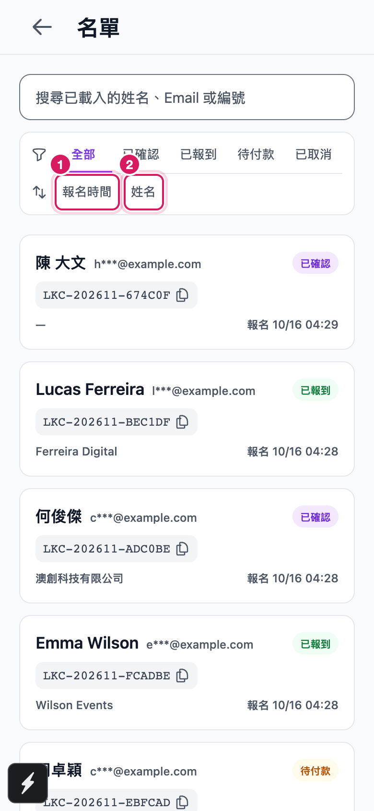

| Callout | What it points at |
| --- | --- |
| 1 | Sort by registration time |
| 2 | Sort by name |

**D1-3　What you do**

If you cannot find them, clear the filters and scroll down.

**What you see**

If nothing matches, the screen says there are no matching registrations and suggests clearing the filters.

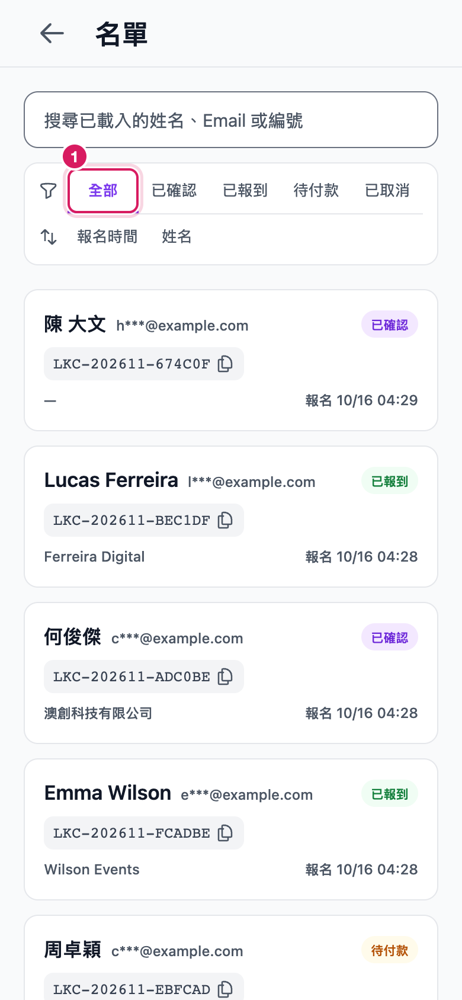

| Callout | What it points at |
| --- | --- |
| 1 | Press to show everything |

### D2．Open one person's full record

| | |
| --- | --- |
| Who | Organiser |
| When | When you need to confirm a check-in time, a token balance, or a ticket type. |
| What you want | See everything about one person on a single page. |
| Before you start | You are on the roster screen. |
| When you are done | Press Back to return to the roster. |

**D2-1　What you do**

Tap the row with that person's name.

**What you see**

You enter the detail view. Note: tapping the registration code only copies it, it does not open the detail.

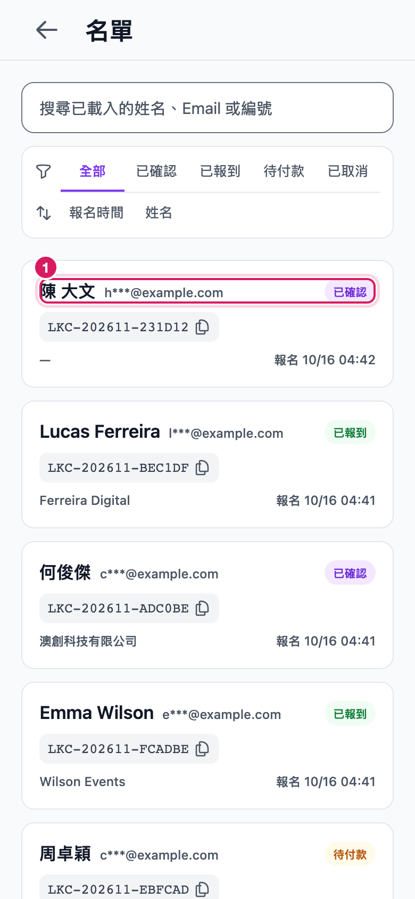

| Callout | What it points at |
| --- | --- |
| 1 | Tap the name row to open the detail |

**D2-2　What you do**

Read the Profile and Registration sections.

**What you see**

Name, email, phone, company, ticket type and registration time are all here.

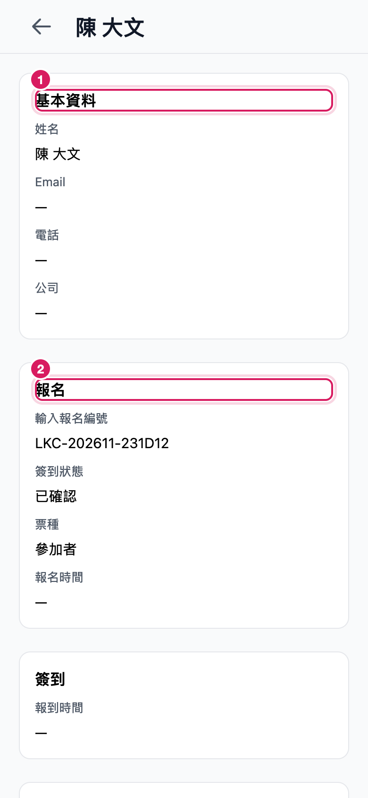

| Callout | What it points at |
| --- | --- |
| 1 | Their details |
| 2 | This ticket's details |

**D2-3　What you do**

Scroll to the Check-in, Token history and NFC sections.

**What you see**

If a section shows a dash or says no bound badge was found, the backend simply has no record yet. It does not mean something is broken.

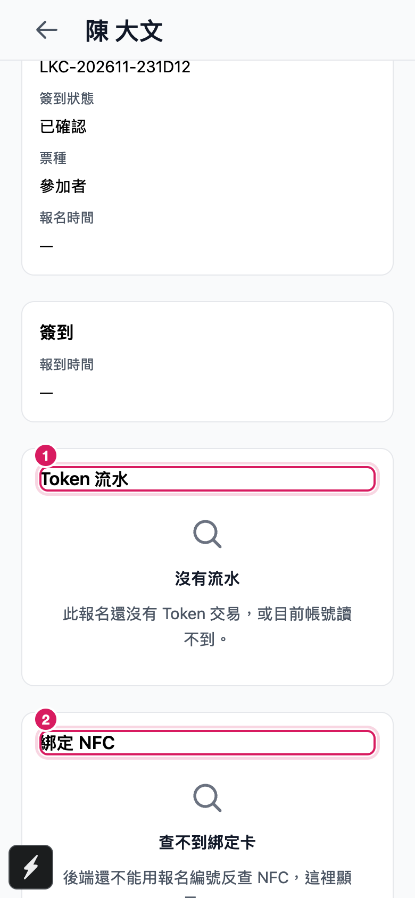

| Callout | What it points at |
| --- | --- |
| 1 | Check-in time |
| 2 | Token history |

### D3．Why door staff cannot open the roster

| | |
| --- | --- |
| Who | Door staff |
| When | You signed in with the door account and the roster will not open. |
| What you want | Understand this is a permission boundary, not a broken phone. |
| Before you start | Signed in with the door-staff account. |
| When you are done | You know to switch to an owner or coordinator account to read the roster. |

**D3-1　What you do**

Sign in with the door-staff account.

**What you see**

The event card shows your role as OPERATOR rather than OWNER.

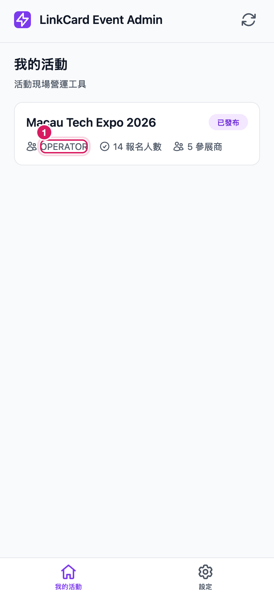

| Callout | What it points at |
| --- | --- |
| 1 | You are signed in as door staff |

**D3-2　What you do**

Open the roster anyway.

**What you see**

The screen explains that the roster needs an owner or coordinator account on the backend. Check-in and badge writing are unaffected.

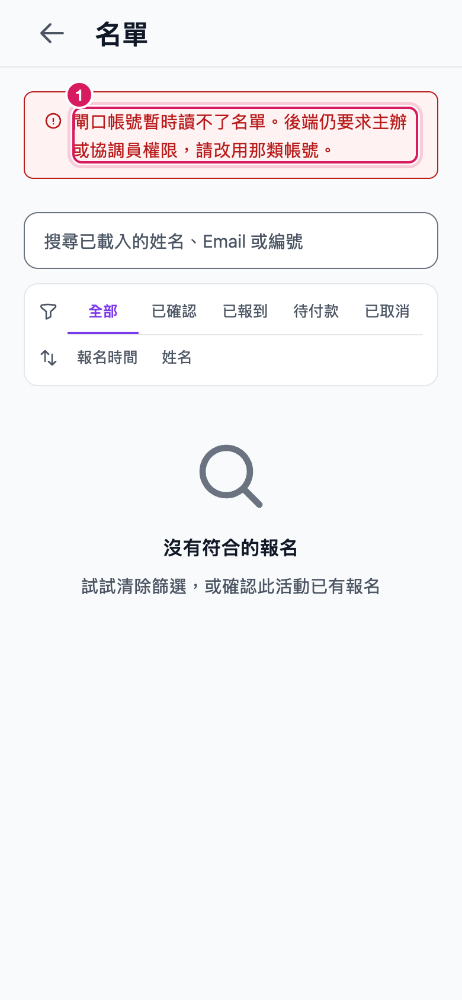

| Callout | What it points at |
| --- | --- |
| 1 | A permission limit, not a fault |

## Part 5: NFC wristbands

### E1．Write a wristband for an attendee

| | |
| --- | --- |
| Who | Door staff |
| When | An attendee has checked in and needs a wristband to enter. |
| What you want | Bind one blank wristband to one attendee. |
| Before you start | You have blank wristbands and the phone supports NFC. |
| When you are done | The wristband is bound and ready to hand over. |

**E1-1　What you do**

Press Write NFC badge in Quick actions.

**What you see**

Step one appears: enter a registration code to look up the attendee.

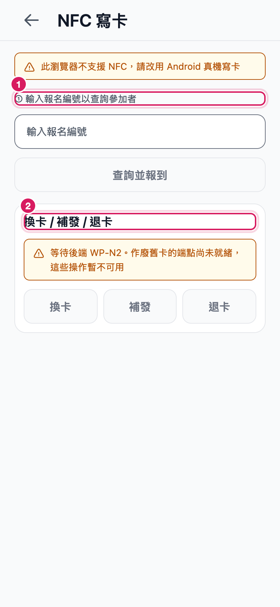

| Callout | What it points at |
| --- | --- |
| 1 | Step one: find the person |
| 2 | Replace, reissue and return are not available yet |

> **About this image**：Captured in a browser, which has no NFC, so the app's own notice appears. On a phone that notice is absent; everything else is the same.

**E1-2　What you do**

Enter the attendee's registration code, or arrive here from the check-in result card.

**What you see**

Once found, the screen shows their name and ticket type so you can confirm.

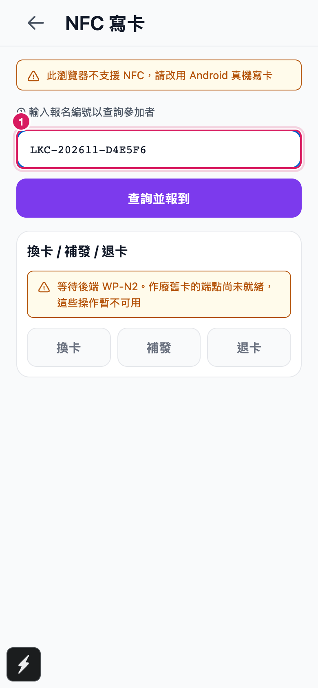

| Callout | What it points at |
| --- | --- |
| 1 | Enter the registration code |

**E1-3　What you do**

Press Look up and check in, and confirm the person on screen is right.

**What you see**

Step two appears: choose a badge type, then hold a blank NFC card to the back of the phone.

| Callout | What it points at |
| --- | --- |
| 1 | Step two: choose a type, then tap the card |

**E1-4　What you do**

Choose Wristband, then press Start writing the NFC badge.

**What you see**

The screen says writing, keep the card close. Do not move the wristband now.

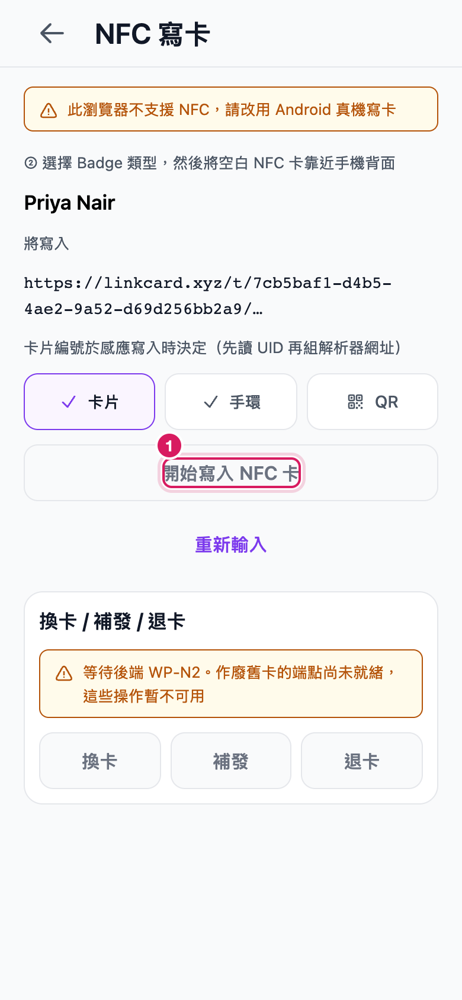

| Callout | What it points at |
| --- | --- |
| 1 | Hold still until it finishes |

**E1-5　What you do**

Hand the wristband over only once the screen confirms the binding succeeded.

**What you see**

If it reports a failure or a timeout, the badge is not done. Tap again and retry; the screen says explicitly not to treat it as success.

| Callout | What it points at |
| --- | --- |
| 1 | Only done when you see this |

### E2．Read a card number and exchange contacts

| | |
| --- | --- |
| Who | Door staff |
| When | You need to identify whose wristband this is, or two attendees want to swap details. |
| What you want | Read a card number, or record one exchange with two taps. |
| Before you start | The phone supports NFC. |
| When you are done | You have the card number, or one exchange is recorded. |

**E2-1　What you do**

Press Read tagUid in Quick actions.

**What you see**

The screen asks you to hold the NFC card to the back of the phone to read its hardware number.

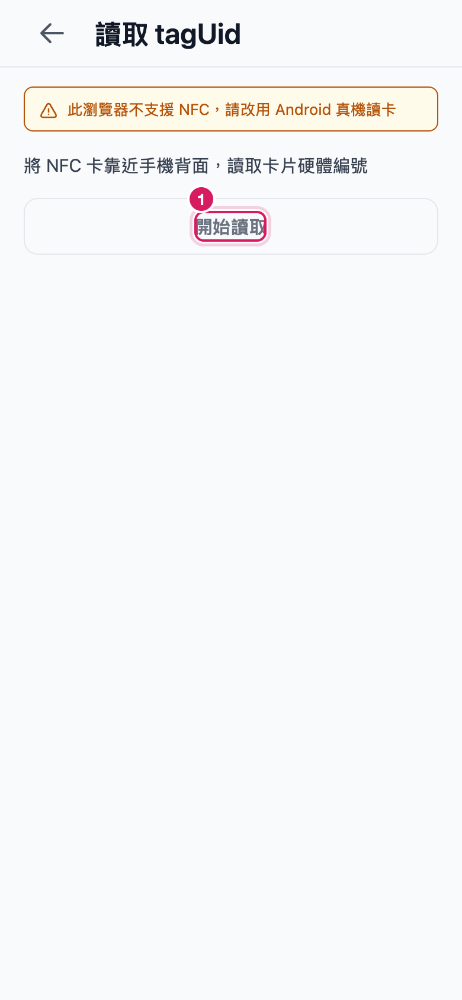

| Callout | What it points at |
| --- | --- |
| 1 | Press, then tap the card |

> **About this image**：Also captured in a browser, so the no-NFC notice appears.

**E2-2　What you do**

Once read, press Copy tagUid.

**What you see**

The card number is copied, ready to paste to a colleague or look up on the badge page.

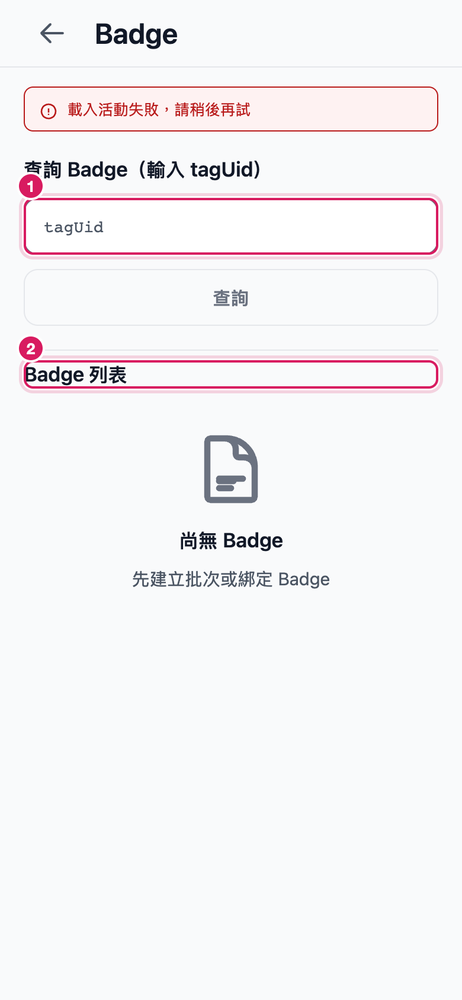

| Callout | What it points at |
| --- | --- |
| 1 | Copy the card number |

**E2-3　What you do**

To let two people swap details, open Exchange contacts.

**What you see**

The screen states the order: tap the first card, wait for the name to appear, then tap the other person's card.

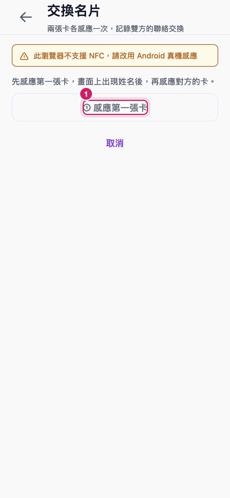

| Callout | What it points at |
| --- | --- |
| 1 | Tap the first card |

> **About this image**：Exchanging contacts needs two physical taps, which a browser cannot demonstrate, so only the app's instructions are shown.

**E2-4　What you do**

Tap the second card as prompted, and wait for the confirmation.

**What you see**

If it says already exchanged, these two cards met before and nothing was written twice. That is normal.

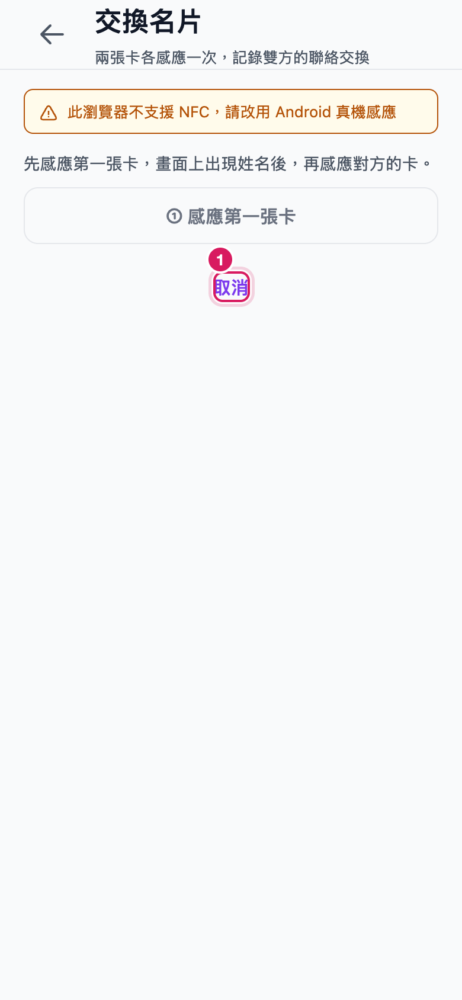

| Callout | What it points at |
| --- | --- |
| 1 | Then tap the second card |

## Part 6: When things are not normal

### F1．The token desk, and what to do when the network drops

| | |
| --- | --- |
| Who | Organiser |
| When | An attendee wants tokens, or the venue network is patchy. |
| What you want | Know that the token desk lives on the web, and how to handle a connection problem. |
| Before you start | You are inside the event. |
| When you are done | You will not hunt for token features in the app, and will not mistake a network problem for a fake ticket. |

**F1-1　What you do**

Press Token in Quick actions.

**What you see**

The app explains that the token desk is web-first and this is only a doorway.

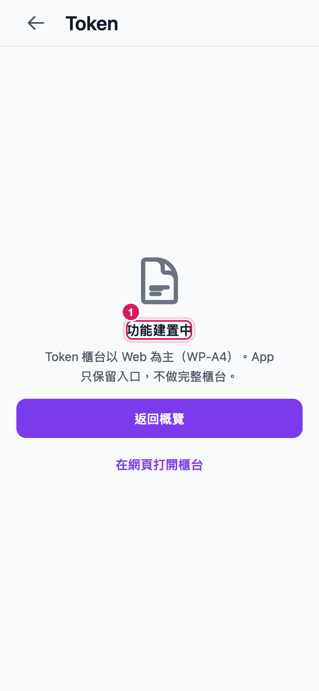

| Callout | What it points at |
| --- | --- |
| 1 | The app does not host the full desk |

**F1-2　What you do**

Press Open the desk on the web.

**What you see**

It opens the web console in your phone's browser, where the same account works.

| Callout | What it points at |
| --- | --- |
| 1 | Top-ups and deductions happen on the web |

**F1-3　What you do**

If check-in reports a network or server problem.

**What you see**

This is not the same as a registration not being found. The ticket may be fine: verify by hand or switch networks, but do not treat it as fake.

| Callout | What it points at |
| --- | --- |
| 1 | When the network is patchy, switch to typing and retry |

**F1-4　What you do**

For a duplicate or an exception you want to allow, press Request supervisor override.

**What you see**

This feature is not open yet. The screen states the backend is not ready, so let the person through by hand and keep a written record rather than changing data yourself.

| Callout | What it points at |
| --- | --- |
| 1 | Not available yet, handle it by hand |
