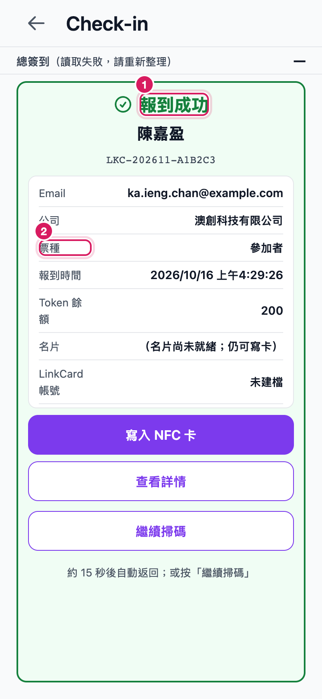

# LinkCard Event Admin — 使用手冊（旅程設計）

`iOS 與 Android 手機應用程式（Expo）`

**給誰看**：活動主辦人與現場閘口工作人員

**畫面怎麼來的**：畫面以手機尺寸的瀏覽器視窗擷取（390 × 844，2 倍解析度）。相機與 NFC 屬於手機硬體，瀏覽器沒有，因此這兩個功能的相關畫面會顯示 App 自己的提示文字。

## 兩種使用者

- **主辦人**：活動的擁有者，可看名單、設定與所有現場工具。
- **閘口工作人員**：只被授權在現場報到與操作 NFC，讀不到完整名單。

## 該用手機 App，還是用筆電簽到台？

這個 App 的 NFC 寫卡**沒有**被取代：它仍然有效，仍然可以發卡。新增的「Web 簽到台」是**第二條**路，不是替代品。從現在起現場同時有兩條路，選錯就是白排一次隊。

**一句話決策準則：** 手上有筆電和讀卡機，就用筆電簽到台；只有手機，就用這個 App。

| 你手上有什麼 | 走哪一條路 | 差別 |
| --- | --- | --- |
| 筆電 ＋ ACR1555U 讀卡機 ＋ Chrome 或 Edge | **Web 簽到台**（筆電） | 掃 QR 後按「寫入這張卡」，系統自動組出卡片網址、自動綁定、自動讀回驗證 |
| 只有手機（iPhone 或 Android），沒有讀卡機 | **這個 App**（手機 NFC，第五部分 E1～E2） | 手機自己就是讀卡機，不需要外接設備 |
| iPad、Android 平板、Safari、Firefox | **兩條都不能用** | 網頁版需要 Web Bluetooth，這些裝置與瀏覽器都沒有；請改用上面任一條可用的路線 |

**同一張卡不要兩邊都寫。** 一邊綁好就定案；兩邊都試，會變成一邊成功、另一邊回報這張卡已經有主人。

筆電路線的完整操作（班前連讀卡機、六種讀卡機狀態、九條失敗分支、卡寫好但沒登記的黃態、以及「不要做什麼」）寫在另一本：**《Web 簽到台 — 現場操作手冊》**（`LinkCard_Frontend/docs/handbook/web-checkin-desk-zh.md`）。這一本不重複它的內容；兩本不要混著用。

## 旅程一覽

| 編號 | 旅程 | 誰做 | 步驟 |
| --- | --- | --- | --- |
| | **第一部分：開始使用** | | |
| A1 | 登入 App | 主辦人 | 4 |
| A2 | 選擇要處理的活動 | 主辦人 | 3 |
| A3 | 檢查手機狀態與登出 | 主辦人 | 3 |
| | **第二部分：開場之前** | | |
| B1 | 掌握活動現況 | 主辦人 | 3 |
| B2 | 點清 Badge 庫存 | 主辦人 | 3 |
| B3 | 先認識名單 | 主辦人 | 3 |
| | **第三部分：現場報到** | | |
| C1 | 用相機掃碼報到 | 閘口工作人員 | 3 |
| C2 | 相機不能用時，改用手動輸入 | 閘口工作人員 | 5 |
| C3 | 看懂四種報到結果 | 閘口工作人員 | 4 |
| C4 | 現場補報名 | 閘口工作人員 | 4 |
| | **第四部分：查名單與找人** | | |
| D1 | 從名單找人 | 主辦人 | 3 |
| D2 | 看一個人的完整資料 | 主辦人 | 3 |
| D3 | 閘口帳號看不到名單 | 閘口工作人員 | 2 |
| | **第五部分：NFC 手環** | | |
| E1 | 把手環寫給參加者 | 閘口工作人員 | 4 |
| E2 | 讀卡片編號與交換名片 | 閘口工作人員 | 4 |
| | **第六部分：特殊情況** | | |
| F1 | Token 櫃台與連線異常 | 主辦人 | 4 |

## 第一部分：開始使用

### A1．登入 App

| | |
| --- | --- |
| 誰做 | 主辦人 |
| 什麼時候 | 第一次拿到手機，或換了裝置之後。 |
| 要達到什麼 | 用自己的帳號登入，看到自己負責的活動。 |
| 開始之前 | 已收到主辦方提供的帳號電郵與密碼。 |
| 做完之後 | 停在「我的活動」畫面，可以開始選活動。 |

**A1-1　你做什麼**

打開 App。

**你會看到什麼**

出現登入畫面：上方是 App 名稱，中間要你填電郵與密碼。

| 圖上編號 | 是什麼 |
| --- | --- |
| 1 | 電郵欄位 |
| 2 | 密碼欄位 |

**A1-2　你做什麼**

點一下電郵欄位，輸入你的電郵地址。

**你會看到什麼**

欄位出現你輸入的文字。

| 圖上編號 | 是什麼 |
| --- | --- |
| 1 | 已輸入的電郵 |

**A1-3　你做什麼**

點密碼欄位輸入密碼，然後按「登入」。

**你會看到什麼**

密碼會顯示成圓點。右邊的眼睛圖示可以切換顯示，確認自己有沒有打錯。

| 圖上編號 | 是什麼 |
| --- | --- |
| 1 | 密碼欄位（顯示為圓點） |
| 2 | 按這裡登入 |

**A1-4　你做什麼**

按「登入」。

**你會看到什麼**

登入成功後直接進入「我的活動」，畫面上列出你負責的活動。

| 圖上編號 | 是什麼 |
| --- | --- |
| 1 | 已經登入，這是你的活動列表 |

### A2．選擇要處理的活動

| | |
| --- | --- |
| 誰做 | 主辦人 |
| 什麼時候 | 每次打開 App 之後。 |
| 要達到什麼 | 進入正確活動的現場工具。 |
| 開始之前 | 已經登入。 |
| 做完之後 | 停在該活動的「活動概覽」。 |

**A2-1　你做什麼**

在「我的活動」找你要辦的活動。

**你會看到什麼**

每張活動卡顯示活動名稱、狀態、你的身分、報名人數與參展商數目。

| 圖上編號 | 是什麼 |
| --- | --- |
| 1 | 活動名稱 |
| 2 | 活動狀態 |

**A2-2　你做什麼**

看一下卡片上的數字，確認是同一場活動。

**你會看到什麼**

報名人數與參展商數目就在名稱下方，不用點進去。

| 圖上編號 | 是什麼 |
| --- | --- |
| 1 | 報名人數與參展商數目 |

**A2-3　你做什麼**

點一下活動卡。

**你會看到什麼**

進入「活動概覽」，最上方是這場活動的即時數字。

| 圖上編號 | 是什麼 |
| --- | --- |
| 1 | 已進入這場活動的概覽 |

### A3．檢查手機狀態與登出

| | |
| --- | --- |
| 誰做 | 主辦人 |
| 什麼時候 | 開場前確認裝置沒問題，或交還手機給別人之前。 |
| 要達到什麼 | 確認 App 版本與 NFC 是否可用，需要時安全登出。 |
| 開始之前 | 已經登入。 |
| 做完之後 | 知道這支手機能不能寫卡；登出後回到登入畫面。 |

**A3-1　你做什麼**

點畫面最下方的「設定」。

**你會看到什麼**

看到「帳號」與「裝置」兩段資料。

| 圖上編號 | 是什麼 |
| --- | --- |
| 1 | 你現在在設定頁 |
| 2 | 帳號區 |

**A3-2　你做什麼**

看「NFC 狀態」那一行。

**你會看到什麼**

顯示「支援」代表這支手機可以寫卡與讀卡；顯示「不支援」就要換另一支手機做 NFC 工作。

| 圖上編號 | 是什麼 |
| --- | --- |
| 1 | NFC 狀態決定這支手機能不能寫卡 |
| 2 | 回報問題時要說出這個版本號 |

**A3-3　你做什麼**

要交還手機時，捲到最下面按「登出」。

**你會看到什麼**

回到登入畫面，別人就看不到你的活動資料。

| 圖上編號 | 是什麼 |
| --- | --- |
| 1 | 交還手機前按這裡 |

## 第二部分：開場之前

### B1．掌握活動現況

| | |
| --- | --- |
| 誰做 | 主辦人 |
| 什麼時候 | 開場前，以及現場期間每隔一段時間。 |
| 要達到什麼 | 一眼看出報名人數、已報到人數與到場率。 |
| 開始之前 | 已經進入這場活動。 |
| 做完之後 | 知道現場節奏，並可直接跳到常用工具。 |

**B1-1　你做什麼**

打開這場活動的「活動概覽」。

**你會看到什麼**

四格數字：報名人數、已報到、參展商、到場率。

| 圖上編號 | 是什麼 |
| --- | --- |
| 1 | 報名人數 |
| 2 | 已報到 |
| 3 | 到場率 |

**B1-2　你做什麼**

如果某格顯示「—」而不是數字，看它下面那行說明。

**你會看到什麼**

破折號代表「這個數字沒拿到」，不是「零」。畫面上會寫明原因。

| 圖上編號 | 是什麼 |
| --- | --- |
| 1 | 破折號的解釋 |

**B1-3　你做什麼**

往下看「快速操作」，這裡是現場最常用的入口。

**你會看到什麼**

七個按鈕：掃碼簽到、Token、名單、NFC 寫卡、讀取 tagUid、交換名片、Badge。

| 圖上編號 | 是什麼 |
| --- | --- |
| 1 | 掃碼簽到：最常用 |
| 2 | 名單：查人用 |
| 3 | NFC 寫卡：發手環用 |

### B2．點清 Badge 庫存

| | |
| --- | --- |
| 誰做 | 主辦人 |
| 什麼時候 | 開場之前，和發到手環用完的時候。 |
| 要達到什麼 | 知道還有幾張空白卡、已經發出去幾張。 |
| 開始之前 | 已經進入這場活動。 |
| 做完之後 | 心裡有數，知道要不要再拆一批新卡。 |

**B2-1　你做什麼**

從「快速操作」按「Badge」。

**你會看到什麼**

上方是查詢框，下方是這場活動所有的 Badge。

| 圖上編號 | 是什麼 |
| --- | --- |
| 1 | 知道卡片編號時用這裡查 |
| 2 | 全部卡片清單 |

**B2-2　你做什麼**

看每張卡的狀態標籤。

**你會看到什麼**

「未綁定」是還沒發出去的空白卡；「啟用」是已經發給人、正在使用。

| 圖上編號 | 是什麼 |
| --- | --- |
| 1 | 已發給人、正在使用 |

**B2-3　你做什麼**

看每張卡的批次名稱。

**你會看到什麼**

批次名稱告訴你這張卡是從哪一疊拿出來的，方便對帳。

| 圖上編號 | 是什麼 |
| --- | --- |
| 1 | 批次名稱 |

### B3．先認識名單

| | |
| --- | --- |
| 誰做 | 主辦人 |
| 什麼時候 | 開場之前，先了解會來哪些人。 |
| 要達到什麼 | 看得懂名單上每一列在講什麼。 |
| 開始之前 | 已經進入這場活動，而且你的帳號讀得到名單。 |
| 做完之後 | 知道怎麼看一列報名，也知道怎麼複製報名編號。 |

**B3-1　你做什麼**

從「快速操作」按「名單」。

**你會看到什麼**

看到這場活動的報名清單。

| 圖上編號 | 是什麼 |
| --- | --- |
| 1 | 報名清單 |

**B3-2　你做什麼**

讀一列報名。

**你會看到什麼**

由左至右是姓名、電郵（中間會打星號保護）、狀態標籤、報名編號、公司、報名時間。

| 圖上編號 | 是什麼 |
| --- | --- |
| 1 | 這一列就是一位報名者 |
| 2 | 狀態：已確認＝可以進場 |

**B3-3　你做什麼**

點一下報名編號。

**你會看到什麼**

編號會被複製起來，方便你貼到別的系統或傳給同事。

| 圖上編號 | 是什麼 |
| --- | --- |
| 1 | 點這裡複製編號 |

## 第三部分：現場報到

### C1．用相機掃碼報到

| | |
| --- | --- |
| 誰做 | 閘口工作人員 |
| 什麼時候 | 參加者遞上手機或紙本上的 QR code 時。這是最快的方法。 |
| 要達到什麼 | 把 QR code 換成一次報到紀錄。 |
| 開始之前 | 已在活動的掃碼簽到畫面，並且相機可用。 |
| 做完之後 | 畫面顯示報到結果，約 15 秒後自動回到掃碼狀態，應付下一個人。 |

**C1-1　你做什麼**

從「快速操作」按「掃碼簽到」。

**你會看到什麼**

看到上方「總簽到」，下方是掃描框。

| 圖上編號 | 是什麼 |
| --- | --- |
| 1 | 累計已報到人次 |
| 2 | 把 QR code 對準這個框 |

**C1-2　你做什麼**

確認現在是「掃描模式」。

**你會看到什麼**

上方兩個標籤可以切換：掃描模式用相機，手動輸入用鍵盤。

| 圖上編號 | 是什麼 |
| --- | --- |
| 1 | 現在是用相機 |
| 2 | 相機不行時改按這裡 |

**C1-3　你做什麼**

把手機對準 QR code。如果畫面顯示相機不能用，看它給你的兩條路。

**你會看到什麼**

「允許使用相機」是再要一次權限；「改用輸入模式」是立刻轉成手動輸入。兩者都不會讓參加者白排。

| 圖上編號 | 是什麼 |
| --- | --- |
| 1 | 先試著重新開啟相機 |
| 2 | 相機真的不行就按這裡 |

> **關於這張圖**：這張截圖在瀏覽器上擷取。瀏覽器沒有 NFC，所以畫面出現 App 自己的提示；手機上不會有這行提示，其餘畫面相同。真正感應卡片的那一下無法在瀏覽器示範。

### C2．相機不能用時，改用手動輸入

| | |
| --- | --- |
| 誰做 | 閘口工作人員 |
| 什麼時候 | QR code 破了、手機反光、或相機被其他程式佔用時。 |
| 要達到什麼 | 一樣完成報到，不用叫參加者重排。 |
| 開始之前 | 已在活動的掃碼簽到畫面。 |
| 做完之後 | 跟掃碼一樣得到報到結果。 |

**C2-1　你做什麼**

相機不能用時，先試「允許使用相機」。

**你會看到什麼**

多數情況按一次就會好，不用離開這個畫面。

| 圖上編號 | 是什麼 |
| --- | --- |
| 1 | 先試這個 |

**C2-2　你做什麼**

還是不行，按「改用輸入模式」。

**你會看到什麼**

掃描框變成一個輸入框，可以直接打報名編號。

| 圖上編號 | 是什麼 |
| --- | --- |
| 1 | 在這裡打報名編號 |

**C2-3　你做什麼**

把參加者提供的報名編號打進去。

**你會看到什麼**

大小寫不拘，前後多打了空格也沒關係，系統會自己校正。

| 圖上編號 | 是什麼 |
| --- | --- |
| 1 | 剛打進去的編號 |

**C2-4　你做什麼**

按「查詢並報到」。

**你會看到什麼**

畫面會顯示「確認中…」，然後出現結果卡。

| 圖上編號 | 是什麼 |
| --- | --- |
| 1 | 送出後要看的就是這個 |

**C2-5　你做什麼**

看結果卡。

**你會看到什麼**

綠色「報到成功」，卡片上有姓名、票種與報到時間，可以放行。

| 圖上編號 | 是什麼 |
| --- | --- |
| 1 | 成功，可以放行 |
| 2 | 核對票種對不對 |

### C3．看懂四種報到結果

| | |
| --- | --- |
| 誰做 | 閘口工作人員 |
| 什麼時候 | 每次報到之後。 |
| 要達到什麼 | 知道哪一種可以放行、哪一種要叫主管。 |
| 開始之前 | 已經完成至少一次查詢。 |
| 做完之後 | 遇到任何結果都知道下一步做什麼。 |

**C3-1　你做什麼**

第一種：票有效，而且剛剛完成報到。

**你會看到什麼**

綠色標題「報到成功」。直接放行。

| 圖上編號 | 是什麼 |
| --- | --- |
| 1 | 放行 |

**C3-2　你做什麼**

第二種：這個人剛剛已經報到過了。

**你會看到什麼**

標題是「重複簽到」。不要重複放行，先問他是不是已經進場了。

| 圖上編號 | 是什麼 |
| --- | --- |
| 1 | 不是新人，先確認 |

**C3-3　你做什麼**

第三種：查不到這張票。

**你會看到什麼**

標題是「無效報名」。先確認編號有沒有打錯，再請參加者出示原本的確認信。

| 圖上編號 | 是什麼 |
| --- | --- |
| 1 | 不要放行 |

**C3-4　你做什麼**

第四種：連線出問題。

**你會看到什麼**

畫面顯示「網路連線異常」。這句話跟「無效報名」完全不同：票可能是好的。改用人工核對或換個網路再試，不要當成假票。

| 圖上編號 | 是什麼 |
| --- | --- |
| 1 | 是網路問題，不是票的問題 |

### C4．現場補報名

| | |
| --- | --- |
| 誰做 | 閘口工作人員 |
| 什麼時候 | 有人臨時到場，沒有事先報名。 |
| 要達到什麼 | 替他建立一筆報名，然後照常報到。 |
| 開始之前 | 已知道要給他哪一種票。 |
| 做完之後 | 名單多一筆紀錄，可以直接接去簽到或寫卡。 |

**C4-1　你做什麼**

打開現場補報名。

**你會看到什麼**

看到票種與欄位。電郵是必填，名與姓分開兩格。

| 圖上編號 | 是什麼 |
| --- | --- |
| 1 | 先選票種 |
| 2 | 電郵是必填 |

**C4-2　你做什麼**

填寫參加者的資料。

**你會看到什麼**

星號欄位都要填。電話與公司可以留空。

| 圖上編號 | 是什麼 |
| --- | --- |
| 1 | 電郵：必填 |

**C4-3　你做什麼**

跟參加者讀一次條款，勾選同意，然後按「建立報名」。

**你會看到什麼**

必須先勾同意，按鈕才會真的送出。

| 圖上編號 | 是什麼 |
| --- | --- |
| 1 | 送出後的結果 |

**C4-4　你做什麼**

看建立結果，然後接去簽到或寫卡。

**你會看到什麼**

提醒：需要付款的票種，報名建立了但還未付款，不能當成已入場。

| 圖上編號 | 是什麼 |
| --- | --- |
| 1 | 直接接去簽到 |

## 第四部分：查名單與找人

### D1．從名單找人

| | |
| --- | --- |
| 誰做 | 主辦人 |
| 什麼時候 | 有人來問自己的報名、或你要確認某個人到了沒有。 |
| 要達到什麼 | 在幾秒內找到那個人。 |
| 開始之前 | 已經進入名單畫面。 |
| 做完之後 | 找到人，可以接去看詳情。 |

**D1-1　你做什麼**

要只看某一種狀態，就按上面的篩選標籤。

**你會看到什麼**

可以選全部、已確認、已報到、待付款、已取消。

| 圖上編號 | 是什麼 |
| --- | --- |
| 1 | 只看已報到的人 |
| 2 | 只看還沒付款的人 |

**D1-2　你做什麼**

要換排序，按「報名時間」或「姓名」。

**你會看到什麼**

清單立即重新排列。

| 圖上編號 | 是什麼 |
| --- | --- |
| 1 | 按報名時間排序 |
| 2 | 按姓名排序 |

**D1-3　你做什麼**

找不到就清除篩選，再往下捲。

**你會看到什麼**

如果完全沒有符合的報名，畫面會說「沒有符合的報名」並提示清除篩選。

| 圖上編號 | 是什麼 |
| --- | --- |
| 1 | 按這裡顯示全部 |

### D2．看一個人的完整資料

| | |
| --- | --- |
| 誰做 | 主辦人 |
| 什麼時候 | 要確認簽到時間、Token 餘額或票種的時候。 |
| 要達到什麼 | 把一個人的所有紀錄看在一頁上。 |
| 開始之前 | 已經在名單畫面。 |
| 做完之後 | 看完按「返回」回到名單。 |

**D2-1　你做什麼**

點一下那個人的姓名那一列。

**你會看到什麼**

進入「查看詳情」。注意：點報名編號只會複製編號，不會進入詳情。

| 圖上編號 | 是什麼 |
| --- | --- |
| 1 | 點姓名這一列進詳情 |

**D2-2　你做什麼**

看「基本資料」與「報名」兩段。

**你會看到什麼**

姓名、電郵、電話、公司、票種、報名時間都在這裡。

| 圖上編號 | 是什麼 |
| --- | --- |
| 1 | 個人的基本資料 |
| 2 | 這張票的內容 |

**D2-3　你做什麼**

往下看「簽到」、「Token 流水」、「綁定 NFC」三段。

**你會看到什麼**

如果某一段顯示「—」或「查不到綁定卡」，那代表後端還沒有這筆資料，不是系統壞了。

| 圖上編號 | 是什麼 |
| --- | --- |
| 1 | Token 使用紀錄 |
| 2 | 這位參加者綁定的手環 |

### D3．閘口帳號看不到名單

| | |
| --- | --- |
| 誰做 | 閘口工作人員 |
| 什麼時候 | 用閘口帳號登入之後，發現名單打不開。 |
| 要達到什麼 | 知道這是權限設計，不是手機壞了。 |
| 開始之前 | 以閘口工作人員帳號登入。 |
| 做完之後 | 知道要看名單要換主辦或協調員帳號。 |

**D3-1　你做什麼**

以閘口工作人員的帳號登入。

**你會看到什麼**

活動卡上顯示的身分是 OPERATOR，不是 OWNER。

| 圖上編號 | 是什麼 |
| --- | --- |
| 1 | 你的身分是閘口工作人員 |

**D3-2　你做什麼**

照樣打開名單。

**你會看到什麼**

畫面顯示「閘口帳號暫時讀不了名單」，並說明後端目前仍要求主辦或協調員權限。報到與寫卡不受影響。

| 圖上編號 | 是什麼 |
| --- | --- |
| 1 | 這是權限限制，不是故障 |

## 第五部分：NFC 手環

### E1．把手環寫給參加者

| | |
| --- | --- |
| 誰做 | 閘口工作人員 |
| 什麼時候 | 參加者完成報到，要拿手環進場的時候。 |
| 要達到什麼 | 把一張空白手環綁定到某一位參加者身上。 |
| 開始之前 | 手邊有空白手環，而且手機支援 NFC。 |
| 做完之後 | 手環綁定完成，可以交給參加者。 |

**E1-1　你做什麼**

從「快速操作」按「NFC 寫卡」。

**你會看到什麼**

看到第一步「輸入報名編號以查詢參加者」。

| 圖上編號 | 是什麼 |
| --- | --- |
| 1 | 第一步：先查人 |
| 2 | 換卡／補發／退卡目前還不能用 |

> **關於這張圖**：這張截圖在瀏覽器上擷取。瀏覽器沒有 NFC，所以畫面出現 App 自己的提示；手機上不會有這行提示，其餘畫面相同。真正感應卡片的那一下無法在瀏覽器示範。

**E1-2　你做什麼**

輸入參加者的報名編號，或用報到結果卡跳過來。

**你會看到什麼**

找到人之後，畫面會顯示姓名與票種讓你確認。

| 圖上編號 | 是什麼 |
| --- | --- |
| 1 | 輸入報名編號 |

**E1-3　你做什麼**

按「查詢並報到」。

**你會看到什麼**

第二步出現：選擇 Badge 類型，然後把空白卡靠近手機背面。

| 圖上編號 | 是什麼 |
| --- | --- |
| 1 | 選好類型再按這裡 |

**E1-4　你做什麼**

看清楚按鈕下方那行字：卡片編號要感應當下才讀得到。

**你會看到什麼**

所以確認畫面只顯示模板網址，不是最後寫進卡裡的完整網址。這是正常的。

| 圖上編號 | 是什麼 |
| --- | --- |
| 1 | 按下去才開始感應 |

> **關於這張圖**：這張截圖在瀏覽器上擷取。瀏覽器沒有 NFC，所以畫面出現 App 自己的提示；手機上不會有這行提示，其餘畫面相同。真正感應卡片的那一下無法在瀏覽器示範。

### E2．讀卡片編號與交換名片

| | |
| --- | --- |
| 誰做 | 閘口工作人員 |
| 什麼時候 | 要查一張手環是誰的，或讓兩位參加者互相留下聯絡方式。 |
| 要達到什麼 | 讀出卡片編號，或用兩次感應記錄一組交換。 |
| 開始之前 | 手機支援 NFC。 |
| 做完之後 | 拿到卡片編號，或完成一筆交換紀錄。 |

**E2-1　你做什麼**

從「快速操作」按「讀取 tagUid」。

**你會看到什麼**

畫面提示把卡片靠近手機背面讀取硬體編號。

| 圖上編號 | 是什麼 |
| --- | --- |
| 1 | 按下去再感應卡片 |

> **關於這張圖**：這張截圖在瀏覽器上擷取。瀏覽器沒有 NFC，所以畫面出現 App 自己的提示；手機上不會有這行提示，其餘畫面相同。真正感應卡片的那一下無法在瀏覽器示範。

**E2-2　你做什麼**

讀到之後可以複製卡片編號，拿去 Badge 頁查詢。

**你會看到什麼**

Badge 頁的查詢框就是吃這一組編號。

| 圖上編號 | 是什麼 |
| --- | --- |
| 1 | 貼上卡片編號查詢 |
| 2 | 也可以直接掃清單找人 |

**E2-3　你做什麼**

要讓兩人交換名片，按「交換名片」。

**你會看到什麼**

畫面說明流程：先感應第一張卡，出現姓名後，再感應對方的卡。順序不能顛倒。

| 圖上編號 | 是什麼 |
| --- | --- |
| 1 | 先感應第一張 |

> **關於這張圖**：這張截圖在瀏覽器上擷取。瀏覽器沒有 NFC，所以畫面出現 App 自己的提示；手機上不會有這行提示，其餘畫面相同。真正感應卡片的那一下無法在瀏覽器示範。

**E2-4　你做什麼**

如果中途想放棄，按「取消」；第一張卡的狀態會放掉，不會留下一半的紀錄。

**你會看到什麼**

如果顯示「已交換過」，代表這兩張卡先前已經交換過，系統不會重複寫入，這是正常的。

| 圖上編號 | 是什麼 |
| --- | --- |
| 1 | 中途放棄按這裡 |

> **關於這張圖**：這張截圖在瀏覽器上擷取。瀏覽器沒有 NFC，所以畫面出現 App 自己的提示；手機上不會有這行提示，其餘畫面相同。真正感應卡片的那一下無法在瀏覽器示範。

## 第六部分：特殊情況

### F1．Token 櫃台與連線異常

| | |
| --- | --- |
| 誰做 | 主辦人 |
| 什麼時候 | 參加者要加值 Token，或者現場網路不穩。 |
| 要達到什麼 | 知道 Token 櫃台在網頁上，以及遇到連線問題時怎麼處理。 |
| 開始之前 | 已經進入這場活動。 |
| 做完之後 | 不會在 App 裡白找 Token 功能，也不會把連線問題當成假票。 |

**F1-1　你做什麼**

按「快速操作」裡的「Token」。

**你會看到什麼**

App 告訴你 Token 櫃台以網頁為主，這裡只保留入口。

| 圖上編號 | 是什麼 |
| --- | --- |
| 1 | App 不提供完整櫃台 |

**F1-2　你做什麼**

按「在網頁打開櫃台」。

**你會看到什麼**

會用手機的瀏覽器打開網頁版，用同一個帳號就能操作。

| 圖上編號 | 是什麼 |
| --- | --- |
| 1 | 加值與扣款都在網頁做 |

**F1-3　你做什麼**

如果報到時看到「網路連線異常」或「伺服器暫時異常」。

**你會看到什麼**

這跟「找不到此報名」是兩件不同的事。票可能是好的，請改用人工核對或換個網路重試，不要當成假票處理。

| 圖上編號 | 是什麼 |
| --- | --- |
| 1 | 連線不穩時改用手動輸入再試 |

**F1-4　你做什麼**

遇到重複報到、要放行例外狀況時，按「申請主管覆核」。

**你會看到什麼**

這個功能還沒開放。畫面會直接說明後端尚未就緒，現場請人工放行並留下紀錄，不要自己改資料。

| 圖上編號 | 是什麼 |
| --- | --- |
| 1 | 目前還不能用，請人工處理 |
