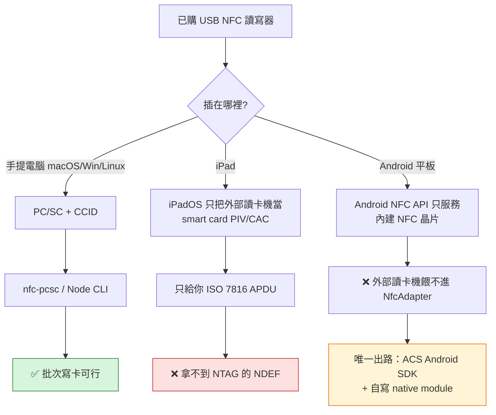

# LinkCard Event — 已購 NFC 讀寫器：可用性裁決與 Gate 1 執行紀錄

> ⚠️ **2026-10-22 同日修訂：本文件 §0／§3／§5 的平台裁決已被 `18-acr1555u-verdict-and-nfc-less-tablets.md` 取代；平板端的實際做法見 `19-writing-badges-from-nfc-less-tablets.md`。**
>
> 原因：當時型號未知，文中以「藍牙讀寫器 = 沒有 USB」的品類假設推算；實際機型是 **ACR1555U**，同時具備 **USB CCID**、**BLE APDU**、**BLE HID** 三種傳輸，且使用單位的平板（Redmi／Honor）**本身沒有 NFC**。
>
> **仍然有效**：§2 環境量測、§7 對 doc 14 的 CC／容量更正、§8 方法論、§12 資產。
> **已被取代**：「平板不可能寫卡」的結論——廠商自己的 Mobile Card Reader Utility 就能在藍牙上寫 NDEF URL，不需要寫程式。

> 產出日期：2026-10-22 ｜ Loop: NFC Gate 1（WP-N1 前置）
> 品質合約：strict（threshold 93）／Depth L3 Deep Dive
> 報告類型：硬體可行性裁決 × 平台架構限制 × 可重跑量測工具
> 前置文件：`docs/research/14-nfc-hardware-and-batch-write-research.md`（下稱 doc 14）、`docs/handoff/04-KNOWN-PITFALLS.md`、`docs/research/16-feiteng2015-work-packages.md`（WP-N1）

---

## §0 一句話結論

**這台機器可以用，但只能用在手提電腦上做「活動前批次寫卡」；它不可能接上平板讓這支 App 寫卡。**
「未成功接入平板」不是設定問題，是架構問題——`react-native-nfc-manager` 只認裝置內建 NFC，iPad 的外部讀卡機只走 smart card（ISO 7816）通道，兩者都不是「USB NFC 讀寫器」的位置。

**型號未知不影響這個結論**，因為三條平板路線全部封閉（§3）。型號只影響「桌面這條路順不順」，而桌面這條路今天已經在真機上驗到「PC/SC 可用、工具鏈可編譯、只差插上讀卡機」。

---

## §1 任務邊界與既有狀態

| 項目                  | 狀態                                                | 出處                                       |
| --------------------- | --------------------------------------------------- | ------------------------------------------ |
| 桌面批次寫卡 CLI      | **WP-N1，🚫 待 Gate 1**，負責人＝用戶本人，3.0 人日 | doc 16 §WP-N1                              |
| Gate 1 = 讀寫器 spike | **從未執行**                                        | 本次 recon：`tools/` 不存在、無 spike 紀錄 |
| 讀寫器採購            | 已完成（本次任務前提）                              | 用戶訊息                                   |
| App 端寫卡            | 已實作，走平板／手機**內建** NFC                    | `src/utils/nfc-utils.ts`                   |
| 標籤規格              | NTAG215（doc 14 §2.5 已鎖定）                       | doc 14                                     |

> 也就是說：本次任務的真正產出不是「一份意見」，而是**把 Gate 1 從一句待辦變成一條可重跑的指令**，並在沒有硬體到位的此刻，先把「與硬體無關的所有失敗原因」全部排除。

---

## §2 已測量事實（本機，2026-10-22）

以下每一條都是本次實際執行得到的，不是推論。

| #   | 量測項                          | 結果                                                                          | 意義                                                                                 |
| :-- | ------------------------------- | ----------------------------------------------------------------------------- | ------------------------------------------------------------------------------------ |
| M1  | CPU / OS                        | Apple Silicon `arm64`，Darwin `27.0.0`                                        | 舊文獻最怕的 Apple Silicon × 舊 ACS driver 問題，本機不存在（因我們不裝 ACS driver） |
| M2  | Node                            | `v22.21.1` 與 `v24.12.0` 皆跑過                                               | 工具不綁單一 Node 版本                                                               |
| M3  | PC/SC 測試工具                  | `/usr/bin/pcsctest` 存在                                                      | macOS 內建 PC/SC stack，零安裝                                                       |
| M4  | PC/SC 連線                      | `SCardEstablishContext : Command successful`，隨後停在 `SCardGetStatusChange` | **PC/SC 正常**，只是等不到讀卡機                                                     |
| M5  | `nfc-pcsc`                      | `0.8.1`，`npm install` 5 個套件 / 7 秒                                        | 無 node-gyp 卡關                                                                     |
| M6  | native binding                  | `@pokusew/pcsclite/build/Release/pcsclite.node` 已編出                        | doc 14 K2／K3 兩個風險**在本機結案**                                                 |
| M7  | 實際 PC/SC 讀卡機數             | **0**                                                                         | 此刻沒有任何讀卡機被系統辨識                                                         |
| M8  | `system_profiler SPUSBDataType` | exit 0，stdout **0 bytes**                                                    | 這台機器上此指令不可作為 USB 探針（見 §8 教訓）                                      |
| M9  | 自動化測試                      | **42 / 42 通過**（5 個測試檔）                                                | 寫卡位元組、頁面規劃、讀回驗證全部有測試                                             |

**M7 的判讀要小心**：0 reader 只代表「PC/SC 看不到讀卡機」。可能原因有三：(a) 現在沒插；(b) 插了但系統沒把它當 CCID 讀卡機；(c) 那台根本不是 PC/SC 裝置（藍牙／串口）。M8 之所以重要，就是它**不能用來排除 (a)**——它在本機回空字串，屬工具失效而非裝置不存在。

---

## §3 為什麼「接上平板」是死路（三條路線全部封閉）



### 3.1 這支 App 沒有外接讀卡機的入口（程式碼層面）

- `src/utils/nfc-utils.ts` 以 **dynamic import** 載入 `react-native-nfc-manager`，並以 `Platform.OS === "web"` 短路（web 直接回 `NfcFlowError("unsupported")`）。
- `react-native-nfc-manager` 的實作面是 Android `NfcAdapter`（`android/.../NfcManager.java`）與 iOS CoreNFC session（`ios/RNNfcManager.swift`），版本 `4.0.0-beta.9`。
- 這是「**手機／平板內建 NFC**」的封裝。它沒有任何 API 可以指向一台 USB 讀卡機。

> 截圖上的「此瀏覽器不支援 NFC，請改用 Android 真機寫卡」正是同一件事的另一面：App 的 NFC 能力來自**執行裝置本身**，不是外接配件。

### 3.2 iPad：外部讀卡機 ≠ NFC 讀寫器

iPadOS 自 16.1 起對外接 smart card 讀卡機提供原生支援，但那是 **smart card（PIV/CAC，ISO 7816 APDU）** 的世界——用來做身份驗證，不是用來讀寫 NFC 標籤。社群實測也一致：同一支 YubiKey 插在 iPad USB-C 上「PIV 即插即用」，但換成 NFC 就得靠廠商 App 另開 session。

**對 NTAG215 的含義**：iPad 走不到 14443-A 的 NDEF 讀寫。即使你的讀卡機支援 ISO 7816（ACR1252U 的 SAM slot 就是），那也是「把 SIM 尺寸的 SAM 卡插進讀卡機」，與貼一張 NTAG 標籤是兩件事。

### 3.3 Android 平板：技術上做得到，但不是這支 App

- Android 的 `NfcAdapter` 只驅動**內建** NFC 控制器；社群問答對「能否用外部 USB 讀卡機取代內建 NFC」的回答是明確的 **No**。
- 外部讀卡機在 Android 上要靠 **USB host（OTG）+ 廠商 SDK**。ACS 確有 Android Library 支援其自家讀卡機，但那是一套獨立的原生整合，不是 Expo／`react-native-nfc-manager` 的一行設定。
- 還有一個現場級問題：**OTG 供電與充電互斥**——Android 平板歷來「要嘛當 USB host、要嘛充電」，活動現場寫一整天卡會撞上這件事。

### 3.4 網頁／WebUSB：不是這支 App，而且不穩定

- Chrome 的 WebUSB 要 `claimInterface()`；桌面上若 OS 的 CCID driver 已佔用介面就會失敗，Windows 還必須先把驅動換成 WinUSB 才能被瀏覽器取用（Zadig 那條路）。
- 有開發者回報 CCID over WebUSB 在 Linux/macOS 可行、Windows 卡在 claim interface——**可用但脆弱**。
- 更關鍵：**iPad 的 Safari 沒有 WebUSB**。所以「用網頁在平板上驅動讀卡機」這條路在 iPad 上直接不存在。

**結論**：三條平板路線（App 內建 API／iPad 外接／WebUSB）全部不通。**「接入平板」這個目標應該放棄，而不是繼續除錯。**

---

## §4 「頂配、支援很多協議」對 LinkCard 值多少？

市面「多協議」通常指在 13.56 MHz 的 14443 A/B 之外再加上 **ISO 15693（vicinity）** 與 **125 kHz**。但 LinkCard 只需要一件事：

| 需求                                               | 所需規格                                | 你買到的「多協議」是否加分 |
| -------------------------------------------------- | --------------------------------------- | -------------------------- |
| 寫 `https://linkcard.xyz/t/{eventId}/{uid}` 到徽章 | **ISO 14443-A + Type 2 Tag（NTAG215）** | ❌ 不加分                  |
| 讀回 UID 做綁定                                    | ISO 14443-A UID                         | ❌ 不加分                  |
| 抗金屬／遠距停車場級應用                           | ISO 15693 / UHF                         | ❌ 與本專案無關            |
| SAM 安全模組（門禁憑證）                           | ISO 7816 SAM slot                       | ❌ 本專案用不到            |

> 以 ACR1252U 為例，官方卡種清單是 **ISO/IEC 18092 NFC、ISO 14443 Type A & B (T=CL)、MIFARE（Classic/Ultralight/Plus/DESFire）、FeliCa、NFC Forum T1–T4**，加上一個 ISO 7816 Class A 的 SAM slot。**清單裡沒有 ISO 15693**。所以「支援很多協議」在 125 kHz／15693 這類場景是真加分，在 LinkCard 是零加分。

**採購上的教訓（給下一次）**：這種專案的選型標準不是協議數量，而是「**PC/SC/CCID + 14443-A 寫入 + 讀回穩定**」。ACR1252U 貴的部分（FeliCa、SAM、認證）本專案一項都用不到。

---

## §5 分型號決策矩陣

型號未確認前，這張表就是「不管你買到哪一台，答案是什麼」。

| 若你的機器是                       |     PC/SC？     |      手提電腦批次寫卡      |         Android 平板          | iPad | 對本專案的裁決             |
| ---------------------------------- | :-------------: | :------------------------: | :---------------------------: | :--: | -------------------------- |
| **ACS ACR1252U**（USB-C 版為 -MF） |     ✅ CCID     |        ✅ 預期可行         | ⚠️ 需 ACS SDK + native module |  ❌  | **留用**，跑 §6 Gate 1     |
| **ACS ACR122U**                    |     ✅ CCID     |  ⚠️ 可行但已 EOL、仿品多   |            ⚠️ 同上            |  ❌  | 可用則用；寫入不穩就換     |
| **ACS ACR1281U / 128 系列**        |     ✅ CCID     |        ✅ 預期可行         |            ⚠️ 同上            |  ❌  | 可用，但多協議對本專案無用 |
| **Identiv uTrust 3700 F / 4701 F** |     ✅ CCID     |        ✅ 預期可行         |           ⚠️ 視型號           |  ❌  | 可用；NDEF 行為需實測      |
| **Sony PaSoRi RC-S380 / S300**     |     ✅ CCID     | ⚠️ 建議改用 Python `nfcpy` |              ❌               |  ❌  | 可用，但工具鏈要換語言     |
| **ACS ACR1255U-J1（藍牙）**        |       ❌        |       ❌ 不是 PC/SC        |          ⚠️ 廠商 SDK          |  ❌  | **不適用**桌面批次路線     |
| **PN532 裸模組 / 自製板**          | ⚠️ 需 FTDI/UART |        ⚠️ 自寫驅動         |              ❌               |  ❌  | 原型可以，生產別用         |
| **手持 Android PDA／一體機**       |        —        |             —              |     ✅ 它本身就是 Android     |  ❌  | 另一條產品線，不是「配件」 |

> 判別方法只有一個：**插上電腦，跑 `node bin/spike.js readers`**。PC/SC 會回報 OS 看到的裝置名稱（例如 `ACS ACR1252U PICC Reader`），那就是型號級答案，比看機身標籤更可靠。

---

## §6 Gate 1 執行手冊（3 分鐘，可重跑）

工具位於 `LinkCard_Event_Admin_App_Expo/tools/nfc-reader-spike/`。

```bash
cd LinkCard_Event_Admin_App_Expo/tools/nfc-reader-spike
npm install

node bin/spike.js doctor      # 環境：Node / PC/SC / native binding / reader
# 插上讀卡機
node bin/spike.js readers     # 裝置：OS 看到什麼、屬於哪個 family
# 放一張 NTAG215 在讀卡機上
node bin/spike.js read        # 標籤：UID + 變體 + 目前 NDEF
node bin/spike.js write --url https://linkcard.xyz/t/EVT1/04A1B2C3D4E5F6   # 乾跑，印頁面計畫
node bin/spike.js write --url https://linkcard.xyz/t/EVT1/04A1B2C3D4E5F6 --yes  # 真寫 + 讀回驗證
```

### 6.1 判讀表

| 輸出                                                             | 結論                           | 下一步                     |
| ---------------------------------------------------------------- | ------------------------------ | -------------------------- |
| `doctor` → gate `PASS`                                           | 這台電腦的 PC/SC 鏈路完整      | 進 `read`                  |
| `doctor` → `reader enumerated FAIL`                              | 讀卡機沒被辨識                 | 換線／換孔；仍失敗見 §6.2  |
| `readers` → `ACS ACR1252U ...`                                   | 型號確認、PC/SC 可用           | 直接量 `read`              |
| `readers` → `generic-pcsc`                                       | 有枚舉但型號未收錄             | 把名稱貼回，補進 family 表 |
| `read` → `variant NTAG215 (CC e1 10 3e 00, data area 496 bytes)` | 標籤規格與採購一致             | 進 `write`                 |
| `read` → `ndef (empty ...)`                                      | 空白卡，正常                   | 進 `write`                 |
| `write` → `REFUSED payload does not fit`                         | 標籤不是 NTAG215（或容量不符） | 換卡，別硬寫               |
| `write` → `VERIFIED ... URI matches`                             | **Gate 1 通過**                | 解鎖 WP-N1（批次 CLI）     |

### 6.2 若「插了但 0 reader」

1. 換一條**資料線**（很多 USB-C 線只供電）。
2. 直接接電腦，不要經 hub。
3. 確認不是藍牙／序列埠機型（見 §5 最後兩列）。
4. 這是 doc 14 §3.3.2 K1 的已知症狀（macOS smartcard 服務搶佔）；`pcsctest` 若同樣停在 `SCardGetStatusChange`，就是系統層沒看到裝置，與我們的工具無關。

---

## §7 本次順手更正 doc 14 的兩處技術細節

兩處都是寫卡工具實作時一定會撞到的，故一併修正。

| #   | doc 14 原文                                  | 實情                                                           | 為何重要                                                |
| --- | -------------------------------------------- | -------------------------------------------------------------- | ------------------------------------------------------- |
| C1  | §2.2 把 **Capability Container 畫在 page 4** | **CC 在 page 3**（byte 12–15），user memory 由 page 4 起       | 若照 doc 14 把 CC 寫到 page 4，會直接蓋掉 NDEF TLV 的頭 |
| C2  | §2.1 以 **504 bytes** 當 NTAG215 可用量      | CC 回報的是 **496 bytes**（`0x3E × 8`）；872 之於 NTAG216 同理 | 寫卡工具必須以 CC 為上限，用 504 會超出晶片宣告的資料區 |

**驗算**：NTAG213 的 CC 是 `E1 10 12 00` → `0x12 × 8 = 144`；NTAG215 是 `E1 10 3E 00` → `0x3E × 8 = 496`；NTAG216 是 `E1 10 6D 00` → `0x6D × 8 = 872`。這三個數字與 doc 14 §2.1 的「可用 NDEF 容量」欄一致，也就是說 **doc 14 的容量表本身沒錯，錯的是「以 504 當寫入上限」的直覺**。

工具已把這兩點固化成程式與測試：`src/ntag.js`（`CC_PAGE = 3`、`NDEF_CAPACITY_BYTES`）＋ `tests/ntag.test.js`。

---

## §8 方法論教訓（可複用）

1. **不要用 `system_profiler SPUSBDataType` 判斷「有沒有插東西」**。本機 exit 0 但輸出 0 bytes，若照單全收就會得到「沒插任何 USB 裝置」的假結論——而 MacBook 不可能沒有 USB 裝置。**權威來源是 PC/SC 本身**（`pcsctest` / `reader` 事件）。
2. **能不用硬體就先排除的，全部先排除**：本次在讀卡機缺席的情況下，已用 in-memory NTAG 把 42 個測試跑綠，其中一個測試（padded comparison）在真實硬體上才會偶發、且極難重現。
3. **「支援很多協議」不是規格優勢，是採購偏誤**。需求是 14443-A + NDEF，就只量這一條。

---

## §9 建議決策

| #       | 決策                                                     | 理由                                                                 | 誰做     |
| ------- | -------------------------------------------------------- | -------------------------------------------------------------------- | -------- |
| **D-1** | 這台讀寫器**留用**，定位為「手提電腦上的批次寫卡器」     | 桌面 PC/SC 路線是本專案唯一可行且已設計好的路線（doc 14 §5）         | 用戶     |
| **D-2** | **放棄**「接上平板寫卡」這個目標                         | §3 三條路線全封閉；平板寫卡本來就由內建 NFC 承擔                     | 用戶／PM |
| **D-3** | 現場寫卡維持 **Android 真機（內建 NFC）**                | App 已實作，且 `nfc-utils.ts` 已處理 UID 正規化與讀回驗證            | 已完成   |
| **D-4** | 立刻跑一次 §6 的 5 條指令，把 `readers`／`read` 輸出貼回 | 這是把「未知型號」變成「確切答案」的最短 path，成本 3 分鐘           | 用戶     |
| **D-5** | 若 `readers` 顯示不是 PC/SC 機型（藍牙／序列埠）         | 換 ACR1252U（USB-C 版 -MF）或 RC-S380；不要退而求其次買 125 kHz 機型 | 用戶     |

---

## §10 未驗證清單（誠實帳）

| #   | 未驗證項                                    | 原因                             | 風險                           |
| --- | ------------------------------------------- | -------------------------------- | ------------------------------ |
| U1  | 真機寫入／讀回                              | 此刻 PC/SC 0 readers，且型號未知 | 中（理論完備、實測缺席）       |
| U2  | ACR1252U 在 Darwin 27 的實測行為            | 同上；Darwin 27 相當新           | 中低                           |
| U3  | 連續批量寫 300 張的穩定性（PN532 過熱、K4） | 需硬體與標籤                     | 中（WP-N1 要加 delay + retry） |
| U4  | WebUSB on macOS Chrome 的可用性             | 僅第三方報告，未自測             | 低（不列為方案）               |
| U5  | 機型價格／關稅                              | 未查證，不寫推測數字             | 無                             |

---

## §11 來源

外部來源以 Brave Search（LLM Context）取得，**搜尋工具未回傳 URL**，故以下以「標題 + 發佈方」記錄，避免編造連結。

| 用途                                       | 來源                                                                                                                                                     |
| ------------------------------------------ | -------------------------------------------------------------------------------------------------------------------------------------------------------- |
| ACR1252U 規格（卡種、CCID、SAM、ISO 清單） | _ACR1252U – USB NFC Reader III (NFC Forum Certified)_（ACS 產品頁）＋ _ACR1252U User Manual and Technical Specification_（ACS 資料表）                   |
| `nfc-pcsc` 能力與平台                      | _pokusew/nfc-pcsc_（GitHub README：Node.js on Linux/UNIX, macOS, Windows；`reader.read` / `reader.write` / `transmit`）                                  |
| 外接讀卡機在 iPad 的定位                   | _CryptoTokenKit_（Apple Developer）、_Supported smart card functions on iPhone and iPad_（Apple Support）                                                |
| Android 無法以外接讀卡機取代內建 NFC       | _Android NFC with USB-NFC-Reader_（Stack Overflow）、_How to Connect External NFC Card Reader to Tablet_（Stack Overflow）                               |
| 外部讀卡機在 Android 需廠商 SDK            | _ACS Android Library_（ACS 文件）、_external-nfc-api_（GitHub）                                                                                          |
| WebUSB 與 CCID 介面搶佔                    | _SmartCard reader "Access denied" while claiming interface with Webusb_（Stack Overflow）、_WebUSB Interface Claim Failed…_、_WebUSB API_（Chrome 文件） |
| 內部依據                                   | doc 14、doc 16（WP-N1）、`docs/handoff/04-KNOWN-PITFALLS.md`、`src/utils/nfc-utils.ts`、`ios/Podfile.lock`                                               |

---

## §12 附錄：本次新增的可重跑資產

| 路徑                                         | 作用                                               |
| -------------------------------------------- | -------------------------------------------------- |
| `tools/nfc-reader-spike/bin/spike.js`        | `doctor` / `readers` / `read` / `write` 四個指令   |
| `tools/nfc-reader-spike/src/reader-model.js` | 讀卡機名稱 → 機型 family → 平台裁決                |
| `tools/nfc-reader-spike/src/ndef.js`         | URI NDEF 記錄與 TLV 編解碼（含前綴壓縮、長短格式） |
| `tools/nfc-reader-spike/src/ntag.js`         | CC 解析、容量判定、頁面寫入規劃、APDU 建構         |
| `tools/nfc-reader-spike/src/tag-session.js`  | 讀取 / 寫入 / **讀回驗證**                         |
| `tools/nfc-reader-spike/tests/`              | 42 個測試，**不需硬體**                            |
