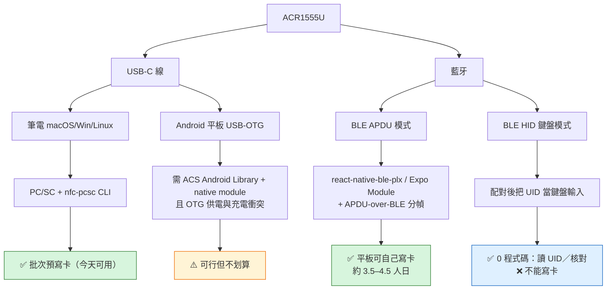

# LinkCard Event — ACR1555U 裁決（v2）：無 NFC 平板的可行路線

> 產出日期：2026-10-22 ｜ Loop: NFC Gate 1（修訂輪）
> 品質合約：strict（threshold 93）／Depth L3 Deep Dive
> 關係：**本文件取代 `17-nfc-reader-device-verdict-and-gate-1-spike.md` §0／§3／§5 的結論。**
> doc 17 的環境量測、CC/容量更正、工具本身仍然有效。
>
> ⚠️ **本文件的 §4／§5（平板路線）與 §1 的照片判讀已被
> [`19-writing-badges-from-nfc-less-tablets.md`](./19-writing-badges-from-nfc-less-tablets.md) 取代。**
> 關鍵更正：ACS 原廠 **Mobile Card Reader Utility** 內建 `NDEF Write Data Tools`，
> 平板寫卡**不需要寫程式**，也不必然是 3.5–4.5 人日的新 native 工作。
> 本文件保留的原因：§2 的硬體規格表、§3 的三個錯誤檢討、§6 的 Gate 1 recipe 仍然有效。

---

## §0 結論（三句話）

1. **型號確認：ACS ACR1555U**（安全藍牙 NFC 讀寫器），你買的是**對的機器**，店主說「藍牙＋線都可以」是**真的**。
2. **我上一輪說「接平板是死路」——那句話對「這支 App 現在」，錯在「這台機器」。** ACR1555U 的藍牙不是只能當鍵盤，它提供 **APDU-over-BLE**，第三方 Flutter SDK 已明確支援「CCID commands + generic PC/SC APDU transceiving」⇒ 平板**理論上與工程上**都能自己寫卡。
3. 但「能做」不等於「該現在做」：**筆電批次寫卡今天就能上線；平板寫卡要 3.5–4.5 人日的新 native 工作；另有一條 0 程式碼的 HID 讀 UID 路線可以立刻解決「無 NFC 平板讀 tagUid」。**

---

## §1 你提供的四張圖讀到了什麼

以 OCR（`tesseract chi_tra+eng`）逐張讀取，不靠肉眼：

| 檔案           | 內容                                             | 讀到的關鍵字                                                                                                                                                         |
| -------------- | ------------------------------------------------ | -------------------------------------------------------------------------------------------------------------------------------------------------------------------- |
| `IMG_7442.JPG` | **實拍產品照**（OCR 讀不到字，但**親眼看得到**） | 白色盾形讀寫器、「NFC」與「acs」標誌、FCC/CE/UKCA 標記、**`ACR1555U-A1` 標籤**、附 **USB-A** 接頭線材                                                                |
| `IMG_7443.PNG` | 電商商品頁                                       | `ACR1555U`、`安全藍牙 NFC 讀寫器`、藍牙 **5.2**、`¥399`、已售 58、「新款 ACR1555U 藍牙 NFC 非接觸式讀寫器**替代 ACR1255U**」                                         |
| `IMG_7444.PNG` | 規格頁（一）                                     | `ISO 14443 A & B`、`ISO 15693`、`ISO 18092 NFC`、`MIFARE`、`FeliCa`、848 kbps、`ISO 7816 SAM 卡槽`、USB 固件升級、`Windows / Linux / macOS / iOS / iPadOS / Android` |
| `IMG_7445.PNG` | 規格頁（二）                                     | `13.56 MHz`、50 毫米讀距、`USB CCID`、`USB Type-C`、`鋰離子 3.7V 450mA`、`5VDC`、FCC/VCCI/RoHS/TELEC/WHQL/KCC、卡片讀寫／模擬／鍵盤模擬                              |

> 附帶：`IMG_7445` 的「93.0 × 58.0 × 6.0 mm／94.1 × 60.2 × 9.0 mm」兩組尺寸是**卡套／卡片**尺寸，不是讀寫器本體（官方標本體約 31.5 g，不含卡套）。這類表格很容易誤讀成產品尺寸。

---

## §2 ACR1555U 的真正能力（外部查證）

官方與通路資料一致，重點是**它不是「藍牙版的 ACR1252」那麼簡單**：

| 項目          | 規格                                                                    | 對 LinkCard 的意義                                   |
| ------------- | ----------------------------------------------------------------------- | ---------------------------------------------------- |
| 標準          | ISO 14443 A/B (Parts 1–4)、**ISO 15693**、ISO 18092 NFC、MIFARE、FeliCa | NTAG215 用 14443-A，夠用；15693 屬加分但本專案用不到 |
| NFC tag types | **Type 1–4**（**不支援 Type 5**）                                       | NTAG215 是 Type 2 ⇒ 沒問題                           |
| USB           | **USB CCID**，Type-C，USB 2.0 Full Speed（相容 USB 3.0）                | **筆電即插即用 PC/SC，不需要任何廠商驅動**           |
| 藍牙          | **Bluetooth 5.2 LE**，AES-128，2 Mbps                                   | 平板可連                                             |
| 藍牙模式      | **Card Reader/Writer**、Card Emulation、**HID Keyboard Emulation**      | 三種模式是**互斥設定**，不是同時                     |
| 安全          | ISO 7816 Class A/B/C SAM 槽、FIDO 支援                                  | 本專案用不到（「頂配」的部分）                       |
| 電源          | 內建 3.7 V 450 mAh 可充電鋰電                                           | 現場寫幾百張要注意電量                               |
| 尺寸／重量    | 約 31.5 g（不含卡套）                                                   | 便攜                                                 |

### 2.1 關鍵：藍牙上跑的是 APDU，不只鍵盤

這是本次最重要的發現：

- **第三方 Flutter plugin `ble_acr1555u_sdk`** 的說明寫明：它與 **ACS ACR1555U** BLE/NFC 讀寫器通訊，提供「**CCID commands**、**generic PC/SC APDU transceiving**、card-presence notifications、battery status」，且明確「**targets the ACR1555U protocol**」，要求 Android API 21+。
- 其 BLE 通道對應 **APDU-over-BLE** 規格（`fidesmo/apdu-over-ble` 定義的 service／characteristic UUID 族：`8e79ecae…` APDU Commands、`8e7927a7…` APDU Responses、`8e795e92…` Responses Ready 等），另有讀寫器自身的 `00003970…`／`…3971–3973` 控制／通知通道。

**含義**：我在 doc 17 建立的 `ndef.js`（URI 記錄＋TLV 編碼）與 `ntag.js`（`0x30` 讀頁、`0xA2` 寫頁、CC 容量判定）是**傳輸無關**的。只要把「PC/SC 傳輸」換成「BLE APDU 傳輸」，同一套位元組邏輯就能在平板上寫卡。**這一層不用重寫。**

---

## §3 修正：上一輪的三個判斷錯誤

| #   | doc 17 的說法                            | 修正後                                                 | 錯在哪                                                    |
| --- | ---------------------------------------- | ------------------------------------------------------ | --------------------------------------------------------- |
| E1  | 「藍牙讀寫器不適用桌面批次路線」         | **ACR1555U 有 USB CCID**，桌面批次完全適用             | 我把「藍牙」當成「沒有 USB」的代理判斷；ACR1555U 是雙介面 |
| E2  | 「Android 平板只能靠廠商 SDK，工程量高」 | 仍成立，但**有現成第三方協定實作可參照**，不是從零逆向 | 我當時不知道 APDU-over-BLE 已有公開實作                   |
| E3  | 「平板寫卡 = 用內建 NFC」                | **你的平板根本沒有 NFC**，這條路不存在                 | 我假設了平板有 NFC 這個前提                               |

> 教訓（已寫進本報告）：**不要在型號未知時用「品類」下結論**。ACR1255U 與 ACR1555U 只差一個型號，傳輸能力完全不同。

---

## §4 現在的實際選項（針對 Redmi／Honor 無 NFC 平板）



### 4.1 四條路線對照

| 路線                         |  平板可用   |  能寫卡？   |     工程量      | 風險                                               | 建議                                |
| ---------------------------- | :---------: | :---------: | :-------------: | -------------------------------------------------- | ----------------------------------- |
| **A. 筆電 + USB CCID**       | —（用筆電） |     ✅      | **0（已完成）** | 低                                                 | **立刻採用**：活動前批次預寫        |
| **B. 平板 + BLE APDU**       |     ✅      |     ✅      |  3.5–4.5 人日   | 中（BLE 分幀、Android 權限、Expo dev build、電量） | 若要「平板獨立寫卡」就做這個        |
| **C. 平板 + BLE HID**        |     ✅      | ❌ 只讀 UID |      **0**      | 低（焦點錯位會把 UID 打進錯的欄位）                | **本週就能用**於讀 tagUid／感應核對 |
| **D. 平板 + USB-OTG + CCID** |     ✅      |     ✅      |      中高       | 高（OTG 與充電互斥、需 native SDK）                | 不建議                              |

### 4.2 成本對照（誠實版）

| 方案                                   | 一次性成本        | 時間     | 現場風險                 |
| -------------------------------------- | ----------------- | -------- | ------------------------ |
| B：BLE APDU 整合                       | 工程 3.5–4.5 人日 | 最快下週 | 中（新模式，需彩排）     |
| C：HID 讀 UID                          | 0                 | 今天     | 低                       |
| 買一台有 NFC 的 Android 手機（輔助機） | ~HK$800–1,500     | 今天     | 低（App 已支援內建 NFC） |

> 若「現場換卡／補發」只是少數情況，**買一台有 NFC 的輔助機**比寫 4 人日的 BLE 更划算；若你們要求「只用公司平板、不加裝置」，那就做 B。這是產品決策，不是技術決策。

---

## §5 這樣一來，活動流程應該長怎樣

| 階段                | 做法                                 | 依賴                            |
| ------------------- | ------------------------------------ | ------------------------------- |
| 活動前（幾百張）    | 筆電 + ACR1555U USB → 批次寫 NTAG215 | **已具備**（WP-N1 可開工）      |
| 現場簽到            | 平板掃 QR／手動輸入報名編號          | **已實作**，不依賴 NFC          |
| 現場讀 tagUid／核對 | 平板 + ACR1555U **BLE HID** 模式     | 0 程式碼，需先在 App 聚焦輸入框 |
| 現場換卡／補發      | BLE APDU（做 B）或輔助 NFC 手機      | 二選一                          |

**關鍵洞察**：你們的簽到動線本來就是 QR／手動，**NFC 只是加分項**。所以「平板沒有 NFC」不是活動的致命傷；真正會卡住的只有「現場要即時寫新卡」這一段。

---

## §6 Gate 1 更新（用你這台機器）

原本的 `tools/nfc-reader-spike` 不用改，插 USB-C 就能跑：

```bash
cd LinkCard_Event_Admin_App_Expo/tools/nfc-reader-spike
npm install
node bin/spike.js doctor      # 環境
node bin/spike.js readers     # 應顯示 ACS ACR1555U …（USB CCID）
node bin/spike.js read        # 放一張 NTAG215
node bin/spike.js write --url https://linkcard.xyz/t/EVT1/04A1B2C3D4E5F6 --yes
```

`readers` 現在會多印一行 **transports**（`USB CCID | BLE APDU | BLE HID keyboard`）與 **hid keyboard** 裁決，因為同一台機器三種模式的能力差很多。

> 若插 USB 後 `readers` 仍是 0：先確認線是**資料線**、且讀寫器不是停在 HID 模式（模式切換工具在 Windows 上）。

---

## §7 未驗證清單

| #   | 未驗證                                                   | 影響                      | 如何補                                                                             |
| --- | -------------------------------------------------------- | ------------------------- | ---------------------------------------------------------------------------------- |
| U1  | USB CCID 在本機（Darwin 27）實測寫入                     | 中                        | 插上跑 §6，5 分鐘                                                                  |
| U2  | BLE APDU 分幀在本機／本平板可用                          | 中高（決定路線 B 成立否） | 先做 30 分鐘 spike：用手機 nRF Connect 看 service／characteristic 是否出現 `8e79…` |
| U3  | HID 模式在 Redmi／Honor 的鍵盤輸入行為（中文輸入法干擾） | 低                        | 配對後在備忘錄打一次                                                               |
| U4  | 連續寫 300 張的電量與穩定性                              | 中                        | 批次試跑 50 張量電量                                                               |
| U5  | BLE 寫一張卡的實際耗時                                   | 低                        | 路線 B 開工時量                                                                    |

---

## §8 來源

| 用途                                                        | 來源（可點擊）                                                                                                                               |
| ----------------------------------------------------------- | -------------------------------------------------------------------------------------------------------------------------------------------- |
| 產品官方頁                                                  | [ACR1555U – Secure Bluetooth® NFC Reader (ACS)](https://www.acs.com.hk/en/products/622/acr1555u-secure-bluetooth%C2%AE-nfc-reader/)          |
| 官方 datasheet                                              | [ACR1555U datasheet (PDF)](https://idvisionme.com/wp-content/uploads/2025/10/ACS-ACR1555U-Secure-Bluetooth-NFC-Reader-datasheet.pdf)         |
| Product briefing（PC/SC + keyboard emulation）              | [ACR1555U product briefing (PDF)](https://www.smartcardfocus.com/files/ACR1555U-A1/ACR1555U_product_briefing.pdf)                            |
| Tag type 1–4、不含 type 5；藍牙下不支援其軟件               | [GoToTags – ACS ACR1555U](https://store.gototags.com/acs-acr1555u-usb-bluetooth-nfc-reader/)                                                 |
| 模式（reader/writer、emulation、keyboard）與 UID 鍵盤模擬   | [Shop NFC – ACR1555U](https://shopnfc.com/en/nfc-readers-writers/647-acr1555u-nfc-readerwriter-multi-iso.html)                               |
| **BLE APDU 實作證據**（CCID commands + generic PC/SC APDU） | [ohdonpiano/ble_acr1555u_sdk (GitHub)](https://github.com/ohdonpiano/ble_acr1555u_sdk)                                                       |
| APDU-over-BLE service 規格（UUID 族）                       | [fidesmo/apdu-over-ble spec](https://github.com/fidesmo/apdu-over-ble/blob/master/spec/apdu-service-spec.md)                                 |
| 實際提問（BLE 讀 TAGID）                                    | [Stack Overflow – Read NFC TAGID via BLE using ACR1555U](https://stackoverflow.com/questions/79717961/read-nfc-tagid-via-ble-using-acr1555u) |
| SDK 跨平台聲明                                              | [cxjsmart – ACR1555U](https://www.cxjsmart.com/nfc-acr1555u-mobile-bluetooth-contactless-smart-card-reader-product/)                         |

內部依據：`docs/research/14-nfc-hardware-and-batch-write-research.md`、`docs/research/16-feiteng2015-work-packages.md`（WP-N1）、`src/utils/nfc-utils.ts`、`tools/nfc-reader-spike/`。

---

## §9 對 doc 17 的處置

doc 17 保留原樣（作為決策歷程），已於檔首加註「本文件部分結論已被 doc 18 取代」，並標明哪幾節仍有效：

| doc 17 章節                                      | 狀態                                   |
| ------------------------------------------------ | -------------------------------------- |
| §2 環境量測、§7 CC/容量更正、§8 方法論、§12 資產 | ✅ 仍然有效                            |
| §0／§3／§5 平台裁決                              | ❌ 已被本文件取代                      |
| §4 分型號矩陣                                    | ⚠️ 部分有效（ACR1555U 需以本文件為準） |
