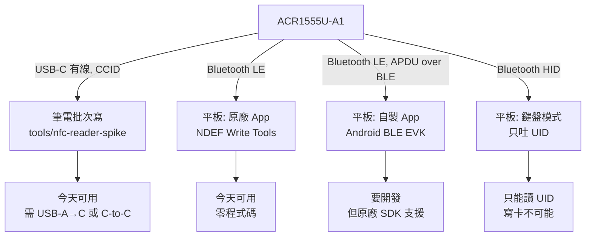
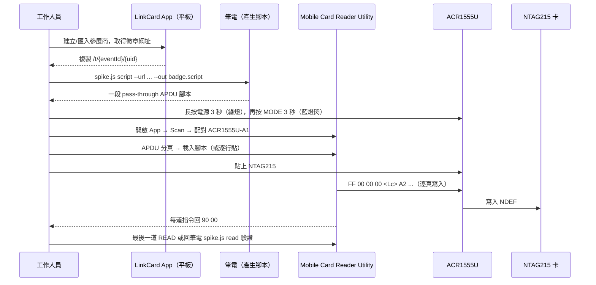

# 19 — 沒有 NFC 的平板怎麼寫徽章卡（ACR1555U 第三輪裁決）

> 🛑 **2026-10-22 同日作廢：本文的路徑 B（「原廠 App 的 NDEF 分頁可以直接寫實體卡」）是錯的。**
>
> 官方 **Mobile Card Reader Utility – User Guide V1.07 §2.2** 原文：
> 「Please select the NDEF record type you want to save **for card emulation**」、
> 「press the save button to **store the data in the ACR1555U**」，
> 接著「return to the **Card Emulation** menu … activate card emulation」。
> ⇒ NDEF 分頁是把紀錄存進**讀卡機**、讓它去模擬 Type 2 Tag，**不是**寫進實體 NTAG215。
>
> 我把 App 商店的「NDEF Write Data Tools」讀成「寫卡工具」，加上第三方教學一句
> 「for NFC emulation」被我當成行銷語，於是推出了一個看起來很省事、實際不存在的路徑。
> **教訓 E5：功能名稱裡有 "write"，不等於寫進你要的媒介；要讀官方操作手冊的操作步驟。**
>
> **仍然有效**：§1 的 E1–E4、§4 線材、§7 官方資源、筆電批次寫卡（路徑 A）。
> **已更正**：平板真正能用的路徑是 **APDU 工具 + 腳本**（見 `20-*.md` §T5），
> 或自製 App 走 BLE APDU（路徑 C）。

> 前情：`17-*.md` 假設平板內建 NFC；`18-*.md` 認出機器是 **ACR1555U-A1**，但把「平板寫卡」
> 判成需要自行開發 native module。這一輪認出原廠 App 的存在。
>
> **店家說的是對的：藍牙可以連、有線也可以連。** 但「用平板寫卡」這一格，
> 本文原本的答案是錯的——原廠 App 的貼心分頁是**模擬**，不是**寫卡**。

## 0. TL;DR（給趕時間的人）

| 問題                                 | 答案                                                                                                                            | 證據                                                      |
| ------------------------------------ | ------------------------------------------------------------------------------------------------------------------------------- | --------------------------------------------------------- |
| 這台機器能連我們的紅米／榮耀平板嗎？ | **能**。藍牙 5.2 BLE，官方支援 Android 4.4+                                                                                     | ACS 驅動頁 `Android BLE EVK (SmartCardIO) v0.6.2`         |
| 平板可以用有線連嗎？                 | **能**，但要看線：附的是 **USB-A → USB-C**                                                                                      | 實機照片 `IMG_7442.JPG`                                   |
| 平板能寫 URL 徽章卡嗎？              | 🛑 **不是原本寫的那樣**：原廠 App 的 NDEF 分頁是**模擬**，寫不進實體 NTAG215。能用的是 **APDU 工具 + 腳本**（見 `20-*.md` §T5） | 官方 App 指南 V1.07 §2.2、Reference Manual v2.02 §5.5.4.1 |
| 筆電能批次寫嗎？                     | **能**，USB CCID 免驅動，直接走我們的 `tools/nfc-reader-spike`                                                                  | 本 repo 已驗（48→49 tests）                               |
| 要寫程式才能用嗎？                   | **不用**。只有「把寫卡併進 LinkCard Event Admin App」才需要                                                                     | —                                                         |

## 1. 我前兩輪錯在哪（要留著的教訓）

| 代號 | 錯誤                                           | 為什麼會錯                                       | 現在怎麼防                                        |
| ---- | ---------------------------------------------- | ------------------------------------------------ | ------------------------------------------------- |
| E1   | 把「Bluetooth NFC reader」當成「沒有桌面路徑」 | ACR1255U 只有藍牙，我拿同系列推論                | 逐型號查官方 datasheet，不用系列推論              |
| E2   | 假設平板有內建 NFC                             | 沒問就假設                                       | 使用者情境要先問，尤其「有沒有 NFC」              |
| E3   | 把「平板寫卡」等同「要自己寫 native module」   | 只查到第三方 Flutter SDK，沒查原廠 App           | **先找原廠有沒有成品 App**，再談開發              |
| E4   | 用 OCR 抽文字就下結論，沒真的看圖              | 想省 payload                                     | 使用者要求看圖時就看；看圖後仍要 OCR 交叉驗證數字 |
| E5   | 把原廠 App 的 `NDEF` 分頁當成寫卡工具          | 只讀商店文案與第三方教學，沒讀官方操作手冊的步驟 | 講到「寫入」就必須指到官方手冊的操作步驟原文      |

E3 是這一輪最貴的錯：如果早點查 `Mobile Card Reader Utility`，18 的工期表會少一整塊。

## 2. 四條路徑（依「今天能不能用」排序）



### 路徑 A — 筆電 USB 批次寫（今天可用）

- 這是 `tools/nfc-reader-spike` 已有的能力：`readers` / `doctor` / `read` / `write`。
- 讀卡機插上就會被 PC/SC 列舉成 `ACS ACR1555U-A1 PICC Reader`，`readers` 會認出 family
  `acs-acr1555u` 並給出三種傳輸與原廠 App 資訊。
- 沒有硬體時可以先用 `--assume` 看裁決：
  `node bin/spike.js readers --assume "ACS ACR1555U-A1 PICC Reader"`。

### 路徑 B — 平板 + 原廠 App 的 **APDU 工具**（可用，但要餵腳本）

原本這裡寫的是「NDEF 分頁貼卡寫入」，那是錯的。更正後的真實路徑：

1. 平板安裝 **Mobile Card Reader Utility**
   - Android：Google Play `com.acs.mobile_card_reader_utility`
   - iOS：App Store `id6478258371`
2. 長按電源鍵 **3 秒** 開機（綠燈亮），再按 **MODE 鍵 3 秒** 進入藍牙可被發現（**藍燈閃**）。
3. 在 **App 內** Scan → 選 `ACR1555U-A1` → 配對（不要在平板設定裡配對）。
4. 切到 **APDU** 分頁（指南 §2.4）：可選腳本檔、選 slot、輸入 APDU、送命令。
5. 把筆電產生的腳本貼進去或載入：

```bash
cd tools/nfc-reader-spike
node bin/spike.js script --url "https://linkcard.example/b/7F3A" --out badge.script
```

6. 驗證：回筆電 `node bin/spike.js read` 讀回來，或看腳本裡最後那道 `READ` 的回應。

**為什麼這條成立**：Reference Manual v2.02 §5.5.4.1 定義了 pass-through 指令
`FF 00 00 00 <Lc> <ISO14443 command>`（手冊自己的例子：`FF 00 00 00 01 60` = GET_VERSION），
而 App 的 APDU 工具送的就是這種指令。所以「平板寫卡」不需要新 App，只需要有人把
`A2` 分頁寫入包成 pass-through —— 那正是 `src/apdu-script.js` 在做的事。

**仍然未驗證**：App 的「選腳本檔」到底接受什麼檔頭格式。若它拒收，就逐行貼上。

**代價**：這是給工程師／技術志工用的操作，不像「貼卡就寫好」那麼直覺。
日常批次仍建議走路徑 A（筆電）。

### 路徑 B′ — NDEF 分頁（只能模擬，不能寫卡）

同一支 App 的 **NDEF** 分頁確實有 `Text / URL / Email / SMS / Phone / Map` 六種型別，
但它們是存進**讀卡機**，讓讀卡機對外模擬成一張 Type 2 Tag 或 FeliCa 卡。
用途是「示範」：拿別人的手機貼讀卡機，會跳出那個網址。

要拿它做徽章，等於每張卡都變成「這台讀卡機」，不可能。

同理，**Reader Mode → Card Writer** 只支援 **ACOS3** 卡，而我們的徽章是 NTAG215，
格式不同，不能互換。

### 路徑 C — 把寫卡併進我們的 App（要開發，但原廠支援）

- 官方 SDK：**Android BLE EVK (SmartCardIO)** `v0.6.2`（2025-12-03，Android 4.4+，支援
  Extended APDU）。另有 **Android EVK** `v1.1.8`（Android 3.1+，走 USB）。
- 這代表 APDU over BLE 是**原廠支援**的通路，不是逆向工程。18 引用的第三方
  `ble_acr1555u_sdk`（Flutter）只是佐證，不是唯一選擇。
- 我們的 byte 邏輯（CC 在第 3 頁、資料從第 4 頁、`30` 讀 / `A2` 寫、NTAG213/215/216 容量
  144/496/872）在 `src/ntag.js` 與 `src/ndef.js` 已經是純函式且有測試，換傳輸層不需要重寫。
- 工作量因此**下修**：不是「從零接一個 reader」，而是「接 SDK + 把已測好的 APDU 送出去」。

### 路徑 D — HID 鍵盤模式（只吐 UID，不要指望寫卡）

- 手冊：配對成鍵盤後，**UID 會被當成鍵盤輸入打到記事本**。
- 要切到 `BLE HID MODE` 必須在 PC 上用 **ACR15XX Keyboard Configuration Tool**：
  選 ACR1555U → Connect → 下拉選 `BLE HID MODE` → Apply → 重開機。
- 所以 HID 模式不是「平板端設定」，而且**無法寫卡**。只在「只要 tagUid、不要寫」時考慮。

## 3. 現場 SOP（平板寫卡，更正版）



注意：這條流程需要「筆電先生成腳本」。若活動現場完全沒有筆電，就只能走路徑 C
（自製 App）或改用「預先寫好卡、現場只做綁定」的流程。

卡片準備（沿用 17/18）：NTAG215、CC 在第 3 頁、資料從第 4 頁、容量以 CC 宣告為準（496 B，
不是 504 B）。

## 4. 線材與充電（容易被忽略但會擋現場）

- 盒內附的是 **USB-A → USB-C**。紅米／榮耀平板是 USB-C，所以有線連線需要
  **C-to-C 線**或 **OTG 轉接頭**；只有原廠線接不上。
- 機器是內建 **3.7 V 450 mAh** 充電電池，整天擺攤要排充電；USB 連線同時可充。
- 重量 31 g（不含卡座）／39 g（含卡座），尺寸 93×58×6 mm。

## 5. 還沒實測、不要當定論（U 清單）

| 代號 | 未驗證                                                           | 怎麼驗                                             |
| ---- | ---------------------------------------------------------------- | -------------------------------------------------- |
| U1   | 原廠 App 的 APDU 工具能否成功送 pass-through 到我們的 NTAG215 上 | 貼卡後送 `FF 00 00 00 01 60`，看是否回 `... 90 00` |
| U2   | 原廠 App 是否會覆寫既有 NDEF（我們的卡可能已有別人的 URL）       | 拿一張已寫過的卡試，讀回看是否被取代               |
| U3   | 平板同時連藍牙 + 我們 App 時的電量/斷線行為                      | 現場前 30 分鐘壓測                                 |
| U4   | `readers` 在 Windows／Linux 上列舉出的名稱是否同樣命中 family    | 換平台跑一次 `readers`                             |
| U5   | Android BLE EVK 的授權條款（能否閉源隨 App 散布）                | 讀 EVK 內 LICENSE，或問 ACS                        |
| U6   | ACR15XX Keyboard Configuration Tool 是否真的只在 Windows         | 找 macOS 版；找不到就當只能在 Windows 切模式       |

## 6. 成本與工期（用原廠 App 之後）

| 方案                   | 一次性成本     | 現場每卡            | 風險                               |
| ---------------------- | -------------- | ------------------- | ---------------------------------- |
| A 筆電批次寫（已可用） | 0（已完成）    | 最低（事前批次）    | 需把卡帶回筆電                     |
| B 平板 + 原廠 App      | 0              | 中（兩支 App 切換） | 依賴原廠 App 的 NDEF 行為（U1/U2） |
| C 併進我們的 App       | 開發（接 SDK） | 低                  | 需 native module、需過 EAS build   |
| D HID                  | 0              | 只能讀 UID          | 不能寫卡，且切模式要 PC            |

實務建議：**A 做批次、B 做現場補寫**，兩者都不需要寫程式；C 等活動結束再排。

## 7. 官方資源

- ACR1555U 產品頁（驅動與 SDK 清單）：https://www.acs.com.hk/en/products/622/acr1555u-secure-bluetooth%C2%AE-nfc-reader/
  - 頁面上的下載項目包含：`Android BLE EVK (SmartCardIO) v0.6.2`（Android 4.4+）、
    `Android EVK v1.1.8`（Android 3.1+）、`BLE PC/SC Driver Installer v1.0.3.1`（Windows）、
    `PC/SC Driver Installer v1.1.13`（macOS）
- 使用手冊（`USR-ACR1555U-A1-1.03-EN.pdf`）：https://rfidshop.co.za/wp-content/uploads/2025/11/USR-ACR1555U-A1-1.03-EN.pdf
- Mobile Card Reader Utility（Android）：https://play.google.com/store/apps/details?id=com.acs.mobile_card_reader_utility
- Mobile Card Reader Utility（iOS）：https://apps.apple.com/us/app/mobile-card-reader-utility/id6478258371
- ACS GitHub（範例程式）：https://github.com/AdvancedCardSystems/ACS
- 第三方佐證（Flutter、APDU over BLE UUID）：https://github.com/ohdonpiano/ble_acr1555u_sdk
