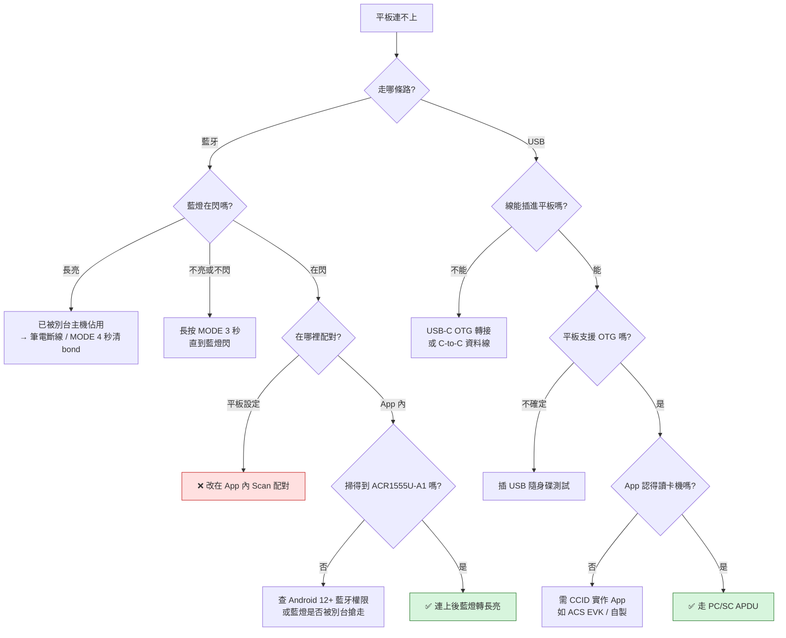

# 20 — ACR1555U 的「驅動」真相，與平板連不上的原因

> 產出日期：2026-10-22 ｜ Loop: NFC Gate 1 ｜ 研究部（Morpheus）
> 關係：`17-*.md` 的環境量測仍有效；`18-*.md` 的 §2 硬體規格仍有效；
> **本文件取代 `19-*.md` 的一個關鍵說法**——見 [§T4.3](#t43-關鍵存疑ndef-工具寫的是實體卡還是讀卡機自己的模擬標籤)。
> 研究法：只用一手官方資料（ACS 官方下載頁／官方手冊 PDF、Microsoft Learn、Android 官方文件、Apple Support）
> 加一份有署名的第三方實測記錄；每一條「要不要驅動」的斷言都指回具體頁面。查不到的一律進 §未驗證假設。

---

## TL;DR

### Q1：「我打開藍牙、也插了 USB 線，但平板就是連不上——是我的做法有問題嗎？」

**是做法問題，不是驅動問題。** 三個最具體的卡點，按可能性排序：

1. **藍牙沒有進「可被搜尋」狀態。** 官方手冊寫得很明確：長按**電源鍵 3 秒**開機後，綠燈亮、**藍燈開始閃**才算進 BLE 模式；若「綠燈亮但藍燈不閃」，要再長按 **MODE 鍵 3 秒**。多數人只看綠燈就以為好了。
2. **讀卡機被你的筆電佔住。** 手冊定義：**藍燈長亮 = 已連線**、藍燈閃 = 可被搜尋。你同時有 macOS 筆電——若它先連上了，平板當然掃不到；清 bond 要**長按 MODE 鍵約 4 秒**直到藍燈快速閃爍。
3. **USB 那條線物理上就插不進平板。** 盒內線規格是 **Type-C ↔ Type-A**（1 m，可拆），USB-A 那端是給電腦的；平板只有 USB-C 埠，必須再加一個 **USB-C OTG 轉接（USB-A 母）**或改用 **C-to-C 資料線**。

### Q2：「是不是一定要裝驅動？不裝就算藍牙連上或插了線也驅動不了它？」

**不需要「裝驅動」，但需要「跑對的軟體」。** 這句話在四個 OS 上的意思完全不同：

- **Windows / macOS：作業系統已內建 USB CCID class driver**（Windows 是 `WUDFUsbccidDriver.dll`／`Usbccid.sys` 家族；macOS 是 CryptoTokenKit 的 CCID 支援）。ACR1555U 的 USB 介面就是 **USB CCID**，屬 USB class `0x0B`，所以插上就會被 PC/SC 子系統列舉。**免驅可行。**
- **Android：根本沒有「安裝驅動」這個動作。** USB 讀卡機要靠 App 透過 USB Host API `claimInterface()` 後自己實作 CCID；沒有 App，插了線什麼都不會發生。這就是「不需要 driver、但需要 app」。
- **iOS / iPadOS：也沒有可安裝的驅動。** 系統層的 CCID 支援（iOS 16.1 / iPadOS 16 起）只服務 **PIV 智慧卡**認證；要寫 NDEF 或送 APDU，官方路徑是 **BLE + App**。

### Q3：「廠商是不是已經有對應的驅動？Windows / macOS / Android / iOS 都有嗎？」

**都有，而且清單完整——8 項驅動/工具 + 6 份官方文件，全部掛在 ACR1555U 專屬下載頁上。**（完整表見 [§T3](#t3--官方軟體與驅動完整清單依-os)）

但只有 **三種情境**是「不裝就不行」：

| 情境                                                            | 必裝項目                                                                                        |
| --------------------------------------------------------------- | ----------------------------------------------------------------------------------------------- |
| Windows 上想把**藍牙連線**的讀卡機當成 PC/SC 讀卡機給桌面程式用 | `BLE PC/SC Driver installer 1.0.3.1`                                                            |
| Windows 上要**切換到 HID 鍵盤模擬模式**                         | `Configuration Tool 207`（或 ACS Script Tool）                                                  |
| 想**自己寫 App**（不要用原廠 App）                              | `Android EVK 1.1.8` / `Android BLE EVK (SmartCardIO) 0.6.2` / `iOS BLE EVK (SmartCardIO) 0.7.0` |

其餘（Windows/Linux/macOS 的 PC/SC Driver Installer）都是**選裝**：內建 class driver 已能跑基本功能，ACS 驅動是為了替換成廠商版本或支援特定功能。

---

## T1 — 各 OS 的「驅動」到底是什麼

### T1.1 Windows 10 / 11 — 內建，免驅

| 問題                                                     | 答案                                                                                                                                                                                                            | 依據                                                                                                          |
| -------------------------------------------------------- | --------------------------------------------------------------------------------------------------------------------------------------------------------------------------------------------------------------- | ------------------------------------------------------------------------------------------------------------- |
| CCID 是否屬內建的 USB class driver？                     | **是。** Microsoft 的「USB Device Class Drivers Included in Windows」表格中，`Smart Card (0Bh)` 一列列有 `Usbccid.sys`，並註明「**The `WUDFUsbccidDriver.dll` UMDF driver replaces the `Usbccid.sys` driver**」 | Microsoft Learn, _USB Device Class Drivers Included in Windows_                                               |
| 插上就看得到嗎？                                         | 讀卡機宣告 `bInterfaceClass = 0x0B`（Smart Card）⇒ 綁上 Windows 的 CCID class driver ⇒ PC/SC 子系統（Smart Card 服務）可列舉                                                                                    | 同上；並與 ACR1555U 規格「USB Interface → Protocol: **USB CCID**」「Certifications: **USB CCID, PC/SC**」對齊 |
| ACS 的 Windows PC/SC driver 是「必要」還是「特定情境」？ | **特定情境／選裝。** 官方提供 `PC/SC Driver Installer 1.0.6.2`（內含 driver `1.0.6.0`，12-Dec-2025）；但 class driver 已在 OS 內，故非「不裝就不能用」                                                          | ACS ACR1555U 下載頁                                                                                           |

旁證（第三方，但清楚說明機制）：SpringCard 技術文件指出，所有符合 USB CCID 的讀卡機「被微軟隨作業系統提供的通用 CCID 驅動支援」，首次連接時會被綁到「Microsoft Usbccid Smartcard Reader (WUDF)」；vsmartcard 專案亦寫「USB CCID drivers are usually shipped with the modern OS」，因此「No installation of a smart card driver is required」。

> **實務判斷**：Windows 上「插了線卻沒反應」的機率遠低於「線／埠／模式」問題。若真的要排查，順序是：換一條**資料線**（不是純充電線）→ 換一個 USB 埠 → 用 `QuickView` 看有沒有列舉 → 最後才考慮裝 ACS 驅動。

### T1.2 macOS — 內建，CryptoTokenKit 負責

| 問題                                      | 答案                                                                                                                                                                                                                                                                                                                   | 依據                                                                          |
| ----------------------------------------- | ---------------------------------------------------------------------------------------------------------------------------------------------------------------------------------------------------------------------------------------------------------------------------------------------------------------------- | ----------------------------------------------------------------------------- |
| macOS 是否內建 CCID class driver？        | **是，自 macOS 10.15 起明確納入原生支援。** Apple：「On devices with iOS 16.1, iPadOS 16, macOS 10.15, or later, Apple offers native support for personal identity verification (PIV) smart cards, **USB CCID class-compliant readers**, and hard tokens」                                                             | Apple Support, _Intro to smart card integration_                              |
| 與 `smartcardd` / CryptoTokenKit 的關係？ | Mac 的智慧卡支援**建立在 CryptoTokenKit 之上**，Apple 原文：「built-in support for smart cards is based on the CryptoTokenKit framework, which supports smart cards support **without any additional software**」                                                                                                      | 同上                                                                          |
| 實際是哪個元件？                          | CryptoTokenKit 的 `usbsmartcardreaderd.slotd` 就是 Apple 自家的 CCID class driver（含 `PC_to_RDR_*` / `RDR_to_PC_*` 指令族），搭配 `com.apple.ifdreader`。這是 class driver，任何 `bInterfaceClass = 0x0B` 的裝置都應可用                                                                                              | Ludovic Rousseau（libccid 作者）實測記錄，_Apple's own CCID driver in Sonoma_ |
| 手冊層有寫嗎？                            | 有。`SmartCardServices(7)`：「OS X has built-in support for USB CCID class-compliant SmartCard readers.」                                                                                                                                                                                                              | 同上（引用 manpage 原文）                                                     |
| ACS 的 macOS driver 何時必要？            | **多數情況非必要。** 官方提供 `PC/SC Driver Installer 1.1.13`（281.65 KB，17-Nov-2025），對應開源專案 `acshk/acsccid`（"PC/SC driver for Linux/Mac OS X … communicates with the readers through the PC/SC Lite resource manager (pcscd)"）。用途是**替換**成廠商調校版，處理 Apple/IFD driver 對特定型號支援不足的情況 | ACS 下載頁；GitHub `acshk/acsccid`                                            |

補充風險（值得知道，但不影響你的情境）：Apple 在 **macOS Sonoma 14.0** 曾把自家 CCID driver 設為預設，**14.1 又改回**用開源的 IFD CCID；需要強制切換可用
`sudo defaults write /Library/Preferences/com.apple.security.smartcard useIFDCCID -bool yes`。——這說明「macOS 上有不只一套 CCID driver 在競爭」，若遇到罕見相容問題，這是第一個要看的開關。

### T1.3 Android — 沒有「驅動」，只有「App」

| 問題                                 | 答案                                                                                                                                                                                                                                              | 依據                                        |
| ------------------------------------ | ------------------------------------------------------------------------------------------------------------------------------------------------------------------------------------------------------------------------------------------------- | ------------------------------------------- |
| Android 有「驅動」概念嗎？           | **沒有可安裝的核心驅動。** 應用層取得 USB 裝置的唯一官方途徑是 USB Host API                                                                                                                                                                       | Android Developers, _USB host overview_     |
| 靠什麼才動？                         | `UsbManager` → `UsbDevice` → `UsbInterface` → `UsbEndpoint` → `UsbDeviceConnection`；官方範例是 `claimInterface(intf, forceClaim)` 後 `bulkTransfer()` / `controlTransfer()`                                                                      | 同上                                        |
| 為什麼「不需要 driver 但需要 app」？ | 因為 **CCID 協定本身要有人實作**。Android 沒有系統級 PC/SC 服務，OS 只給你「原始 USB 端點讀寫」；把 CCID 的 `PC_to_RDR_XfrBlock` 等封包組出來、再包成 APDU 的，是 App（或 ACS 的 `Android EVK 1.1.8`）                                            | 同上 + ACS 下載頁                           |
| 前提條件                             | 裝置要支援 USB host：manifest 需宣告 `<uses-feature android:name="android.hardware.usb.host" />`；官方明講「**not all Android-powered devices are guaranteed to support the USB host APIs**」，且 USB host mode 自 **Android 3.1** 起才支援       | 同上                                        |
| 藍牙面呢？                           | 走 BLE GATT（ACS 提供 `Android BLE EVK (SmartCardIO) 0.6.2`）。權限：**Android 12+** 要 `BLUETOOTH_SCAN` / `BLUETOOTH_CONNECT`（均為 runtime 權限）；**Android 11 或更低**要 `BLUETOOTH` + `ACCESS_FINE_LOCATION`（理由：掃描結果可用來推得位置） | Android Developers, _Bluetooth permissions_ |

> 這正是問題 1 的核心：**在 Android 上「連上了」跟「能用了」是兩件事**。系統設定裡的藍牙配對只解決 GATT 連線；能不能讀寫卡片，取決於你開的是哪個 App。

### T1.4 iOS / iPadOS — 沒有驅動；CCID 只服務 PIV

| 問題                 | 答案                                                                                                                                                                                            | 依據                                                   |
| -------------------- | ----------------------------------------------------------------------------------------------------------------------------------------------------------------------------------------------- | ------------------------------------------------------ |
| 有沒有驅動概念？     | **沒有。** BLE 由 App 用 CoreBluetooth 自行實作 GATT 服務／特徵                                                                                                                                 | Apple 平台 API 分工（CoreBluetooth vs CryptoTokenKit） |
| USB 讀卡機能不能用？ | **能，但範圍很窄。** iOS 16.1 / iPadOS 16 起 Apple 原生支援「USB CCID class-compliant readers」，但同一句話裡限定用途是 **PIV 智慧卡**（憑證認證、簽章、加密）                                  | Apple Support, _Intro to smart card integration_       |
| 有電源限制嗎？       | 有，Apple 明講：「When using smart cards with iPhone or iPad, **some desktop CCID class-compliant readers may require the use of a powered USB hub** to address increased power requirements.」 | 同上                                                   |
| 對 ACR1555U 的意義   | iPad 插 USB 的實用場景是 PIV；**要寫 NDEF / 送 APDU，官方路徑是 BLE + `Mobile Card Reader Utility`（App Store `id6478258371`）或 `iOS BLE EVK 0.7.0`**                                          | ACS 下載頁；App Store 頁                               |

---

## T2 — 為什麼平板的藍牙與 USB 都連不上

### T2.1 三個模式的互斥性（先搞懂這張表，一半問題就沒了）

| 模式                                 | 主機看到什麼                        | 能做什麼                          | 怎麼切                                                                                       |
| ------------------------------------ | ----------------------------------- | --------------------------------- | -------------------------------------------------------------------------------------------- |
| **USB CCID**                         | 標準 CCID 讀卡機                    | 完整 APDU 讀寫（PC/SC）           | 插 USB 線；用 `Configuration Tool` 選回 CCID                                                 |
| **BLE Card Reader（APDU over BLE）** | BLE GATT 裝置（不是系統設定的鍵盤） | 完整 APDU 讀寫，App 內配對        | 開機長按電源 3 秒；或按 MODE 3 秒                                                            |
| **BLE HID Keyboard**                 | 藍牙鍵盤                            | **只吐 UID 當鍵盤輸入**，不能寫卡 | 必須先用 `ACR15XX Keyboard Configuration Tool` / ACS Script Tool 切成 `BLE HID MODE`，再重啟 |

官方手冊原文把這件事說死：「The ACR1555U supports two operation modes: **NFC Card Reader** / **Bluetooth HID Keyboard Emulation** … When switching to HID mode, pairing (bonding) will be required … **This process differs from the connection procedure used for the NFC Card Reader.**」

### T2.2 根因清單（依可能性排序）

| #   | 症狀                                   | 根因                                                                              | 判別方法                                                                                                     | 修法                                                                    | 依據                                                                                              |
| --- | -------------------------------------- | --------------------------------------------------------------------------------- | ------------------------------------------------------------------------------------------------------------ | ----------------------------------------------------------------------- | ------------------------------------------------------------------------------------------------- |
| 1   | 平板掃不到裝置                         | **讀卡機已被另一台主機（你的筆電）連上**                                          | 看**藍燈**：**長亮 = 已連線**；閃 = 可被搜尋                                                                 | 筆電關藍牙或移除裝置；長按 **MODE 4 秒**直到藍燈快速閃爍（清 bond）     | 手冊 §2.2.1（藍燈長亮＝已連線）、§5.2（清 bond）                                                  |
| 2   | 綠燈亮但掃不到                         | **沒進 BLE discoverable**（只有通電，不等於廣播）                                 | 藍燈是否**閃**                                                                                               | 長按 **MODE 鍵 3 秒**                                                   | 手冊 §2.2.1 / §3.2.1 步驟 1–2                                                                     |
| 3   | 系統設定看得到但連了沒用；或根本看不到 | **在平板「設定 → 藍牙」裡配對，而不是在 App 內 Scan**                             | 官方流程是 App 內 Scan → 選 `ACR1555U-A1` → 配對                                                             | 用 `Mobile Card Reader Utility` 或 `BLE Test` App 掃描配對              | 手冊 §2.2.1 步驟 4–8、§3.2.1 步驟 4–7                                                             |
| 4   | 之前連過、現在兩台都連不上             | **殘留 bond**（讀卡機記著舊主機，會自動重連）                                     | 手冊直說清 bond 是為了「prevent unexpected reconnections … previously connected devices that may interfere」 | 平板先 Forget；長按 MODE 4 秒；或用 Script Tool 送 `[D] E0 00 00 5B 00` | 手冊 §5.2                                                                                         |
| 5   | USB 插不進去／插了沒反應               | **線是 USB-A ↔ USB-C**，平板只有 USB-C                                            | 看線的兩端                                                                                                   | 加 **USB-C OTG 轉接（USB-A 母）**，或換 **C-to-C 資料線**（非純充電線） | 規格表：Cable = 「1 m, Detachable (**Type-C to Type-A**)」                                        |
| 6   | 插了線完全沒動靜                       | **平板不支援 USB host（OTG）**，或 OTG 沒開                                       | 找平板設定裡的 OTG 開關；或插一支 USB 隨身碟測試                                                             | 換裝置；或走藍牙路線                                                    | Android 官方：「**not all Android-powered devices are guaranteed to support the USB host APIs**」 |
| 7   | App 掃不到任何 BLE 裝置                | **Android 12+ 未授權 `BLUETOOTH_SCAN` / `BLUETOOTH_CONNECT`**；或舊版未給定位權限 | 檢查 App 的「附近的裝置」權限                                                                                | 授予權限後重開 App                                                      | Android _Bluetooth permissions_                                                                   |
| 8   | 裝置出現但當成鍵盤／模擬卡片           | **模式不是 Reader**（在 HID 或 Card Emulation）                                   | 開機後按鍵是否有字元打進輸入框                                                                               | 用 `Configuration Tool` 切回 CCID / NFC Card Reader 模式                | 手冊 §5.0–§5.1                                                                                    |
| 9   | 有線時好時壞                           | **供電不足**（平板 OTG 供電弱）                                                   | 換供電充足的埠／用帶供電的 hub                                                                               | Apple 也明講某些 CCID reader 要 powered hub                             | Apple Support                                                                                     |
| 10  | 完全沒反應                             | 電量過低                                                                          | 用 `Device Information` 或 App 讀 battery level                                                              | 先充電                                                                  | 手冊 §2.2.2（Get Battery Level）                                                                  |

### T2.3 判別決策樹



### T2.4 兩個最容易被誤判的地方

1. **「我打開藍牙了」≠「讀卡機在廣播」。** 手冊的 LED 語意是硬證據：**綠燈 = 電源**、**藍燈閃 = 可被搜尋**、**藍燈長亮 = 已連線**。任何時候只要藍燈不是「閃」，平板就沒有理由看得到它。
2. **「插了 USB 線」≠「USB 主機模式」。** 線的其中一端是 USB-A，那是**主機端**接頭；平板要扮演主機，需要 OTG。若平板只支援 device 模式，這條路根本不通——這不是驅動能救的。

---

## T3 — 官方軟體與驅動完整清單（依 OS）

以下逐項轉錄自 ACS **ACR1555U 專屬**下載頁（`/en/driver/622/`），一項不漏。

### T3.1 驅動與工具（8 項）

| #   | 名稱                              | 大小      | 版本                                   | 日期        | 適用 OS                            | 用途                                                     | 必裝／選裝                                        |
| --- | --------------------------------- | --------- | -------------------------------------- | ----------- | ---------------------------------- | -------------------------------------------------------- | ------------------------------------------------- |
| 1   | **Android BLE EVK (SmartCardIO)** | 1.70 MB   | 0.6.2                                  | 03-Dec-2025 | Android 4.4+（支援 Extended APDU） | 自己開發 BLE App 用的函式庫＋範例                        | 選裝（開發用）                                    |
| 2   | **BLE PC/SC Driver installer**    | 4.25 MB   | 1.0.3.1                                | 26-Nov-2025 | **Windows®**                       | 讓 BLE 連線的讀卡機被 Windows PC/SC 看到                 | **必裝**（僅限「Windows + 藍牙 + 桌面程式」情境） |
| 3   | **iOS BLE EVK (SmartCardIO)**     | 4.09 MB   | 0.7.0                                  | 27-Jul-2026 | iOS 15.0+（支援 Extended APDU）    | 自己開發 iOS App 用的函式庫＋範例                        | 選裝（開發用）                                    |
| 4   | **Configuration Tool**            | 567.78 KB | 207                                    | 27-Oct-2025 | Windows®                           | **僅供 UID 鍵盤模擬模式**：切 `BLE HID MODE` / 切回 CCID | **必裝**（僅限要切 HID 模式時）                   |
| 5   | **PC/SC Driver Installer**        | 5.83 MB   | **1.0.6.2**（內含 driver **1.0.6.0**） | 12-Dec-2025 | Windows®                           | 廠商版 PC/SC 驅動                                        | 選裝（OS 已內建 CCID）                            |
| 6   | **PC/SC Driver Installer**        | 4.30 MB   | 1.1.13                                 | 20-Nov-2025 | Linux®                             | `acsccid` + pcsc-lite 生態                               | 選裝                                              |
| 7   | **PC/SC Driver Installer**        | 281.65 KB | 1.1.13                                 | 17-Nov-2025 | macOS®                             | 替換 Apple/IFD CCID                                      | 選裝（OS 已內建 CCID）                            |
| 8   | **Android EVK**                   | 1.46 MB   | 1.1.8                                  | 25-Nov-2025 | Android™ 3.1+                      | USB 介面的 Android 函式庫＋範例                          | 選裝（開發用）                                    |

### T3.2 官方文件（6 份）

| 文件名稱                                                  | 說明                               |
| --------------------------------------------------------- | ---------------------------------- |
| Technical Specification                                   | ACR1555U 技術規格                  |
| Reference Manual                                          | 參考手冊（APDU 指令集）            |
| User Manual                                               | 使用者手冊（安裝／配對／HID 設定） |
| Product Presentation                                      | 產品簡報                           |
| Library Update Guide (iOS & Android)                      | 藍牙函式庫更新指南                 |
| **Mobile Card Reader Utility User Guide (iOS & Android)** | 原廠 App 操作手冊                  |

### T3.3 官方 App 與工具（不在此頁，但在 ACS Utility Tools / 商店）

| 項目                                    | 識別碼                                                           | 平台                                      | 說明                                                                                                                                                                                                   |
| --------------------------------------- | ---------------------------------------------------------------- | ----------------------------------------- | ------------------------------------------------------------------------------------------------------------------------------------------------------------------------------------------------------ |
| **Mobile Card Reader Utility**          | Android `com.acs.mobile_card_reader_utility`；iOS `id6478258371` | Android / iOS（**iOS 版要求 iOS 17.2+**） | 原廠 App。功能：Smart Card Reader/Writer（ACOS3、MIFARE 1K）、NFC emulation（Type 2 Tag、FeliCa）、**NDEF Write Data Tools（Text / URL / Map / SMS / Email / Phone）**、APDU tools、Device Information |
| **ACS Script Tool 5.2**                 | —                                                                | Windows                                   | 送 APDU 腳本；清 bond 用 `[D] E0 00 00 5B 00`                                                                                                                                                          |
| **ACR15XX Keyboard Configuration Tool** | 手冊寫 V201；下載頁為 207                                        | Windows                                   | 設定 HID 鍵盤模擬（語言／Layout／UID 格式）                                                                                                                                                            |
| **ACS QuickView v2.18**                 | —                                                                | Windows / macOS / Linux                   | 列出讀卡機與卡片，驗證列舉是否正常                                                                                                                                                                     |

> **版本落差備註**：官方手冊 §5.1 寫「ACR15XX Keyboard Configuration Tool (V201)」，下載頁目前是 **207**。以**下載頁為準**（更新）。

### T3.4 官方規格宣稱的 OS 支援（產品頁原文）

| 介面          | 支援 OS                                                                                                        |
| ------------- | -------------------------------------------------------------------------------------------------------------- |
| **USB**       | Windows®、Linux®、macOS® **10.7 或以上**、Android™ **4.3 或以上**、iOS **12.0 或以上**、iPadOS **16.0 或以上** |
| **Bluetooth** | Windows®、Android™ **4.3 或以上**、iOS **12.0 或以上**、iPadOS **16.0 或以上**                                 |

---

## T4 — 給「無 NFC 平板」的最短成功路徑

### T4.1 藍牙路線（官方文件有寫的每一步）

| 步  | 動作                                                            | 應該看到什麼                 | 依據                                                                                                 |
| --- | --------------------------------------------------------------- | ---------------------------- | ---------------------------------------------------------------------------------------------------- |
| 1   | 先確認電量足夠（用 App 的 `Device Information` 或先充 30 分鐘） | —                            | 手冊 §2.2.2                                                                                          |
| 2   | **長按電源鍵 3 秒**開機                                         | **綠燈亮**                   | 手冊 §2.2.1 步驟 1                                                                                   |
| 3   | 若綠燈亮但**藍燈不閃** → **長按 MODE 鍵 3 秒**                  | **藍燈開始閃**（= 可被搜尋） | 手冊 §2.2.1 步驟 2                                                                                   |
| 4   | 平板藍牙打開                                                    | —                            | 手冊 §2.2.1 步驟 3                                                                                   |
| 5   | 開 **Mobile Card Reader Utility**（**不要**在平板設定裡配對）   | —                            | 手冊 §2.2.1 步驟 4                                                                                   |
| 6   | 按 Scan，選 terminal type `ACR1555U-A1`                         | 出現可用裝置清單             | 手冊 §3.2.1 步驟 5–7                                                                                 |
| 7   | 點選該讀卡機完成配對（iOS：選 reader → `Done`）                 | 主頁面出現；**藍燈轉長亮**   | 手冊 §2.2.1 步驟 7–8；§4.2 步驟 8（「Blue LED … will go steady when the device is well connected」） |
| 8   | 用 `Device Information` 確認 Device Name / Firmware / Battery   | 有數值即代表通道正常         | 手冊 §2.2.2；App 商店頁                                                                              |

### T4.2 有線路線（平板）

| 步  | 動作                                                         | 重點                                                                          |
| --- | ------------------------------------------------------------ | ----------------------------------------------------------------------------- |
| 1   | 確認平板支援 **USB host / OTG**（插一支 USB 隨身碟測試最快） | 不支援就沒有這條路                                                            |
| 2   | 備妥 **USB-C OTG 轉接（USB-A 母）** 或 **C-to-C 資料線**     | 盒內附的是 Type-C ↔ Type-A，直接插平板不通                                    |
| 3   | 插線後確認平板有沒有「USB 裝置已連接」提示                   | 沒提示 → 供電／OTG／線材問題                                                  |
| 4   | 用一個**會講 CCID 的 App** 去 claim 介面                     | Android 沒有系統級 PC/SC；`Android EVK 1.1.8` 或 `Mobile Card Reader Utility` |
| 5   | 有列舉後才能送 APDU                                          | 到這一步才算「能用」                                                          |

### T4.3 關鍵存疑：NDEF 工具寫的是實體卡，還是讀卡機自己的模擬標籤？

**這是本輪最重要的發現，也是對 `19-*.md` 的一處修正。**

`19-*.md` 的路徑 B 寫：「切到 **NDEF** 分頁，選 `URL`，貼上 LinkCard 的徽章網址，**貼卡寫入**。」——這個描述很可能是**錯的**。

| 觀察                                     | 內容                                                                                                                                                                                                                                  |
| ---------------------------------------- | ------------------------------------------------------------------------------------------------------------------------------------------------------------------------------------------------------------------------------------- |
| App 商店描述把兩件事綁在一起             | 「**NFC emulation (NFC Type 2 Tag and FeliCa)** - **NDEF Write Data Tools** (Text, URL, Map, SMS, Email and Phone)」——NDEF 工具被列在「模擬」這條功能線下                                                                             |
| 第三方教學（CXJsmart，有截圖）明確這樣寫 | 「**URL**: You can write a web link **to the ACR1555 Card reader for NFC emulation**. The web link will pop up as a notification **when it is read by a mobile phone**.」Text / vCard / SmartPoster 三段同樣都是「for NFC emulation」 |
| App 另有一組**獨立**的寫卡功能           | 「Smart Card Reader/Writer (**ACOS3 and MIFARE 1K**)」——那是專有卡片格式，不是 NDEF                                                                                                                                                   |
| 手冊章節標題                             | §2.8 屬 **NFC emulation** 章節，不是 card writer 章節                                                                                                                                                                                 |

⇒ **推論（高信度但未經實機驗證）**：官方 App 的 `NDEF Write Data Tools` 是把 NDEF 寫進**讀卡機自身的模擬標籤（Type 2 Tag emulation）**，讓**別人的手機**貼上去讀到網址；它**不是**把 NDEF 寫進實體 NTAG215。

**5 分鐘鑑別實驗**（建議在做任何現場流程前先跑）：

1. 用平板 App 的 `NDEF → URL` 寫一段網址（此時**不要**放任何實體卡在讀卡機上）。
2. 拿另一支手機貼讀卡機天線區 → 若**讀得到網址** ⇒ 證實是模擬標籤。
3. 再放一張**空白 NTAG215** 在讀卡機上，重做一次「寫入」。
4. 把該 NTAG215 拿去別的手機讀 → 若**讀不到** ⇒ 確認官方 App **不能**寫實體卡，`19` 的路徑 B 需下修等級。

> 這個結論會直接影響現場 SOP：若成立，官方 App 只能解決「示範／席次感應」，**不能取代**筆電端的 `tools/nfc-reader-spike` 批次寫卡。

---

## T5 — 已證實：NDEF 分頁只做模擬，真正能寫卡的是 APDU 工具

§T4.3 的推論在這一輪被一手文件證實，而且找到了比「自製 App」更省的做法。

### T5.1 證實：NDEF 分頁寫進讀卡機，不是寫進卡片

ACS 官方 **Mobile Card Reader Utility – User Guide V1.07**（EN，`download-manual/14207`）
§2.2 `Write Tag Data (NDEF)` 原文：

> 1. Please select the NDEF record type you want to save **for card emulation**.
> 2. Once you've selected the record type, an input dialog box will appear. If "URL" is selected,
>    you can input the website address. After entering the web link, choose the card type you wish
>    to save: **NTAG Type 2 or FeliCa**. Finally, press the save button to **store the data in the
>    ACR1555U**.
>
> \# After saving the NDEF record, you can return to the **Card Emulation** menu to select the card
> type and **activate card emulation**.

「store the data in the ACR1555U」＋「card emulation」⇒ 這段資料住在讀卡機裡，讓讀卡機
對外模擬成一張 Type 2 Tag。**它不會寫進你放在讀卡機上的 NTAG215。**

同一份指南還有兩個相鄰功能，容易一起被誤讀：

| 分頁                          | 真實用途                                                                   | 對徽章有幫助嗎                    |
| ----------------------------- | -------------------------------------------------------------------------- | --------------------------------- |
| **Reader Mode → Card Writer** | 只支援 **ACOS3** 卡（先把空白 ACOS3 卡放上讀卡機，再填欄位按 Create Card） | ❌ 我們的徽章是 NTAG215           |
| **NFC**                       | **Type 2 Tag / FeliCa 模擬**，要先在上面存 NDEF 才會動                     | ❌ 那是「這台機器假裝成一張卡」   |
| **NDEF**                      | 存一筆紀錄到讀卡機，供上面的模擬使用                                       | ❌ 同上                           |
| **APDU**                      | 送任意 APDU（可選腳本檔、選 slot、逐行輸入、送命令）                       | ✅ **這是唯一能碰到實體卡的分頁** |

### T5.2 真正可用的平板路徑：pass-through APDU

**Reference Manual v2.02 §5.5.4.1** 定義了「Transfer ISO14443-3 Native Command to Pass Though
Command」：

```
FF 00 00 00 <Lc> <ISO14443 native command>
```

手冊自己的例子是 MIFARE Ultralight AES 的 GET_VERSION：

```
60                (native)
FF 00 00 00 01 60 (pass-through)
```

所以 NTAG215 的一頁寫入 `A2 04 03 0B D1 01`，在 App 裡要送的是：

```
FF 00 00 00 06 A2 04 03 0B D1 01
```

⇒ **平板不需要新 App 就能寫實體卡**，只要有人把 `A2` 分頁寫入包成 pass-through。
那件事已經做進 `tools/nfc-reader-spike`：

```bash
cd tools/nfc-reader-spike
node bin/spike.js script --url "https://linkcard.example/b/7F3A" --out badge.script
```

輸出（節錄，實測）：

```
FF 00 00 00 01 60          # GET_VERSION，先確認真的打到卡
FF 00 00 00 06 A2 04 03 1C D1 01
FF 00 00 00 06 A2 05 18 55 04 6C
...
FF 00 00 00 02 30 04       # READ 第 4 頁起，讀回比對
```

`tests/apdu-script.test.js` 會把這些頁面重新拼回去、解回原始 URL，
所以「位元組是對的」是被測試驗過的，不是靠人眼。

### T5.3 三條平板路徑的現實排序

| 路徑                            | 需要什麼                               | 今天可行？               | 適合誰                    |
| ------------------------------- | -------------------------------------- | ------------------------ | ------------------------- |
| 官方 App **APDU 分頁 + 腳本**   | 筆電先生成腳本；App 的腳本檔格式未驗證 | ✅（腳本逐行貼一定可行） | 技術志工、少量補寫        |
| **官方 App NDEF 分頁**          | —                                      | ❌ 只模擬，不寫卡        | 示範用                    |
| **自製 App（Android BLE EVK）** | 3.5–4.5 人日                           | 之後                     | 要把寫卡併進 LinkCard App |
| **筆電批次寫卡**                | USB 線                                 | ✅ 已可跑                | 活動前批次                |

### T5.4 驅動問題的一句話回答

> **不是「要不要裝驅動」，而是「這個平台有沒有東西會講這個協定」。**
> Windows／macOS／Linux 的 USB 是作業系統內建的 CCID class driver（免裝）；
> Windows 的藍牙要 ACS 的 BLE PC/SC Driver（必裝）；macOS 的藍牙根本不在支援清單；
> Android 與 iOS 沒有可安裝的驅動——**App 就是驅動**。

用指令重跑這個矩陣：

```bash
node tools/nfc-reader-spike/bin/spike.js drivers
node tools/nfc-reader-spike/bin/spike.js drivers --os windows   # 需要安裝時 exit 1
```

## 未驗證假設

| #      | 假設                                                                     | 為什麼未驗證                                                                                                                               | 怎麼證                                                      |
| ------ | ------------------------------------------------------------------------ | ------------------------------------------------------------------------------------------------------------------------------------------ | ----------------------------------------------------------- |
| A1     | **同一時間只允許一台主機連線**（所以筆電佔住時平板掃不到）               | 找不到官方明文寫「one host at a time」。手冊只說清 bond 是為了避免「previously connected devices … interfere」，屬**間接證據**             | 兩台裝置同時開藍牙 + App 掃描，觀察第二台是否看得到／能否連 |
| A2     | **藍燈長亮時不會再廣播**                                                 | 由「長亮 = 已連線」推得，非官方明文                                                                                                        | 保持連線狀態下，用第三台裝置掃描                            |
| A3     | **Redmi / Honor 這兩台平板支援 OTG**                                     | 未逐一查具體型號規格                                                                                                                       | 插 USB 隨身碟實測                                           |
| ~~A4~~ | ~~官方 App 的 NDEF 工具寫的是模擬標籤而非實體卡~~ → **已證實，見 §T5.1** | 已由一手文件回答                                                                                                                           | —                                                           |
| A5     | **ACR1555U 在 iPad 上插 USB 對 NDEF 沒用**                               | Apple 的 CCID 支援限定 PIV 用途；但 ACS 產品規格表又寫 USB 支援 iOS 12+/iPadOS 16+，而**下載頁沒有 iOS USB 項目** ⇒ 兩份官方資料互相不對齊 | iPad 插線 + 開 `Mobile Card Reader Utility` 觀察是否列舉    |
| A6     | **必須先用 Configuration Tool 才能進 HID 模式**                          | 手冊說「you will need the ACS script tools or ACS ACR15XX keyboard configuration tool」，但也提到「Mode 鍵會重啟裝置」；兩者關係未完全釐清 | 出廠狀態下按 MODE 循環，看是否會變成鍵盤                    |
| A7     | **低電量會停用無線**                                                     | 手冊未載明；屬一般行為推測                                                                                                                 | 放電到低電量再測                                            |

---

## 來源

**ACS 官方（一手）**

1. ACR1555U 產品頁（規格表、OS 支援、LED、線材、介面）
   https://www.acs.com.hk/en/products/622/acr1555u-secure-bluetooth%C2%AE-nfc-reader/
2. ACR1555U 驅動／手冊下載頁（8 項驅動 + 6 份文件，版本與日期）
   https://www.acs.com.hk/en/driver/622/acr1555u-secure-bluetooth%C2%AE-nfc-reader/
3. ACR1555U-A1 User Manual **V1.07 EN**（LED 語意、配對步驟、HID、清 bond）
   https://www.acs.com.hk/download-manual/14204/USR-ACR1555U-A1-1.07-EN.pdf
4. ACR1555U **Reference Manual v2.02 EN**（§5.5.4.1 pass-through `FF 00 00 00`）
   https://www.acs.com.hk/download-manual/14203/REF-ACR1555U-2.02-EN.pdf
   4b. **Mobile Card Reader Utility — User Guide V1.07 EN**（§2.2 NDEF 只做模擬、§2.4 APDU 工具）
   https://www.acs.com.hk/download-manual/14207/USR-ACS_Mobile_Card_Reader_Utility__V1.07-EN.pdf
5. ACR1555U Technical Specification（PDF）
   https://elvantic.com/files/14197-TSP-ACR1555U-A1-1.09-EN.pdf
6. ACS Utility Tools（Script Tool 5.2 / QuickView / APDU Tool）
   https://www.acs.com.hk/en/utility-tools/
7. ACS Mobile Support（Android/iOS EVK 說明）
   https://www.acs.com.hk/en/mobile-support
8. GitHub `acshk/acsccid`（Linux/macOS 的 ACS PC/SC driver 原始碼）
   https://github.com/acshk/acsccid

**Microsoft 官方**

9. USB Device Class Drivers Included in Windows（`Smart Card (0Bh)` → `Usbccid.sys`（Obsolete）／`WUDFUsbccidDriver.dll`）
   https://learn.microsoft.com/en-us/windows-hardware/drivers/usbcon/supported-usb-classes
10. Microsoft Class Drivers for USB CCID Smart Cards（`Usbccid.sys` 版本與 INF 說明）
    https://learn.microsoft.com/en-us/previous-versions/windows/hardware/design/dn653571(v=vs.85)

**Apple 官方**

11. Intro to smart card integration（macOS 10.15+ / iOS 16.1+ / iPadOS 16+ 原生支援 USB CCID class readers；CryptoTokenKit 不需額外軟體；iOS/iPad 可能需要 powered USB hub）
    https://support.apple.com/guide/deployment/intro-to-smart-card-integration-depd0b888248/web

**Android 官方**

12. USB host overview（USB Host API、`claimInterface`／`bulkTransfer`、`android.hardware.usb.host`、Android 3.1+、「not all devices guaranteed」）
    https://developer.android.com/develop/connectivity/usb/host
13. Bluetooth permissions（Android 12+ `BLUETOOTH_SCAN`/`BLUETOOTH_CONNECT`；Android 11- 需定位權限）
    https://developer.android.com/develop/connectivity/bluetooth/bt-permissions

**App 商店（發行方：Advanced Card Systems Ltd.）**

14. Mobile Card Reader Utility — Google Play
    https://play.google.com/store/apps/details?id=com.acs.mobile_card_reader_utility
15. Mobile Card Reader Utility — App Store（iOS 17.2+；APDU Mode 需 FW1.01.03+）
    https://apps.apple.com/us/app/mobile-card-reader-utility/id6478258371

**第三方（有署名，用作機制佐證）**

16. Ludovic Rousseau — _Apple's own CCID driver in Sonoma_（`usbsmartcardreaderd.slotd`、`useIFDCCID`、SmartCardServices manpage 引文）
    https://blog.apdu.fr/posts/2023/11/apple-own-ccid-driver-in-sonoma/
17. SpringCard TechZone — Windows 預設綁 `Microsoft Usbccid Smartcard Reader (WUDF)`
    https://tech.springcard.com/2021/how-to-be-sure-that-the-springcard-pcsc-driver-is-installed-on-windows/
18. vsmartcard — 「No installation of a smart card driver is required since USB CCID drivers are usually shipped with the modern OS」
    http://frankmorgner.github.io/vsmartcard/ccid/README.html
19. CXJsmart — ACR1555U-A1 在 iOS 的操作走查（NDEF 工具「for NFC emulation」原文）
    https://nfc-readers.com/how-to-use-acr1555u-a1-nfc-bluetooth-reader-in-ios-phone/
20. manuals.plus / device.report — ACR1555 使用手冊（Windows HID 配對流程：選裝置後**再按一次 Mode 鍵**完成 bonding）
    https://manuals.plus/acs/acr1555-acr1555u-nfc-bluetooth-reader-manual
